# Image Plan & Prompt Pack — Dialysis Decisions in the ICU

**Guide:** `guides/aki-icu-dialysis-decisions.html` · **Canonical:** https://renalcarematters.com/guides/aki-icu-dialysis-decisions.html
**Pipeline:** Stage 1 (this file, written with the repo graphic skills) → generate in the ChatGPT Image Generator GPT (https://chatgpt.com/g/g-pmuQfob8d-image-generator) → Stage 2 `williamriveromd-local-image-generator` (validation, manifests, `og:image` tags).
**Prepared:** November 8, 2026. Every number inside a prompt comes from a source verified for the guide (STARRT-AKI 2020; AKIKI 2016; IDEAL-ICU 2018; ELAIN 2016; the 2020 individual-patient meta-analysis; AKIKI 2 2021; Allegretti 2018; Kim 2024; Bagshaw 2022; the 2012 international AKI guideline; the 2024 thoracic-society time-limited trial report). Do not let the generator add numbers, drug doses, or names that are not written in the prompt.

**Skills used:** `williamriveromd-hero-vignette` (00) · `williamriveromd-algorithm-generator-skill` Mode C (01) · `williamriveromd-infographic-skill` (02 circular workflow, 04 procedural, 12 reference card, 15 reference card, 17 case snapshot, OG) · `williamriveromd-simple-figure` (03, 05, 06, 07, 08, 09, 10, 13, 14, 16, 18, 19) · `williamriveromd-organ-crosstalk-sigil-graphic` (11).

---

## Part 1 · Visual strategy

### 1.1 The goal
This guide asks readers to hold uncertainty: a machine that can fix some problems but not the illness, numbers that describe groups rather than one person, and a decision that will be revisited. Families read it while frightened, often on a phone in a hospital corridor; clinicians read it to structure a conversation. Every image teaches **one idea** that words alone carry poorly: a bridge, a fork in the road, a calendar promise, a denominator. Images are teaching tools here, not decoration, and none of them should frighten.

### 1.2 Design rules for every literacy level

| Rule | Why it helps | How the prompts enforce it |
|---|---|---|
| **One idea per image** | Frightened readers have less working memory | Each prompt states a single VISUAL GOAL; patient images cap at about 6 short labels |
| **Concrete metaphor first** | An everyday picture anchors an abstract decision | "A bridge, not a cure"; "a road with a meeting date"; "your loved one's voice" |
| **Icon + short word, never icon alone** | Icons are ambiguous; words alone fail low literacy | Every icon in patient images has a 1–4 word label |
| **Numbers as people, not percentages** | Icon arrays are understood across numeracy levels | Figure 06 shows 100 people; patient images never show a % sign |
| **Color is never the only signal** | Color vision deficiency; grayscale printing | Each color is paired with a shape: ✓ continue, calendar extend, dove comfort, triangle warning |
| **Dignity in every human image** | Readers may be living this scene | No visible patient face in the ICU bed, no blood, no crying, no deathbed staging |
| **Filipino context** | Recognition builds trust | Filipino families, rosaries, extended-family meetings, hospital settings that look Philippine |
| **Clinician images look like journal figures** | Clinicians scan, then verify | Flat flowcharts, exact denominators, trial years; no 3D in algorithms |
| **On-image text in English** | Generators garble Tagalog, Cebuano, Kapampangan | Four-language explanation lives in the HTML `figcaption` |

### 1.3 Shared visual vocabulary (draw identically in every image)

| Element | Always drawn as |
|---|---|
| **Dialysis machine (CRRT)** | A clean upright continuous-dialysis console on a wheeled base, screen blank or out of focus, tubing neat; never a readable screen, never visible blood |
| **Filter inset (when shown)** | Vertical hollow-fiber cartridge: blood IN at the bottom end port, OUT at the top end port; dialysate enters the side port near the TOP, effluent leaves the side port near the BOTTOM (countercurrent) |
| **Potassium** | small violet spheres with a white "K" |
| **Acid** | small amber droplets |
| **Extra fluid** | soft light-blue droplets |
| **The illness (infection, shock)** | a muted red cloud or ring around the body, never gore |
| **Continue** | renal green #1f7a4d + check mark |
| **Extend** | amber #b8860b + calendar icon |
| **Comfort-focused care** | soft purple #6c3d8e + simple dove outline |
| **Review date / family meeting** | a wall calendar with one day circled in teal |
| **Patient's voice** | teal #1a6b72 speech bubble |
| **Structure / text** | navy #0f1e2e; headings clinical teal #1a6b72 |

### 1.4 House constitution (applies to every prompt)
- Light backgrounds only (white #ffffff, off-white #fafafa, soft gray #f3f4f6, light teal #eef6f7). Never navy, charcoal, or black.
- Fonts: **Inter, Nunito Sans, IBM Plex Sans, or Manrope only**; each prompt names one. Never serif.
- Attribution on every image: `© renalcarematters.com` (bottom-right; bottom-center for portrait), small, ~70% opacity. The hero vignette is the only exception: it is wordless by the hero-vignette spec.
- No guideline or society acronyms, journal names, brand names, or device logos inside images (Stage 2 hard rule). Trial names appear only in clinician figure 12, where the trial *is* the data label.
- Output `.png`; save a `.webp` twin with the same stem in `images/`.
- Fixed sizes: hero vignette 2048 × 2048; OG card exactly 1200 × 630.

---

## Part 2 · Image inventory and placement

**Status:** ● already referenced in the guide HTML (generate first) · ○ new (paste the Part 4 snippet once the image exists)
**Priority:** P1 essential for understanding · P2 strong enhancement · P3 optional

| # | Status | Pri | File stem | Section | Audience | Skill · archetype | Size |
|---|---|---|---|---|---|---|---|
| 00 | ● | P1 | `aki-icu-dialysis-decisions-vignette-hero` | Hero (patient tab) | Families | hero-vignette v3 · J Environmental | 2048 × 2048 |
| OG | ● | P1 | `aki-icu-dialysis-decisions-og` | `og:image` | Social | infographic · OG card | 1200 × 630 |
| 01 | ● | P1 | `aki-icu-dialysis-decisions-01-bedside-pathway` | `#md-bedside` | Clinicians | algorithm Mode C | 1536 × 1152 |
| 02 | ● | P1 | `aki-icu-dialysis-decisions-02-trial-cycle` | `#md-trial` | Clinicians | infographic · circular workflow | 1536 × 1152 |
| 03 | ○ | P1 | `aki-icu-dialysis-decisions-03-bridge-not-cure` | `#what`, after the three cards | Families | simple-figure B comparison | 1792 × 1024 |
| 04 | ○ | P1 | `aki-icu-dialysis-decisions-04-how-crrt-works` | `#what`, after paragraph 1 | Families | infographic · procedural | 1792 × 1024 |
| 05 | ○ | P1 | `aki-icu-dialysis-decisions-05-three-questions` | `#questions`, after intro | Families | simple-figure C sequence | 1792 × 1024 |
| 06 | ○ | P1 | `aki-icu-dialysis-decisions-06-hundred-people` | `#questions`, inside the purple alert's section, after it | Families | simple-figure E icon array | 1536 × 1152 |
| 07 | ○ | P1 | `aki-icu-dialysis-decisions-07-trial-road` | `#trial`, after the intro paragraph | Families | simple-figure C journey | 1792 × 1024 |
| 08 | ○ | P2 | `aki-icu-dialysis-decisions-08-their-voice` | `#decides`, after paragraph 1 | Families | simple-figure D one-panel | 1792 × 1024 |
| 09 | ○ | P2 | `aki-icu-dialysis-decisions-09-comfort-care` | `#comfort`, before the green alert | Families | simple-figure E card | 1024 × 1024 |
| 10 | ○ | P2 | `aki-icu-dialysis-decisions-10-questions-card` | `#ask`, after the list | Families | simple-figure E portrait card | 1024 × 1536 |
| 11 | ○ | P2 | `aki-icu-dialysis-decisions-11-what-krt-replaces` | `#md-bedside`, after paragraph 1 | Clinicians | organ crosstalk sigil | 1024 × 1024 |
| 12 | ○ | P1 | `aki-icu-dialysis-decisions-12-timing-trials` | `#md-timing`, after the trial table | Clinicians | infographic · reference card | 1792 × 1024 |
| 13 | ○ | P1 | `aki-icu-dialysis-decisions-13-three-denominators` | `#md-prognosis`, after "Anchor numbers" paragraph | Clinicians | simple-figure B | 1792 × 1024 |
| 14 | ○ | P2 | `aki-icu-dialysis-decisions-14-three-trajectories` | `#md-prognosis`, end | Mixed | simple-figure D | 1792 × 1024 |
| 15 | ○ | P2 | `aki-icu-dialysis-decisions-15-high-risk-cohorts` | `#md-populations`, after the table | Clinicians | infographic · reference card | 1536 × 1152 |
| 16 | ○ | P1 | `aki-icu-dialysis-decisions-16-family-meeting-roadmap` | `#md-shared`, before the script | Clinicians | simple-figure C | 1792 × 1024 |
| 17 | ○ | P2 | `aki-icu-dialysis-decisions-17-worked-case` | `#md-case`, after the case paragraph | Clinicians | infographic · case snapshot | 1792 × 1024 |
| 18 | ○ | P1 | `aki-icu-dialysis-decisions-18-two-stops` | `#md-after`, after the H2 | Clinicians | simple-figure B | 1792 × 1024 |
| 19 | ○ | P3 | `aki-icu-dialysis-decisions-19-certainty-ladder` | `#md-ledger`, after the intro | Clinicians | simple-figure E | 1536 × 1152 |

**Reading order across literacy levels.** A family member who only looks at pictures should still follow the story: 00 (we decide together) → 04 (what the machine does) → 03 (a bridge, not a cure) → 05 (three questions) → 06 (what the numbers mean) → 07 (the meeting date) → 08 (you are their voice) → 09 (comfort is care) → 10 (what to ask). A clinician gets the evidence spine: 11 → 01 → 12 → 13 → 14 → 15 → 16 → 02 → 17 → 18 → 19.

---

## Part 3 · Prompts

Each block follows the Stage 2 schema so it can be split into `image-prompts/NNN-*.md` files unchanged.

### 00 · Hero vignette ● (patient hero)

```
IMAGE NUMBER: 00
SECTION PLACEMENT: Hero — figure.hero-figure.mode-patient (circular vignette, patient tab only)
FILE NAME: aki-icu-dialysis-decisions-vignette-hero.png
ARCHETYPE: Hero vignette v3 · J Environmental Storytelling (Scaffold A, clinical people scene)
AUDIENCE: families first; clinicians see the Evidence Snapshot instead
ASPECT RATIO: 1:1
PIXEL DIMENSIONS: 2048 × 2048
VISUAL MIX:
- photorealistic models: yes — family, nephrologist, ICU nurse
- 2D infographic: no
- 3D component graphics: no
- algorithm/flowchart: no
PURPOSE: Set the emotional register — a calm shared decision at the bedside, not bad news.
KEY CONCEPTS: family at the table; clinician listening at eye level; dialysis present but in the background.

COPY-READY IMAGE GENERATOR GPT PROMPT:
Square 1:1 photorealistic editorial photograph on a 2048×2048 canvas, composed to be displayed inside a
CIRCULAR vignette occupying 85–90% of the canvas diameter with a visible WHITE BORDER around the full
circle (the circle must never touch the canvas edges). Composition archetype: J — Environmental
Storytelling, one cohesive scene with no floating panels. Camera: eye-level medium-wide shot from the foot
of a bed, slightly off-axis, gentle shallow depth of field.

Subject: a family meeting at the bedside in a bright, modern Philippine intensive care unit. A Filipina
nephrologist in her early 40s — short layered black hair tucked behind one ear, round face, thin
wire-rimmed glasses, light-brown skin, navy scrubs under an open white coat, a small silver wristwatch —
sits on a low stool at eye level, leaning slightly forward, one open hand resting on her knee as she
listens. Facing her, a Filipino man in his late 20s with a buzz cut, lean build, darker morena skin, a
faded maroon T-shirt, holding a folded paper with handwritten questions, sits beside his aunt, a heavy-set
woman in her 60s with chin-length gray-streaked hair, a floral duster blouse, and a wooden rosary looped
around her fingers. A male ICU nurse in his 30s with a neat undercut and ceil-blue scrubs stands quietly
to one side near an IV pole. The patient is visible only in soft focus in the bed: a white blanket and one
relaxed hand on top; the face is turned away and out of frame. A continuous dialysis console stands in
calm soft focus behind the bed, tubing neatly arranged, screen blank. Morning daylight through sheer white
curtains.

Mood: attentive, honest, unhurried. Expressions thoughtful, not distressed. Hands and faces anatomically
correct.

Visual hierarchy: the three seated people and the clinician fill 60–70% of the circle; bed, console, and
nurse are 20–30% supporting context; reserve a 20–25% TITLE SAFE ZONE in the upper-left of the circle of
soft pale wall and window light (no faces, equipment, icons, or callouts inside it).

Calm documentary color grade harmonizing with clinical teal #1a6b72 and navy #0f1e2e on a light
background; warm natural skin tones. Edge falloff toward a slightly deeper neutral at the rim. Full-bleed
within the inscribed circle; no rectangular borders, frames, or banners.

Absolutely NO text of any kind: no title, caption, label, logo, monitor numbers, or watermark.

NEGATIVE INSTRUCTIONS:
No busy layout, collage, duplicated people, cropped circle, objects touching the circular border,
content in the title safe zone, readable monitor screens, blood in tubing, visible patient face, crying
or anguished expressions, dark or moody lighting, cartoon style, neon, HDR, distorted hands or faces.
No journal names, guideline acronyms, brand names, or watermarks.

QUALITY CHECK:
Circle fully visible with white margin; upper-left zone empty; nobody resembles the cast of earlier
guides; the scene reads as "we are deciding together" within two seconds.

ALT TEXT: A family sitting with a nephrologist and ICU nurse beside a patient's bed, with a continuous dialysis machine in soft focus — a shared decision in the intensive care unit.
OG WIDTH: —
OG HEIGHT: —
```

---

### OG · Social share card ●

```
IMAGE NUMBER: OG
SECTION PLACEMENT: <meta property="og:image"> and twitter:image (already in the guide head)
FILE NAME: aki-icu-dialysis-decisions-og.png
ARCHETYPE: OG social card (infographic skill, light base)
AUDIENCE: social feeds, Messenger and Viber link previews
ASPECT RATIO: 1.91:1
PIXEL DIMENSIONS: 1200 × 630
VISUAL MIX:
- photorealistic models: no
- 2D infographic: yes — title block
- 3D component graphics: yes — soft semi-flat console and calendar
- algorithm/flowchart: no
PURPOSE: Make the share preview read as a calm decision guide, legible at thumbnail size.
KEY CONCEPTS: dialysis + a planned review date + a check mark.

COPY-READY IMAGE GENERATOR GPT PROMPT:
Social share card, exactly 1200×630 landscape. Off-white (#fafafa) background with a very light teal
(#eef6f7) rounded panel filling the right 45%. Left side, set in Inter: title in bold navy (#0f1e2e), two
lines, large: "Dialysis Decisions" / "in the ICU". Below in clinical teal (#1a6b72), Nunito Sans, one
line: "What can dialysis do — and how will we know it is helping?" Under it, small gray text: "Clinician
guide · family section in 4 languages". Right panel: a calm semi-flat 3D illustration of an upright
continuous-dialysis console beside the foot of a hospital bed with a folded white blanket, no person
visible, screen blank, tubing neat; floating gently above it, a small wall-calendar card with one day
circled in teal and a green (#1f7a4d) check-mark pill. Thin teal vertical rule between the halves.
Bottom-left, small navy: "W Rivero, MD · renalcarematters.com". Bottom-right: "© renalcarematters.com" in
small gray at 70% opacity. All text crisp and correctly spelled; keep every element inside a 40-px safe
margin so nothing is cropped in previews.

NEGATIVE INSTRUCTIONS:
No dark background, no people's faces, no blood, no readable screen, no device logos, no clutter, no
serif fonts, no gibberish text. No journal names, guideline acronyms, or brand names; the only mark is
the © renalcarematters.com footer.

QUALITY CHECK:
Title legible at 300 px wide; exact 1200 × 630; spelling of "Dialysis Decisions" correct.

ALT TEXT: Dialysis Decisions in the ICU — what dialysis can do, three prognoses, and the time-limited trial, a guide by W Rivero, MD.
OG WIDTH: 1200
OG HEIGHT: 630
```

---

### 01 · Bedside pathway ● (clinician, `#md-bedside`) — algorithm generator Mode C

```
IMAGE NUMBER: 01
SECTION PLACEMENT: #md-bedside — figure after the four-step pathway card
FILE NAME: aki-icu-dialysis-decisions-01-bedside-pathway.png
ARCHETYPE: Wide clinical algorithm (Mode C, renalcarematters.com house style)
AUDIENCE: nephrologists, intensivists, hospitalists, trainees, ICU and dialysis nurses
ASPECT RATIO: 4:3
PIXEL DIMENSIONS: 1536 × 1152
VISUAL MIX:
- photorealistic models: no
- 2D infographic: no
- 3D component graphics: no
- algorithm/flowchart: yes
PURPOSE: One glance shows the four starting points and that every path ends in an owner, a time, and a plan.
KEY CONCEPTS: urgent indication; active surveillance with owner/interval/triggers; time-limited trial; supportive care plan.

COPY-READY IMAGE GENERATOR GPT PROMPT:
Create a clean publication-ready clinical algorithm flowchart in the renalcarematters.com house style,
landscape 1536×1152. White (#ffffff) background, restrained navy and teal typography set in Inter (never
a serif font), thin teal connector arrows, generous margins, centered layout, flat vector look.

Colors: navy #0f1e2e for title and body text; teal #1a6b72 for decision diamonds and connectors; renal
green #1f7a4d for the trial endpoint; amber #b8860b for the supportive-care node; clinical red #b91c1c
for the urgent branch only; soft gray #f3f4f6 for the footer band.

Content:
Title: "Dialysis decisions in the ICU — four starting points"
Subtitle (teal, smaller): "Adults with acute kidney injury (AKI)"
Top teal diamond: "Urgent indication for KRT?"
- YES → red-outlined rounded rectangle "Temporize + start KRT" with three short lines:
  "Hyperkalemia · acidemia · pulmonary edema · uremic complications"
  "Reach the surrogate in parallel"
  "Set the first reassessment point"
  A thin dashed teal arrow runs from this box to the green trial box, labeled "can begin as a trial".
- NO → second teal diamond: "Benefit plausible? Goal reachable?" with three branches:
  "Plausible" → navy-outlined box "Active surveillance": "Owner — who reviews" · "Interval — when" ·
  "Triggers — what starts KRT"
  "Uncertain" → green-outlined box "Time-limited trial": "One defined uncertainty" ·
  "Patient-valued milestones" · "Review date + owner"
  "KRT forgone" → amber-outlined box "Supportive care plan": "Symptom orders" · "Family updates" ·
  "Lead clinician named"
Bottom full-width soft-gray band, navy text: "Every path ends with a named person, a review time, and a plan."

Design: top-to-bottom logic, two diamonds, rounded rectangles, consistent node sizes, balanced branches,
short labels legible at thumbnail size, no 3D, no photographs, no decorative icons. Include a small
professional footer reading "© renalcarematters.com" at the bottom-right corner in subtle gray.

NEGATIVE INSTRUCTIONS:
No spaghetti arrows, no extra branches, no numbers or doses, no dark background, no serif fonts, no
gibberish text. No journal names, guideline acronyms, or brand names; the only mark is the
© renalcarematters.com footer.

QUALITY CHECK:
Exactly two diamonds and four action boxes; the dashed "can begin as a trial" link present; every label
spelled correctly (hyperkalemia, acidemia, uremic, surrogate).

ALT TEXT: Flowchart of the ICU dialysis decision: urgent indication leads to temporizing treatment and KRT with a reassessment plan; no urgent indication leads to active surveillance with an owner, interval, and triggers; uncertain benefit leads to a time-limited trial; KRT forgone leads to a supportive care plan.
OG WIDTH: —
OG HEIGHT: —
```

---

### 02 · Time-limited trial cycle ● (clinician, `#md-trial`) — infographic circular workflow

```
IMAGE NUMBER: 02
SECTION PLACEMENT: #md-trial — figure after the "three lenses" paragraph
FILE NAME: aki-icu-dialysis-decisions-02-trial-cycle.png
ARCHETYPE: Circular workflow / cycle (infographic archetype 8), 4:3 for the figure frame
AUDIENCE: clinicians; readable by families
ASPECT RATIO: 4:3
PIXEL DIMENSIONS: 1536 × 1152
VISUAL MIX:
- photorealistic models: no
- 2D infographic: yes
- 3D component graphics: small — a calendar and a dialysis console at the center
- algorithm/flowchart: cycle
PURPOSE: Show the trial as a loop with four phases and exactly three exits.
KEY CONCEPTS: consider, plan, support, reassess; continue / extend with a reason / stop and focus on comfort; review sooner if worse.

COPY-READY IMAGE GENERATOR GPT PROMPT:
Circular clinical workflow infographic, polished nephrology systems diagram, landscape 1536×1152, white
(#ffffff) background, clean sans-serif typography set in Manrope (never serif). Title top-center in bold
navy (#0f1e2e): "A time-limited trial of dialysis". Subtitle in clinical teal (#1a6b72): "Four phases,
three agreed outcomes".

Left two-thirds: at the center, a small soft 3D wall calendar with one day circled in teal resting
against a simplified upright dialysis console (screen blank). Around it, four rounded cards placed
clockwise on a soft gray (#f3f4f6) ring, joined by bold navy curved arrows:
1. top — "CONSIDER" (teal top band): "Plausible benefit" · "Real uncertainty"
2. right — "PLAN" (navy top band): "Patient-valued goal" · "Milestones + review date"
3. bottom — "SUPPORT" (soft purple #6c3d8e top band): "Symptoms + family" · "Hand over at shift change"
4. left — "REASSESS" (teal top band): "Treatment effect" · "Illness trajectory" · "Goal progress"

Right third: from the REASSESS card, three outcome pills stacked vertically with short arrows:
- renal green (#1f7a4d) pill with a check mark: "CONTINUE"
- amber (#b8860b) pill with a calendar icon: "EXTEND — named reason, new date"
- soft purple (#6c3d8e) pill with a dove outline: "STOP — comfort-focused care"
Small gray note under the pills: "Review sooner if the patient worsens."

Maximum six words per label, labels ≥11 pt, generous whitespace, color always paired with an icon or
word. Bottom-right: "© renalcarematters.com" in small semi-transparent navy text at 70% opacity.

NEGATIVE INSTRUCTIONS:
No people, no numbers, no drug names, no readable screen, no dark background, no serif fonts, no
gibberish text. No journal names, guideline acronyms, or brand names; the only mark is the
© renalcarematters.com footer.

QUALITY CHECK:
Four phases in the correct clockwise order; exactly three exits; "comfort-focused" spelled correctly.

ALT TEXT: Circular diagram of a time-limited trial of dialysis in four phases: consider, plan, support, and reassess, with three exits at the review: continue, extend with a new date, or stop and focus on comfort.
OG WIDTH: —
OG HEIGHT: —
```

---

### 03 · A bridge, not a cure ○ (patient, `#what`)

```
IMAGE NUMBER: 03
SECTION PLACEMENT: #what — after the three feature cards, before the teal "one idea" alert
FILE NAME: aki-icu-dialysis-decisions-03-bridge-not-cure.png
ARCHETYPE: Side-by-side comparison with a unifying metaphor (simple-figure Scaffold B)
AUDIENCE: families, all reading levels
ASPECT RATIO: 16:9
PIXEL DIMENSIONS: 1792 × 1024
VISUAL MIX:
- photorealistic models: no
- 2D infographic: yes
- 3D component graphics: light — soft stone footbridge
- algorithm/flowchart: no
PURPOSE: The single most important patient idea: dialysis buys time; recovery depends on the illness.
KEY CONCEPTS: can lower potassium, correct acid, remove fluid; cannot cure infection, heal heart or lungs, wake the brain.

COPY-READY IMAGE GENERATOR GPT PROMPT:
Medical education comparison infographic for patients and families, landscape 1792×1024, white
(#ffffff) background, clean friendly sans-serif typography set in Nunito Sans (never serif), not
cartoonish. Title centered at top in bold navy (#0f1e2e): "Dialysis is a bridge, not a cure".

Upper two-thirds: two rounded panels separated by a soft dashed vertical divider.
LEFT panel, header in renal green (#1f7a4d) with a check mark: "What dialysis can do". Three rows, each
an icon plus 2–3 words: a cluster of small violet spheres with a white "K" — "Lowers potassium"; amber
droplets — "Corrects acid"; light-blue droplets — "Removes extra fluid".
RIGHT panel, header in amber (#b8860b) with a circle-slash icon: "What it cannot do". Three rows: a
muted red cloud — "Cure the infection"; a simple heart-and-lungs outline — "Heal heart or lungs"; a
simple head outline with a small moon — "Wake the brain".

Lower third: a gentle, softly rendered stone footbridge in pale teal spanning a calm river from left to
right. On the left bank a small sign reads "Now"; on the far bank, a small sign reads "Recovery?" with a
soft path leading on. A tiny calendar icon sits on the bridge's midpoint. Caption under the bridge in
navy: "It buys time while the team treats the illness."

Ample whitespace, no more than eight labels plus title and caption, labels ≥11 pt, color always paired
with an icon. Bottom-right: "© renalcarematters.com" in small semi-transparent navy text.

NEGATIVE INSTRUCTIONS:
No people, no machines, no blood, no numbers, no cartoon faces, no dark background, no serif fonts, no
gibberish text. No journal names, guideline acronyms, or brand names; the only mark is the
© renalcarematters.com footer.

QUALITY CHECK:
A reader who ignores every word still sees "a bridge to the other side, not the other side itself."

ALT TEXT: Two panels: what dialysis can do (lower potassium, correct acid, remove fluid) and what it cannot do (cure infection, heal heart or lungs, wake the brain), above a footbridge leading toward recovery.
OG WIDTH: —
OG HEIGHT: —
```

---

### 04 · How the machine works ○ (patient, `#what`)

```
IMAGE NUMBER: 04
SECTION PLACEMENT: #what — after the first body paragraph (the one that defines AKI, KRT, and CRRT)
FILE NAME: aki-icu-dialysis-decisions-04-how-crrt-works.png
ARCHETYPE: Access / procedural education (infographic archetype 9), patient-simplified
AUDIENCE: families, all reading levels
ASPECT RATIO: 16:9
PIXEL DIMENSIONS: 1792 × 1024
VISUAL MIX:
- photorealistic models: no (a simplified, dignified bed illustration only)
- 2D infographic: yes — numbered steps
- 3D component graphics: yes — catheter, console, filter cartridge
- algorithm/flowchart: no
PURPOSE: Demystify the machine families see at the bedside so it stops being frightening.
KEY CONCEPTS: a soft tube in a large vein; blood passes through a filter and returns; runs slowly day and night; gentler on blood pressure.

COPY-READY IMAGE GENERATOR GPT PROMPT:
Patient education infographic, mixed-media medical visual, landscape 1792×1024, white (#ffffff)
background, clean sans-serif typography set in Nunito Sans (never serif). Title top-left in bold navy
(#0f1e2e): "How slow, continuous dialysis works". Subtitle in teal (#1a6b72): "A filter outside the body
does some of the kidneys' work".

Left half: a calm semi-flat 3D illustration of a hospital bed seen from the side with a blanket-covered
figure, head on a pillow, face turned away and softly blurred, no expression shown. A small soft
dialysis catheter enters a large vein at the right side of the neck, with a neat dressing. Two thin
tubes (one teal-tinted "out", one navy-tinted "back") run to an upright continuous-dialysis console on a
wheeled base beside the bed; the console screen is blank. No red blood is shown in the tubing; draw the
tubing as softly tinted lines.

Right half: an enlarged VERTICAL filter cartridge inset in a rounded card, drawn as a clear cylinder
filled with fine parallel fibers. Blood enters at the BOTTOM end port (arrow labeled "Blood in") and
leaves at the TOP end port ("Clean blood back"). Cleaning fluid enters through a side port near the TOP
("Clean fluid in") and the used fluid leaves through a side port near the BOTTOM ("Waste out"), so the
two flows run in opposite directions. Beside the "Waste out" arrow, three small icon tags: violet
spheres with "K" — "extra potassium"; amber droplets — "acid"; light-blue droplets — "extra water".

Bottom strip, full width, light teal (#eef6f7), three numbered step chips in navy:
"1 · A soft tube in a large vein" · "2 · Blood is filtered outside the body" · "3 · Runs slowly, day and
night — gentler on blood pressure".

Labels ≥11 pt, at most twelve labels in total, generous whitespace. Bottom-right: "© renalcarematters.com"
in small semi-transparent navy text.

NEGATIVE INSTRUCTIONS:
No visible patient face, no red blood, no needles in the arm, no readable screen, no device logos, no
pressure numbers, no dark background, no serif fonts, no gibberish text. Do not put both side ports at
the same end; do not connect the cleaning fluid to the blood tubing. No journal names, guideline
acronyms, or brand names; the only mark is the © renalcarematters.com footer.

QUALITY CHECK:
Filter inset is vertical, blood bottom-to-top, side ports countercurrent; the scene feels calm.

ALT TEXT: A patient resting in an ICU bed connected by a neck-vein catheter to a slow, continuous dialysis machine, with an enlarged filter showing blood flowing up through fine fibers while cleaning fluid flows the opposite way and carries away extra potassium, acid, and water.
OG WIDTH: —
OG HEIGHT: —
```

---

### 05 · Three questions the team is asking ○ (patient, `#questions`)

```
IMAGE NUMBER: 05
SECTION PLACEMENT: #questions — after the intro paragraph, before the numbered list
FILE NAME: aki-icu-dialysis-decisions-05-three-questions.png
ARCHETYPE: Horizontal step sequence, 3 cards (simple-figure Scaffold C)
AUDIENCE: families
ASPECT RATIO: 16:9
PIXEL DIMENSIONS: 1792 × 1024
VISUAL MIX:
- photorealistic models: no
- 2D infographic: yes
- 3D component graphics: no
- algorithm/flowchart: no
PURPOSE: Break "prognosis" into three separate questions whose answers can differ.
KEY CONCEPTS: survive the illness; kidneys recover enough to stop dialysis; what recovery would look like for this person.

COPY-READY IMAGE GENERATOR GPT PROMPT:
Clean clinical education infographic, landscape 1792×1024, white (#ffffff) background, clean sans-serif
typography set in Nunito Sans (never serif). Title at top center in bold navy (#0f1e2e): "Three
different questions". Subtitle in teal (#1a6b72): "The answers can be different — ask about each one".

Three tall rounded cards in a single row on a very soft gray panel (#f3f4f6), joined by thin navy arrows,
each with a colored top band, one large simple flat icon, a bold question, and one short line:
Card 1 — teal band. Icon: a simple heart-rhythm line over lungs. Bold: "Can they survive this
illness?" Line: "Depends on infection, heart, lungs, brain".
Card 2 — navy band. Icon: a pair of kidneys beside a small dialysis console with a dotted arrow
"off". Bold: "Will the kidneys recover?" Line: "Enough to stop dialysis?"
Card 3 — soft purple (#6c3d8e) band. Icon: a simple Filipino home doorway with two figures holding
hands. Bold: "What would recovery look like?" Line: "Only you and your loved one can answer this".

Under the row, a soft teal (#eef6f7) strip with navy text: "A person can survive but still need dialysis
— or the kidneys can heal while the body stays very sick."

Labels ≥11 pt, at most nine labels plus title, generous whitespace. Bottom-right:
"© renalcarematters.com" in small semi-transparent navy text.

NEGATIVE INSTRUCTIONS:
No numbers or percentages, no photorealism, no medical jargon, no dark background, no serif fonts, no
gibberish text. No journal names, guideline acronyms, or brand names; the only mark is the
© renalcarematters.com footer.

QUALITY CHECK:
Three cards read left to right as survive → kidneys → life; the bottom sentence is legible.

ALT TEXT: Three cards: can they survive this illness, will the kidneys recover enough to stop dialysis, and what would recovery look like for this person.
OG WIDTH: —
OG HEIGHT: —
```

---

### 06 · What "out of 100" means ○ (patient, `#questions`)

```
IMAGE NUMBER: 06
SECTION PLACEMENT: #questions — directly after the purple "Numbers are about groups" alert
FILE NAME: aki-icu-dialysis-decisions-06-hundred-people.png
ARCHETYPE: Icon array / quick-look card (simple-figure Scaffold E)
AUDIENCE: families, low numeracy friendly; clinicians can use it at the bedside
ASPECT RATIO: 4:3
PIXEL DIMENSIONS: 1536 × 1152
VISUAL MIX:
- photorealistic models: no
- 2D infographic: yes — 100-person icon array
- 3D component graphics: no
- algorithm/flowchart: no
PURPOSE: Turn the trial percentages into people, which readers of every numeracy level understand.
KEY CONCEPTS: about 44 of 100 died by 3 months; about 5 alive and still on dialysis; about 51 alive and off dialysis (from a large 2020 trial of very sick adults with severe AKI; 6–10% of survivors dialysis-dependent).

COPY-READY IMAGE GENERATOR GPT PROMPT:
Patient-friendly icon-array infographic, landscape 1536×1152, white (#ffffff) background, clean
sans-serif typography set in Inter (never serif). Title top-left in bold navy (#0f1e2e): "If 100 very
sick adults needed this decision…". Subtitle in teal (#1a6b72): "What happened by 3 months in a large
study".

Left 60%: a grid of exactly 100 simple, identical, gender-neutral person icons in 10 rows × 10 columns,
evenly spaced. Fill them in reading order (left to right, top to bottom):
- the first 51 icons in renal green (#1f7a4d);
- the next 5 icons in amber (#b8860b), each with a tiny drop symbol on the chest;
- the last 44 icons in soft gray (#c8cdd4), drawn as outlines only (no fill).
Count carefully: 51 green + 5 amber + 44 gray = 100.

Right 40%: a legend of three rows with a matching icon swatch and large numbers in Inter Bold:
- green swatch, "About 51" — "alive and off dialysis"
- amber swatch, "About 5" — "alive, still needing dialysis"
- gray outline swatch, "About 44" — "did not survive"

Bottom strip, light teal (#eef6f7), navy text: "These numbers describe a large group. Ask your team where
your loved one seems to fit — and how sure they are."

Calm, respectful tone; no faces on the icons. Labels ≥11 pt. Bottom-right: "© renalcarematters.com" in
small semi-transparent navy text.

NEGATIVE INSTRUCTIONS:
No percent signs, no red, no skulls or crosses, no coffins, no more or fewer than 100 icons, no
decorative variation between icons, no dark background, no serif fonts, no gibberish text. No journal
names, guideline acronyms, or brand names; the only mark is the © renalcarematters.com footer.

QUALITY CHECK:
Count the icons: 51 green, 5 amber, 44 gray outlines, 100 total. Regenerate if the count is off.

ALT TEXT: A grid of 100 person icons: about 51 alive and off dialysis, about 5 alive and still needing dialysis, and about 44 who did not survive by 3 months in a large study of very sick adults with severe kidney injury.
OG WIDTH: —
OG HEIGHT: —
```

---

### 07 · The road with a meeting date ○ (patient, `#trial`)

```
IMAGE NUMBER: 07
SECTION PLACEMENT: #trial — after the intro paragraph, before the three outcome cards
FILE NAME: aki-icu-dialysis-decisions-07-trial-road.png
ARCHETYPE: Journey / horizontal sequence (simple-figure Scaffold C)
AUDIENCE: families
ASPECT RATIO: 16:9
PIXEL DIMENSIONS: 1792 × 1024
VISUAL MIX:
- photorealistic models: no
- 2D infographic: yes
- 3D component graphics: light — road and signposts
- algorithm/flowchart: simple fork
PURPOSE: Explain a time-limited trial as a promise to meet again, not a deadline.
KEY CONCEPTS: agree on a goal; start dialysis; meet on a set date (or sooner); three paths.

COPY-READY IMAGE GENERATOR GPT PROMPT:
Clean, friendly patient-education illustration, landscape 1792×1024, white (#ffffff) background, clean
sans-serif typography set in Nunito Sans (never serif). Title top-center in bold navy (#0f1e2e): "A trial
of dialysis is a promise to meet again".

A softly rendered winding road runs from the lower-left toward the right, drawn in pale gray with a
light teal edge. Along it, three milestones as small rounded signposts:
1. "Agree on the goal" — a teal speech bubble icon
2. "Start dialysis" — a small simplified dialysis console icon
3. "Meet again on this date" — a wall calendar with one day circled in teal; beside it a small
   amber note: "Sooner if things change"
After the calendar the road forks into three short branches, each ending at a rounded sign:
- green (#1f7a4d) sign with a check mark: "Continue"
- amber (#b8860b) sign with a calendar: "Extend, for a reason"
- soft purple (#6c3d8e) sign with a dove outline: "Comfort and family support"

Small caption under the road in navy: "The date is not a deadline. It is when everyone looks honestly
at what has changed."

No people. Gentle colors, generous whitespace, labels ≥11 pt, at most eight labels plus title and
caption. Bottom-right: "© renalcarematters.com" in small semi-transparent navy text.

NEGATIVE INSTRUCTIONS:
No numbers, no hourglass or countdown imagery, no stop signs, no dark background, no serif fonts, no
gibberish text. No journal names, guideline acronyms, or brand names; the only mark is the
© renalcarematters.com footer.

QUALITY CHECK:
Three milestones before the fork, three branches after; nothing implies a countdown.

ALT TEXT: A winding road with three signposts — agree on the goal, start dialysis, meet again on a circled calendar date — that forks into continue, extend for a reason, or comfort and family support.
OG WIDTH: —
OG HEIGHT: —
```

---

### 08 · You are their voice ○ (patient, `#decides`)

```
IMAGE NUMBER: 08
SECTION PLACEMENT: #decides — after the first body paragraph, before the three domain cards
FILE NAME: aki-icu-dialysis-decisions-08-their-voice.png
ARCHETYPE: Single one-panel poster (simple-figure Scaffold D, soft editorial illustration)
AUDIENCE: families
ASPECT RATIO: 16:9
PIXEL DIMENSIONS: 1792 × 1024
VISUAL MIX:
- photorealistic models: no — warm semi-realistic illustration
- 2D infographic: yes
- 3D component graphics: no
- algorithm/flowchart: no
PURPOSE: Relieve the surrogate's burden: they share the patient's wishes; the team brings a recommendation; nobody decides alone.
KEY CONCEPTS: share their words; share what mattered; the team recommends; you are their voice, not alone.

COPY-READY IMAGE GENERATOR GPT PROMPT:
Warm semi-realistic editorial illustration (soft painted vector, not photographic, not cartoonish),
landscape 1792×1024, white (#ffffff) background, clean sans-serif typography set in Nunito Sans (never
serif). Title top-center in bold navy (#0f1e2e): "You are their voice — you do not decide alone".

Center-left: a small Filipino family group seated at a round table in a hospital family room — a woman
in her 50s with a short bob and a cardigan holding an old family photograph, and a teenage grandson in
a school polo leaning in. From the photograph rises a teal (#1a6b72) speech bubble containing three
small icons with one-word labels: a church — "Faith"; a house — "Home"; a group of people — "Family".
Center-right, across the table: a Filipino ICU doctor in his 50s with graying temples and a white coat,
and a dialysis nurse with a hair bun, both listening; from the doctor rises a navy (#0f1e2e) speech
bubble with a small clipboard icon and the word "Recommendation".
Between the two bubbles, a soft dotted line meets in a simple handshake icon labeled "Decided together".

Bottom strip, light teal (#eef6f7), three short navy phrases separated by dots: "Share their words ·
Share what mattered · Ask for the team's recommendation".

Calm, respectful expressions; correct hands. Labels ≥11 pt, at most eight labels plus title and strip.
Bottom-right: "© renalcarematters.com" in small semi-transparent navy text.

NEGATIVE INSTRUCTIONS:
No patient in a bed, no medical equipment in the foreground, no crying, no legal documents with fake
text, no dark background, no serif fonts, no gibberish text. No journal names, guideline acronyms, or
brand names; the only mark is the © renalcarematters.com footer.

QUALITY CHECK:
Two speech bubbles meet in "Decided together"; the photograph is the source of the family's bubble.

ALT TEXT: A family holding an old photograph shares their loved one's values of faith, home, and family, while an ICU doctor and nurse offer a recommendation, meeting in a shared decision.
OG WIDTH: —
OG HEIGHT: —
```

---

### 09 · Comfort is care ○ (patient, `#comfort`)

```
IMAGE NUMBER: 09
SECTION PLACEMENT: #comfort — after the first body paragraph, before the green "What families can expect" alert
FILE NAME: aki-icu-dialysis-decisions-09-comfort-care.png
ARCHETYPE: Square quick-look card (simple-figure Scaffold E)
AUDIENCE: families
ASPECT RATIO: 1:1
PIXEL DIMENSIONS: 1024 × 1024
VISUAL MIX:
- photorealistic models: no
- 2D infographic: yes
- 3D component graphics: no
- algorithm/flowchart: no
PURPOSE: Show that stopping dialysis starts a full care plan, not an absence of care.
KEY CONCEPTS: easier breathing; pain relief; calm and rest; mouth and skin care; family presence; spiritual support; a named person who updates you.

COPY-READY IMAGE GENERATOR GPT PROMPT:
Gentle square reference card, 1024×1024, very light warm cream (#f8f5f0) background, clean sans-serif
typography set in Nunito Sans (never serif). Title top-center in bold navy (#0f1e2e): "When dialysis
stops, care continues". A small soft purple (#6c3d8e) dove outline sits above the title.

Six soft rounded tiles in a 3 × 2 grid, each with a simple flat line icon in soft purple or teal and a
2–3 word label in navy:
- a gentle breeze/fan icon — "Easier breathing"
- a hand resting on a hand — "Pain relief"
- a crescent moon over a pillow — "Calm and rest"
- a small cup and cloth — "Mouth and skin care"
- three figures close together — "Family close by"
- a candle and rosary — "Spiritual support"

Bottom band, light teal (#eef6f7), navy text: "A named nurse or doctor checks comfort often and keeps
you informed."

Soft, peaceful, uncluttered; generous whitespace; labels ≥12 pt. Bottom-right:
"© renalcarematters.com" in small semi-transparent navy text.

NEGATIVE INSTRUCTIONS:
No patient image, no beds, no machines, no medicine names or doses, no clocks or hourglasses, no dark
background, no serif fonts, no gibberish text. No journal names, guideline acronyms, or brand names; the
only mark is the © renalcarematters.com footer.

QUALITY CHECK:
Six tiles, all icons calm; nothing suggests "nothing more can be done."

ALT TEXT: Six gentle tiles showing what comfort care includes: easier breathing, pain relief, calm and rest, mouth and skin care, family close by, and spiritual support, with a named nurse or doctor checking often.
OG WIDTH: —
OG HEIGHT: —
```

---

### 10 · Questions to bring to the family meeting ○ (patient, `#ask`)

```
IMAGE NUMBER: 10
SECTION PLACEMENT: #ask — after the numbered list, before the Philippines cost alert
FILE NAME: aki-icu-dialysis-decisions-10-questions-card.png
ARCHETYPE: Portrait reference card (simple-figure Scaffold E, phone-saveable)
AUDIENCE: families — designed to be saved to a phone and shown at the meeting
ASPECT RATIO: 2:3
PIXEL DIMENSIONS: 1024 × 1536
VISUAL MIX:
- photorealistic models: no
- 2D infographic: yes
- 3D component graphics: no
- algorithm/flowchart: no
PURPOSE: A screenshot-friendly checklist that gives families words when they are too overwhelmed to find them.
KEY CONCEPTS: the seven questions in the guide.

COPY-READY IMAGE GENERATOR GPT PROMPT:
Portrait phone-friendly checklist card, 1024×1536, white (#ffffff) background, clean sans-serif
typography set in Nunito Sans (never serif). Header band in light teal (#eef6f7) with bold navy
(#0f1e2e) title: "Questions for the family meeting" and a small teal speech-bubble icon.

Seven rows, each a rounded card with an empty checkbox on the left, a small flat icon, and one question
in navy (keep each to one or two lines):
1. kidney-and-filter icon — "Which problem is dialysis helping right now?"
2. target icon — "What do you hope it will help them do? How likely?"
3. three small arrows (up, flat, down) — "Best case, worst case, most likely?"
4. magnifying glass — "Which signs will show it is working?"
5. circled calendar — "When do we meet again? Who calls if things change?"
6. house icon — "If dialysis continues after the hospital, what changes at home and in cost?"
7. dove outline — "If we focus on comfort, who manages symptoms and updates us?"

Footer line in teal: "It is okay to ask twice, or to ask for an interpreter."
Bottom-center: "© renalcarematters.com" in small semi-transparent navy text.

Large readable text (≥14 pt equivalent), generous spacing between rows, high contrast.

NEGATIVE INSTRUCTIONS:
No photographs, no extra questions, no fine print, no dark background, no serif fonts, no gibberish
text. No journal names, guideline acronyms, or brand names; the only mark is the
© renalcarematters.com footer.

QUALITY CHECK:
Exactly seven questions, worded as above, readable on a phone screen without zooming.

ALT TEXT: A phone-friendly checklist of seven questions to ask at an ICU family meeting about dialysis.
OG WIDTH: —
OG HEIGHT: —
```

---

### 11 · What KRT replaces — and what it does not ○ (clinician, `#md-bedside`) — organ crosstalk sigil

```
IMAGE NUMBER: 11
SECTION PLACEMENT: #md-bedside — after the physiology paragraph, before the red urgent-indications alert
FILE NAME: aki-icu-dialysis-decisions-11-what-krt-replaces.png
ARCHETYPE: Organ crosstalk sigil (monoline, labeled)
AUDIENCE: clinicians; families can read it
ASPECT RATIO: 1:1
PIXEL DIMENSIONS: 1024 × 1024
VISUAL MIX:
- photorealistic models: no
- 2D infographic: monoline sigil
- 3D component graphics: no
- algorithm/flowchart: no
PURPOSE: Physiology first — KRT substitutes for kidney functions only; survival depends on the organs it does not replace.
KEY CONCEPTS: kidneys (solute, potassium, acid, volume) replaced by an external loop; heart, lungs, brain, and the infection source are not.

COPY-READY IMAGE GENERATOR GPT PROMPT:
Create a simple medical organ-crosstalk sigil illustration, square 1024×1024, white background, minimal
clinical line-art with thin monoline strokes in a soft teal-blue palette, clean rounded organ shapes,
balanced radial composition, generous whitespace, no photorealism, no 3D. Labels set in IBM Plex Sans
(never serif), small and sparse.

ORGANS: a pair of kidneys at the center; around them on a faint circle — heart (top), lungs (upper
right), brain (upper left), and a small muted red-outlined circle labeled "infection source" (bottom).

RELATIONSHIP: a solid teal loop runs from the kidneys out to a small simplified vertical filter
cartridge icon on the right and back again, labeled "KRT replaces" with four tiny tags along the loop:
"K⁺", "acid", "fluid", "solutes". From the kidneys to each surrounding organ, draw soft dotted gray
two-way arrows; at each of those organs place a small gray tag "not replaced". A quiet caption below the
sigil in navy: "Survival depends on the organs dialysis cannot replace."

Calm, symbolic, uncluttered; no more than eleven short labels. Bottom-right: a small semi-transparent
"© renalcarematters.com" in navy at about 70% opacity — the only mark permitted.

NEGATIVE INSTRUCTIONS:
No photorealistic anatomy, no surgical detail, no thick cartoon outlines, no glossy icons, no dark
background, no neon, no crowded arrows, no gibberish text. No journal names, guideline acronyms, or
brand names.

QUALITY CHECK:
One solid loop (replaced) versus dotted links (not replaced) is visible at a glance; "K⁺" rendered with
the superscript plus.

ALT TEXT: Line-art sigil of the kidneys connected by a solid loop to a dialysis filter that replaces potassium, acid, fluid, and solute removal, with dotted links to the heart, lungs, brain, and infection source marked not replaced.
OG WIDTH: —
OG HEIGHT: —
```

---

### 12 · The timing trials at a glance ○ (clinician, `#md-timing`)

```
IMAGE NUMBER: 12
SECTION PLACEMENT: #md-timing — after the trial table, before "Reading the absolute numbers"
FILE NAME: aki-icu-dialysis-decisions-12-timing-trials.png
ARCHETYPE: Clinician reference card with dot plot (infographic archetype 5)
AUDIENCE: clinicians
ASPECT RATIO: 16:9
PIXEL DIMENSIONS: 1792 × 1024
VISUAL MIX:
- photorealistic models: no
- 2D infographic: yes — paired dot plot and bar panel
- 3D component graphics: no
- algorithm/flowchart: no
PURPOSE: Let the eye see in one second that early and standard starts land at the same mortality, while many standard-arm patients never need KRT.
KEY CONCEPTS: mortality pairs per trial; proportion of the deferred arm never receiving KRT; AKIKI 2 as the ceiling on waiting.

COPY-READY IMAGE GENERATOR GPT PROMPT:
Publication-grade clinician reference figure, journal graphical-abstract style, landscape 1792×1024,
white (#ffffff) background, clean sans-serif typography set in IBM Plex Sans (never serif), navy
(#0f1e2e) text, flat vector, no 3D.

Title top-left in bold navy: "Starting KRT earlier did not save more lives". Subtitle in teal (#1a6b72):
"Patients without an urgent indication".

LEFT PANEL (60% width) — "Mortality, early vs standard/delayed start": a horizontal paired dot plot with
a shared x-axis from 30% to 60% (gridlines at 30, 40, 50, 60). One row per study, top to bottom, each
row showing a teal dot (early) and a navy hollow circle (standard/delayed) joined by a thin gray line,
with the values printed beside the dots exactly as written:
- "ELAIN 2016 · 90-day" — early 39.3%, delayed 54.7% (add a tiny gray note: "single center")
- "AKIKI 2016 · 60-day" — early 48.5%, delayed 49.7%
- "IDEAL-ICU 2018 · 90-day" — early 58%, delayed 54%
- "STARRT-AKI 2020 · 90-day" — early 43.9%, standard 43.7%
- "Pooled 9 trials 2020 · 28-day" — early 43%, delayed 44% (draw this row with a light gray background
  band as the summary row)
Legend under the plot: teal filled dot "Early start", navy hollow circle "Standard / delayed start".

RIGHT PANEL (40% width) — "Never needed KRT in the standard/delayed arm": four short horizontal bars in
renal green (#1f7a4d) on a 0–60% axis, values printed at bar ends exactly: "AKIKI 49%", "IDEAL-ICU 38%",
"STARRT-AKI 38%", "Pooled 42%".
Beneath the bars, an amber (#b8860b) outlined callout with a small warning triangle: "AKIKI 2 (2021):
waiting even longer added no benefit and may harm".

Bottom strip, light gray (#f3f4f6), navy: "Watch closely. Start for a defined trigger or a worsening
course — not for a number alone."

Precise alignment, every number exactly as written and nowhere else, labels ≥11 pt. Bottom-right:
"© renalcarematters.com" in small gray at 70% opacity.

NEGATIVE INSTRUCTIONS:
No invented numbers, confidence intervals, p-values, or extra trials; no 3D; no people; no dark
background; no serif fonts; no gibberish text. No journal names, guideline acronyms, or brand names; the
only mark is the © renalcarematters.com footer.

QUALITY CHECK:
Every number matches the prompt; the summary row is visually distinct; dots on the correct side of each
pair (ELAIN early lower, IDEAL-ICU early higher).

ALT TEXT: Paired dot plot showing similar mortality with early and standard dialysis starts across ELAIN, AKIKI, IDEAL-ICU, STARRT-AKI, and a pooled analysis, beside bars showing that 38 to 49 percent of deferred-arm patients never needed dialysis, with a caution that AKIKI 2 found no benefit from waiting even longer.
OG WIDTH: —
OG HEIGHT: —
```

---

### 13 · One trial, three true sentences ○ (clinician, `#md-prognosis`)

```
IMAGE NUMBER: 13
SECTION PLACEMENT: #md-prognosis — after the "Anchor numbers — with their denominators" paragraph
FILE NAME: aki-icu-dialysis-decisions-13-three-denominators.png
ARCHETYPE: Three-panel comparison (simple-figure Scaffold B, extended to three panels)
AUDIENCE: clinicians and trainees
ASPECT RATIO: 16:9
PIXEL DIMENSIONS: 1792 × 1024
VISUAL MIX:
- photorealistic models: no
- 2D infographic: yes — three waffle charts
- 3D component graphics: no
- algorithm/flowchart: no
PURPOSE: Teach the denominator lesson: the same arm yields 44%, 94%, and 52% depending on the question.
KEY CONCEPTS: standard arm 1,462 patients; 43.7% died by day 90; 6.0% of 815 confirmed survivors dependent; 766 of 1,462 (about 52%) alive and free of KRT.

COPY-READY IMAGE GENERATOR GPT PROMPT:
Clinician teaching infographic, landscape 1792×1024, white (#ffffff) background, clean sans-serif
typography set in Inter (never serif), flat vector. Title top-center in bold navy (#0f1e2e): "One trial
arm, three true sentences". Subtitle in teal (#1a6b72): "Standard-start arm of a 2020 timing trial,
1,462 patients — say which denominator you mean".

Three equal rounded panels side by side, each with a 10 × 10 waffle chart (100 squares) and one large
statement:
Panel 1 — denominator "All 1,462 patients". Waffle: 44 squares in soft gray, 56 in teal. Big number
"About 44%" with the sentence "died by day 90".
Panel 2 — denominator "Confirmed 90-day survivors (815)". Waffle: 6 squares in amber (#b8860b), 94 in
renal green (#1f7a4d). Big number "About 94%" with the sentence "of survivors were off dialysis".
Panel 3 — denominator "All 1,462 patients". Waffle: 52 squares in renal green, 48 in soft gray. Big
number "About 52%" with the sentence "alive and off dialysis (766 of 1,462)".

Above each waffle, the denominator in a small navy pill. Bottom strip, light gray (#f3f4f6), navy text:
"Pick the sentence that answers the family's actual question — and name its denominator."

Labels ≥11 pt; numbers exactly as written. Bottom-right: "© renalcarematters.com" in small gray at 70%
opacity.

NEGATIVE INSTRUCTIONS:
No other numbers, no people, no trial logos, no 3D, no dark background, no serif fonts, no gibberish
text. No journal names, guideline acronyms, or brand names; the only mark is the
© renalcarematters.com footer.

QUALITY CHECK:
Waffle counts 44/56, 6/94, 52/48; denominators shown above each panel.

ALT TEXT: Three waffle charts from the same trial arm: about 44 percent of all patients died by day 90, about 94 percent of survivors were off dialysis, and about 52 percent of all patients were alive and off dialysis.
OG WIDTH: —
OG HEIGHT: —
```

---

### 14 · Best case, most likely, worst case ○ (mixed, `#md-prognosis`, end)

```
IMAGE NUMBER: 14
SECTION PLACEMENT: #md-prognosis — after the "A structure for the conversation" paragraph
FILE NAME: aki-icu-dialysis-decisions-14-three-trajectories.png
ARCHETYPE: Single-panel concept chart (simple-figure Scaffold D)
AUDIENCE: clinicians; usable when drawing with families
ASPECT RATIO: 16:9
PIXEL DIMENSIONS: 1792 × 1024
VISUAL MIX:
- photorealistic models: no
- 2D infographic: yes — conceptual trajectory chart
- 3D component graphics: no
- algorithm/flowchart: no
PURPOSE: Give clinicians a picture to sketch on a whiteboard during the family meeting.
KEY CONCEPTS: best plausible, most likely, worst plausible course over days to months; findings that move the estimate.

COPY-READY IMAGE GENERATOR GPT PROMPT:
Clean conceptual chart for medical teaching, landscape 1792×1024, white (#ffffff) background, clean
sans-serif typography set in Manrope (never serif). Title top-left in bold navy (#0f1e2e): "Describe
three paths, not one number".

A simple chart with an unlabeled vertical axis titled "Function and independence" (arrow pointing up)
and a horizontal axis with three tick labels only: "Today", "Days", "Weeks to months". From a single
starting point at "Today", three smooth curves fan out:
- upper curve in renal green (#1f7a4d) ending at a small house icon — label "Best plausible: home,
  off dialysis"
- middle curve in teal (#1a6b72) ending at a small rehabilitation-walker icon with a tiny dialysis
  console — label "Most likely: slow recovery, may need dialysis for a while"
- lower curve in soft purple (#6c3d8e) ending at a dove outline — label "Worst plausible: does not
  survive — comfort matters most"
Along the timeline, three small gray flag markers above the curves, each with a short label: "Shock
improving?", "Waking when sedation lightens?", "Urine output returning?" — with the caption "Findings
that move the estimate".

No numbers on any axis. Labels ≥11 pt, calm and spacious. Bottom-right: "© renalcarematters.com" in
small gray at 70% opacity.

NEGATIVE INSTRUCTIONS:
No percentages, no axis numbers, no people, no red, no dark background, no serif fonts, no gibberish
text. No journal names, guideline acronyms, or brand names; the only mark is the
© renalcarematters.com footer.

QUALITY CHECK:
Three curves from one origin; the end icons match the labels; no numbers anywhere.

ALT TEXT: Concept chart with three paths from today: best plausible recovery to home off dialysis, a most likely slow recovery that may need dialysis for a while, and a worst plausible course where comfort matters most, with flags for findings that change the estimate.
OG WIDTH: —
OG HEIGHT: —
```

---

### 15 · High-risk cohorts in context ○ (clinician, `#md-populations`)

```
IMAGE NUMBER: 15
SECTION PLACEMENT: #md-populations — after the table, before the amber "Guardrails" alert
FILE NAME: aki-icu-dialysis-decisions-15-high-risk-cohorts.png
ARCHETYPE: Compact clinician reference card (infographic archetype 5)
AUDIENCE: clinicians
ASPECT RATIO: 4:3
PIXEL DIMENSIONS: 1536 × 1152
VISUAL MIX:
- photorealistic models: no
- 2D infographic: yes
- 3D component graphics: small flat organ icons only
- algorithm/flowchart: no
PURPOSE: Pair each sobering number with the colleague to call, and frame all four as conversation inputs, never exclusions.
KEY CONCEPTS: cirrhosis 51/341 (15%) alive at 6 months, not listed; allo-HSCT 97/111 (87%) died within 90 days; stage IV cancer — KRT not associated with survival; pre-existing CKD 14% vs 8% dependent at 90 days.

COPY-READY IMAGE GENERATOR GPT PROMPT:
Clinical reference card, landscape 1536×1152, white (#ffffff) background, clean sans-serif typography
set in IBM Plex Sans (never serif), flat vector, navy (#0f1e2e) text, teal (#1a6b72) headings.

Title top-left in bold navy: "High-risk cohorts: inform the conversation". A teal banner across the top
right: "Never an exclusion rule".

Four rounded cards in a 2 × 2 grid, each with a small flat line organ icon, a heading, one large number
line, a denominator line in small gray, and an "Ask:" line with a small speech-bubble icon:
1. Liver icon — "Cirrhosis, not listed for transplant" — big: "15% alive at 6 months" — small gray:
   "51 of 341 patients" — "Ask hepatology: bridge to transplant or reversible injury?"
2. Bone-marrow/cell icon — "Recent stem cell transplant" — big: "87% died within 90 days" — small
   gray: "97 of 111 patients" — "Ask transplant team: what is reversible?"
3. Ribbon icon — "Stage IV solid tumor" — big: "KRT not linked to longer survival" — small gray:
   "465 patients, one cancer center" — "Ask oncology: what treatment comes next?"
4. Kidney icon — "Pre-existing CKD" — big: "14% vs 8% still on dialysis at 90 days" — small gray:
   "with vs without CKD" — "Ask: what was kidney function before?"

Bottom strip, light gray (#f3f4f6), navy: "Selected cohorts. Quote the setting, the denominator, and how
sure you are."

Numbers exactly as written; labels ≥11 pt; generous spacing. Bottom-right: "© renalcarematters.com" in
small gray at 70% opacity.

NEGATIVE INSTRUCTIONS:
No skulls, no red alarm styling, no people, no extra statistics, no 3D, no dark background, no serif
fonts, no gibberish text. No journal names, guideline acronyms, or brand names; the only mark is the
© renalcarematters.com footer.

QUALITY CHECK:
Four cards, each with number + denominator + "Ask"; the "Never an exclusion rule" banner is prominent.

ALT TEXT: Reference card of four high-risk groups — cirrhosis not listed for transplant, recent stem cell transplant, stage IV solid tumor, and pre-existing CKD — each with its outcome figure, denominator, and the specialist question to ask, under a banner saying never an exclusion rule.
OG WIDTH: —
OG HEIGHT: —
```

---

### 16 · Family meeting roadmap ○ (clinician, `#md-shared`)

```
IMAGE NUMBER: 16
SECTION PLACEMENT: #md-shared — immediately before "Family meeting — a working script"
FILE NAME: aki-icu-dialysis-decisions-16-family-meeting-roadmap.png
ARCHETYPE: Horizontal step sequence, 5 steps (simple-figure Scaffold C)
AUDIENCE: clinicians, trainees, nurses
ASPECT RATIO: 16:9
PIXEL DIMENSIONS: 1792 × 1024
VISUAL MIX:
- photorealistic models: no
- 2D infographic: yes
- 3D component graphics: no
- algorithm/flowchart: linear sequence
PURPOSE: A memorable five-beat structure trainees can run in a real meeting.
KEY CONCEPTS: open with understanding; information; values; recommendation; check understanding.

COPY-READY IMAGE GENERATOR GPT PROMPT:
Clean clinical education infographic, landscape 1792×1024, white (#ffffff) background, clean sans-serif
typography set in Inter (never serif). Title at top center in bold navy (#0f1e2e): "The family meeting
in five beats". Five rounded cards in a single horizontal row on a very soft gray panel (#f3f4f6),
connected by bold navy right-pointing arrows. Each card has a colored top band, a small flat icon, a bold
label, and one short sample phrase in italic gray:
1. teal band, ear icon — "Open" — "What do you understand so far?"
2. navy band, kidney-and-filter icon — "Inform" — "Dialysis can fix potassium, not the infection."
3. soft purple (#6c3d8e) band, heart-in-hand icon — "Values" — "What matters most to her?"
4. renal green (#1f7a4d) band, clipboard-check icon — "Recommend" — "I recommend dialysis and a review on Thursday."
5. amber (#b8860b) band, loop-arrow icon — "Check" — "What have you heard us say?"
Below the row, a thin teal line with two small tags: "Name who updates the family" · "Document the review date".

Labels ≥11 pt, at most two lines per sample phrase, generous whitespace. Bottom-right:
"© renalcarematters.com" in small semi-transparent navy text.

NEGATIVE INSTRUCTIONS:
No people, no photographs, no numbers, no dark background, no serif fonts, no gibberish text. No journal
names, guideline acronyms, or brand names; the only mark is the © renalcarematters.com footer.

QUALITY CHECK:
Five cards in order Open → Inform → Values → Recommend → Check; phrases legible.

ALT TEXT: Five-step family meeting roadmap: open by asking what the family understands, inform about what dialysis can and cannot do, explore values, make a recommendation with a review date, and check understanding.
OG WIDTH: —
OG HEIGHT: —
```

---

### 17 · Worked case: one trial, three outcomes ○ (clinician, `#md-case`)

```
IMAGE NUMBER: 17
SECTION PLACEMENT: #md-case — after the case paragraph, before the 48-hour algo card
FILE NAME: aki-icu-dialysis-decisions-17-worked-case.png
ARCHETYPE: Case snapshot (infographic archetype 7)
AUDIENCE: clinicians and trainees
ASPECT RATIO: 16:9
PIXEL DIMENSIONS: 1792 × 1024
VISUAL MIX:
- photorealistic models: no
- 2D infographic: yes — timeline with three branches
- 3D component graphics: small — console and calendar icons
- algorithm/flowchart: branching timeline
PURPOSE: Show that the same 48-hour review leads to continue, extend, or comfort depending on what changed beyond the potassium.
KEY CONCEPTS: fictional 68-year-old; septic shock; oliguric AKI; refractory hyperkalemia; CRRT started; potassium normal at 48 h; branches A/B/C.

COPY-READY IMAGE GENERATOR GPT PROMPT:
Clinical case snapshot infographic, nephrology teaching-conference style, landscape 1792×1024, white
(#ffffff) background, clean sans-serif typography set in Manrope (never serif), flat vector with small
soft 3D icons. Title top-left in bold navy (#0f1e2e): "Worked case — the same review, three outcomes".
Small gray tag top-right: "Fictional case · illustrative interval".

Left third, a case card on light teal (#eef6f7): "68-year-old, previously independent" · "Septic shock
after source-control surgery" · "Oliguric AKI, refractory hyperkalemia" · "Goal: wake and recognize her
grandchildren". Under it a small console icon: "CRRT started — review at 48 h".

Center: a horizontal timeline arrow from "0 h" to "48 h", at 48 h a calendar icon and a green tag
"Potassium normal". Then the timeline splits into three branches to the right:
A — renal green (#1f7a4d), check mark: "Shock improving, squeezes daughter's hand" → "CONTINUE"
B — amber (#b8860b), calendar: "Shock resolving, still sedated" → "EXTEND: change sedation, reassess in 48–72 h"
C — soft purple (#6c3d8e), dove: "Worsening multiorgan failure, devastating brain injury" → "COMFORT: symptom plan before stopping CRRT"

Bottom strip, light gray (#f3f4f6), navy: "A normal potassium shows KRT is working — not that the goal is reachable."

Labels ≥11 pt; numbers only as written (68, 0 h, 48 h, 48–72 h). Bottom-right:
"© renalcarematters.com" in small gray at 70% opacity.

NEGATIVE INSTRUCTIONS:
No patient image, no faces, no brain scans, no additional lab values, no drug doses, no dark background,
no serif fonts, no gibberish text. No journal names, guideline acronyms, or brand names; the only mark
is the © renalcarematters.com footer.

QUALITY CHECK:
Three branches with matching color + icon + word; the bottom teaching pearl is present.

ALT TEXT: Case timeline of a fictional 68-year-old with septic shock started on CRRT, whose potassium is normal at 48 hours, branching into continue, extend after changing sedation, or comfort care, depending on what else changed.
OG WIDTH: —
OG HEIGHT: —
```

---

### 18 · Two different stops ○ (clinician, `#md-after`)

```
IMAGE NUMBER: 18
SECTION PLACEMENT: #md-after — directly after the H2 "Two different stops — two different plans"
FILE NAME: aki-icu-dialysis-decisions-18-two-stops.png
ARCHETYPE: Side-by-side comparison (simple-figure Scaffold B)
AUDIENCE: clinicians, ICU and dialysis nurses, pharmacists
ASPECT RATIO: 16:9
PIXEL DIMENSIONS: 1792 × 1024
VISUAL MIX:
- photorealistic models: no
- 2D infographic: yes
- 3D component graphics: no
- algorithm/flowchart: no
PURPOSE: Prevent the most common handover error — treating a recovery stop and a goal-directed stop with the same orders.
KEY CONCEPTS: recovery stop = monitored pause, restart criteria, follow-up at about 3 months; goal-directed stop = documented decision, anticipatory symptom orders, kidney-appropriate drug choice, named updater.

COPY-READY IMAGE GENERATOR GPT PROMPT:
Medical education comparison infographic, landscape 1792×1024, white (#ffffff) background, clean
sans-serif typography set in IBM Plex Sans (never serif), flat vector. Title centered at top in bold navy
(#0f1e2e): "Stopping KRT: two different plans". Soft dashed vertical divider between two rounded panels.

LEFT panel, header in renal green (#1f7a4d) with an upward arrow icon: "Kidneys recovering". Four short
checklist rows with small icons:
- droplet with upward arrow — "Monitored pause; urine output is the best-studied sign"
- circular arrow — "Written restart triggers: K⁺, acid, fluid, uremia"
- clipboard — "Medication reconciliation"
- calendar — "Kidney follow-up at about 3 months"

RIGHT panel, header in soft purple (#6c3d8e) with a dove outline: "Goals of care changed". Four short
checklist rows with small icons:
- pen — "Document the decision and the lead clinician"
- bell — "Anticipatory orders: breathlessness, pain, agitation, nausea, secretions"
- capsule with a small kidney — "Choose drugs for absent kidney function — avoid morphine"
- phone — "Name who updates the family, and how often"

Bottom strip, light teal (#eef6f7), navy text: "Write the plan before the circuit stops."

Labels ≥11 pt, each row one line where possible. Bottom-right: "© renalcarematters.com" in small gray at
70% opacity.

NEGATIVE INSTRUCTIONS:
No doses, no drug brand names, no patient images, no dark background, no serif fonts, no gibberish text.
No journal names, guideline acronyms, or brand names; the only mark is the © renalcarematters.com footer.

QUALITY CHECK:
Green left / purple right, four rows each; "K⁺" rendered correctly; "avoid morphine" present.

ALT TEXT: Side-by-side checklist: stopping KRT because the kidneys are recovering (monitored pause, restart triggers, medication review, follow-up at about 3 months) versus stopping because goals of care changed (documented decision, anticipatory symptom orders, kidney-appropriate drugs avoiding morphine, named family updater).
OG WIDTH: —
OG HEIGHT: —
```

---

### 19 · The certainty ladder ○ (clinician, `#md-ledger`)

```
IMAGE NUMBER: 19
SECTION PLACEMENT: #md-ledger — after the first paragraph, before the claim table
FILE NAME: aki-icu-dialysis-decisions-19-certainty-ladder.png
ARCHETYPE: Compact reference card (simple-figure Scaffold E)
AUDIENCE: clinicians and trainees
ASPECT RATIO: 4:3
PIXEL DIMENSIONS: 1536 × 1152
VISUAL MIX:
- photorealistic models: no
- 2D infographic: yes
- 3D component graphics: no
- algorithm/flowchart: no
PURPOSE: Teach calibrated language — match the verb to the strength of the evidence.
KEY CONCEPTS: established physiology; strong clinical evidence; evidence-supported inference; observational association; mechanism only — each with its verb.

COPY-READY IMAGE GENERATOR GPT PROMPT:
Clinical teaching reference card, landscape 1536×1152, white (#ffffff) background, clean sans-serif
typography set in Inter (never serif), flat vector. Title top-left in bold navy (#0f1e2e): "Match the verb
to the evidence".

Left 40%: a simple tall ladder drawn in clean teal (#1a6b72) lines with five rungs, top to bottom, the
rungs fading from solid teal at the top to light gray at the bottom.
Right 60%: five rows aligned with the rungs, each with a bold label and a verb chip:
1. "Established physiology" — chip: "is / does"
2. "Strong randomized evidence" — chip: "reduces · prevents"
3. "Evidence-supported inference" — chip: "supports · indicates"
4. "Observational association" — chip: "is associated with"
5. "Mechanism only" — chip: "may · plausibly"
Beside rows 2 and 4, a small gray example in italic: row 2 — "Early KRT does not reduce mortality";
row 4 — "Cirrhosis cohorts are associated with high mortality".

Bottom strip, light gray (#f3f4f6), navy: "Reserve causal verbs for causal evidence."

Labels ≥11 pt; generous whitespace. Bottom-right: "© renalcarematters.com" in small gray at 70%
opacity.

NEGATIVE INSTRUCTIONS:
No people, no numbers, no 3D, no dark background, no serif fonts, no gibberish text. No journal names,
guideline acronyms, or brand names; the only mark is the © renalcarematters.com footer.

QUALITY CHECK:
Five rungs in the stated order; verb chips match their rows.

ALT TEXT: A five-rung ladder pairing levels of evidence with the verbs to use, from established physiology and strong randomized evidence down to observational association and mechanism only.
OG WIDTH: —
OG HEIGHT: —
```

---

## Part 4 · HTML snippets for the new images (○)

Paste each snippet once its image exists, at the placement named in Part 2. Patient figures carry four-language captions; clinician figures are English-only. Every acronym inside an image is listed in `fig-abbrevs` and is already expanded earlier on the page, so `audit_acronym_expansion.py` stays at N/N.

```html
<!-- 04 · #what, after paragraph 1 -->
<figure class="illus-wrap illus-wrap-light" style="margin:28px 0;"><picture><source srcset="../images/aki-icu-dialysis-decisions-04-how-crrt-works.webp" type="image/webp">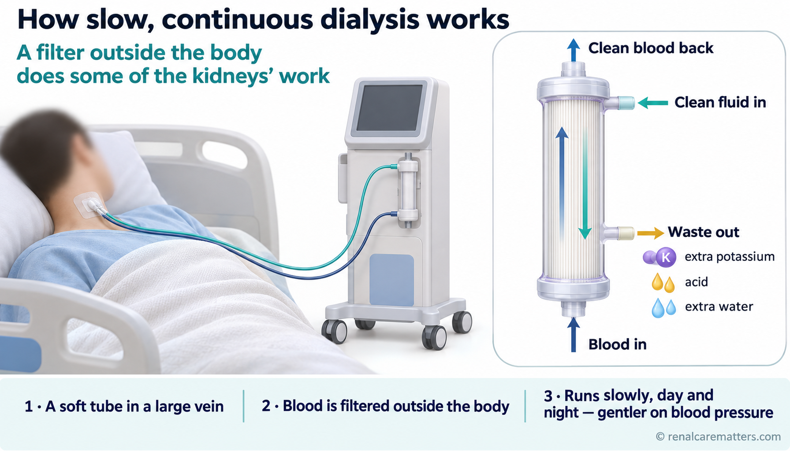</picture><figcaption><p class="fig-desc"><span data-lang="en">A soft tube in a large vein carries blood to a filter outside the body. The filter removes extra potassium, acid, and water, and the cleaned blood goes back. It runs slowly, day and night.</span><span data-lang="tl" class="lang-hidden">Isang malambot na tubo sa malaking ugat ang nagdadala ng dugo sa filter sa labas ng katawan. Inaalis ng filter ang sobrang potassium, acid, at tubig, at ibinabalik ang nalinis na dugo. Dahan-dahan itong tumatakbo, araw at gabi.</span><span data-lang="ceb" class="lang-hidden">Usa ka humok nga tubo sa dakong ugat ang modala sa dugo ngadto sa filter sa gawas sa lawas. Tangtangon sa filter ang sobrang potassium, acid, ug tubig, ug ibalik ang nalimpyohan nga dugo. Hinay-hinay kini modagan, adlaw ug gabii.</span><span data-lang="kap" class="lang-hidden">Metung a malambut a tubu king maragul a ugat ing magdala daya king filter king pali ning katawan. Ilako na ning filter ing sobrang potassium, acid, at danum, at ibalik ing melinis a daya. Dahan-dahan yang manalakad, aldo at bengi.</span></p><dl class="fig-abbrevs"><dt>ICU</dt><dd>Intensive care unit</dd></dl></figcaption></figure>

<!-- 03 · #what, after the .three-col cards -->
<figure class="illus-wrap illus-wrap-light" style="margin:28px 0;"><picture><source srcset="../images/aki-icu-dialysis-decisions-03-bridge-not-cure.webp" type="image/webp">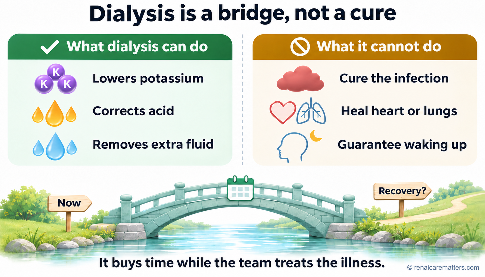</picture><figcaption><p class="fig-desc"><span data-lang="en">Dialysis is a bridge: it buys time while the team treats the illness. Whether a person recovers depends mostly on the illness itself.</span><span data-lang="tl" class="lang-hidden">Ang dialysis ay isang tulay: nagbibigay ito ng panahon habang ginagamot ng team ang sakit. Ang paggaling ay nakasalalay higit sa lahat sa sakit mismo.</span><span data-lang="ceb" class="lang-hidden">Ang dialysis usa ka taytayan: naghatag kini og panahon samtang gitambalan sa team ang sakit. Ang pagkaayo nagdepende kasagaran sa sakit mismo.</span><span data-lang="kap" class="lang-hidden">Ing dialysis metung yang tete: dadanan nang panaun kabang panulunan ning team ing sakit. Ing pamagaling masyadu yang makasalalay king sakit mismu.</span></p></figcaption></figure>

<!-- 05 · #questions, after the intro paragraph -->
<figure class="illus-wrap illus-wrap-light" style="margin:28px 0;"><picture><source srcset="../images/aki-icu-dialysis-decisions-05-three-questions.webp" type="image/webp">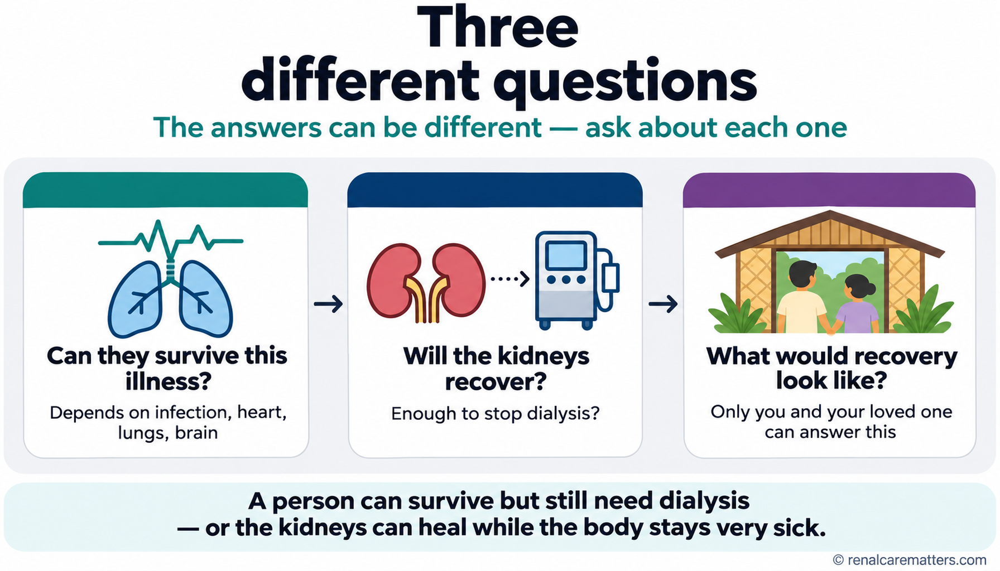</picture><figcaption><p class="fig-desc"><span data-lang="en">Three separate questions, three possibly different answers. Ask the team about each one.</span><span data-lang="tl" class="lang-hidden">Tatlong magkahiwalay na tanong, tatlong maaaring magkakaibang sagot. Itanong sa team ang bawat isa.</span><span data-lang="ceb" class="lang-hidden">Tulo ka lahi nga pangutana, tulo ka tingali lahi nga tubag. Pangutan-a ang team bahin sa matag usa.</span><span data-lang="kap" class="lang-hidden">Atlung makabukud a kutang, atlung malyaring makayibang sabat. Kutnan me ing team king balang metung.</span></p></figcaption></figure>

<!-- 06 · #questions, after the purple "Numbers are about groups" alert -->
<figure class="illus-wrap illus-wrap-light" style="margin:28px 0;"><picture><source srcset="../images/aki-icu-dialysis-decisions-06-hundred-people.webp" type="image/webp">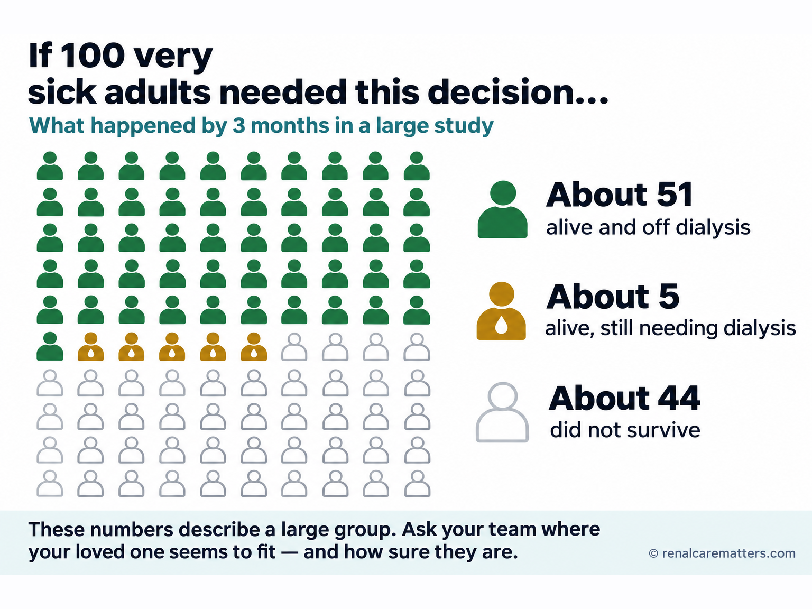</picture><figcaption><p class="fig-desc"><span data-lang="en">If 100 very sick adults faced this decision, about 51 were alive and off dialysis at 3 months, about 5 still needed dialysis, and about 44 did not survive. These numbers describe a group, not your loved one.</span><span data-lang="tl" class="lang-hidden">Kung 100 malubhang may sakit na nasa hustong gulang ang humarap sa desisyong ito, mga 51 ang buhay at hindi na nagda-dialysis sa 3 buwan, mga 5 ang nangangailangan pa ng dialysis, at mga 44 ang hindi nakaligtas. Inilalarawan ng mga numerong ito ang isang grupo, hindi ang iyong mahal sa buhay.</span><span data-lang="ceb" class="lang-hidden">Kung 100 ka grabe og sakit nga hamtong ang nag-atubang niini nga desisyon, mga 51 ang buhi ug wala na mag-dialysis sa 3 ka bulan, mga 5 ang nagkinahanglan pa og dialysis, ug mga 44 ang wala makalahutay. Kini nga mga numero naghulagway sa usa ka grupo, dili sa imong minahal.</span><span data-lang="kap" class="lang-hidden">Nung 100 a matua a malala ing sakit ing mikaharap king desisyun a iti, kasi 51 ing mabie at ala nang dialysis king 3 bulan, kasi 5 ing kailangan da pa ing dialysis, at kasi 44 ing e mikaligtas. Ilarawan da ning numeru a reti ing metung a grupu, e ing kamaganakan mu.</span></p></figcaption></figure>

<!-- 07 · #trial, after the intro paragraph -->
<figure class="illus-wrap illus-wrap-light" style="margin:28px 0;"><picture><source srcset="../images/aki-icu-dialysis-decisions-07-trial-road.webp" type="image/webp">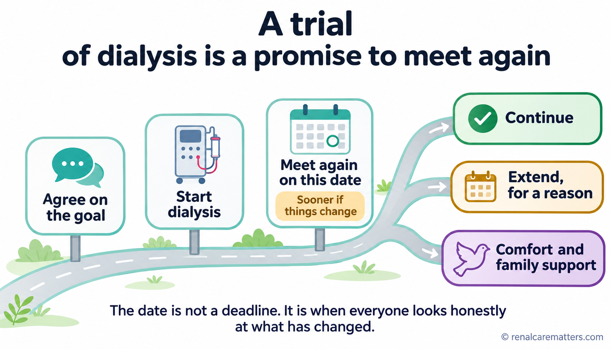</picture><figcaption><p class="fig-desc"><span data-lang="en">A trial of dialysis is a promise to meet again on a set date, or sooner if things change, and decide together which road to take.</span><span data-lang="tl" class="lang-hidden">Ang pagsubok ng dialysis ay pangakong muling magkita sa takdang petsa, o mas maaga kung may magbago, at sama-samang pagpasyahan kung aling daan ang tatahakin.</span><span data-lang="ceb" class="lang-hidden">Ang pagsulay sa dialysis usa ka saad nga magkita pag-usab sa gitakdang petsa, o mas sayo kung adunay mausab, ug magkauban nga modesisyon kung asang dalan ang subayon.</span><span data-lang="kap" class="lang-hidden">Ing pamanubuk ning dialysis metung yang pangaku a mikit pasibayu king takdang petsa, o mas agad nung atin mabayu, at samasamang pagpasyan nung nu nung dalan ing lakaran.</span></p></figcaption></figure>

<!-- 08 · #decides, after paragraph 1 -->
<figure class="illus-wrap illus-wrap-light" style="margin:28px 0;"><picture><source srcset="../images/aki-icu-dialysis-decisions-08-their-voice.webp" type="image/webp">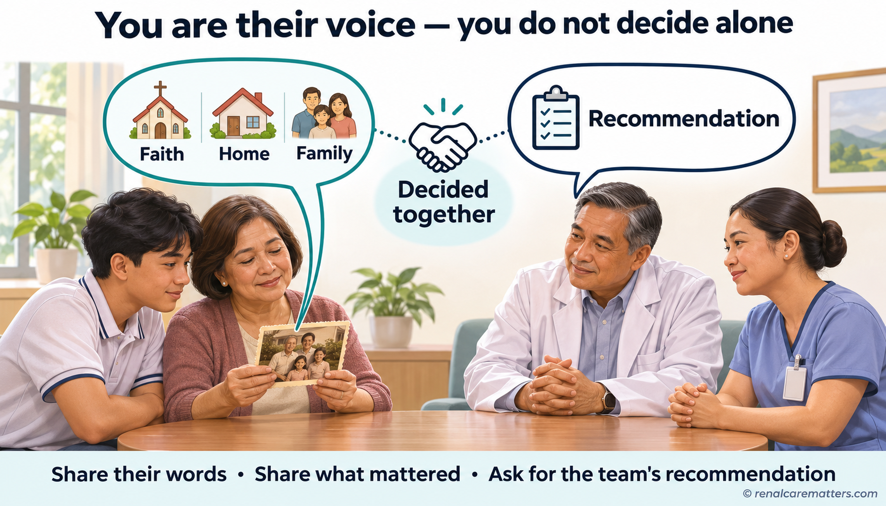</picture><figcaption><p class="fig-desc"><span data-lang="en">You bring your loved one's words and values; the team brings a recommendation. The decision is made together.</span><span data-lang="tl" class="lang-hidden">Dala mo ang mga salita at pinahahalagahan ng iyong mahal sa buhay; dala ng team ang rekomendasyon. Sama-sama ninyong ginagawa ang desisyon.</span><span data-lang="ceb" class="lang-hidden">Dala nimo ang mga pulong ug gipabilhan sa imong minahal; dala sa team ang rekomendasyon. Magkauban ninyong himuon ang desisyon.</span><span data-lang="kap" class="lang-hidden">Dala mu ing amanu at pepakamahalan ning kamaganakan mu; dala ning team ing rekomendasyun. Samasama yung gawan ing desisyun.</span></p></figcaption></figure>

<!-- 09 · #comfort, after paragraph 1, before the green alert -->
<figure class="illus-wrap illus-wrap-light" style="margin:28px auto;max-width:560px;"><picture><source srcset="../images/aki-icu-dialysis-decisions-09-comfort-care.webp" type="image/webp">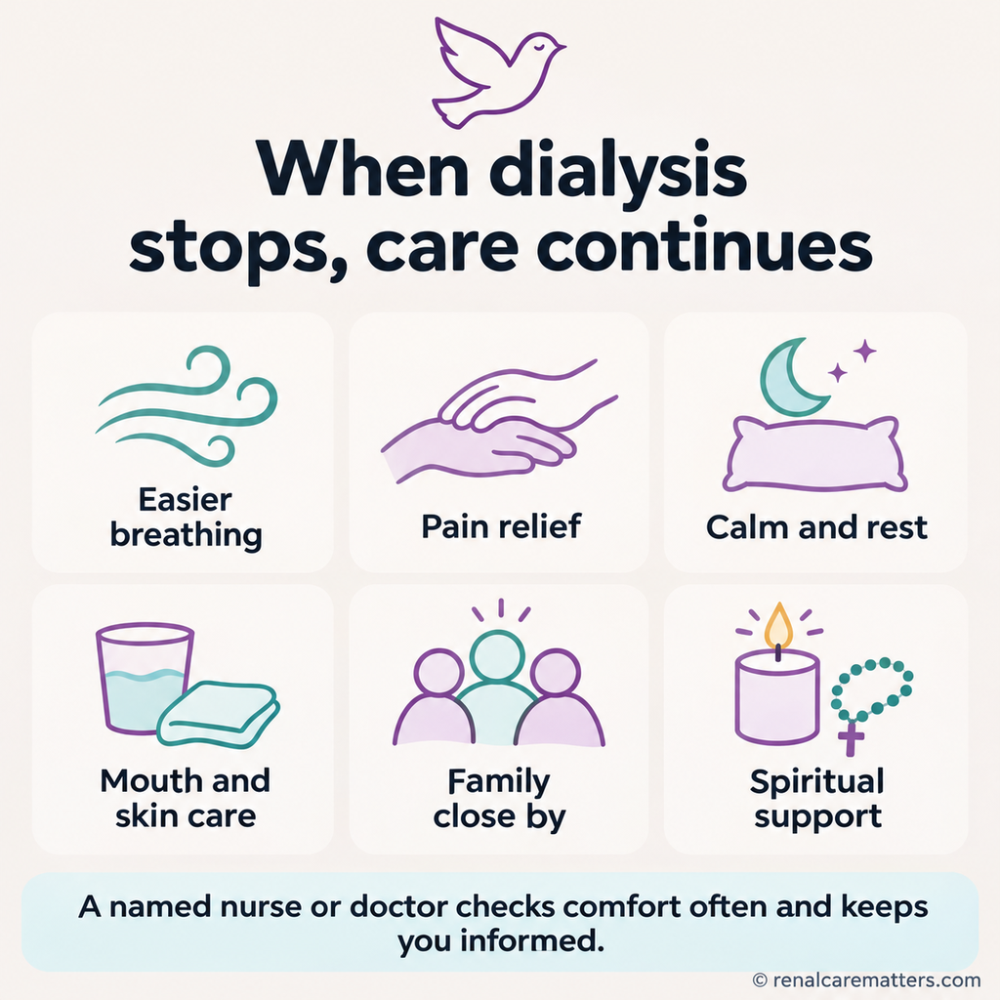</picture><figcaption><p class="fig-desc"><span data-lang="en">When dialysis stops, care continues: breathing, pain, rest, mouth and skin care, family, and faith.</span><span data-lang="tl" class="lang-hidden">Kapag itinigil ang dialysis, nagpapatuloy ang pag-aalaga: paghinga, sakit, pahinga, pangangalaga sa bibig at balat, pamilya, at pananampalataya.</span><span data-lang="ceb" class="lang-hidden">Kung hunongon ang dialysis, magpadayon ang pag-atiman: pagginhawa, kasakit, pahulay, pag-atiman sa baba ug panit, pamilya, ug pagtuo.</span><span data-lang="kap" class="lang-hidden">Nung ituknang ing dialysis, tuloy ya ing pamanyaga: pamangisnawa, sakit, pamagpainawa, pamanyaga king asbuk at balat, pamilya, at pamaniwala.</span></p></figcaption></figure>

<!-- 10 · #ask, after the numbered list -->
<figure class="illus-wrap illus-wrap-light" style="margin:28px auto;max-width:480px;"><picture><source srcset="../images/aki-icu-dialysis-decisions-10-questions-card.webp" type="image/webp">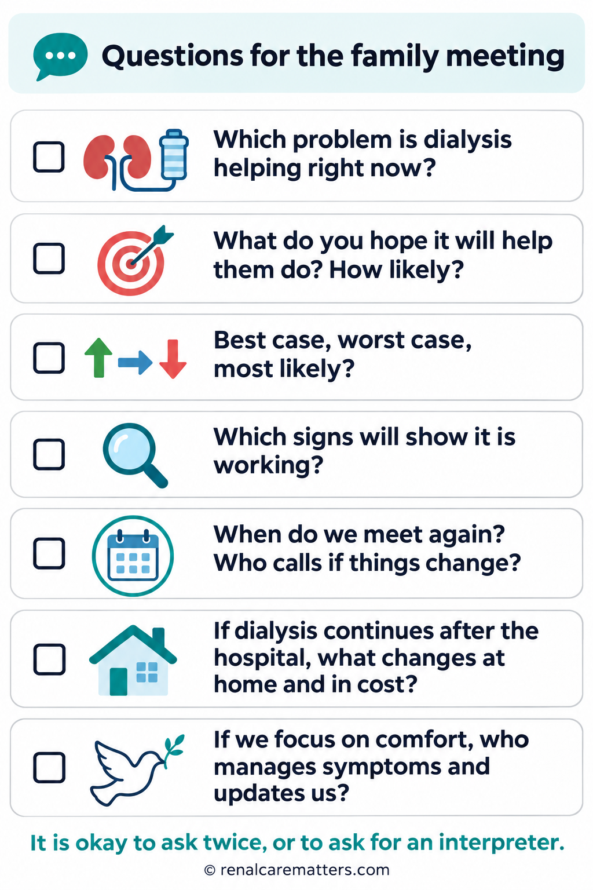</picture><figcaption><p class="fig-desc"><span data-lang="en">Save this card to your phone and bring it to the family meeting. Tap twice to open it full size.</span><span data-lang="tl" class="lang-hidden">I-save ang card na ito sa iyong telepono at dalhin sa pulong ng pamilya. I-tap nang dalawang beses para buksan nang buo.</span><span data-lang="ceb" class="lang-hidden">I-save kini nga card sa imong telepono ug dad-a sa miting sa pamilya. I-tap kaduha aron ablihan nga bug-os.</span><span data-lang="kap" class="lang-hidden">I-save me ing card a iti king telepono mu at dalan me king pamipulung ning pamilya. I-tap makaduang besis bang buksan nang buu.</span></p><dl class="fig-abbrevs"><dt>ICU</dt><dd>Intensive care unit</dd></dl></figcaption></figure>

<!-- 11 · #md-bedside, after the physiology paragraph -->
<figure class="illus-wrap illus-wrap-light" style="margin:28px auto;max-width:560px;"><picture><source srcset="../images/aki-icu-dialysis-decisions-11-what-krt-replaces.webp" type="image/webp">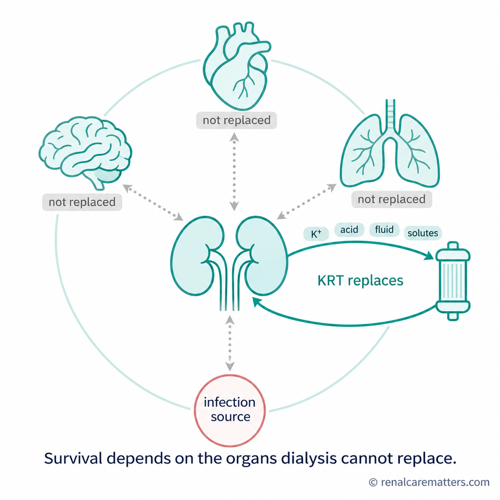</picture><figcaption><p class="fig-desc">KRT replaces potassium, acid, fluid, and solute handling. Survival depends on the organs it does not replace.</p><dl class="fig-abbrevs"><dt>KRT</dt><dd>Kidney replacement therapy</dd><dt>K⁺</dt><dd>Potassium</dd></dl></figcaption></figure>

<!-- 12 · #md-timing, after the trial table -->
<figure class="illus-wrap illus-wrap-light" style="margin:28px 0;"><picture><source srcset="../images/aki-icu-dialysis-decisions-12-timing-trials.webp" type="image/webp">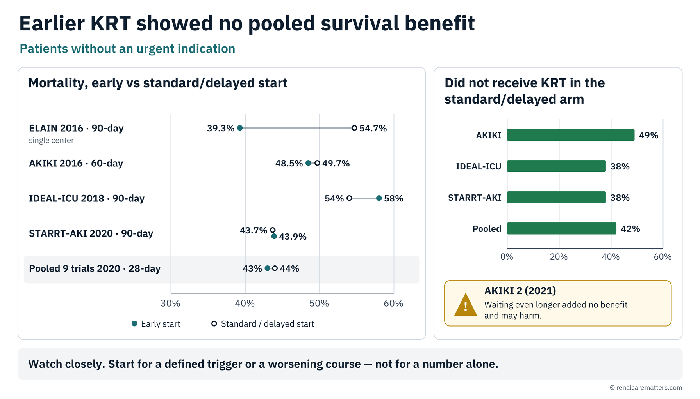</picture><figcaption><p class="fig-desc">Early and standard starts land at similar mortality; a large share of deferred-arm patients never need KRT; waiting beyond conventional criteria adds nothing.</p><dl class="fig-abbrevs"><dt>KRT</dt><dd>Kidney replacement therapy</dd><dt>ELAIN</dt><dd>Early vs Late Initiation of renal replacement therapy trial</dd><dt>AKIKI</dt><dd>Artificial Kidney Initiation in Kidney Injury trials</dd><dt>IDEAL-ICU</dt><dd>Initiation of Dialysis Early versus Delayed in the ICU trial</dd><dt>STARRT-AKI</dt><dd>Standard versus Accelerated Initiation of Renal-Replacement Therapy in AKI trial</dd></dl></figcaption></figure>

<!-- 13 · #md-prognosis, after the "Anchor numbers" paragraph -->
<figure class="illus-wrap illus-wrap-light" style="margin:28px 0;"><picture><source srcset="../images/aki-icu-dialysis-decisions-13-three-denominators.webp" type="image/webp">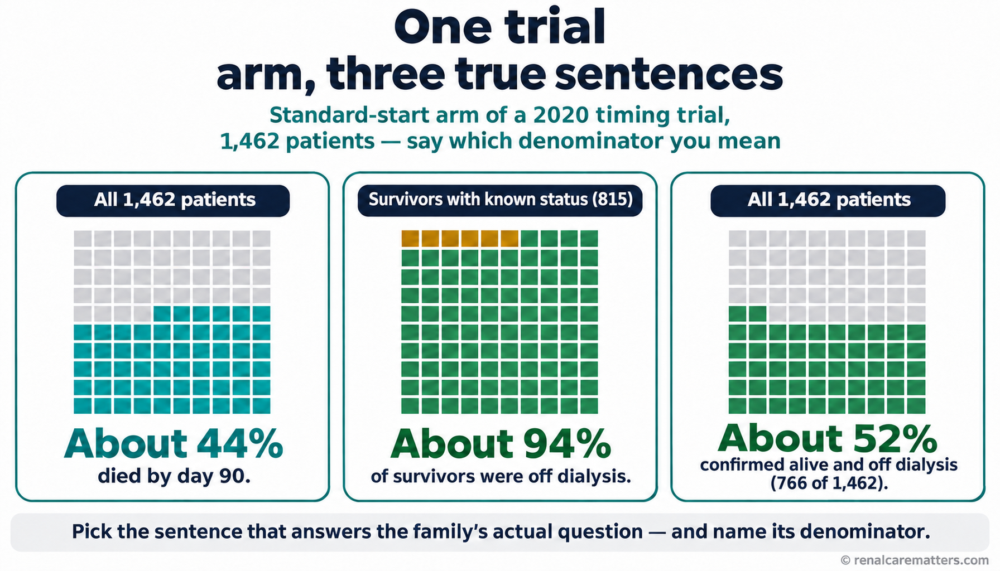</picture><figcaption><p class="fig-desc">The same 1,462 patients support three true sentences. Name the denominator every time you quote a number.</p></figcaption></figure>

<!-- 14 · #md-prognosis, after "A structure for the conversation" -->
<figure class="illus-wrap illus-wrap-light" style="margin:28px 0;"><picture><source srcset="../images/aki-icu-dialysis-decisions-14-three-trajectories.webp" type="image/webp">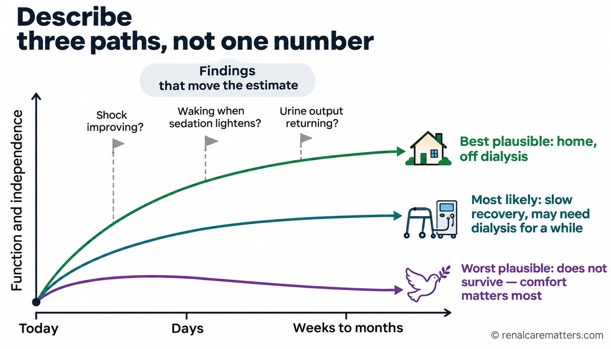</picture><figcaption><p class="fig-desc">Describe best plausible, most likely, and worst plausible paths, and name the findings that would move the estimate.</p></figcaption></figure>

<!-- 15 · #md-populations, after the table -->
<figure class="illus-wrap illus-wrap-light" style="margin:28px 0;"><picture><source srcset="../images/aki-icu-dialysis-decisions-15-high-risk-cohorts.webp" type="image/webp">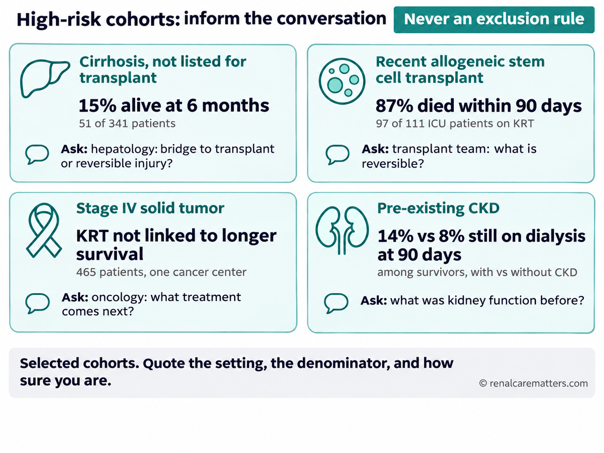</picture><figcaption><p class="fig-desc">Each cohort number comes with a denominator and a colleague to call. These figures inform the conversation; they never decide eligibility.</p><dl class="fig-abbrevs"><dt>KRT</dt><dd>Kidney replacement therapy</dd><dt>CKD</dt><dd>Chronic kidney disease</dd></dl></figcaption></figure>

<!-- 16 · #md-shared, before the script box -->
<figure class="illus-wrap illus-wrap-light" style="margin:28px 0;"><picture><source srcset="../images/aki-icu-dialysis-decisions-16-family-meeting-roadmap.webp" type="image/webp">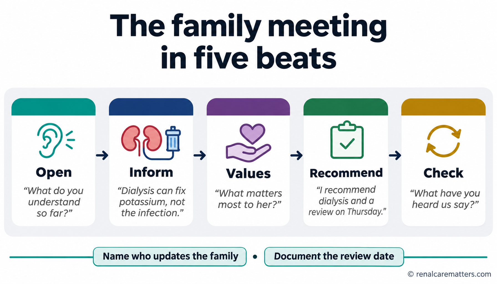</picture><figcaption><p class="fig-desc">Five beats for the family meeting: open, inform, explore values, recommend, and check understanding.</p></figcaption></figure>

<!-- 17 · #md-case, after the case paragraph -->
<figure class="illus-wrap illus-wrap-light" style="margin:28px 0;"><picture><source srcset="../images/aki-icu-dialysis-decisions-17-worked-case.webp" type="image/webp">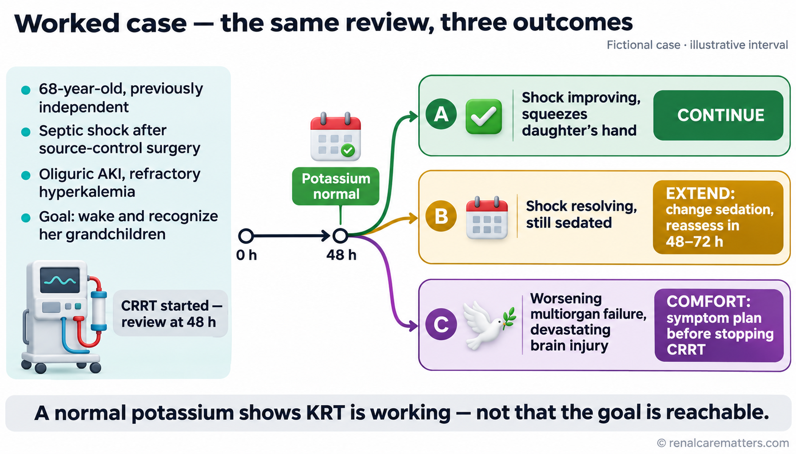</picture><figcaption><p class="fig-desc">A normal potassium shows that KRT is working, not that the goal is reachable. The review turns on what changed elsewhere.</p><dl class="fig-abbrevs"><dt>AKI</dt><dd>Acute kidney injury</dd><dt>CRRT</dt><dd>Continuous renal replacement therapy</dd><dt>KRT</dt><dd>Kidney replacement therapy</dd></dl></figcaption></figure>

<!-- 18 · #md-after, after the H2 -->
<figure class="illus-wrap illus-wrap-light" style="margin:28px 0;"><picture><source srcset="../images/aki-icu-dialysis-decisions-18-two-stops.webp" type="image/webp">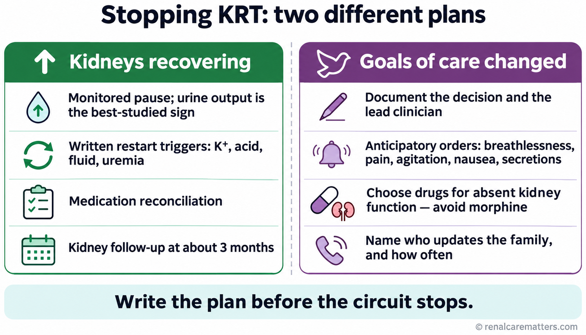</picture><figcaption><p class="fig-desc">A recovery stop and a goal-directed stop need different orders. Write the plan before the circuit stops.</p><dl class="fig-abbrevs"><dt>KRT</dt><dd>Kidney replacement therapy</dd><dt>K⁺</dt><dd>Potassium</dd></dl></figcaption></figure>

<!-- 19 · #md-ledger, after the intro paragraph -->
<figure class="illus-wrap illus-wrap-light" style="margin:28px 0;"><picture><source srcset="../images/aki-icu-dialysis-decisions-19-certainty-ladder.webp" type="image/webp">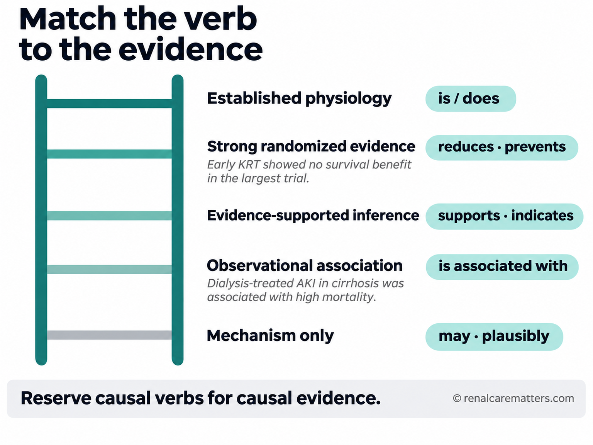</picture><figcaption><p class="fig-desc">Match the verb to the strength of the evidence; reserve causal verbs for causal evidence.</p><dl class="fig-abbrevs"><dt>KRT</dt><dd>Kidney replacement therapy</dd></dl></figcaption></figure>
```

**Glossary note:** `K⁺` appears in figures 11 and 18. It is an ion symbol (exempt from the acronym audit), but add "K⁺ — potassium" to the glossary Terms list when those figures go in, so the lightbox abbreviation panel and the glossary agree.

---

## Part 5 · Production checklist

1. **Generate the four ● images first** (00, OG, 01, 02). The live page shows alt text in their frames until they exist.
2. Then the P1 ○ images in reading order: 04, 03, 05, 06, 07 (families) and 12, 13, 16, 18 (clinicians). P2 next; 19 is optional.
3. Save `<stem>.png` and `<stem>.webp` in `images/`, keeping stems exactly as written.
4. **Check each image against its prompt** before accepting it:
   - only the numbers written in the prompt, spelled exactly (06: count 51/5/44; 12: every dot value; 13: waffle counts);
   - the named approved font, a light background, `© renalcarematters.com` visible (except 00);
   - the filter inset in 04 is vertical with countercurrent side ports;
   - no visible patient face, no blood, no readable monitor in any human scene;
   - common misspellings to reject: "hyperkalemia", "acidemia", "uremic", "surrogate", "comfort-focused", "cirrhosis", "hematopoietic".
5. For ○ images, paste the Part 4 snippet at the stated placement, then run from the repo root:
   `python3 patch_image_lightbox.py --guide aki-icu-dialysis-decisions.html` ·
   `python3 audit_acronym_expansion.py --guide aki-icu-dialysis-decisions.html` ·
   `python3 patch_reading_time.py --guide aki-icu-dialysis-decisions.html`,
   and re-check dark mode (the `.illus-wrap-light` caption remaps are already in the guide's second style block).
6. Run Stage 2 (`williamriveromd-local-image-generator`) for manifests. The `og:image` tags already point to `aki-icu-dialysis-decisions-og.png` at 1200 × 630; switch them to the `.webp` per Stage 2 if you prefer.
7. Commit directly to `main`.
