# Image Plan & Prompt Pack — Eosinophilia and Kidney Disease

**Guide:** `guides/eosinophilia-kidney-disease-clinician.html` · **Canonical:** https://renalcarematters.com/guides/eosinophilia-kidney-disease-clinician.html
**Pipeline:** Stage 1 (this file, written with the repo graphic skills) → generate in the ChatGPT Image Generator GPT (https://chatgpt.com/g/g-pmuQfob8d-image-generator) → Stage 2 `williamriveromd-local-image-generator` (validation, manifests, `og:image` tags).
**Prepared:** November 8, 2026. Every number inside a prompt is taken from the guide, which was verified against PubMed and primary sources (refined eosinophil-disorder criteria 2023; KDIGO AKI 2012; Blank 2014; Muriithi 2013 and 2014; Moledina 2023; Chavez 2026; González 2008; Fernandez-Juarez 2018; Gupta 2021; Grayson 2022; Durel 2021; MANDARA 2024; Roufosse 2020; NATRON 2026; MITIGATE 2025; Scolari 2007; Hildebrand 2016; Abad 2022; Ross 2017; CDC). Do not let the generator add numbers, doses, drug brands, or names that are not written in the prompt.

**Skills used:** `williamriveromd-hero-vignette` (00) · `williamriveromd-biomedical-mechanism-figure` (01) · `williamriveromd-algorithm-generator-skill` Mode C (02, 03, 13) and Mode A (18) · `williamriveromd-simple-figure` (04, 05, 07, 09, 10, 11, 12, 14, 15, 17, 19, 21, 23, 24) · `williamriveromd-infographic-skill` (06, 16, 20 circular workflow, 22 case snapshot, 25 reference card, OG) · `williamriveromd-organ-crosstalk-sigil-graphic` (08).

---

## Part 1 · Visual strategy

### 1.1 The goal
This guide asks readers to stop trusting a single number. An eosinophil count looks precise, but it can be a bystander, a marker, or a culprit; it vanishes after one steroid dose; it can be normal while the kidney is inflamed and while a parasite is spreading. Words carry these ideas poorly. Pictures carry them well: an iceberg (most eosinophils live in tissue), a balance that refuses to tip (a test with likelihood ratios near 1), two lines that drift apart (the count falls, the creatinine does not), a parasite that circles back on itself (autoinfection). Every image here teaches **one idea** a reader can grasp in ten seconds, whether that reader is a consultant nephrologist, a first-year resident, a dialysis nurse, a renal pharmacist, or a patient's family member who found the page.

### 1.2 Design rules for every literacy level

| Rule | Why it helps | How the prompts enforce it |
|---|---|---|
| **One idea per image** | Working memory is limited, especially at the bedside | Each prompt states a single VISUAL GOAL; no image carries more than one take-home sentence |
| **Concrete metaphor first, then the science** | An everyday picture anchors an abstract idea | Iceberg (tissue vs blood), balance scale (useless test), window closing (steroid timing), smoke alarm vs fire (count vs organ threat) |
| **Icon + short word, never icon alone** | Icons are ambiguous; words alone fail low literacy | Every icon has a 1–4 word label; the "teaching" figures cap at about 8 labels |
| **Numbers as counts, not only percentages** | Frequencies are understood across numeracy levels | Figure 09 draws 100,000 person-years as blocks; figure 04 uses plain words; percentages appear only in clinician reference figures |
| **Color is never the only signal** | Color vision deficiency, grayscale printing | Each color pairs with a shape: red triangle = urgent, green check = proceed, amber clock = caution/time, teal diamond = decision |
| **Microscopy drawn clean, not gross** | Readers vary in tolerance; clarity beats realism | Sediment and biopsy views are stylized vector micrographs; parasites are thin pale threads, never close-up worms in tissue |
| **No patient faces, no blood, no gore** | Dignity; readers may be living the scene | Human figures appear only as hands, silhouettes, or a distant nurse; the dialysis reaction scene shows no face |
| **Filipino context where people or places appear** | Recognition builds trust | Rice-field, river, sari-sari-store medicine shelf, Philippine dialysis unit interiors |
| **Clinician figures look like journal figures** | Clinicians scan, then verify | Flat flowcharts, exact denominators, trial names only where the trial *is* the data label (figures 15, 16) |
| **On-image text in English** | Generators garble Tagalog, Cebuano, Kapampangan | Plain-language explanation lives in the HTML `figcaption` (`fig-desc`) |

### 1.3 Shared visual vocabulary (draw identically in every image)

| Element | Always drawn as |
|---|---|
| **Eosinophil** | Round cell, two-lobed purple nucleus, cytoplasm packed with bright warm-orange granules `#d9822b` — the only orange object in any image |
| **Lymphocyte** | Smaller round cell, single dark-blue nucleus, thin pale rim |
| **Neutrophil (if needed)** | Pale cell with a 3–4-lobed lilac nucleus, no orange |
| **Kidney** | Smooth bean-shaped kidney, muted renal red-brown with teal hilum accents |
| **Tubule** | Pale-yellow tube lined with cuboidal cells |
| **Glomerulus** | Teal-outlined capillary tuft in a cup (Bowman capsule) |
| **Drug / culprit medicine** | White capsule with a small amber band; no readable brand |
| **Steroid** | Small white round tablet labeled "steroid" on a tray, never a brand |
| **Ivermectin** | Small white tablet labeled "ivermectin" |
| **Strongyloides larva** | Thin, pale cream thread with a tapered tail — tiny and schematic, never magnified gore |
| **Creatinine line** | Navy `#0f1e2e` line on charts |
| **Eosinophil-count line** | Orange `#d9822b` line on charts |
| **Urgent / red flag** | Clinical red `#b91c1c` triangle with "!" |
| **Proceed / do this** | Renal green `#1f7a4d` check mark |
| **Caution / time-sensitive** | Amber `#b8860b` clock |
| **Decision** | Teal `#1a6b72` diamond |
| **Dialyzer (any inset)** | Vertical hollow-fiber cartridge: blood IN at the bottom end port, OUT at the top end port; dialysate enters the side port near the TOP, effluent leaves the side port near the BOTTOM (countercurrent) |
| **Structure / text** | Navy `#0f1e2e`; headings clinical teal `#1a6b72` |

### 1.4 House constitution (applies to every prompt)
- Light backgrounds only (white `#ffffff`, off-white `#fafafa`, soft gray `#f3f4f6`, light teal `#eef6f7`). Never navy, charcoal, or black.
- Fonts: **Inter** in every prompt below (approved set: Inter, Nunito Sans, IBM Plex Sans, Manrope). Never serif.
- Attribution on every image: `© renalcarematters.com`, bottom-right (bottom-center for portrait), small, about 70% opacity. The hero vignette is the only exception: it is wordless by the hero-vignette spec.
- No journal names, society logos, brand names, or device logos inside images. Guideline acronyms appear only where the guide itself uses them as labels (KDIGO in 02 and 25).
- Output `.png`; save a `.webp` twin with the same stem in `images/`.
- Fixed sizes: hero vignette 2048 × 2048; OG card exactly 1200 × 630.

---

## Part 2 · Image inventory and placement

**Status:** ● already referenced in the guide HTML (generate first; the page shows alt text in an empty frame until then) · ○ new (paste the Part 4 snippet once the image exists)
**Priority:** P1 essential for understanding · P2 strong enhancement · P3 optional

| # | Status | Pri | File stem | Section → placement | Teaches | Skill · archetype | Size |
|---|---|---|---|---|---|---|---|
| 00 | ● | P1 | `eosinophilia-kidney-disease-clinician-vignette-hero` | Hero | Mood: a count becomes a tissue question | hero-vignette v3 · F Anatomy | 2048 × 2048 |
| OG | ● | P1 | `eosinophilia-kidney-disease-clinician-og` | `og:image` | Share card | infographic · OG | 1200 × 630 |
| 01 | ● | P1 | `eos-kidney-four-routes-mechanism` | `#mechanism`, after the four cards | Four ways eosinophilia and kidney injury connect | biomedical-mechanism | 1792 × 1024 |
| 02 | ● | P1 | `eos-kidney-decision-pathway` | `#pathway`, after step 5 list | The whole decision in one picture | algorithm Mode C | 1024 × 1536 |
| 03 | ● | P1 | `eos-kidney-strongyloides-safety-check` | `#strongyloides`, after the regimen table | Test, treat, or treat-and-test before steroids | algorithm Mode C | 1792 × 1024 |
| 04 | ○ | P1 | `eos-kidney-04-bystander-marker-culprit` | `#bedside`, after paragraph 1 | The count has three possible meanings | simple-figure C · three cards | 1792 × 1024 |
| 05 | ○ | P1 | `eos-kidney-05-red-flags` | `#bedside`, after the red alert | Organ threat outranks the number | simple-figure E · square card | 1024 × 1024 |
| 06 | ○ | P1 | `eos-kidney-06-count-the-cells` | `#count`, after the AEC alert | How to calculate the AEC and where the thresholds sit | infographic · reference card | 1792 × 1024 |
| 07 | ○ | P1 | `eos-kidney-07-iceberg` | `#count`, after the pitfall list | Blood count is the tip; tissue is the iceberg; steroids empty the blood fast | simple-figure D · metaphor | 1792 × 1024 |
| 08 | ○ | P3 | `eos-kidney-08-eosinophil-journey` | `#mechanism`, after paragraph 1 | Marrow → blood → tissue; IL-5 and eotaxin | organ-crosstalk sigil | 1024 × 1024 |
| 09 | ○ | P2 | `eos-kidney-09-real-but-rare` | `#evidence`, after the table | PPI-associated AIN is real but rare in absolute terms | simple-figure B · icon blocks | 1792 × 1024 |
| 10 | ○ | P1 | `eos-kidney-10-read-the-urine` | `#pathway`, after the phenotype table | Three urine pictures, three branches | simple-figure B · three micrographs | 1792 × 1024 |
| 11 | ○ | P1 | `eos-kidney-11-balance-that-wont-tip` | `#urine`, after the callout | Urine eosinophils do not move probability; CXCL9 does better | simple-figure B · comparison | 1792 × 1024 |
| 12 | ○ | P1 | `eos-kidney-12-window-closing` | `#ain`, after paragraph 1 | Inflammation becomes scar over weeks; act early | simple-figure C · timeline | 1792 × 1024 |
| 13 | ○ | P2 | `eos-kidney-13-steroid-decision` | `#ain`, after the green alert | Observe vs consider steroids, with a review date | algorithm Mode C | 1024 × 1536 |
| 14 | ○ | P1 | `eos-kidney-14-two-lines` | `#ain`, after the amber alert | A falling count is not kidney recovery | simple-figure D · concept chart | 1792 × 1024 |
| 15 | ○ | P2 | `eos-kidney-15-dress-timeline` | `#ici-dress`, after the DRESS paragraph 1 | DRESS arrives weeks later, in layers | simple-figure C · timeline | 1792 × 1024 |
| 16 | ○ | P2 | `eos-kidney-16-trials-at-a-glance` | `#egpa-hes`, end of section | What MANDARA, the HES trials, and MITIGATE do and do not show | infographic · reference card | 1792 × 1024 |
| 17 | ○ | P2 | `eos-kidney-17-egpa-many-organs` | `#egpa-hes`, after the EGPA H3 | One disease, many organs | simple-figure D · body map | 1792 × 1024 |
| 18 | ○ | P1 | `eos-kidney-18-dialysis-reaction-card` | `#dialysis-transplant`, after paragraph 1 | Stop · don't return blood · epinephrine | algorithm Mode A · emergency card | 1024 × 1536 |
| 19 | ○ | P2 | `eos-kidney-19-what-changed-circuit` | `#dialysis-transplant`, after paragraph 2 | Every circuit component that can trigger a reaction | simple-figure D · labeled circuit | 1792 × 1024 |
| 20 | ○ | P1 | `eos-kidney-20-autoinfection-loop` | `#strongyloides`, after paragraph 1 | Why a parasite can hide for decades and explode on steroids | infographic · circular workflow | 1024 × 1024 |
| 21 | ○ | P2 | `eos-kidney-21-philippine-exposure` | `#philippines`, after paragraph 1 | The exposure questions to ask | simple-figure E · checklist card | 1536 × 1152 |
| 22 | ○ | P2 | `eos-kidney-22-three-cases` | `#cases`, after the H2 | Three cases side by side: action and what changes it | infographic · case snapshot | 1792 × 1024 |
| 23 | ○ | P2 | `eos-kidney-23-cholesterol-emboli` | `#vascular`, after the atheroembolic paragraph | A catheter scrapes plaque; crystals travel; toes and kidneys suffer | simple-figure D · mechanism | 1792 × 1024 |
| 24 | ○ | P2 | `eos-kidney-24-follow-up-timeline` | `#followup`, after the follow-up card | 48–72 hours, 1 week, 3 months | simple-figure C · timeline | 1792 × 1024 |
| 25 | ○ | P3 | `eos-kidney-25-bedside-checklist` | `#followup`, after the checklist alert | Phone-saveable bedside checklist | infographic · reference card | 1024 × 1536 |

**Reading orders.**
*Picture-only reader (student, nurse, family member):* 00 → 04 (three meanings) → 05 (red flags) → 07 (iceberg) → 10 (read the urine) → 11 (useless test) → 12 (act early) → 14 (two lines) → 20 (hidden parasite) → 03 (safety check) → 24 (follow-up).
*Clinician evidence spine:* 06 → 01 → 09 → 02 → 10 → 11 → 12 → 13 → 14 → 15 → 17 → 16 → 23 → 18 → 19 → 20 → 03 → 21 → 22 → 24 → 25.

---

## Part 3 · Prompts

Each block follows the Stage 2 schema so it can be split into `image-prompts/NNN-*.md` files unchanged. Paste only the text under **COPY-READY IMAGE GENERATOR GPT PROMPT** (plus the negative instructions) into the Image Generator GPT.

### 00 · Hero vignette ● (hero) — hero-vignette v3

```
IMAGE NUMBER: 00
SECTION PLACEMENT: Hero — figure.hero-figure > .hero-vignette
FILE NAME: eosinophilia-kidney-disease-clinician-vignette-hero.png
ARCHETYPE: Circular vignette hero v3 — Scaffold C anatomy · Composition F (Anatomy) · Camera: macro cross-section, slight three-quarter tilt
AUDIENCE: clinicians (readable by all)
ASPECT RATIO: 1:1
PIXEL DIMENSIONS: 2048 × 2048
HUMAN VARIATION (vs. previous guide): no people
VISUAL MIX:
- photorealistic models: no
- 2D infographic: no
- 3D component graphics: yes (semi-photoreal anatomy)
- algorithm/flowchart: no
PURPOSE: Set the mood — a blood-count finding becomes a question about kidney tissue.
KEY CONCEPTS: eosinophils in the interstitium beside a tubule; organ context.

COPY-READY IMAGE GENERATOR GPT PROMPT:
Square 1:1 semi-photorealistic 3D medical illustration on a 2048×2048 canvas, composed to be
displayed inside a CIRCULAR vignette occupying 85–90% of the canvas diameter with a visible WHITE
BORDER around the full circle (the circle never touches the canvas edges). Composition archetype:
F Anatomy. Camera: macro cross-section with a slight three-quarter tilt.

Subject: one large, softly lit cross-section of renal cortex showing a single proximal tubule
(pale-yellow cuboidal epithelium, open lumen) and a neighboring peritubular capillary, set in a
lightly swollen interstitium. Seven to nine eosinophils sit in the interstitium beside the tubule —
round cells with two-lobed purple nuclei and densely packed bright warm-orange granules (#d9822b) —
two of them squeezing through the capillary wall. Two lymphocytes nearby for scale. A few faint
orange granules drift from one eosinophil toward the tubule's basement membrane. In soft focus far
behind, the curved silhouette of a whole kidney (muted renal red-brown, teal hilum accents) gives
organ-level context.

Visual hierarchy: the tubule-and-eosinophil cluster fills 60–70% of the circle, right of center and
lower; 2–3 supporting cues (capillary, red cells inside it, the distant kidney silhouette) take
20–30%; the upper-left 20–25% of the circle is an empty soft gradient from pale mint to off-white
(no cells, anatomy, or texture) as the title-safe zone. Gentle studio lighting, soft shadow,
restrained clinical color (teal #1a6b72 accents, renal reds, orange only on eosinophil granules),
light background, soft falloff toward a slightly deeper neutral at the rim.

Absolutely NO text, labels, leader lines, callouts, titles, logos, or watermark — clean render only.
Full-bleed within the inscribed circle, no rectangular borders.

NEGATIVE INSTRUCTIONS:
Avoid busy layouts, collage overload, more than four supporting scenes, dozens of icons, tiny
labels, infographic clutter, cropped circle, cropped anatomy, edge clipping, objects touching the
circular border, content inside the title-safe zone, baked-in text, logos, watermarks, rectangular
frames, dark/charcoal/black backgrounds, cartoon style, neon, HDR, over-saturation, implausible
anatomy, eosinophils drawn larger than the tubule, gore.

QUALITY CHECK:
Square 2048×2048; circle 85–90% of canvas with a white margin; one dominant subject; empty
upper-left title-safe zone; no text anywhere; orange appears only in eosinophil granules.

ALT TEXT: Circular vignette hero — a semi-photorealistic kidney cross-section with one enlarged interstitial window where eosinophils with bright orange granules gather beside a teal tubule.
OG WIDTH: —
OG HEIGHT: —
```

### OG · Social share card ● — infographic OG

```
IMAGE NUMBER: OG
SECTION PLACEMENT: og:image / twitter:image (already wired in the guide head)
FILE NAME: eosinophilia-kidney-disease-clinician-og.png
ARCHETYPE: OG social share card
AUDIENCE: mixed (social)
ASPECT RATIO: 1.91:1
PIXEL DIMENSIONS: 1200 × 630
VISUAL MIX:
- photorealistic models: no
- 2D infographic: yes (type layout)
- 3D component graphics: yes (interstitial scene)
- algorithm/flowchart: no
PURPOSE: A share card that reads clearly as a small thumbnail.
KEY CONCEPTS: title, subtitle, clinician tag, the eosinophil-beside-tubule image.

COPY-READY IMAGE GENERATOR GPT PROMPT:
Editorial medical share card, exactly 1200×630, off-white background #fafafa, renalcarematters.com
house style, all text in Inter. Left 55%: a small teal (#1a6b72) outlined pill tag reading
"CLINICIAN GUIDE"; below it the title in Inter Bold, navy #0f1e2e, two lines:
"Eosinophilia and" / "Kidney Disease"; below that the subtitle in Inter Regular, teal #1a6b72:
"When the count changes the workup"; a thin teal rule under the subtitle. Right 45%: a large
soft-edged circle containing a semi-photorealistic close-up of a pale-yellow kidney tubule with a
small cluster of eosinophils (two-lobed purple nuclei, bright warm-orange granules #d9822b) in the
interstitium beside it, light background inside the circle. Small gray "© renalcarematters.com"
bottom-right at about 70% opacity. Generous margins; title must stay legible at thumbnail size.

NEGATIVE INSTRUCTIONS:
No other text, no logos, no dark background, no clutter, no serif fonts, no gibberish, no faces.

QUALITY CHECK:
Exactly 1200×630; title spelled exactly; "© renalcarematters.com" visible; light background.

ALT TEXT: Eosinophilia and Kidney Disease — a clinician guide, showing a kidney with an enlarged interstitium where eosinophils with orange granules gather beside a tubule.
OG WIDTH: 1200
OG HEIGHT: 630
```

### 01 · Four routes mechanism ● (`#mechanism`) — biomedical-mechanism-figure

```
IMAGE NUMBER: 01
SECTION PLACEMENT: #mechanism — existing <figure> after the four mechanism cards
FILE NAME: eos-kidney-four-routes-mechanism.png
ARCHETYPE: Review-article biomedical mechanism schematic (organ panel → magnified insets → summary flow)
AUDIENCE: clinicians
ASPECT RATIO: 16:9
PIXEL DIMENSIONS: 1792 × 1024
VISUAL MIX:
- photorealistic models: no
- 2D infographic: yes
- 3D component graphics: soft semi-3D shading only
- algorithm/flowchart: no
PURPOSE: Show the four ways a blood eosinophilia and a kidney injury can be connected, so the reader stops treating the count as one disease.
KEY CONCEPTS: drug-triggered tubulointerstitial injury; EGPA/IgG4 systemic disease; IL-5-driven eosinophil toxicity; cholesterol emboli and dialysis-circuit exposure.

COPY-READY IMAGE GENERATOR GPT PROMPT:
Create a publication-grade biomedical mechanism schematic in scientific review-article style: flat
vector illustration with soft semi-3D shading, white background, thin dashed boxes for magnified
panels, muted clinical palette (light gray-blue anatomy, soft yellow tubule, red for arteries and
injury, blue for veins, warm orange #d9822b ONLY for eosinophil granules, pale pink pathology box,
pale blue outcome box). All text in Inter, navy #0f1e2e, never serif.

Title (top-left, Inter Bold): "Four routes from blood eosinophilia to kidney injury"

Left organ-level panel (about 25% width): a simplified kidney cross-section labeled
"AKI or CKD with blood eosinophilia", renal artery (red) and vein (blue), with a small dashed
connector fanning out to four magnified panels.

Center/right: four equal dashed-border panels in a 2×2 grid, numbered 1–4 in teal circles:
1 "Drug-triggered tubulointerstitial injury": a pale-yellow tubule with small lymphocytes invading
its lining (label "Tubulitis"), swollen space around it (label "Edema"), only two eosinophils
(label "Eosinophils: variable — may be few or absent"); a white capsule with an amber band at the
panel edge labeled "Drug".
2 "Systemic immune disease": a glomerulus with one dark necrotic capillary segment and a small
crescent (label "Necrotizing GN"); a small artery ringed by eosinophils (label "EGPA vasculitis");
a small cluster of plasma cells (label "IgG4 disease: plasma-cell–rich").
3 "Reactive and clonal eosinophilia": a bone-marrow niche with an arrow labeled "IL-5" producing
eosinophils; arrow into a capillary where eosinophils exit (label "Eotaxin pulls cells into
tissue"); one eosinophil releasing orange granules beside a tubule (label "Granule toxins").
4 "Vascular and circuit exposure": a small artery with needle-shaped cholesterol clefts blocking
the lumen (label "Cholesterol crystals → ischemia"); a small vertical dialyzer inset drawn
correctly (blood IN bottom end port, OUT top end port; dialysate IN side port near the top,
effluent OUT side port near the bottom) labeled "Dialysis circuit reaction".

Bottom summary flow, three boxes joined by arrows left → right:
pale-pink box "The signal": "A blood count can be a bystander, a marker, or a culprit"
white box "What decides": "Urine sediment · exposure timeline · pace of injury"
pale-blue box "The action": "Stop the culprit · branch by phenotype · biopsy if it changes treatment"

Keep labels short and exactly as written; legible at slide size. Generous whitespace. Small gray
"© renalcarematters.com" bottom-right at about 70% opacity.

NEGATIVE INSTRUCTIONS:
No numbers, doses, or percentages. No photorealism, dark background, decorative icons, gibberish
text, extra panels, or crowding. Orange only on eosinophil granules. Dialyzer ports must not be
swapped or merged. No journal or brand names.

QUALITY CHECK:
Four numbered panels; panel 1 explicitly says eosinophils may be absent; dialyzer anatomy correct;
attribution visible.

ALT TEXT: Review-article schematic of four routes linking blood eosinophilia to kidney injury: drug-triggered tubulointerstitial inflammation with tubulitis, EGPA small-vessel vasculitis with glomerular necrosis, IL-5–driven eosinophil degranulation releasing granule proteins into the interstitium, and cholesterol crystal emboli occluding an arcuate artery, with a dialysis circuit inset.
OG WIDTH: —
OG HEIGHT: —
```

### 02 · Decision pathway ● (`#pathway`) — algorithm generator Mode C

```
IMAGE NUMBER: 02
SECTION PLACEMENT: #pathway — existing <figure> after the step 5 test list
FILE NAME: eos-kidney-decision-pathway.png
ARCHETYPE: Tall clinical algorithm (Mode C, renalcarematters.com house style)
AUDIENCE: clinicians, trainees, dialysis teams
ASPECT RATIO: 2:3
PIXEL DIMENSIONS: 1024 × 1536
VISUAL MIX:
- photorealistic models: no
- 2D infographic: no
- 3D component graphics: no
- algorithm/flowchart: yes
PURPOSE: The whole decision in one picture: organ threat first, then count and trend, then sediment and timeline choose the branch.
KEY CONCEPTS: organ-threat screen; AEC and KDIGO stage; sediment + exposure timeline; four phenotypes; Strongyloides check; owner and review date; two direct escalation routes.

COPY-READY IMAGE GENERATOR GPT PROMPT:
Create a clean publication-ready clinical algorithm flowchart in the renalcarematters.com house
style, portrait 1024×1536. White background, navy #0f1e2e and teal #1a6b72 typography set in Inter
(never serif), thin teal connector arrows, generous margins, centered, flat vector look. Colors:
navy for title and text; teal for decision diamonds and arrows; renal green #1f7a4d for recommended
actions; amber #b8860b for the caution node; clinical red #b91c1c outline only for emergency routes;
soft gray for side notes. Rounded rectangles for actions, diamonds for decisions.

Title: "Eosinophilia with kidney disease — decision pathway"

1. Entry box: "New or persistent eosinophilia + a kidney finding"
2. Red-outlined diamond: "Organ threat?" — right branch "Yes" → red-outlined box with a small red
   warning triangle: "Escalate now: fast-rising creatinine or nephritic urine · lung bleeding ·
   heart inflammation · new nerve damage · drug rash with organ injury · anaphylaxis ·
   suspected Strongyloides hyperinfection". Down branch "No — or in parallel".
3. Box: "Confirm AEC (find the pre-steroid value) + KDIGO AKI stage vs baseline"
4. Two boxes side by side, joined below: left "Read the urine sediment yourself + UPCR/UACR";
   right "Exposure timeline: drugs · procedures · dialysis · lifetime places lived".
5. Teal diamond "Phenotype?" → four green boxes in one row:
   "Glomerular → ANCA · anti-GBM · complement · urgent nephrology"
   "Interstitial → stop the culprit · nephrology if not improving"
   "Vascular → eyes and skin exam · biopsy if needed"
   "Stable chronic → booked recheck"
6. All four converge into an amber box with a small amber clock: "Strongyloides check before any steroid"
7. Final green box with a green check: "Biopsy if it changes treatment · name an owner · set a review date"

Far-left column, two red-outlined boxes, each with an arrow joining at the "Organ threat?" diamond:
"Kidney transplant dysfunction → transplant team the same day" and
"Severe reaction on dialysis → stop · no blood return · epinephrine".

Text exactly as written, short, legible at thumbnail size. Small gray "© renalcarematters.com"
bottom-center at about 70% opacity.

NEGATIVE INSTRUCTIONS:
No numbers, no doses, no icons beyond the triangle, clock, and check named above, no spaghetti
arrows, no extra branches, no dark background, no serif fonts, no gibberish, no brand or journal names.

QUALITY CHECK:
Two diamonds; four phenotype boxes; amber Strongyloides node sits after the phenotypes and before the
final box; both escalation side routes present; spelling: "hyperinfection", "nephritic", "anaphylaxis".

ALT TEXT: Clinical algorithm: new or persistent eosinophilia enters an organ-threat screen, then confirmation of the absolute eosinophil count and kidney trajectory, then parallel urine-sediment and exposure-timeline branches leading to glomerular, interstitial, vascular, and stable-chronic pathways, with direct escalation side routes for kidney transplant dysfunction and dialysis emergencies.
OG WIDTH: —
OG HEIGHT: —
```

### 03 · Strongyloides safety check ● (`#strongyloides`) — algorithm generator Mode C

```
IMAGE NUMBER: 03
SECTION PLACEMENT: #strongyloides — existing <figure> after the CDC regimen table
FILE NAME: eos-kidney-strongyloides-safety-check.png
ARCHETYPE: Three-lane clinical workflow (Mode C)
AUDIENCE: clinicians, pharmacists
ASPECT RATIO: 16:9
PIXEL DIMENSIONS: 1792 × 1024
VISUAL MIX:
- photorealistic models: no
- 2D infographic: yes
- 3D component graphics: no
- algorithm/flowchart: yes
PURPOSE: One glance shows that the urgency of the organ, not convenience, decides whether you test first, treat and test together, or treat urgently.
KEY CONCEPTS: three lanes; empiric ivermectin; hyperinfection regimen; eosinophilia often absent.

COPY-READY IMAGE GENERATOR GPT PROMPT:
Create a clean publication-ready clinical workflow in the renalcarematters.com house style,
landscape 1792×1024: white background, Inter typography (never serif), navy #0f1e2e text, teal
#1a6b72 arrows, generous margins, flat vector look.

Title (top-left, Inter Bold): "Before steroids: the Strongyloides safety check"
Subtitle (teal): "Ask where the patient has lived, soil and river contact, and transplant status"

Three equal vertical swim lanes, each with a colored header tab and a small shape icon:
Lane A — teal tab with a teal diamond icon: "Stable — steroids can wait a few days"
  box "Blood test (serology) + repeated stool tests"
  ↓ box "Positive or high suspicion → treat first"
  ↓ green box with a green check "Then start immunosuppression"
Lane B — amber tab with an amber clock icon: "Organ threatened — cannot wait"
  box "Draw samples now"
  ↓ box "Start the immunosuppression the organ needs"
  ↓ green box with a green check "Give ivermectin 200 µg/kg if risk is high and tests are delayed"
  small gray side note "Blood tests are less reliable after steroids"
Lane C — red tab with a red triangle icon: "Suspected hyperinfection"
  box "Gut or lung worsening · gram-negative sepsis on steroids"
  ↓ red-outlined box "Ivermectin daily until stool and sputum are negative for 2 weeks"
  ↓ box "Reduce immunosuppression · infectious disease input"

Centered gray footer line under the lanes: "Eosinophilia is often absent in hyperinfection."
Small gray "© renalcarematters.com" bottom-right at about 70% opacity.

NEGATIVE INSTRUCTIONS:
No numbers other than "200 µg/kg" and "2 weeks"; no drawings of worms; no brand names; no dark
background; no serif fonts; no gibberish; no extra lanes.

QUALITY CHECK:
Three lanes in teal/amber/red with diamond/clock/triangle icons; dose written "200 µg/kg" with the
micro sign; footer sentence present.

ALT TEXT: Three-lane workflow: a stable patient lane where testing precedes steroids, an organ-threatened lane where samples are drawn, steroids start, and empiric ivermectin is given, and a hyperinfection lane with urgent ivermectin until stool and sputum are negative for two weeks plus reduction of immunosuppression.
OG WIDTH: —
OG HEIGHT: —
```

### 04 · Bystander, marker, or culprit ○ (`#bedside`) — simple-figure Scaffold C

```
IMAGE NUMBER: 04
SECTION PLACEMENT: #bedside — after the first paragraph
FILE NAME: eos-kidney-04-bystander-marker-culprit.png
ARCHETYPE: Horizontal three-card sequence (simple-figure C)
AUDIENCE: mixed — all literacy levels
ASPECT RATIO: 16:9
PIXEL DIMENSIONS: 1792 × 1024
VISUAL MIX:
- photorealistic models: no
- 2D infographic: yes
- 3D component graphics: small semi-3D cells and kidney
- algorithm/flowchart: no
PURPOSE: Teach in ten seconds that the same eosinophil count can mean three different things.
KEY CONCEPTS: bystander (reactive); marker (systemic disease also hurting the kidney); culprit (eosinophils injure tissue).

COPY-READY IMAGE GENERATOR GPT PROMPT:
Clean clinical education infographic, landscape 1792×1024, white background, all text in Inter.
Title at top center in Inter Bold navy #0f1e2e: "One count, three meanings". Subtitle in teal
#1a6b72: "The eosinophil number cannot tell you which — the urine and the history can".

Three equal rounded cards in one row on a very soft gray panel (#f3f4f6). Each card shows the same
small kidney at the bottom and one eosinophil (round cell, two-lobed purple nucleus, bright orange
granules #d9822b) placed differently:
Card 1, gray-blue top band, heading "Bystander": the eosinophil stands to the side, separated from
the kidney by a thin dashed line; three tiny labeled icons above it: a white capsule "medicine", a
thin pale thread "parasite", a small dialyzer "dialysis circuit". One-line caption: "Reacting to
something else".
Card 2, purple #6c3d8e top band, heading "Marker": the eosinophil and the kidney both sit inside one
larger soft purple ring labeled "systemic disease"; small labels "vasculitis", "drug reaction".
Caption: "A sign of a disease that also hurts the kidney".
Card 3, red #b91c1c top band, heading "Culprit": the eosinophil touches the kidney and releases a
few orange granules into it; small label "granule toxins". Caption: "Directly injuring tissue".

Bottom full-width soft-gray strip, navy text: "Same number — different meaning. Read the sediment
and the timeline." Small gray "© renalcarematters.com" bottom-right at about 70% opacity.

NEGATIVE INSTRUCTIONS:
Avoid cartoon style, clutter, tiny labels, gibberish, unrealistic anatomy, HDR, excessive
saturation. No numbers. Light background only. Inter only, never serif. No faces. Never omit the
attribution.

QUALITY CHECK:
Three cards readable on a phone; the eosinophil is drawn identically in all three; color is paired
with distinct placement (apart / inside a ring / touching).

ALT TEXT: Three cards showing the same eosinophil as a bystander reacting to a medicine, parasite, or dialysis circuit; as a marker inside a systemic disease that also affects the kidney; and as a culprit releasing granule toxins into the kidney.
OG WIDTH: —
OG HEIGHT: —
```

### 05 · Red flags ○ (`#bedside`) — simple-figure Scaffold E

```
IMAGE NUMBER: 05
SECTION PLACEMENT: #bedside — after the red "Urgent regardless of the eosinophil count" alert
FILE NAME: eos-kidney-05-red-flags.png
ARCHETYPE: Square quick-look card (simple-figure E)
AUDIENCE: mixed — clinicians, nurses, trainees
ASPECT RATIO: 1:1
PIXEL DIMENSIONS: 1024 × 1024
VISUAL MIX:
- photorealistic models: no
- 2D infographic: yes
- 3D component graphics: no
- algorithm/flowchart: no
PURPOSE: Make the red flags memorable as a picture: organ threat outranks the number.
KEY CONCEPTS: eight red flags drawn as organ icons around a central count that is crossed out as the decider.

COPY-READY IMAGE GENERATOR GPT PROMPT:
Clinical quick-look card, square 1024×1024, white background, all text in Inter. Title in Inter
Bold navy #0f1e2e at top: "Urgent at any eosinophil count". At the center, a small gray rounded
badge reading "AEC" with a thin gray line through it and the caption "the number does not decide".
Around it, eight evenly spaced small white tiles in a ring, each with a simple flat line icon in
clinical red #b91c1c, a small red warning triangle, and a short navy label:
1 kidney with an up arrow: "Kidney function falling fast"
2 lungs: "Bleeding in the lungs or low oxygen"
3 heart: "Possible heart inflammation"
4 foot with a nerve line: "New nerve damage or foot drop"
5 fingertip with a dark tip: "Cold, blue fingers or toes"
6 skin with rash and a small thermometer: "Drug rash with fever or organ injury"
7 dialysis machine: "Severe reaction on dialysis"
8 intestine with a small pale thread: "Gut or lung worsening on steroids"
Bottom strip, soft gray, navy text: "Escalate first. Sort the cause in parallel."
Small gray "© renalcarematters.com" bottom-right at about 70% opacity.

NEGATIVE INSTRUCTIONS:
Avoid clutter, tiny labels, gibberish, gore, faces. No numbers. Light background only. Inter only.
Never omit the attribution.

QUALITY CHECK:
Exactly eight tiles; every tile has icon + words; red always paired with the triangle shape.

ALT TEXT: Quick-look card with eight red-flag icons around a crossed-out eosinophil count: fast-falling kidney function, lung bleeding or low oxygen, possible heart inflammation, new nerve damage, cold blue digits, drug rash with fever or organ injury, severe dialysis reaction, and gut or lung worsening on steroids.
OG WIDTH: —
OG HEIGHT: —
```

### 06 · Count the cells ○ (`#count`) — infographic clinician reference card

```
IMAGE NUMBER: 06
SECTION PLACEMENT: #count — after the "AEC = WBC × eosinophil fraction" teal alert
FILE NAME: eos-kidney-06-count-the-cells.png
ARCHETYPE: Clinician reference card (infographic)
AUDIENCE: clinicians, trainees, nurses, pharmacists
ASPECT RATIO: 16:9
PIXEL DIMENSIONS: 1792 × 1024
VISUAL MIX:
- photorealistic models: no
- 2D infographic: yes
- 3D component graphics: one small semi-3D blood tube
- algorithm/flowchart: no
PURPOSE: Show how to turn a percentage into an absolute count, and where that count sits on the threshold ruler.
KEY CONCEPTS: worked example 8,000 × 0.08 = 640 cells/µL = 0.64 × 10⁹/L; thresholds 500 / 1,500 / 5,000; HE needs two counts ≥2 weeks apart; HES needs organ damage.

COPY-READY IMAGE GENERATOR GPT PROMPT:
Clinician reference infographic, landscape 1792×1024, white background, all text in Inter, navy
#0f1e2e text, teal #1a6b72 headings. Title (Inter Bold): "Count the cells, not the percentage".

Left half — worked example in three rounded cards joined by "×" and "=" symbols:
card 1 (small lavender blood-tube icon) "White cells 8,000 /µL"
card 2 "Eosinophils 8%" with a small note "= 0.08"
card 3, teal outline, large: "AEC 640 cells/µL" with a smaller second line "= 0.64 × 10⁹/L".
Under the cards, one gray note: "Same answer in either unit system — keep the units consistent."

Right half — a horizontal threshold ruler from 0 to beyond 5,000 cells/µL, divided into four
colored bands with labels above:
gray band "Normal" up to the tick "500";
pale amber band "Mild" from "500" to "1,500";
amber band "Moderate" from "1,500" to "5,000";
red band "Severe" beyond "5,000".
A teal pointer marks "640 — our patient" inside the mild band.
Under the ruler, two small rounded definition boxes:
"Hypereosinophilia (HE): ≥1,500 on two counts ≥2 weeks apart — or in tissue"
"Hypereosinophilic syndrome (HES): HE + organ damage it explains"
Bottom soft-gray strip, navy text: "A threatened organ is treated now — the 2-week rule defines
persistence, not a waiting period." Small gray "© renalcarematters.com" bottom-right, ~70% opacity.

NEGATIVE INSTRUCTIONS:
Only these numbers: 8,000; 8%; 0.08; 640; 0.64 × 10⁹/L; 500; 1,500; 5,000; 2 weeks. Write the
micro sign "µ" correctly. Avoid clutter, gibberish, dark background, serif fonts. Never omit the
attribution.

QUALITY CHECK:
Arithmetic correct (8,000 × 0.08 = 640); superscript ⁹ rendered; four bands in the right order;
pointer inside the mild band.

ALT TEXT: Worked example converting 8,000 white cells per microliter and 8 percent eosinophils into an absolute eosinophil count of 640 cells per microliter, placed on a threshold ruler with normal, mild above 500, moderate from 1,500, and severe above 5,000, with definitions of hypereosinophilia and hypereosinophilic syndrome.
OG WIDTH: —
OG HEIGHT: —
```

### 07 · The iceberg ○ (`#count`) — simple-figure Scaffold D

```
IMAGE NUMBER: 07
SECTION PLACEMENT: #count — after the "Physiologic reasons a count misleads" list
FILE NAME: eos-kidney-07-iceberg.png
ARCHETYPE: One-panel metaphor poster (simple-figure D)
AUDIENCE: mixed — all literacy levels
ASPECT RATIO: 16:9
PIXEL DIMENSIONS: 1792 × 1024
VISUAL MIX:
- photorealistic models: no
- 2D infographic: yes
- 3D component graphics: soft semi-3D iceberg
- algorithm/flowchart: no
PURPOSE: Make three physiologic traps unforgettable: most eosinophils are in tissue; steroids empty the blood within hours; the count swings through the day.
KEY CONCEPTS: tissue reservoir; steroid eosinopenia; diurnal variation (low in the morning); adrenal insufficiency raises the count.

COPY-READY IMAGE GENERATOR GPT PROMPT:
Medical education metaphor illustration, landscape 1792×1024, white background, all text in Inter.
Title in Inter Bold navy #0f1e2e: "The blood count is the tip of the iceberg".

Left 60%: a calm stylized iceberg in pale blue-white floating in light teal water (#eef6f7). The
small tip above the waterline is labeled "Blood" and contains three eosinophils (two-lobed purple
nucleus, bright orange granules #d9822b). The large submerged part is labeled "Tissue — gut, lung,
skin, kidney" and contains many eosinophils. A thin teal note beside the waterline: "Eosinophils
circulate for less than a day, then move into tissue."

Right 40%: three stacked small rounded cards, each with a simple icon:
card 1 (white tablet labeled "steroid" and an amber clock): "One steroid dose empties the blood
within hours — the tissue disease may remain"
card 2 (small sun and moon on a gentle curve, curve lowest at the sun): "Lowest in the morning,
higher at night — sample at the same time"
card 3 (small adrenal gland above a kidney): "Low cortisol (adrenal insufficiency) raises the count"
Bottom strip, soft gray, navy text: "A normal blood count does not mean normal tissue."
Small gray "© renalcarematters.com" bottom-right at about 70% opacity.

NEGATIVE INSTRUCTIONS:
No numbers. No dark water, no dramatic ocean, no ship. Avoid clutter, gibberish, serif fonts.
Orange only on eosinophil granules. Never omit the attribution.

QUALITY CHECK:
Iceberg tip visibly smaller than the submerged part; more eosinophils below the waterline than
above; the diurnal curve is lowest at the morning sun.

ALT TEXT: An iceberg whose small tip above water is the blood with a few eosinophils and whose large submerged body is tissue full of eosinophils, beside three cards: steroids empty the blood within hours, counts are lowest in the morning, and adrenal insufficiency raises the count.
OG WIDTH: —
OG HEIGHT: —
```

### 08 · The eosinophil's journey ○ (`#mechanism`) — organ-crosstalk sigil

```
IMAGE NUMBER: 08
SECTION PLACEMENT: #mechanism — after the first paragraph (before the four mechanism cards)
FILE NAME: eos-kidney-08-eosinophil-journey.png
ARCHETYPE: Organ-crosstalk sigil (monoline)
AUDIENCE: mixed
ASPECT RATIO: 1:1
PIXEL DIMENSIONS: 1024 × 1024
VISUAL MIX:
- photorealistic models: no
- 2D infographic: yes (monoline)
- 3D component graphics: no
- algorithm/flowchart: no
PURPOSE: A calm symbol of where eosinophils come from and where they go.
KEY CONCEPTS: bone marrow → blood → tissues (lung, gut, skin, kidney); IL-5 drives production; eotaxin pulls cells into tissue.

COPY-READY IMAGE GENERATOR GPT PROMPT:
Create a simple medical organ-crosstalk sigil illustration, square 1024×1024, white background.
Minimal clinical line-art, thin monoline strokes, soft teal-blue palette (#1a6b72 and pale slate),
clean rounded organ shapes, balanced radial composition, generous whitespace, no photorealism,
no 3D.

At the top center, a simplified long-bone cross-section with marrow (label "Bone marrow"). A dotted
teal arrow flows down to a single circular blood-vessel ring at the center (label "Blood — less than
a day"). From the ring, four dotted curved arrows radiate outward to four small monoline organ
icons evenly placed below and around it: lungs ("Lung"), intestine ("Gut"), a skin patch ("Skin"),
and a kidney ("Kidney"). Along the top arrow, a small teal tag "IL-5 builds"; along the outward
arrows, one small teal tag "Eotaxin pulls". A single tiny eosinophil icon (circle with two small
lobes and a few orange dots #d9822b) travels along the arrows — the only color accent.

All labels set in Inter, small and sparse. Small semi-transparent "© renalcarematters.com"
bottom-right.

NEGATIVE INSTRUCTIONS:
No dense anatomy, no shading, no numbers, no extra organs, no serif fonts, no clutter, no dark
background.

QUALITY CHECK:
Exactly one marrow, one blood ring, four organs; arrows dotted; labels spelled "Eotaxin", "IL-5".

ALT TEXT: Monoline sigil showing eosinophils produced in the bone marrow under IL-5, passing briefly through the blood, and pulled by eotaxin into the lung, gut, skin, and kidney.
OG WIDTH: —
OG HEIGHT: —
```

### 09 · Real but rare ○ (`#evidence`) — simple-figure Scaffold B

```
IMAGE NUMBER: 09
SECTION PLACEMENT: #evidence — after the evidence table, before the "Observational" paragraph
FILE NAME: eos-kidney-09-real-but-rare.png
ARCHETYPE: Side-by-side comparison with frequency blocks (simple-figure B)
AUDIENCE: mixed — clinicians and patients who ask "should I stop my PPI?"
ASPECT RATIO: 16:9
PIXEL DIMENSIONS: 1792 × 1024
VISUAL MIX:
- photorealistic models: no
- 2D infographic: yes
- 3D component graphics: no
- algorithm/flowchart: no
PURPOSE: Show relative and absolute risk together so the reader neither dismisses nor exaggerates PPI-associated AIN.
KEY CONCEPTS: about 12 vs about 2 serious AIN cases per 100,000 person-years; about 1 extra case per 9,700 person-years.

COPY-READY IMAGE GENERATOR GPT PROMPT:
Medical education comparison infographic, landscape 1792×1024, white background, all text in Inter.
Title in Inter Bold navy #0f1e2e: "PPI kidney inflammation: real, but rare". Subtitle in teal:
"Serious acute interstitial nephritis (hospital or death), per 100,000 person-years of use".

A soft dashed vertical divider splits two equal panels.
Left panel heading in amber #b8860b: "Taking a PPI now". A large neat grid of 1,000 tiny pale-gray
squares (representing 100,000 person-years, each square = 100), with 12 small squares filled amber,
clustered in one corner. Big label: "about 12". Small legend under this grid: "Each square = 100 person-years · a filled
square marks one case".
Right panel heading in renal green #1f7a4d: "Stopped the PPI". The same grid, with 2 squares filled
green. Big label: "about 2".
Under both panels, a full-width soft-gray strip with two short lines in navy:
"Relative risk is several-fold higher — the absolute excess is about 1 case per 9,700 person-years."
"So: prescribe PPIs for a reason, and suspect them when creatinine rises."
Small gray "© renalcarematters.com" bottom-right at about 70% opacity.

NEGATIVE INSTRUCTIONS:
Only these numbers: 100,000; 12; 2; 1; 9,700; 100. No percentages, no drug brands, no pill
photos. Squares must be the same size in both panels. Light background, Inter only, no gibberish.
Never omit the attribution.

QUALITY CHECK:
Exactly 12 amber and 2 green filled squares; both grids identical in size; the small legend under
the left grid reads "Each square = 100 person-years · a filled square marks one case".

ALT TEXT: Two identical grids of 1,000 squares representing 100,000 person-years: about 12 serious acute interstitial nephritis cases with current proton pump inhibitor use versus about 2 after stopping, an absolute excess of about 1 case per 9,700 person-years.
OG WIDTH: —
OG HEIGHT: —
```

### 10 · Read the urine ○ (`#pathway`) — simple-figure Scaffold B (three panels)

```
IMAGE NUMBER: 10
SECTION PLACEMENT: #pathway — after the "Step 4 — branch by phenotype" table
FILE NAME: eos-kidney-10-read-the-urine.png
ARCHETYPE: Three-panel micrograph comparison (simple-figure B, extended)
AUDIENCE: clinicians, trainees, nurses
ASPECT RATIO: 16:9
PIXEL DIMENSIONS: 1792 × 1024
VISUAL MIX:
- photorealistic models: no
- 2D infographic: yes
- 3D component graphics: stylized microscope views
- algorithm/flowchart: no
PURPOSE: Teach the three sediment pictures that choose the branch.
KEY CONCEPTS: glomerular (dysmorphic red cells, red-cell cast); interstitial (white cells, white-cell cast, no bacteria); bland (few cells) — bland does not exclude AIN.

COPY-READY IMAGE GENERATOR GPT PROMPT:
Medical education comparison infographic, landscape 1792×1024, white background, all text in Inter.
Title in Inter Bold navy #0f1e2e: "Read the urine yourself — it chooses the branch".

Three equal circular "microscope field" views side by side, each a clean stylized vector micrograph
on a pale cream field with a thin gray ring, with a heading above and a branch label below:
Circle 1, heading "Glomerular" with a red #b91c1c accent: several red cells with irregular
blebbed outlines (label "dysmorphic red cells") and one cylindrical cast packed with red cells
(label "red-cell cast"). Below: red box "→ ANCA · complement · urgent nephrology".
Circle 2, heading "Interstitial" with a teal #1a6b72 accent: many white cells with lobed nuclei
(label "white cells, no bacteria") and one cylindrical cast filled with white cells (label
"white-cell cast"). Below: teal box "→ stop the culprit · consider biopsy".
Circle 3, heading "Bland" with a gray accent: a nearly empty field with one or two cells and a
plain hyaline cast (label "few cells"). Below: amber box with an amber clock "→ does NOT exclude
interstitial nephritis — follow the trend".
Bottom soft-gray strip, navy text: "A bland sediment can still hide active kidney inflammation."
Small gray "© renalcarematters.com" bottom-right at about 70% opacity.

NEGATIVE INSTRUCTIONS:
No numbers. No photographic microscopy noise, no stain color clutter, no bacteria drawn in circle 2.
Avoid gibberish, serif fonts, dark background. Never omit the attribution.

QUALITY CHECK:
Red-cell cast only in circle 1; white-cell cast only in circle 2; circle 3 near-empty; spelling
"dysmorphic", "hyaline" (if labeled).

ALT TEXT: Three stylized urine microscope fields: glomerular with dysmorphic red cells and a red-cell cast leading to ANCA testing and urgent nephrology; interstitial with white cells, a white-cell cast, and no bacteria leading to culprit withdrawal; and a bland field that does not exclude interstitial nephritis.
OG WIDTH: —
OG HEIGHT: —
```

### 11 · The balance that won't tip ○ (`#urine`) — simple-figure Scaffold B

```
IMAGE NUMBER: 11
SECTION PLACEMENT: #urine — after the "Test-performance callout" alert
FILE NAME: eos-kidney-11-balance-that-wont-tip.png
ARCHETYPE: Side-by-side comparison metaphor (simple-figure B)
AUDIENCE: mixed — all literacy levels
ASPECT RATIO: 16:9
PIXEL DIMENSIONS: 1792 × 1024
VISUAL MIX:
- photorealistic models: no
- 2D infographic: yes
- 3D component graphics: soft semi-3D balance scales
- algorithm/flowchart: no
PURPOSE: Show what a likelihood ratio near 1 means without the statistics: the scale does not move.
KEY CONCEPTS: urine eosinophils sensitivity 31%, specificity 68%, likelihood ratios 0.97 and 1.01; urinary CXCL9 AUC 0.94.

COPY-READY IMAGE GENERATOR GPT PROMPT:
Medical education comparison infographic, landscape 1792×1024, white background, all text in Inter.
Title in Inter Bold navy #0f1e2e: "A test should move the scale".

Soft dashed vertical divider, two equal panels.
Left panel heading in clinical red #b91c1c: "Urine eosinophils". A simple brass-free, light-gray
balance scale with the beam perfectly level; left pan labeled "AIN", right pan labeled "not AIN";
a small urine cup sits on the fulcrum. Large label under the scale: "The scale does not move".
Two small gray stat lines: "Sensitivity 31% · Specificity 68%" and "Likelihood ratios 0.97 and 1.01".
Right panel heading in renal green #1f7a4d: "Urinary CXCL9". The same scale, now clearly tipped
toward the "AIN" pan; a small urine cup with a teal tag "CXCL9". Large label: "The scale tips".
Small gray stat line: "AUC 0.94 in validation cohorts — not yet widely available".
Bottom soft-gray strip, navy text: "Use the sediment, the trajectory, and a biopsy when it changes
treatment." Small gray "© renalcarematters.com" bottom-right at about 70% opacity.

NEGATIVE INSTRUCTIONS:
Only these numbers: 31%, 68%, 0.97, 1.01, 0.94. No brand names, no lab-device logos. Light
background, Inter only, no gibberish. Never omit the attribution.

QUALITY CHECK:
Left beam exactly level; right beam visibly tipped toward "AIN"; "CXCL9" spelled correctly.

ALT TEXT: Two balance scales: urine eosinophils leave the scale level with sensitivity 31 percent, specificity 68 percent, and likelihood ratios of 0.97 and 1.01, while urinary CXCL9 tips the scale toward acute interstitial nephritis with an area under the curve of 0.94.
OG WIDTH: —
OG HEIGHT: —
```

### 12 · The window is closing ○ (`#ain`) — simple-figure Scaffold C (timeline)

```
IMAGE NUMBER: 12
SECTION PLACEMENT: #ain — after the first paragraph (before the steroid-evidence table)
FILE NAME: eos-kidney-12-window-closing.png
ARCHETYPE: Horizontal timeline sequence (simple-figure C)
AUDIENCE: mixed — all literacy levels
ASPECT RATIO: 16:9
PIXEL DIMENSIONS: 1792 × 1024
VISUAL MIX:
- photorealistic models: no
- 2D infographic: yes
- 3D component graphics: small semi-3D tissue tiles
- algorithm/flowchart: no
PURPOSE: Show why timing matters in drug-induced AIN: inflammation is reversible, scar is not.
KEY CONCEPTS: drug exposure → inflammation (reversible) → scar (permanent); stop the drug early; steroids, if used, early; fibrosis >50% predicts poor recovery.

COPY-READY IMAGE GENERATOR GPT PROMPT:
Clean clinical education infographic, landscape 1792×1024, white background, all text in Inter.
Title in Inter Bold navy #0f1e2e: "Inflammation heals. Scar does not." Subtitle in teal #1a6b72:
"Drug-induced interstitial nephritis is a race against time".

A horizontal timeline arrow runs left to right across the middle, shading from pale teal on the
left to warm gray on the right, with a soft amber clock icon above its midpoint. Four tissue tiles
sit above the arrow at evenly spaced points, each a stylized square of kidney tissue around a
pale-yellow tubule:
Tile 1 "Healthy": tubule with clean surroundings.
Tile 2 "Drug starts": a white capsule with an amber band beside the tubule.
Tile 3 "Inflamed — reversible": swollen space, lymphocytes, a few orange-granule eosinophils
(#d9822b) around the tubule; a green check badge "can recover".
Tile 4 "Scarred — permanent": the tubule shrunken, surrounded by dense gray-tan fiber strands; a
red triangle badge "cannot recover".
Below the arrow, two green callout boxes pointing at the space between tiles 2 and 3:
"Stop the culprit drug as early as possible"
"If steroids are used, start early — longer courses add nothing"
Below tile 4, one red callout: "Scar on more than half the biopsy predicts poor recovery".
Small gray "© renalcarematters.com" bottom-right at about 70% opacity.

NEGATIVE INSTRUCTIONS:
Only the number "half" as a word; no doses, no days. No gore, no dark background, no serif fonts,
no gibberish. Never omit the attribution.

QUALITY CHECK:
Tiles in the correct order; reversible tile carries the green check, scar tile the red triangle.

ALT TEXT: Timeline of drug-induced interstitial nephritis from healthy tissue, to a drug starting, to reversible inflammation around a tubule, to permanent scar, with callouts to stop the culprit early, start steroids early if used, and a note that scar on more than half the biopsy predicts poor recovery.
OG WIDTH: —
OG HEIGHT: —
```

### 13 · Steroid decision ○ (`#ain`) — algorithm generator Mode C

```
IMAGE NUMBER: 13
SECTION PLACEMENT: #ain — after the green "A practical steroid decision" alert
FILE NAME: eos-kidney-13-steroid-decision.png
ARCHETYPE: Compact clinical algorithm (Mode C)
AUDIENCE: clinicians, pharmacists
ASPECT RATIO: 2:3
PIXEL DIMENSIONS: 1024 × 1536
VISUAL MIX:
- photorealistic models: no
- 2D infographic: no
- 3D component graphics: no
- algorithm/flowchart: yes
PURPOSE: A one-glance version of the steroid decision for drug-induced AIN only.
KEY CONCEPTS: withdraw culprit; improving → observe; persistent → exclude infection and obstruction, biopsy, Strongyloides check; consider prednisone-equivalent 0.5–1 mg/kg/day; review at 1–2 weeks; no response → rethink diagnosis.

COPY-READY IMAGE GENERATOR GPT PROMPT:
Create a clean publication-ready clinical algorithm in the renalcarematters.com house style,
portrait 1024×1536, white background, Inter typography (never serif), navy #0f1e2e text, thin teal
#1a6b72 arrows, generous margins, flat vector look. Teal diamonds for decisions; green #1f7a4d
rounded boxes for recommended actions; amber #b8860b for caution; gray side notes.

Title: "Steroids in drug-induced AIN — a practical decision"
Small gray subtitle: "Not for DRESS, checkpoint-inhibitor injury, vasculitis, or HES — each has its own protocol"

1. Box: "Stop the likely culprit · safe substitute · review doses and volume"
2. Teal diamond: "Creatinine clearly falling within days?"
   Left "Yes" → green box: "Observe · recheck on a set date"
   Down "No — persisting or worsening" →
3. Amber box: "Exclude infection and obstruction · Strongyloides check"
4. Teal diamond: "Biopsy or strong suspicion: active inflammation, limited scar?"
   Right "No / mostly scar" → gray box: "Steroids unlikely to help · supportive care · nephrology"
   Down "Yes" →
5. Green box: "Consider prednisone-equivalent 0.5–1 mg/kg/day · short high-dose phase · total under about 8 weeks"
6. Box: "Monitor glucose, blood pressure, infection"
7. Teal diamond: "Creatinine response at 1–2 weeks?"
   "Yes" → green box: "Taper and finish"
   "No" → amber box: "Rethink the diagnosis — do not escalate the dose"

Small gray "© renalcarematters.com" bottom-center at about 70% opacity.

NEGATIVE INSTRUCTIONS:
Only these numbers: 0.5–1 mg/kg/day; 8 weeks; 1–2 weeks. No brand names. No spaghetti arrows,
no dark background, no serif fonts, no gibberish.

QUALITY CHECK:
Three diamonds; the "rethink the diagnosis" box present; the scope note present under the title.

ALT TEXT: Algorithm for steroids in drug-induced acute interstitial nephritis: stop the culprit; observe if creatinine falls; otherwise exclude infection and obstruction and check Strongyloides; if active inflammation with limited scar, consider prednisone-equivalent 0.5 to 1 milligram per kilogram per day for a short course under about 8 weeks, review at 1 to 2 weeks, and rethink the diagnosis if there is no response.
OG WIDTH: —
OG HEIGHT: —
```

### 14 · Two lines that drift apart ○ (`#ain`) — simple-figure Scaffold D

```
IMAGE NUMBER: 14
SECTION PLACEMENT: #ain — after the amber "Do not read a falling eosinophil count as kidney recovery" alert
FILE NAME: eos-kidney-14-two-lines.png
ARCHETYPE: One-panel concept chart (simple-figure D)
AUDIENCE: mixed — all literacy levels
ASPECT RATIO: 16:9
PIXEL DIMENSIONS: 1792 × 1024
VISUAL MIX:
- photorealistic models: no
- 2D infographic: yes
- 3D component graphics: no
- algorithm/flowchart: no
PURPOSE: Show that the eosinophil count and kidney function are two different lines; steroids drop one without guaranteeing the other.
KEY CONCEPTS: steroid start marker; orange eosinophil line drops to normal within a day; navy creatinine line can stay high; track separately; divergence → rethink.

COPY-READY IMAGE GENERATOR GPT PROMPT:
Concept chart infographic, landscape 1792×1024, white background, all text in Inter.
Title in Inter Bold navy #0f1e2e: "Two lines, two questions".

A simple clean chart with a horizontal time axis labeled "Days" (no numbers on it) and no numeric
y-axis. A thin vertical dashed amber line marks "Steroid started" with a small white tablet icon.
An orange (#d9822b) line labeled "Eosinophil count" runs high, then drops steeply to a gray shaded
"normal" band right after the steroid marker, and stays there.
A navy (#0f1e2e) line labeled "Creatinine" stays high and nearly flat after the steroid marker,
with only a slight dip.
A small red triangle callout points at the gap between the two lines after the marker:
"Count normal ≠ kidney recovered".
A green callout at the right edge: "Judge recovery by creatinine, urine output, and sediment".
Legend top-right: orange line "Eosinophils", navy line "Creatinine".
Small gray "© renalcarematters.com" bottom-right at about 70% opacity.

NEGATIVE INSTRUCTIONS:
No numbers on either axis, no gridlines clutter, no extra lines. Light background, Inter only, no
gibberish. Never omit the attribution.

QUALITY CHECK:
Orange line drops after the marker; navy line stays high; the "≠" sign renders correctly.

ALT TEXT: Concept chart in which the eosinophil count drops to normal right after a steroid is started while creatinine stays high, with a callout that a normal count does not mean the kidney has recovered.
OG WIDTH: —
OG HEIGHT: —
```

### 15 · DRESS timeline ○ (`#ici-dress`) — simple-figure Scaffold C

```
IMAGE NUMBER: 15
SECTION PLACEMENT: #ici-dress — after the first DRESS paragraph ("DRESS is a delayed, T-cell–mediated…")
FILE NAME: eos-kidney-15-dress-timeline.png
ARCHETYPE: Horizontal timeline (simple-figure C)
AUDIENCE: clinicians, pharmacists, nurses
ASPECT RATIO: 16:9
PIXEL DIMENSIONS: 1792 × 1024
VISUAL MIX:
- photorealistic models: no
- 2D infographic: yes
- 3D component graphics: no
- algorithm/flowchart: no
PURPOSE: Show that DRESS arrives weeks after the drug, in layers, with eosinophilia sometimes last.
KEY CONCEPTS: culprits (allopurinol, aromatic anticonvulsants, sulfonamides, vancomycin); onset 2–8 weeks; fever, rash, facial edema, lymph nodes; liver then kidney; eosinophilia may appear late; re-score over time; stop the drug.

COPY-READY IMAGE GENERATOR GPT PROMPT:
Clean clinical education timeline, landscape 1792×1024, white background, all text in Inter.
Title in Inter Bold navy #0f1e2e: "DRESS arrives late — and in layers".

A horizontal arrow labeled "Weeks after starting the drug" with tick marks labeled only "0", "2",
and "8"; a shaded amber band between 2 and 8 labeled "usual onset window".
At "0": a small white capsule with an amber band and four short gray labels stacked:
"allopurinol · anticonvulsants · sulfonamides · vancomycin".
Within the amber band, four stacked layer cards that appear one above another from left to right
(like rising steps), each with a simple line icon:
step 1 thermometer "Fever"; step 2 skin patch "Widespread rash";
step 3 face outline with puffy cheeks (no features beyond simple lines) "Facial swelling · lymph nodes";
step 4 liver and kidney icons "Liver and kidney injury".
A separate orange (#d9822b) dotted marker placed AFTER step 4: "Eosinophilia — may appear late".
Right side, green box with a check: "Stop the drug now · admit if organs are involved · re-score over time".
Small gray "© renalcarematters.com" bottom-right at about 70% opacity.

NEGATIVE INSTRUCTIONS:
Only the numbers 0, 2, 8. No realistic faces, no severe skin photos, no gore, no brand names.
Light background, Inter only, no gibberish. Never omit the attribution.

QUALITY CHECK:
Eosinophilia marker sits after the organ step; culprit list spelled correctly ("sulfonamides").

ALT TEXT: Timeline showing DRESS starting about 2 to 8 weeks after allopurinol, anticonvulsants, sulfonamides, or vancomycin, with fever, widespread rash, facial swelling and lymph nodes, then liver and kidney injury, and eosinophilia that may appear late, ending with stop the drug and re-score over time.
OG WIDTH: —
OG HEIGHT: —
```

### 16 · Trials at a glance ○ (`#egpa-hes`) — infographic clinician reference card

```
IMAGE NUMBER: 16
SECTION PLACEMENT: #egpa-hes — end of section, after the HES paragraph on labeling (or #vascular end, if preferred)
FILE NAME: eos-kidney-16-trials-at-a-glance.png
ARCHETYPE: Clinician reference card (infographic)
AUDIENCE: clinicians
ASPECT RATIO: 16:9
PIXEL DIMENSIONS: 1792 × 1024
VISUAL MIX:
- photorealistic models: no
- 2D infographic: yes
- 3D component graphics: no
- algorithm/flowchart: no
PURPOSE: One card that states what each randomized trial showed — and the population it does not cover.
KEY CONCEPTS: MANDARA, mepolizumab-HES, NATRON, MITIGATE.

COPY-READY IMAGE GENERATOR GPT PROMPT:
Clinician reference card, landscape 1792×1024, white background, all text in Inter, navy #0f1e2e
text, teal #1a6b72 headers. Title (Inter Bold): "Randomized trials in eosinophilic and IgG4 disease
— what they show, and what they don't".

Four equal columns, each a rounded card with three stacked rows labeled in small gray caps
"WHO", "RESULT", "DOES NOT SHOW":
Column 1, header "MANDARA · EGPA":
WHO "140 adults, relapsing or refractory EGPA"
RESULT "Benralizumab noninferior to mepolizumab: remission 59% vs 56%; steroid-free 41% vs 26%"
DOES NOT SHOW (amber) "Induction for new organ-threatening kidney disease"
Column 2, header "Mepolizumab · HES":
WHO "108 patients, FIP1L1::PDGFRA-negative HES"
RESULT "Patients with a flare halved: 28% vs 56%"
DOES NOT SHOW (amber) "Benefit in clonal PDGFRA-driven disease (use imatinib)"
Column 3, header "NATRON · HES":
WHO "133 patients, FIP1L1::PDGFRA-negative HES"
RESULT "Benralizumab: first-flare hazard ratio 0.35"
DOES NOT SHOW (amber) "Kidney-specific outcomes"
Column 4, header "MITIGATE · IgG4 disease":
WHO "135 adults with active IgG4-related disease"
RESULT "Inebilizumab: flares 10% vs 60%; more serious adverse events 18% vs 9%"
DOES NOT SHOW (amber) "Kidney-specific efficacy"
Bottom soft-gray strip: "Check local registration and labeling before use."
Small gray "© renalcarematters.com" bottom-right at about 70% opacity.

NEGATIVE INSTRUCTIONS:
Only the numbers written above. No company logos, no drug packaging, no journal names. Light
background, Inter only, no gibberish. Never omit the attribution.

QUALITY CHECK:
Every number matches exactly; "FIP1L1::PDGFRA" rendered with double colon; amber "does not show" row
in every column.

ALT TEXT: Reference card of four randomized trials: MANDARA in relapsing or refractory EGPA, mepolizumab and NATRON in FIP1L1::PDGFRA-negative hypereosinophilic syndrome, and MITIGATE in IgG4-related disease, each with its population, main result, and what it does not show.
OG WIDTH: —
OG HEIGHT: —
```

### 17 · EGPA: one disease, many organs ○ (`#egpa-hes`) — simple-figure Scaffold D

```
IMAGE NUMBER: 17
SECTION PLACEMENT: #egpa-hes — directly after the "EGPA" H3, before the criteria paragraph
FILE NAME: eos-kidney-17-egpa-many-organs.png
ARCHETYPE: One-panel body map (simple-figure D)
AUDIENCE: mixed — all literacy levels
ASPECT RATIO: 16:9
PIXEL DIMENSIONS: 1792 × 1024
VISUAL MIX:
- photorealistic models: no
- 2D infographic: yes
- 3D component graphics: soft semi-3D organs
- algorithm/flowchart: no
PURPOSE: Show that EGPA is a whole-body disease whose clues lie outside the kidney.
KEY CONCEPTS: asthma; sinuses and nasal polyps; nerves (foot drop); skin (purpura); heart; lungs; kidney (nephritic urine); ANCA in about 40%.

COPY-READY IMAGE GENERATOR GPT PROMPT:
Medical body-map infographic, landscape 1792×1024, white background, all text in Inter.
Title in Inter Bold navy #0f1e2e: "EGPA: look beyond the kidney". Subtitle in teal #1a6b72:
"Eosinophilic granulomatosis with polyangiitis".

Center: a neutral, featureless light-gray human outline (no face details), with seven semi-3D
organs highlighted in soft color and connected by thin teal leader lines to seven small rounded
label cards around the figure:
sinuses/nose → "Sinus disease · nasal polyps"
airways → "Adult-onset asthma"
lungs → "Shifting lung shadows"
heart → "Heart involvement — screen early"
skin of the lower leg with small purple dots → "Purpura"
peroneal nerve at the leg with a dropped foot outline → "Nerve damage · foot drop"
kidney → "Blood and casts in urine"
Small badge near the kidney card: "ANCA positive in about 4 in 10 — negative does not exclude"
Bottom soft-gray strip, navy text: "Asthma + eosinophilia + one new organ = think EGPA."
Small gray "© renalcarematters.com" bottom-right at about 70% opacity.

NEGATIVE INSTRUCTIONS:
No face, no realistic skin texture, no gore, no extra organs. Only the numbers "4 in 10".
Light background, Inter only, no gibberish. Never omit the attribution.

QUALITY CHECK:
Seven organ labels; foot-drop outline correct side of the leg; ANCA badge present.

ALT TEXT: Body map of eosinophilic granulomatosis with polyangiitis highlighting sinus disease and nasal polyps, adult-onset asthma, lung shadows, heart involvement, purpura, nerve damage with foot drop, and blood and casts in the urine, with ANCA positive in about 4 in 10 patients.
OG WIDTH: —
OG HEIGHT: —
```

### 18 · Dialysis reaction emergency card ○ (`#dialysis-transplant`) — algorithm generator Mode A

```
IMAGE NUMBER: 18
SECTION PLACEMENT: #dialysis-transplant — after the first paragraph of "Hemodialysis circuit and infusion reactions"
FILE NAME: eos-kidney-18-dialysis-reaction-card.png
ARCHETYPE: AHA-style emergency algorithm (Mode A)
AUDIENCE: dialysis nurses, technicians, nephrologists
ASPECT RATIO: 2:3
PIXEL DIMENSIONS: 1024 × 1536
VISUAL MIX:
- photorealistic models: no
- 2D infographic: no
- 3D component graphics: no
- algorithm/flowchart: yes
PURPOSE: A card a dialysis unit can print and post: the first minutes of a severe reaction.
KEY CONCEPTS: recognize; stop pump; do not return blood; emergency team; IM epinephrine per protocol; parallel differential; after stabilization, record lot and preserve circuit; safe alternative setup.

COPY-READY IMAGE GENERATOR GPT PROMPT:
Create a polished medical guideline algorithm flowchart in the style of a resuscitation provider
algorithm, portrait 1024×1536, white background, clean sans-serif typography set in Inter (never
serif), thin black arrows, pastel rounded boxes, pink decision diamonds, spacious and centered.
Peach boxes for recognition and activation; pink diamond for the decision; blue boxes for active
treatment; green boxes for monitoring and follow-up; gray capsule for a transition; red bold labels
beside urgent arrows. A dashed horizontal divider separates "First minutes" from "After stabilization".

Title (bold black): "Severe reaction on hemodialysis — first minutes"

1. Peach box: "Minutes after connection: wheeze · hives · swelling of lips or throat · low blood pressure"
2. Pink diamond: "Severe reaction?" — red bold label on the "Yes" arrow: "ACT NOW"
3. Blue box: "Stop the blood pump"
4. Blue box, bold: "Do NOT return the blood in the circuit"
5. Peach box: "Call the emergency team"
6. Blue box: "Intramuscular epinephrine for anaphylaxis — per unit protocol · oxygen · fluids"
7. Gray side box (to the right, joined by a thin line): "Think in parallel: hemolysis · air embolism · fever reaction · sepsis · heart event"
— dashed divider "After stabilization" —
8. Green box: "Record dialyzer lot, sterilization method, and timing"
9. Green box: "Preserve the circuit for unit investigation"
10. Green box: "Next session: different membrane and sterilization · review ACE inhibitor"
"No" arrow from the diamond → green box: "Mild symptoms: slow down, observe, document, investigate"

Small gray "© renalcarematters.com" bottom-center at about 70% opacity.

NEGATIVE INSTRUCTIONS:
No doses or numbers. No patient faces, no blood photos, no machine brand. No dark background, no
serif fonts, no gibberish, no decorative icons.

QUALITY CHECK:
"Do NOT return the blood" is bold and its own box; dashed divider present; "ACE inhibitor" spelled
correctly.

ALT TEXT: Emergency card for a severe hemodialysis reaction: recognize wheeze, hives, swelling, or low blood pressure minutes after connection; stop the pump; do not return the circuit blood; call the emergency team; give intramuscular epinephrine per protocol; consider other causes in parallel; then record the dialyzer lot, preserve the circuit, and change the setup before the next session.
OG WIDTH: —
OG HEIGHT: —
```

### 19 · What changed? — the circuit ○ (`#dialysis-transplant`) — simple-figure Scaffold D

```
IMAGE NUMBER: 19
SECTION PLACEMENT: #dialysis-transplant — after the "After stabilization, record lot numbers…" paragraph
FILE NAME: eos-kidney-19-what-changed-circuit.png
ARCHETYPE: One-panel labeled circuit (simple-figure D)
AUDIENCE: dialysis nurses, technicians, nephrologists
ASPECT RATIO: 16:9
PIXEL DIMENSIONS: 1792 × 1024
VISUAL MIX:
- photorealistic models: no
- 2D infographic: yes
- 3D component graphics: semi-3D dialyzer and tubing
- algorithm/flowchart: no
PURPOSE: Show every point in the hemodialysis setup that can trigger a reaction or a persistent eosinophilia, so the "what changed?" question has a map.
KEY CONCEPTS: dialyzer membrane (incl. AN69 with ACE inhibitor); sterilization method; tubing; disinfectant/skin antiseptic; heparin; IV iron; antibiotic; blood product.

COPY-READY IMAGE GENERATOR GPT PROMPT:
Medical education diagram, landscape 1792×1024, white background, all text in Inter.
Title in Inter Bold navy #0f1e2e: "What changed? Every suspect in the circuit".

Horizontal circuit map: on the left, a simplified forearm with an arteriovenous fistula (no face,
no body beyond the forearm); a red arterial line runs right through a small roller blood pump into
a horizontal hollow-fiber dialyzer drawn correctly — arterial end port = blood IN on the left,
venous end port = blood OUT on the right, fine parallel fibers inside; dialysate IN side port near
the RIGHT (venous) end and effluent OUT side port near the LEFT (arterial) end, with small arrows
showing dialysate flowing opposite to blood. A blue venous line returns from the right end back to
the forearm. One arterial line and one venous line only.

Eight numbered amber tags with thin leader lines:
1 on the dialyzer body: "Membrane type (AN69 + ACE inhibitor)"
2 beside the dialyzer: "Sterilization method"
3 on the tubing: "Blood tubing set"
4 at the needle sites: "Skin antiseptic"
5 on a small syringe joining the arterial line: "Heparin"
6 on a small IV bag joining the venous line: "IV iron"
7 on a second small IV bag: "Antibiotic"
8 on a small blood bag: "Blood product"
Right-side soft-gray panel, navy text, three lines: "Did a supply, lot, or brand change?"
"Do symptoms start minutes after connection or an infusion?" "Record it — then change one thing at a time."
Small gray "© renalcarematters.com" bottom-right at about 70% opacity.

NEGATIVE INSTRUCTIONS:
Do not swap or merge the dialysate and effluent ports; do not draw a second arterial line; no
pressure numbers; no machine brand; no face. Light background, Inter only, no gibberish. Never
omit the attribution.

QUALITY CHECK:
Countercurrent dialysate flow correct; eight tags present; "AN69" and "ACE inhibitor" spelled exactly.

ALT TEXT: Hemodialysis circuit map from an arteriovenous fistula through a blood pump and a correctly drawn countercurrent dialyzer, with eight tagged suspects for reactions: membrane type including AN69 with an ACE inhibitor, sterilization method, tubing set, skin antiseptic, heparin, IV iron, antibiotic, and blood product.
OG WIDTH: —
OG HEIGHT: —
```

### 20 · The parasite that circles back ○ (`#strongyloides`) — infographic circular workflow

```
IMAGE NUMBER: 20
SECTION PLACEMENT: #strongyloides — after the first paragraph (before the three-pathway workflow card)
FILE NAME: eos-kidney-20-autoinfection-loop.png
ARCHETYPE: Circular workflow / cycle (infographic)
AUDIENCE: mixed — all literacy levels
ASPECT RATIO: 1:1
PIXEL DIMENSIONS: 1024 × 1024
VISUAL MIX:
- photorealistic models: no
- 2D infographic: yes
- 3D component graphics: small semi-3D intestine
- algorithm/flowchart: no
PURPOSE: Explain why someone can carry Strongyloides for decades and why steroids turn it dangerous.
KEY CONCEPTS: skin entry from soil; gut; autoinfection loop; decades; steroids speed up the loop; larvae carry gut bacteria into blood; eosinophils disappear.

COPY-READY IMAGE GENERATOR GPT PROMPT:
Circular clinical workflow infographic, square 1024×1024, white background, all text in Inter.
Title in Inter Bold navy #0f1e2e at top: "A parasite that can hide for decades".

Center object: a soft semi-3D loop of small intestine in muted pink-tan. Around it, a teal (#1a6b72)
circular arrow with four labeled stations, each with a tiny schematic pale-cream thread larva
(never magnified, never gory):
Station 1 (top-left, small bare foot on soil): "Larvae enter through skin in soil — often in childhood"
Station 2 (top-right): "They settle in the gut"
Station 3 (bottom-right): "New larvae re-enter the body from inside (autoinfection)"
Station 4 (bottom-left): "The loop keeps going for decades — usually silently"
Outside the loop on the right, an amber (#b8860b) box with a white tablet labeled "steroid" and an
amber clock: "Steroids speed the loop up". A red (#b91c1c) arrow leads from it to a red box with a
red triangle: "Larvae carry gut bacteria into the blood → sepsis".
Small gray note under the red box: "The eosinophil count often falls to normal at this stage."
Small gray "© renalcarematters.com" bottom-right at about 70% opacity.

NEGATIVE INSTRUCTIONS:
No close-up worms, no gore, no realistic feces or skin lesions, no numbers. Light background,
Inter only, no gibberish. Never omit the attribution.

QUALITY CHECK:
Four stations in a clear clockwise loop; steroid box outside the loop; "autoinfection" spelled correctly.

ALT TEXT: Circular diagram of the Strongyloides life cycle: larvae enter through the skin from soil, settle in the gut, re-enter the body from inside, and keep the loop going for decades; steroids speed the loop and larvae carry gut bacteria into the blood, often with a normal eosinophil count.
OG WIDTH: —
OG HEIGHT: —
```

### 21 · Philippine exposure questions ○ (`#philippines`) — simple-figure Scaffold E

```
IMAGE NUMBER: 21
SECTION PLACEMENT: #philippines — after the first paragraph (before the bulleted list)
FILE NAME: eos-kidney-21-philippine-exposure.png
ARCHETYPE: 4:3 checklist reference card (simple-figure E)
AUDIENCE: mixed — clinicians and patients
ASPECT RATIO: 4:3
PIXEL DIMENSIONS: 1536 × 1152
VISUAL MIX:
- photorealistic models: no (one soft photographic strip of a rice field is acceptable, no people)
- 2D infographic: yes
- 3D component graphics: no
- algorithm/flowchart: no
PURPOSE: Turn "lifetime exposure history" into six concrete questions a Filipino patient can answer.
KEY CONCEPTS: province of childhood; farming/rice fields; barefoot soil; rivers and lakes; over-the-counter medicines; herbal products; Northern Samar survey 28.9% / 75.6%.

COPY-READY IMAGE GENERATOR GPT PROMPT:
Clinical reference card, 4:3, 1536×1152, white background, all text in Inter. A thin soft
photographic header strip across the top showing a calm green Philippine rice field at morning
with a distant river and coconut palms, no people, light and airy. Title over a white band below
it, Inter Bold navy #0f1e2e: "Ask where life was lived". Subtitle teal #1a6b72: "Exposure questions
before steroids".

Two columns of three rounded question tiles (six total), each with a simple flat teal line icon
and a short question:
1 house with a small map pin: "Which province did you grow up in?"
2 rice stalks: "Did you farm or work in rice fields?"
3 bare foot on soil: "Did you walk barefoot on soil?"
4 river waves: "Did you bathe or swim in rivers or lakes?"
5 small store shelf with capsules: "Any medicines bought without a prescription?"
6 leaf and bottle: "Any herbal products or supplements?"
Small side panel, soft gray: "In one rural Northern Samar survey: Schistosoma japonicum 28.9% ·
any worm 75.6%" with a tiny gray footnote "one region — not a national rate".
Bottom strip, navy: "Decades since exposure do not remove the risk."
Small gray "© renalcarematters.com" bottom-right at about 70% opacity.

NEGATIVE INSTRUCTIONS:
No map of the Philippines with borders or region markers (generators misplace them). No people,
no worms. Only the numbers 28.9% and 75.6%. Light background, Inter only, no gibberish. Never omit
the attribution.

QUALITY CHECK:
Six questions spelled exactly; "Schistosoma japonicum" italic if possible and spelled correctly;
"not a national rate" footnote present.

ALT TEXT: Card with six exposure questions for Filipino patients before steroids — province of childhood, rice-field work, barefoot soil contact, river or lake bathing, medicines bought without prescription, and herbal products — with a note that one rural Northern Samar survey found Schistosoma japonicum in 28.9 percent and any worm in 75.6 percent.
OG WIDTH: —
OG HEIGHT: —
```

### 22 · Three cases at a glance ○ (`#cases`) — infographic case snapshot

```
IMAGE NUMBER: 22
SECTION PLACEMENT: #cases — directly after the "Three cases — action and reassessment" H2
FILE NAME: eos-kidney-22-three-cases.png
ARCHETYPE: Case snapshot (infographic)
AUDIENCE: clinicians, trainees
ASPECT RATIO: 16:9
PIXEL DIMENSIONS: 1792 × 1024
VISUAL MIX:
- photorealistic models: no
- 2D infographic: yes
- 3D component graphics: one small icon per case
- algorithm/flowchart: no
PURPOSE: Show the three teaching cases as three branches of the same pathway.
KEY CONCEPTS: interstitial (PPI + NSAID, AEC 640); glomerular/vasculitic (asthma, foot drop, RBC casts, AEC 4,200); circuit reaction (wheeze and hypotension minutes into dialysis).

COPY-READY IMAGE GENERATOR GPT PROMPT:
Clinical case snapshot infographic, nephrology teaching style, landscape 1792×1024, white
background, all text in Inter, navy #0f1e2e text, teal #1a6b72 headings.
Title (Inter Bold): "Three patients, three branches".

Three equal rounded case cards, each with a colored top band, one small icon, and four rows
labeled in small gray caps "STORY", "KEY FINDING", "DO NOW", "WOULD CHANGE IT":
Card 1, teal band, icon: a white capsule with an amber band. Header "Interstitial".
STORY "OTC PPI + mefenamic acid · creatinine 1.0 → 2.1 mg/dL"
KEY FINDING "AEC 640 · sterile pyuria · no rash"
DO NOW "Stop both · recheck in 48–72 h"
WOULD CHANGE IT "Not falling at 1 week → biopsy"
Card 2, red band, icon: lungs and a foot outline. Header "Vasculitis".
STORY "Asthma, nasal polyps, foot drop · creatinine 1.4 → 3.2 mg/dL in 5 days"
KEY FINDING "AEC 4,200 · RBC casts"
DO NOW "Same-day nephrology + rheumatology · heart screen · ivermectin + induction"
WOULD CHANGE IT "Anti-GBM positive · heart involved"
Card 3, navy-outlined band, icon: a small dialysis machine. Header "Circuit reaction".
STORY "New dialyzer brand this week · takes an ACE inhibitor"
KEY FINDING "Wheeze + low blood pressure at 5 minutes"
DO NOW "Stop · no blood return · epinephrine"
WOULD CHANGE IT "Fever later in session → sepsis or fever reaction"
Small gray "© renalcarematters.com" bottom-right at about 70% opacity.

NEGATIVE INSTRUCTIONS:
Only the numbers written above. No faces, no brand names. Light background, Inter only, no
gibberish. Never omit the attribution.

QUALITY CHECK:
Arrows "→" render; "mefenamic", "anti-GBM", "ACE inhibitor" spelled correctly; values match the guide.

ALT TEXT: Three case cards: an interstitial case after an over-the-counter PPI and mefenamic acid with an AEC of 640; a vasculitis case with asthma, foot drop, RBC casts, and an AEC of 4,200; and a dialysis circuit reaction with wheeze and low blood pressure five minutes after connection, each with the action now and the finding that would change it.
OG WIDTH: —
OG HEIGHT: —
```

### 23 · Cholesterol emboli ○ (`#vascular`) — simple-figure Scaffold D

```
IMAGE NUMBER: 23
SECTION PLACEMENT: #vascular — after the atheroembolic paragraph
FILE NAME: eos-kidney-23-cholesterol-emboli.png
ARCHETYPE: One-panel mechanism (simple-figure D)
AUDIENCE: mixed
ASPECT RATIO: 16:9
PIXEL DIMENSIONS: 1792 × 1024
VISUAL MIX:
- photorealistic models: no
- 2D infographic: yes
- 3D component graphics: semi-3D aorta and small arteries
- algorithm/flowchart: no
PURPOSE: Show how a procedure on a stiff aorta can send crystal showers to the kidneys and toes.
KEY CONCEPTS: catheter in atherosclerotic aorta; plaque shedding; cholesterol crystals lodge in small arteries; kidney decline is stepwise; blue toes with pulses; livedo; transient eosinophilia; low complement.

COPY-READY IMAGE GENERATOR GPT PROMPT:
Medical pathophysiology infographic, landscape 1792×1024, white background, all text in Inter.
Title in Inter Bold navy #0f1e2e: "Cholesterol crystal showers". Subtitle teal #1a6b72: "After a
catheter procedure — or on their own".

Left: a semi-3D section of an aorta with yellow-tan atherosclerotic plaque; a thin catheter tip
brushes the plaque and a small shower of needle-shaped crystals breaks off (label "Plaque releases
crystals"). Thin arrows carry the crystals down two branches.
Upper-right inset (dashed circle): a small kidney artery cross-section with needle-shaped clear
clefts blocking the lumen (label "Crystals lodge → kidney function falls in steps").
Lower-right inset (dashed circle): a foot with dusky blue toes and a lace-like purple skin pattern
on the sole area, with a small pulse symbol over the top of the foot (labels "Blue toes — pulses
still present", "Livedo").
Bottom strip with three small chips: orange chip "Eosinophils may rise briefly" · gray chip
"Complement may be low" · green chip "Statin and risk-factor control".
Small gray "© renalcarematters.com" bottom-right at about 70% opacity.

NEGATIVE INSTRUCTIONS:
No gangrene, no gore, no numbers. Light background, Inter only, no gibberish. Never omit the
attribution.

QUALITY CHECK:
Crystals drawn as clear needle-shaped clefts; pulse symbol present in the foot inset.

ALT TEXT: A catheter brushing plaque in the aorta releases cholesterol crystals that lodge in a kidney artery, causing stepwise loss of kidney function, and in the toes, causing blue toes with pulses still present and livedo, with chips noting a brief eosinophil rise, possible low complement, and statin therapy.
OG WIDTH: —
OG HEIGHT: —
```

### 24 · Follow-up timeline ○ (`#followup`) — simple-figure Scaffold C

```
IMAGE NUMBER: 24
SECTION PLACEMENT: #followup — after the "Follow-up card" algo card
FILE NAME: eos-kidney-24-follow-up-timeline.png
ARCHETYPE: Horizontal step sequence (simple-figure C)
AUDIENCE: mixed — clinicians, nurses, patients
ASPECT RATIO: 16:9
PIXEL DIMENSIONS: 1792 × 1024
VISUAL MIX:
- photorealistic models: no
- 2D infographic: yes
- 3D component graphics: no
- algorithm/flowchart: no
PURPOSE: Make the follow-up schedule visible: nothing ends without a named owner and a date.
KEY CONCEPTS: today (owner + date); 48–72 hours; within 1 week; about 3 months (BP, creatinine/eGFR, albuminuria); record the culprit.

COPY-READY IMAGE GENERATOR GPT PROMPT:
Clean clinical education infographic, landscape 1792×1024, white background, all text in Inter.
Title in Inter Bold navy #0f1e2e: "Every plan ends with a name and a date".

Four rounded cards in a single row on a soft gray panel (#f3f4f6), joined by bold navy arrows,
each with a colored top band and a simple icon:
Card 1, teal band, calendar with one circled day: "Today" — "Name the next clinician · write the review date"
Card 2, amber band, clock: "48–72 hours" — "Recheck creatinine after stopping the culprit"
Card 3, amber band, small lab tube: "Within 1 week" — "Not improving → nephrology and biopsy discussion"
Card 4, green band, kidney with a check: "About 3 months" — "Blood pressure · creatinine/eGFR · urine albumin — recovered or new CKD?"
Below the row, one full-width soft-gray strip with a small allergy-band icon, navy text:
"Record the culprit as an allergy — tell the patient, every prescriber, and the dialysis unit."
Small gray "© renalcarematters.com" bottom-right at about 70% opacity.

NEGATIVE INSTRUCTIONS:
Only these time labels: 48–72 hours, 1 week, 3 months. Light background, Inter only, no
gibberish. Never omit the attribution.

QUALITY CHECK:
Four cards in time order; allergy strip present.

ALT TEXT: Follow-up timeline: today name the next clinician and review date; at 48 to 72 hours recheck creatinine; within 1 week escalate to nephrology and a biopsy discussion if not improving; at about 3 months check blood pressure, creatinine or eGFR, and urine albumin; and record the culprit as an allergy.
OG WIDTH: —
OG HEIGHT: —
```

### 25 · Bedside checklist (phone card) ○ (`#followup`) — infographic reference card

```
IMAGE NUMBER: 25
SECTION PLACEMENT: #followup — after the "Printable bedside checklist" alert
FILE NAME: eos-kidney-25-bedside-checklist.png
ARCHETYPE: Portrait reference card (infographic)
AUDIENCE: clinicians, trainees, nurses
ASPECT RATIO: 2:3
PIXEL DIMENSIONS: 1024 × 1536
VISUAL MIX:
- photorealistic models: no
- 2D infographic: yes
- 3D component graphics: no
- algorithm/flowchart: no
PURPOSE: A phone-saveable checklist for the encounter.
KEY CONCEPTS: the twelve checklist items in the guide.

COPY-READY IMAGE GENERATOR GPT PROMPT:
Clinical reference card, portrait 1024×1536, white background, all text in Inter, navy #0f1e2e text,
teal #1a6b72 section headers, phone-friendly large type. Title (Inter Bold): "Eosinophilia + kidney:
bedside checklist".

Twelve rows, each with an empty square checkbox on the left, grouped under four teal headers:
COUNT — "AEC and trend (pre-steroid value)"
KIDNEY — "Baseline and current creatinine · KDIGO stage" · "Urine output" · "Sediment read personally" · "UPCR or UACR"
HISTORY — "Drug, procedure, and dialysis-circuit timeline" · "Skin, airways, nerves, heart, digits, eyes" · "Lifetime places lived"
PLAN — "Strongyloides plan before steroids" · "Biopsy decision and reason" · "Referral owner" · "Next review date"
Alternating very light gray row fills. Small gray "© renalcarematters.com" bottom-center at about 70% opacity.

NEGATIVE INSTRUCTIONS:
No numbers. Light background, Inter only, no gibberish, no decorative icons. Never omit the attribution.

QUALITY CHECK:
Exactly twelve checkboxes; spelling "Strongyloides", "UPCR", "UACR", "KDIGO".

ALT TEXT: Phone-friendly bedside checklist with twelve boxes grouped under count, kidney, history, and plan, from the absolute eosinophil count and trend to the Strongyloides plan, biopsy decision, referral owner, and next review date.
OG WIDTH: —
OG HEIGHT: —
```

---

## Part 4 · HTML snippets for the new images (○)

Paste each snippet once its image exists, at the placement named in Part 2. This is a clinician-only guide, so captions are English-only (CLAUDE.md permits English-only clinician content) but written in plain language for any reader. Every acronym inside an image is listed in `fig-abbrevs` and is already expanded earlier on the page, so `audit_acronym_expansion.py` stays at N/N.

```html
<!-- 04 · #bedside, after paragraph 1 -->
<figure><picture><source srcset="../images/eos-kidney-04-bystander-marker-culprit.webp" type="image/webp">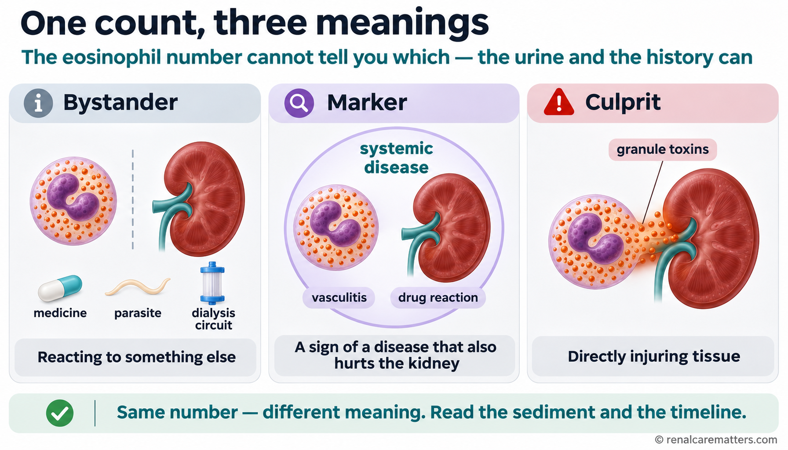</picture><figcaption><p class="fig-desc">The same eosinophil count can mean three things: the cells are reacting to something else, they are a sign of a disease that is also hurting the kidney, or they are injuring the kidney directly. The urine and the history tell you which.</p></figcaption></figure>

<!-- 05 · #bedside, after the red "Urgent regardless" alert -->
<figure style="max-width:560px;margin-left:auto;margin-right:auto;"><picture><source srcset="../images/eos-kidney-05-red-flags.webp" type="image/webp">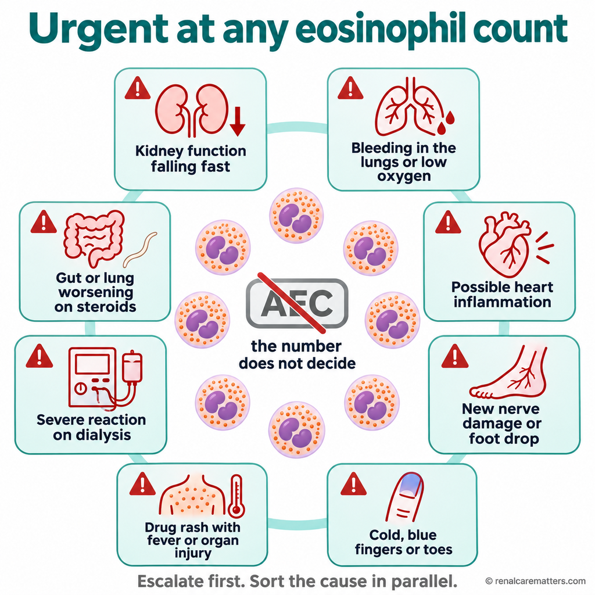</picture><figcaption><p class="fig-desc">Any of these eight warning signs means act now, whatever the eosinophil number shows.</p><dl class="fig-abbrevs"><dt>AEC</dt><dd>Absolute eosinophil count</dd></dl></figcaption></figure>

<!-- 06 · #count, after the AEC alert -->
<figure><picture><source srcset="../images/eos-kidney-06-count-the-cells.webp" type="image/webp">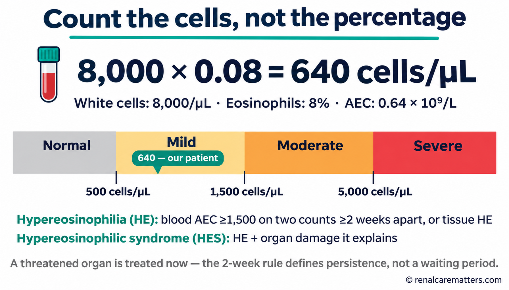</picture><figcaption><p class="fig-desc">Multiply the white cell count by the eosinophil fraction to get the absolute count, then see where it sits on the ruler. A threatened organ is treated now; the two-week rule only defines persistence.</p><dl class="fig-abbrevs"><dt>AEC</dt><dd>Absolute eosinophil count</dd><dt>HE</dt><dd>Hypereosinophilia</dd><dt>HES</dt><dd>Hypereosinophilic syndrome</dd></dl></figcaption></figure>

<!-- 07 · #count, after the pitfall list -->
<figure><picture><source srcset="../images/eos-kidney-07-iceberg.webp" type="image/webp">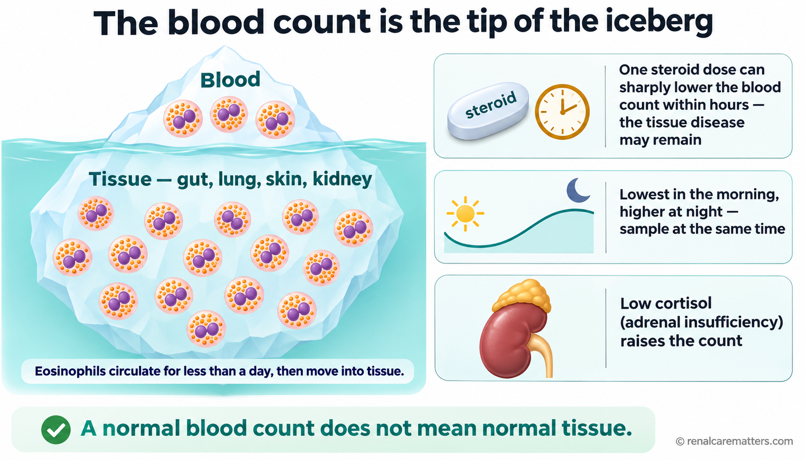</picture><figcaption><p class="fig-desc">Most eosinophils live in tissue, not blood. A steroid dose, the time of day, and adrenal function all change the blood count without changing the disease underneath.</p></figcaption></figure>

<!-- 08 · #mechanism, after paragraph 1 (optional, P3) -->
<figure style="max-width:520px;margin-left:auto;margin-right:auto;"><picture><source srcset="../images/eos-kidney-08-eosinophil-journey.webp" type="image/webp">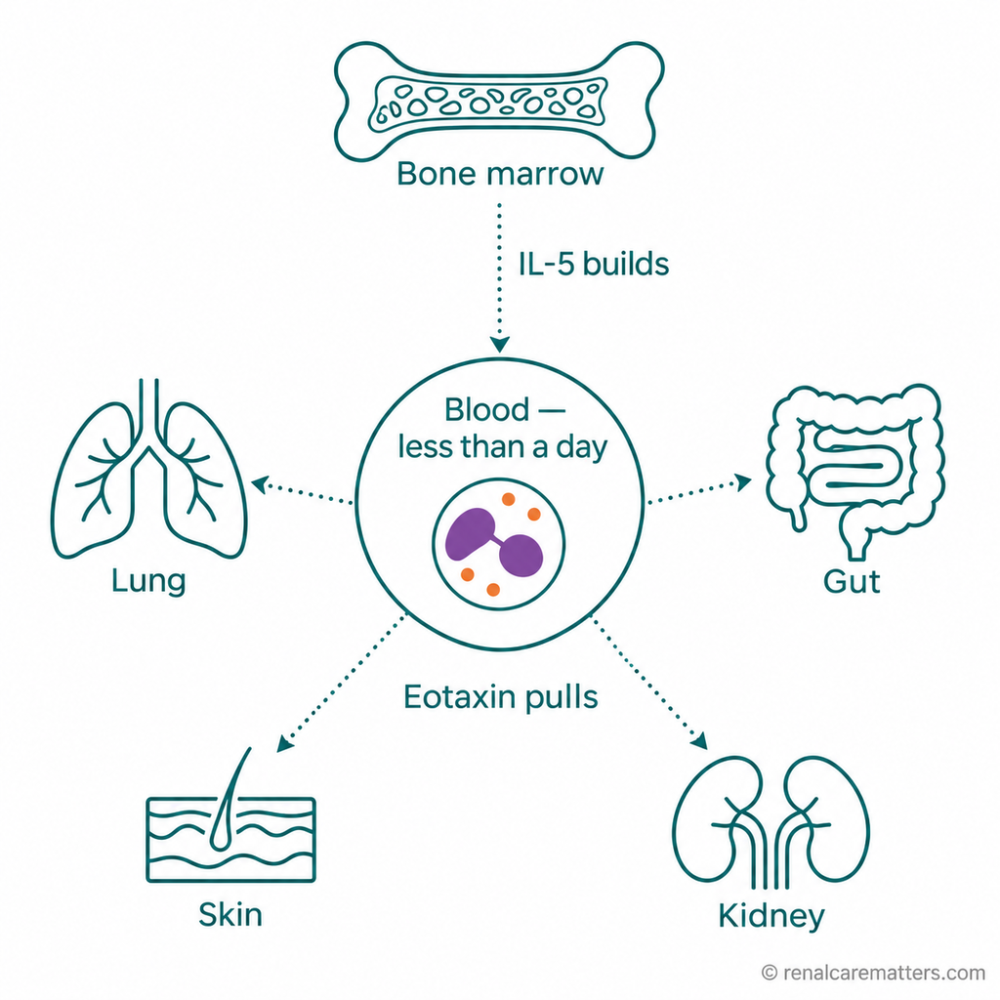</picture><figcaption><p class="fig-desc">Eosinophils are made in the bone marrow, pass through the blood for less than a day, and are pulled into tissues such as the lung, gut, skin, and kidney.</p><dl class="fig-abbrevs"><dt>IL-5</dt><dd>Interleukin-5</dd></dl></figcaption></figure>

<!-- 09 · #evidence, after the evidence table -->
<figure><picture><source srcset="../images/eos-kidney-09-real-but-rare.webp" type="image/webp">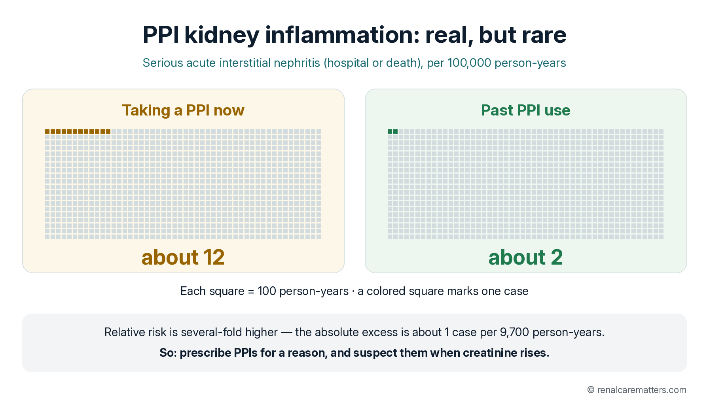</picture><figcaption><p class="fig-desc">Kidney inflammation from acid-reducing PPIs is several times more likely while taking them, but still rare: about 1 extra serious case for every 9,700 years of use.</p><dl class="fig-abbrevs"><dt>PPI</dt><dd>Proton pump inhibitor</dd><dt>AIN</dt><dd>Acute interstitial nephritis</dd></dl></figcaption></figure>

<!-- 10 · #pathway, after the phenotype table -->
<figure><picture><source srcset="../images/eos-kidney-10-read-the-urine.webp" type="image/webp">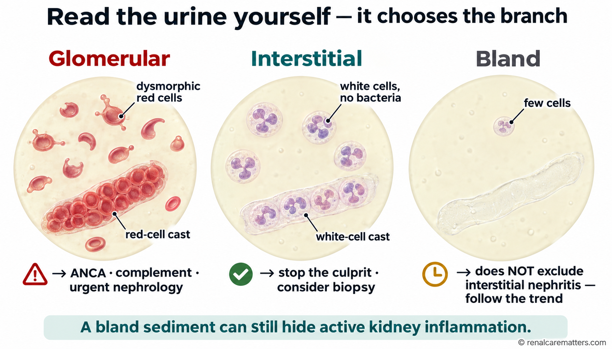</picture><figcaption><p class="fig-desc">What the urine looks like under the microscope chooses the next step. A nearly empty sample can still hide active kidney inflammation.</p><dl class="fig-abbrevs"><dt>ANCA</dt><dd>Antineutrophil cytoplasmic antibody</dd></dl></figcaption></figure>

<!-- 11 · #urine, after the test-performance callout -->
<figure><picture><source srcset="../images/eos-kidney-11-balance-that-wont-tip.webp" type="image/webp">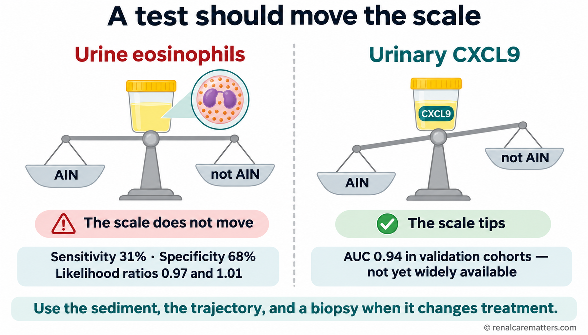</picture><figcaption><p class="fig-desc">A useful test moves the odds. Urine eosinophils leave them where they were; newer urine markers such as CXCL9 move them, though they are not yet widely available.</p><dl class="fig-abbrevs"><dt>AIN</dt><dd>Acute interstitial nephritis</dd><dt>CXCL9</dt><dd>C-X-C motif chemokine ligand 9</dd><dt>AUC</dt><dd>Area under the receiver-operating-characteristic curve</dd></dl></figcaption></figure>

<!-- 12 · #ain, after paragraph 1 -->
<figure><picture><source srcset="../images/eos-kidney-12-window-closing.webp" type="image/webp">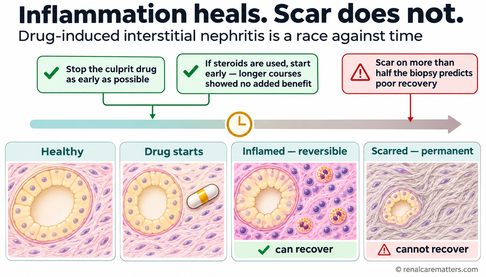</picture><figcaption><p class="fig-desc">Inflamed kidney tissue can heal; scarred tissue cannot. That is why stopping the drug early matters most, and why steroids, if used, should start early.</p></figcaption></figure>

<!-- 13 · #ain, after the green "practical steroid decision" alert -->
<figure style="max-width:560px;margin-left:auto;margin-right:auto;"><picture><source srcset="../images/eos-kidney-13-steroid-decision.webp" type="image/webp">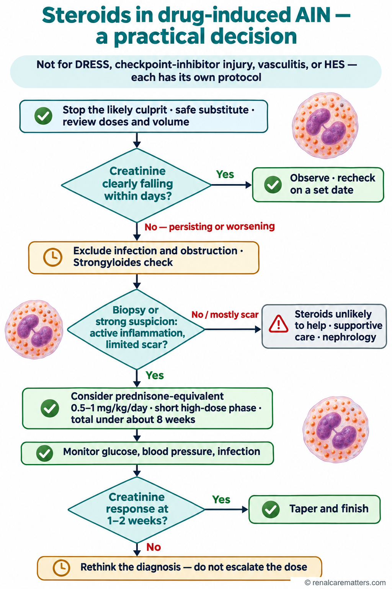</picture><figcaption><p class="fig-desc">The steroid decision for drug-induced AIN only, with a built-in review date and a stop rule.</p><dl class="fig-abbrevs"><dt>AIN</dt><dd>Acute interstitial nephritis</dd><dt>DRESS</dt><dd>Drug reaction with eosinophilia and systemic symptoms</dd><dt>HES</dt><dd>Hypereosinophilic syndrome</dd></dl></figcaption></figure>

<!-- 14 · #ain, after the amber "falling eosinophil count" alert -->
<figure><picture><source srcset="../images/eos-kidney-14-two-lines.webp" type="image/webp">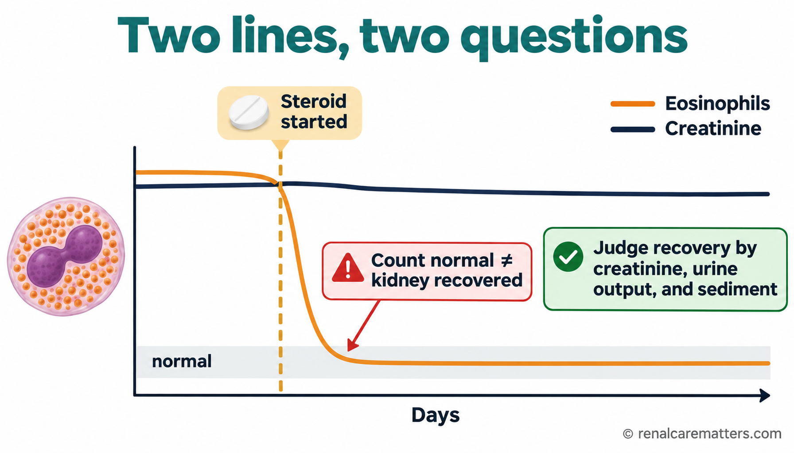</picture><figcaption><p class="fig-desc">Steroids bring the eosinophil count down within hours. Whether the kidney is recovering is a separate question, answered by creatinine, urine output, and the urine sediment.</p></figcaption></figure>

<!-- 15 · #ici-dress, after DRESS paragraph 1 -->
<figure><picture><source srcset="../images/eos-kidney-15-dress-timeline.webp" type="image/webp">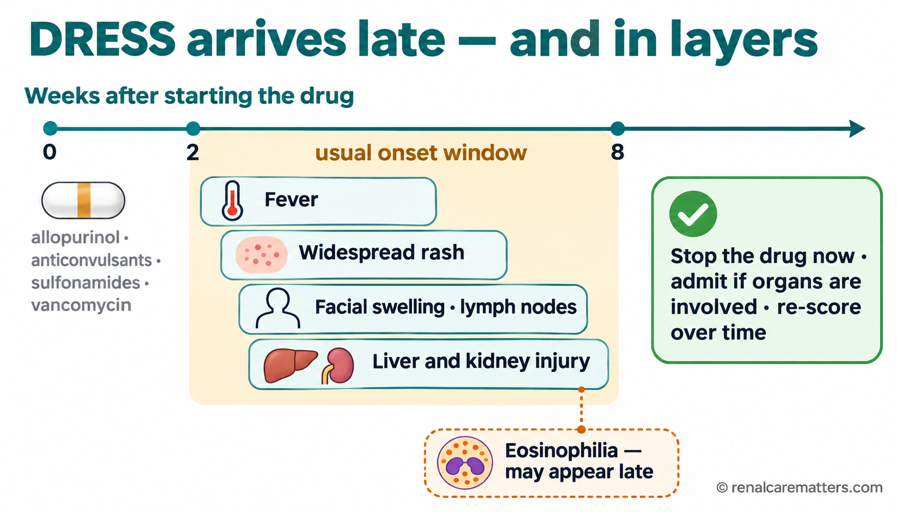</picture><figcaption><p class="fig-desc">This drug reaction usually starts weeks after the medicine, builds in layers, and may show raised eosinophils only at the end.</p><dl class="fig-abbrevs"><dt>DRESS</dt><dd>Drug reaction with eosinophilia and systemic symptoms</dd></dl></figcaption></figure>

<!-- 16 · #egpa-hes, end of section -->
<figure><picture><source srcset="../images/eos-kidney-16-trials-at-a-glance.webp" type="image/webp">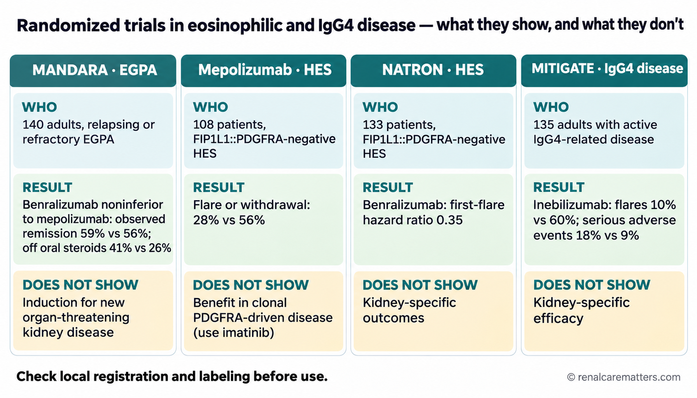</picture><figcaption><p class="fig-desc">What each randomized trial showed, and the patients it does not speak to. None tested kidney-specific outcomes or induction for new, organ-threatening kidney disease.</p><dl class="fig-abbrevs"><dt>EGPA</dt><dd>Eosinophilic granulomatosis with polyangiitis</dd><dt>HES</dt><dd>Hypereosinophilic syndrome</dd><dt>IgG4-RD</dt><dd>Immunoglobulin G4-related disease</dd></dl></figcaption></figure>

<!-- 17 · #egpa-hes, after the EGPA H3 -->
<figure><picture><source srcset="../images/eos-kidney-17-egpa-many-organs.webp" type="image/webp">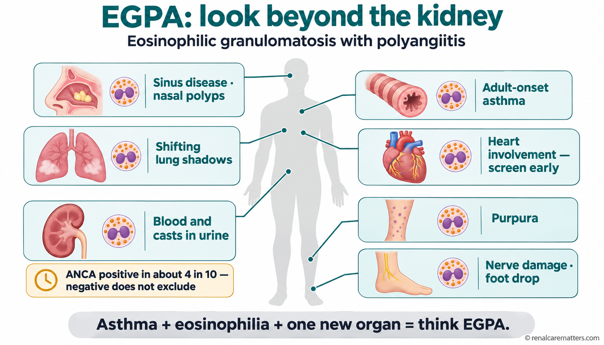</picture><figcaption><p class="fig-desc">EGPA can touch the sinuses, airways, lungs, heart, skin, nerves, and kidneys. The clues are often outside the kidney, and a negative ANCA test does not rule it out.</p><dl class="fig-abbrevs"><dt>EGPA</dt><dd>Eosinophilic granulomatosis with polyangiitis</dd><dt>ANCA</dt><dd>Antineutrophil cytoplasmic antibody</dd></dl></figcaption></figure>

<!-- 18 · #dialysis-transplant, after paragraph 1 -->
<figure style="max-width:560px;margin-left:auto;margin-right:auto;"><picture><source srcset="../images/eos-kidney-18-dialysis-reaction-card.webp" type="image/webp">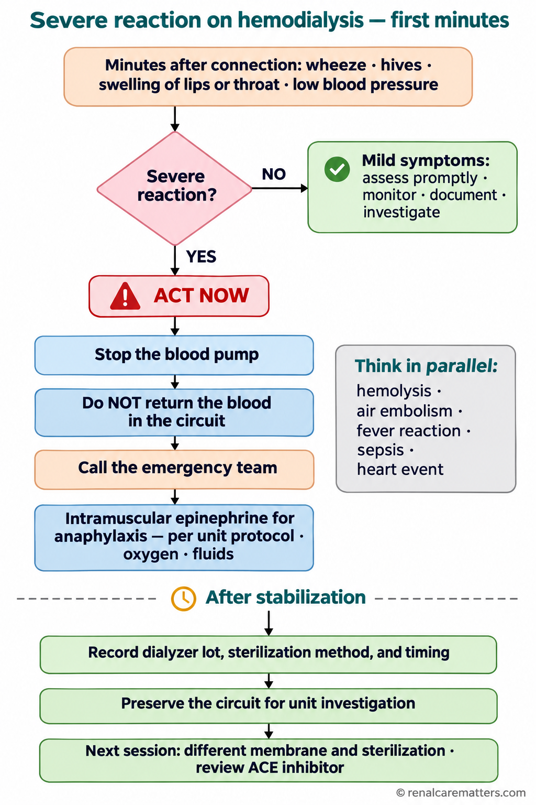</picture><figcaption><p class="fig-desc">The first minutes of a severe reaction on dialysis: stop, do not give back the blood in the lines, call for help, and give epinephrine. Investigate the equipment afterward.</p><dl class="fig-abbrevs"><dt>ACE</dt><dd>Angiotensin-converting enzyme</dd></dl></figcaption></figure>

<!-- 19 · #dialysis-transplant, after the "After stabilization" paragraph -->
<figure><picture><source srcset="../images/eos-kidney-19-what-changed-circuit.webp" type="image/webp">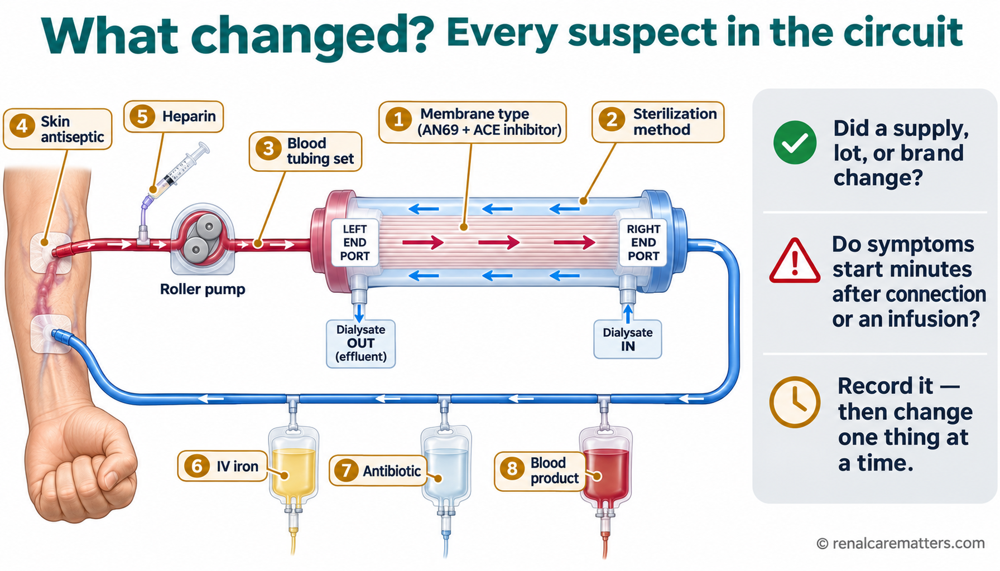</picture><figcaption><p class="fig-desc">Every part of the dialysis setup that can trigger a reaction. When a reaction happens, ask what changed and record it.</p><dl class="fig-abbrevs"><dt>AN69</dt><dd>Acrylonitrile–sodium methallyl sulfonate copolymer membrane</dd><dt>ACE</dt><dd>Angiotensin-converting enzyme</dd><dt>IV</dt><dd>Intravenous</dd></dl></figcaption></figure>

<!-- 20 · #strongyloides, after paragraph 1 -->
<figure style="max-width:560px;margin-left:auto;margin-right:auto;"><picture><source srcset="../images/eos-kidney-20-autoinfection-loop.webp" type="image/webp">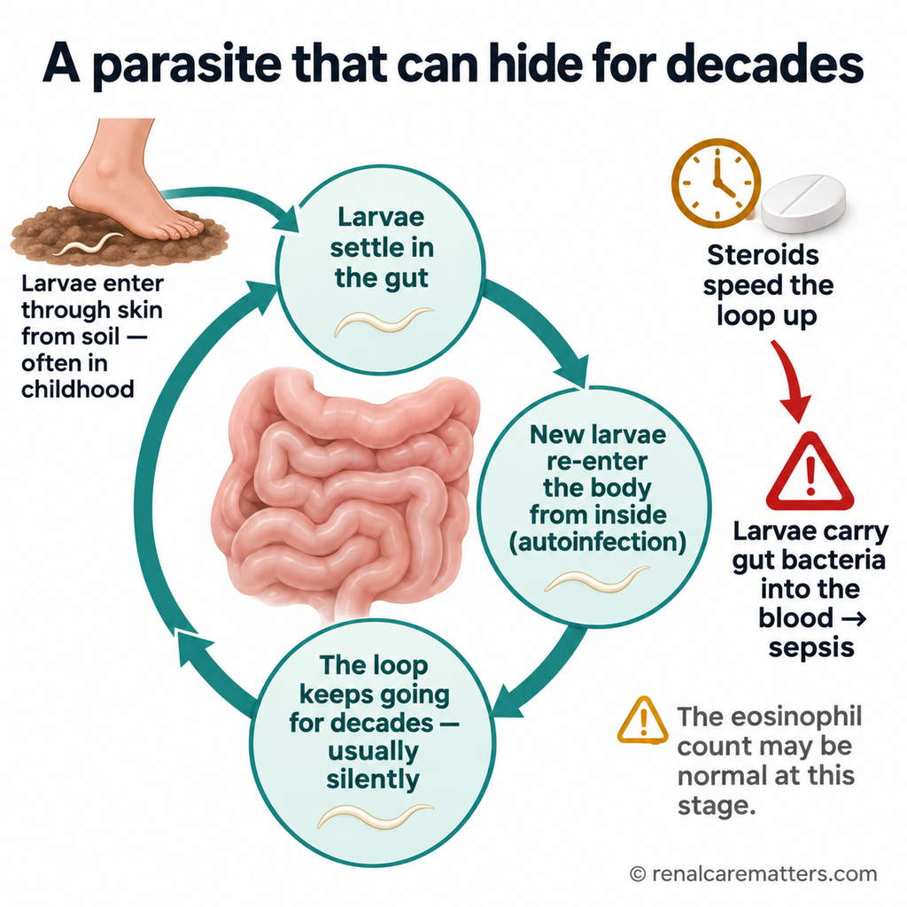</picture><figcaption><p class="fig-desc">This parasite can live quietly in the gut for decades. Steroids speed up its cycle, and the larvae can carry gut bacteria into the blood, often while the eosinophil count looks normal.</p></figcaption></figure>

<!-- 21 · #philippines, after paragraph 1 -->
<figure><picture><source srcset="../images/eos-kidney-21-philippine-exposure.webp" type="image/webp">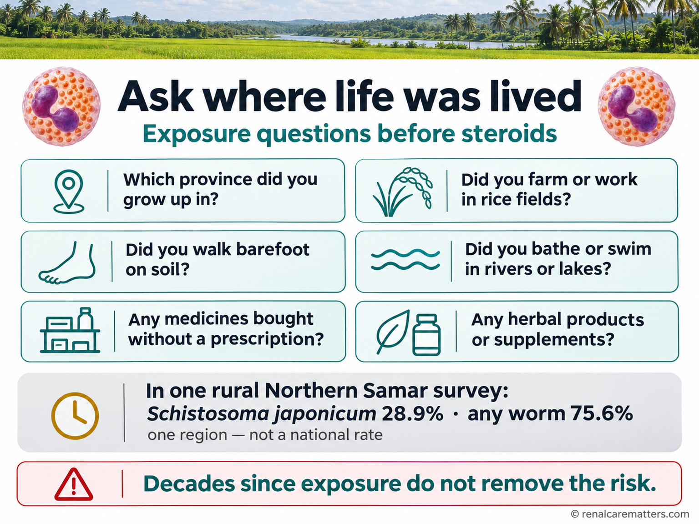</picture><figcaption><p class="fig-desc">Six questions that turn "exposure history" into answers a patient can give. Where a person grew up still matters decades later.</p></figcaption></figure>

<!-- 22 · #cases, after the H2 -->
<figure><picture><source srcset="../images/eos-kidney-22-three-cases.webp" type="image/webp">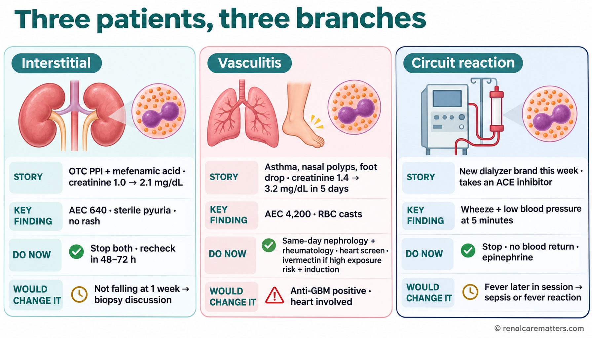</picture><figcaption><p class="fig-desc">Three patients, three branches of the same pathway. Open each case below for the full reasoning.</p><dl class="fig-abbrevs"><dt>OTC</dt><dd>Over-the-counter</dd><dt>PPI</dt><dd>Proton pump inhibitor</dd><dt>AEC</dt><dd>Absolute eosinophil count</dd><dt>RBC</dt><dd>Red blood cell</dd><dt>GBM</dt><dd>Glomerular basement membrane</dd><dt>ACE</dt><dd>Angiotensin-converting enzyme</dd></dl></figcaption></figure>

<!-- 23 · #vascular, after the atheroembolic paragraph -->
<figure><picture><source srcset="../images/eos-kidney-23-cholesterol-emboli.webp" type="image/webp">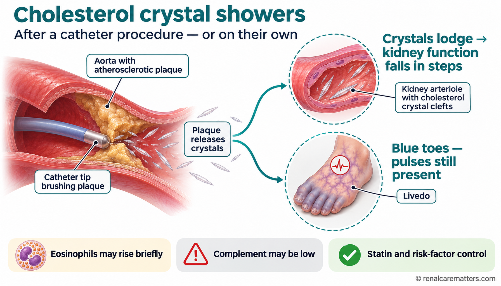</picture><figcaption><p class="fig-desc">A procedure, or sometimes nothing at all, can break cholesterol crystals off a stiff aorta. They block small arteries in the kidneys and toes.</p></figcaption></figure>

<!-- 24 · #followup, after the follow-up card -->
<figure><picture><source srcset="../images/eos-kidney-24-follow-up-timeline.webp" type="image/webp">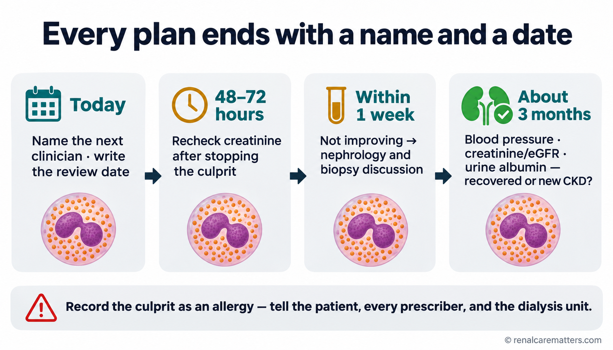</picture><figcaption><p class="fig-desc">Who checks, and when: a named person and a date at every step, ending with a 3-month check for lasting kidney damage.</p><dl class="fig-abbrevs"><dt>eGFR</dt><dd>Estimated glomerular filtration rate</dd><dt>CKD</dt><dd>Chronic kidney disease</dd></dl></figcaption></figure>

<!-- 25 · #followup, after the checklist alert (optional, P3) -->
<figure style="max-width:480px;margin-left:auto;margin-right:auto;"><picture><source srcset="../images/eos-kidney-25-bedside-checklist.webp" type="image/webp">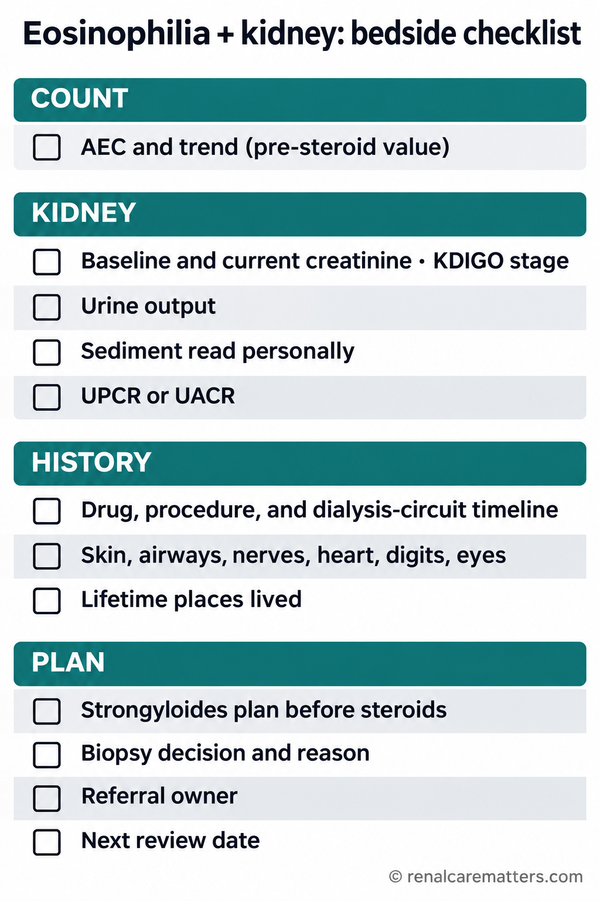</picture><figcaption><p class="fig-desc">Save this checklist to your phone. Tap twice to open it full size.</p><dl class="fig-abbrevs"><dt>AEC</dt><dd>Absolute eosinophil count</dd><dt>KDIGO</dt><dd>Kidney Disease: Improving Global Outcomes</dd><dt>UPCR</dt><dd>Urine protein-to-creatinine ratio</dd><dt>UACR</dt><dd>Urine albumin-to-creatinine ratio</dd></dl></figcaption></figure>
```

---

## Part 5 · Production checklist

1. **Generate the five ● images first** (00, OG, 01, 02, 03). The live page shows their alt text in an empty frame until they exist.
2. Then the P1 ○ images in picture-reader order: 04, 05, 06, 07, 10, 11, 12, 14, 18, 20. P2 next (09, 13, 15, 16, 17, 19, 21, 22, 23, 24); 08 and 25 are optional.
3. Save `<stem>.png` and `<stem>.webp` in `images/`, keeping stems exactly as written.
4. **Check each image against its prompt before accepting it:**
   - only the numbers written in the prompt, spelled exactly (06: 8,000 × 0.08 = 640; 09: exactly 12 and 2 filled squares; 11: 31%, 68%, 0.97, 1.01, 0.94; 16: every trial value; 21: 28.9% and 75.6%; 22: creatinine values and AECs);
   - Inter on a light background, `© renalcarematters.com` visible (except 00);
   - orange `#d9822b` used only for eosinophil granules and the eosinophil-count line;
   - dialyzer anatomy (01, 19): blood through the end ports, dialysate and effluent through side ports, countercurrent, one arterial and one venous line;
   - no faces, no gore, no worm close-ups, no map of the Philippines;
   - misspellings to reject: "Strongyloides", "hyperinfection", "dysmorphic", "eosinophilic", "polyangiitis", "sulfonamides", "mefenamic", "FIP1L1::PDGFRA", "japonicum".
5. For ○ images, paste the Part 4 snippet at the stated placement, then run from the repo root:
   `python3 patch_image_lightbox.py --guide eosinophilia-kidney-disease-clinician.html` ·
   `python3 audit_acronym_expansion.py --guide eosinophilia-kidney-disease-clinician.html` ·
   `python3 patch_reading_time.py --guide eosinophilia-kidney-disease-clinician.html`,
   and re-check dark mode.
6. Run Stage 2 (`williamriveromd-local-image-generator`) for manifests. The `og:image` tags already point to `eosinophilia-kidney-disease-clinician-og.png` at 1200 × 630.
7. Publication of the guide is on hold pending clinical sign-off. When signing off, re-stamp the publish time (`patch_published_time.py` will not overwrite an existing stamp — delete the current `article:published_time` line first so the stamp equals the go-live moment), regenerate the Latest strip, then push to `main`.
