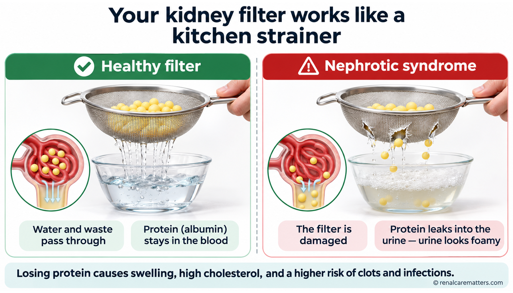
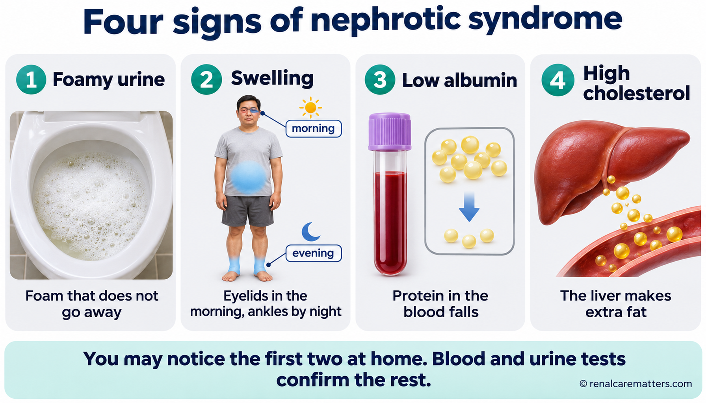
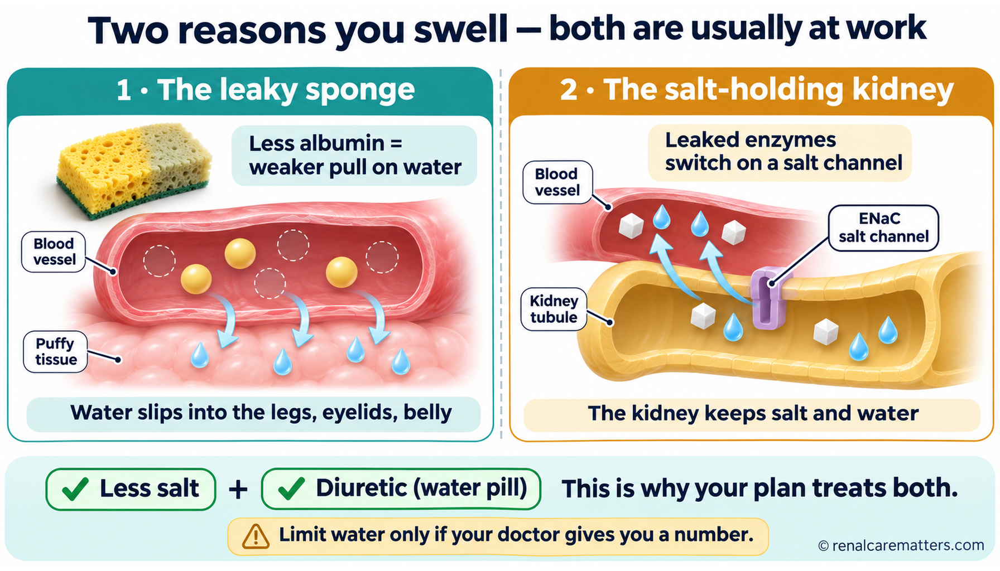
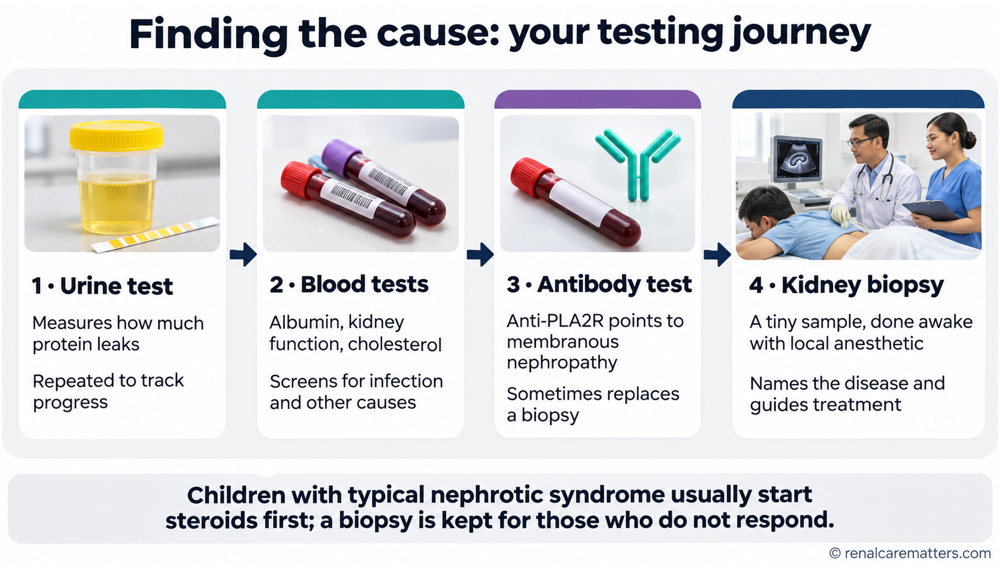
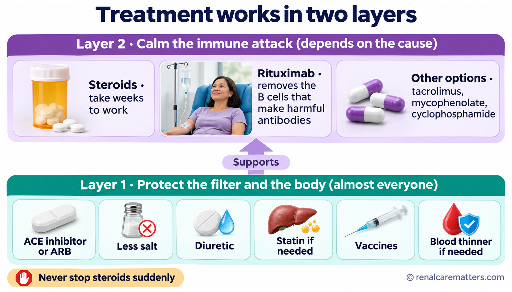
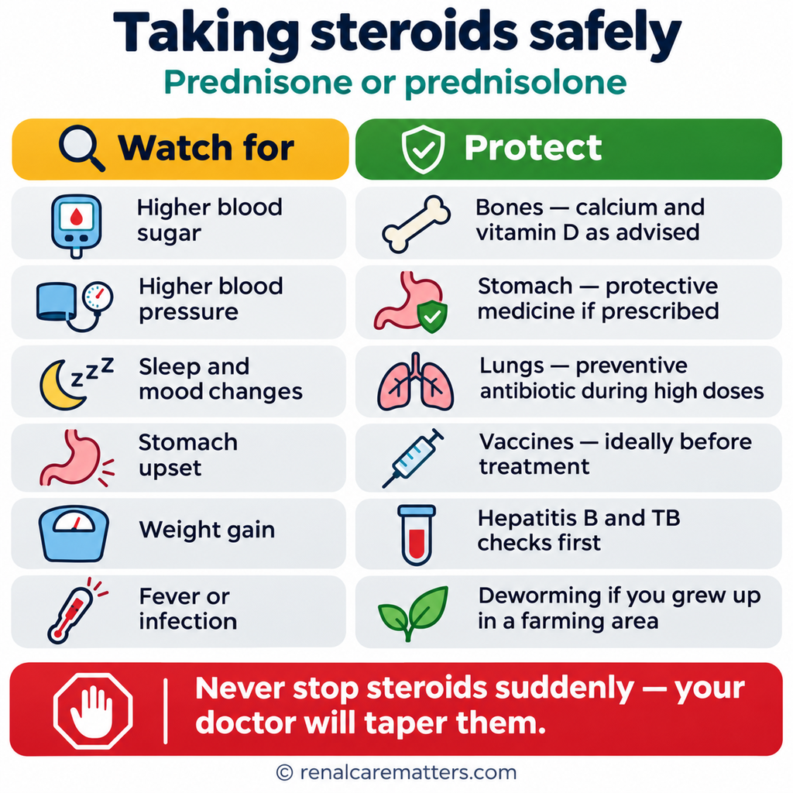
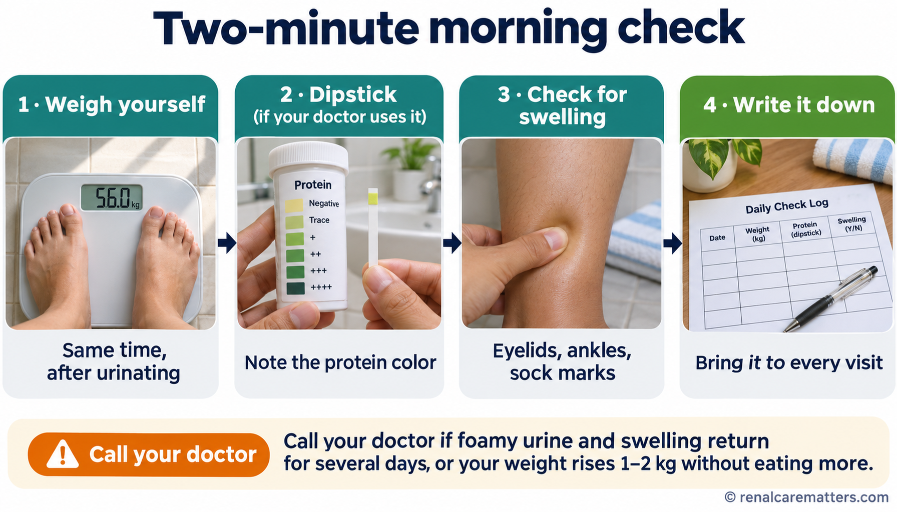
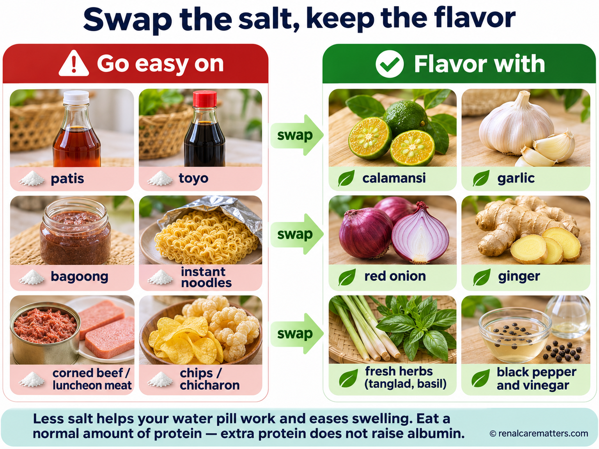
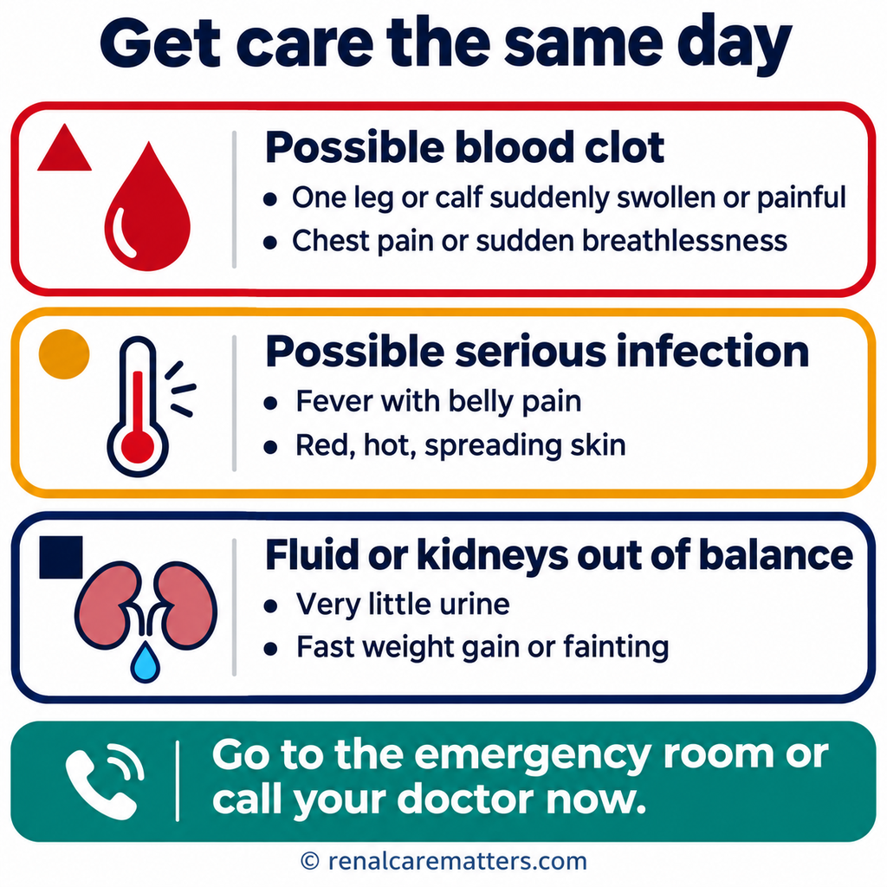

# Image Plan & Prompt Pack — Nephrotic Syndrome

**Guide:** `guides/nephrotic-syndrome.html` · **Canonical:** https://renalcarematters.com/guides/nephrotic-syndrome.html
**Pipeline:** Stage 1 (this file, written with the repo graphic skills) → generate in the ChatGPT Image Generator GPT (https://chatgpt.com/) → Stage 2 `williamriveromd-local-image-generator` (validation, manifests, og:image wiring).
**Prepared:** 6 November 2026. Every number inside a prompt comes from a source verified for the guide (KDIGO 2021 Glomerular Diseases, KDIGO 2025 Nephrotic Syndrome in Children, and the 2026 papers cited in the guide). Do not let the generator add numbers that are not written in a prompt.

**Skills used:** `williamriveromd-hero-vignette` (00) · `williamriveromd-biomedical-mechanism-figure` (01, 03, 17) · `williamriveromd-simple-figure` (02, 05, 07, 08, 10, 11, 13, 16, 20) · `williamriveromd-infographic-skill` (06, 09, 12, OG) · `williamriveromd-algorithm-generator-skill` (04, 15, 18, 19) · `williamriveromd-organ-crosstalk-sigil-graphic` (14).

---

## Part 1 · Visual strategy

### 1.1 The goal
A reader with a grade-school education and a nephrologist should each leave every image understanding **one idea**. Words carry nuance; pictures carry the mechanism and the action. The images are teaching tools, not decoration.

### 1.2 Design rules for every literacy level

| Rule | Why it helps | How the prompts enforce it |
|---|---|---|
| **One idea per image** | Working memory holds only a few new chunks at once | Each prompt states a single VISUAL GOAL; patient images cap at about 6 labels |
| **Concrete before abstract** | An everyday analogy anchors new physiology | The patient set opens with a kitchen strainer and a sponge before showing a glomerulus |
| **Icon + short word, never icon alone** | Icons are ambiguous; words alone fail low literacy | Every icon in patient images has a 1–4 word label |
| **Color is never the only signal** | Red–green color vision deficiency is common in men | Color is paired with shape (✓, ✗, warning triangle) or pattern (solid vs striped) |
| **Filipino context** | Recognition builds trust | Filipino people, homes, and foods (patis, toyo, bagoong, calamansi) |
| **Numbers only where they change action** | Numbers overwhelm low-numeracy readers | Patient images use "about 3 in 10" phrasing; clinician images carry grades and thresholds |
| **Clinician images look like journal figures** | Clinicians scan, then verify | Algorithms use KDIGO wording and grades verbatim |
| **On-image text in English** | Generators garble Tagalog, Cebuano, and Kapampangan | Four-language explanation lives in each HTML `figcaption` |

### 1.3 Shared visual vocabulary (draw identically in every image)

| Element | Always drawn as |
|---|---|
| **Albumin** | small pale-yellow spheres |
| **Salt / sodium** | small white cubic crystals |
| **Water / fluid** | soft light-blue droplets or shading |
| **Podocyte** | pale lavender-blue cell with finger-like foot processes |
| **Antibody (IgG)** | small teal "Y" shape |
| **Harmful / leaking** | clinical red #b91c1c accents + warning triangle |
| **Protective / treatment** | renal green #1f7a4d or blue accents + check mark |
| **Caution** | amber #b8860b |
| **Structure / text** | navy #0f1e2e; headings clinical teal #1a6b72 |

### 1.4 House constitution (applies to every prompt)
- Light backgrounds only (white #ffffff, off-white #fafafa, soft gray #f3f4f6, light teal #eef6f7). Never navy, charcoal, or black.
- Fonts: **Inter, Nunito Sans, IBM Plex Sans, or Manrope only**; each prompt names one. Never serif.
- Attribution on every image: `© renalcarematters.com` (bottom-right; bottom-center for portrait), small, ~70% opacity. The hero vignette is the only exception: it is wordless by the hero-vignette spec.
- Output `.png`; save a `.webp` twin with the same stem in `images/`.
- Fixed sizes: hero vignette 2048 × 2048; OG card exactly 1200 × 630.

---

## Part 2 · Image inventory and placement

**Status:** ● already referenced in the guide HTML (generate first) · ○ new (add the Part 4 snippet once the image exists)
**Priority:** P1 essential for understanding · P2 strong enhancement · P3 optional

| # | Status | Pri | File stem | Section | Audience | Skill · archetype | Size |
|---|---|---|---|---|---|---|---|
| 00 | ● | P1 | `nephrotic-syndrome-vignette-hero` | Hero (patient) | Patients | hero-vignette v3 · J Environmental | 2048 × 2048 |
| 05 | ○ | P1 | `nephrotic-syndrome-05-strainer-analogy` | `#what-it-is` (top) | Patients | simple-figure · B comparison | 1792 × 1024 |
| 06 | ○ | P1 | `nephrotic-syndrome-06-four-signs` | `#what-it-is` | Patients | infographic · multi-panel | 1792 × 1024 |
| 01 | ● | P1 | `nephrotic-syndrome-01-filter-leak-mechanism` | `#what-it-is` | Mixed | biomedical-mechanism | 1792 × 1024 |
| 07 | ○ | P1 | `nephrotic-syndrome-07-two-swelling-mechanisms` | `#why-swelling` | Patients | simple-figure · B comparison | 1792 × 1024 |
| 02 | ● | P1 | `nephrotic-syndrome-02-three-causes` | `#three-causes` | Patients | simple-figure · B (3-column) | 1792 × 1024 |
| 08 | ○ | P2 | `nephrotic-syndrome-08-tests-journey` | `#tests` | Patients | simple-figure · C steps | 1792 × 1024 |
| 09 | ○ | P1 | `nephrotic-syndrome-09-treatment-two-layers` | `#treatment` | Patients | infographic · multi-panel | 1792 × 1024 |
| 10 | ○ | P1 | `nephrotic-syndrome-10-steroid-safety-card` | `#treatment` | Patients | simple-figure · E card | 1024 × 1024 |
| 11 | ○ | P1 | `nephrotic-syndrome-11-home-check-routine` | `#relapse` | Patients | simple-figure · C steps | 1792 × 1024 |
| 12 | ○ | P2 | `nephrotic-syndrome-12-salt-swap-matrix` | `#daily-life` | Patients | infographic · food matrix | 1536 × 1152 |
| 13 | ○ | P1 | `nephrotic-syndrome-13-warning-signs-card` | `#daily-life` (end) | Patients | simple-figure · E card | 1024 × 1024 |
| 14 | ○ | P2 | `nephrotic-syndrome-14-one-physiology-sigil` | `#md-framework` | Clinicians | organ-crosstalk sigil | 1024 × 1024 |
| 04 | ● | P1 | `nephrotic-syndrome-04-adult-workup-algorithm` | `#md-framework` | Clinicians | algorithm · Mode B journal | 1024 × 1536 |
| 03 | ● | P2 | `nephrotic-syndrome-03-pla2r-shedding` | `#md-mn-serology` | Clinicians | biomedical-mechanism | 1792 × 1024 |
| 15 | ○ | P1 | `nephrotic-syndrome-15-mn-risk-treatment-algorithm` | `#md-mn-treatment` | Clinicians | algorithm · Mode B journal | 1024 × 1536 |
| 16 | ○ | P2 | `nephrotic-syndrome-16-pla2r-precedes-proteinuria` | `#md-mn-treatment` | Clinicians | simple-figure · D one-panel | 1792 × 1024 |
| 17 | ○ | P2 | `nephrotic-syndrome-17-anti-nephrin-podocytopathy` | `#md-anti-nephrin` | Clinicians | biomedical-mechanism | 1792 × 1024 |
| 18 | ○ | P1 | `nephrotic-syndrome-18-mcd-fsgs-treatment-algorithm` | `#md-fsgs` (linked from `#md-mcd`) | Clinicians | algorithm · Mode B journal | 1024 × 1536 |
| 19 | ○ | P1 | `nephrotic-syndrome-19-anticoagulation-albumin-algorithm` | `#md-complications` | Clinicians | algorithm · Mode C house | 1024 × 1536 |
| 20 | ○ | P3 | `nephrotic-syndrome-20-kdigo2025-children-steroid-timeline` | `#md-children-genetics` | Clinicians | simple-figure · C timeline | 1792 × 1024 |
| OG | ● | P1 | `nephrotic-syndrome-og` | og:image / Latest strip | Mixed | infographic · OG card | 1200 × 630 |

**Code-native (do not generate):** the ADAPT remission and cumulative-dose chart is inline SVG in both modes, drawn to scale from the published values.

**Production order:** 00 → OG → 01 → 02 → 04 (already in the HTML, so the page stops showing empty frames), then the remaining P1s, then P2/P3.

**Learning arc, patient tab:** strainer analogy (05) → what you notice (06) → what happens inside (01) → why you swell (07) → which disease (02) → which test (08) → how treatment works (09, 10) → what to watch at home (11, 13) → what to eat (12).

**Learning arc, clinician tab:** one physiology (14) → first workup (04) → MN mechanism (03) → MN treatment and monitoring (15, 16) → autoimmune podocytopathy (17) → MCD/FSGS treatment (18) → thromboprophylaxis (19) → children (20).

---

## Part 3 · Prompts

### 00 · Hero vignette ●

```
FILE NAME: nephrotic-syndrome-vignette-hero.png
IMAGE TYPE: Circular vignette hero v3 — Scaffold A people
ASPECT RATIO: 1:1 (square — displayed inside an 85–90% inscribed circle with white margin)
PIXEL DIMENSIONS: 2048 × 2048
COMPOSITION ARCHETYPE: J — Environmental Storytelling
CAMERA: low side-profile, three-quarter view from near floor level
HUMAN VARIATION (vs. previous guide, AL amyloidosis): two people instead of one; man in his early 40s;
  lean-to-average build; short wavy black hair with a slight side part; light stubble; angular jaw; warm
  medium-brown skin; faded maroon cotton T-shirt and gray drawstring house shorts; seated on a low wooden
  bench, leaning forward, pressing a thumb into his own puffy lower leg; a teenage daughter (about 15)
  kneeling beside him, long straight hair in a low ponytail, mint school PE shirt, holding a small
  notebook; calm, focused expressions; morning light; home sala instead of clinic or kitchen.
AUDIENCE: patients and families
VISUAL GOAL: The everyday moment a father first checks the swelling in his leg at home, with his daughter beside him.

PROMPT:
Square 1:1 photorealistic editorial photograph on a 2048×2048 canvas, composed to be displayed inside a
CIRCULAR vignette occupying 85–90% of the canvas diameter with a visible WHITE BORDER around the full
circle (the circle must never touch the canvas edges). Composition archetype: J — Environmental
Storytelling. Camera: low side-profile three-quarter view from near floor level.

Subject: a Filipino man in his early 40s with a lean-to-average build, short wavy black hair, light
stubble, an angular jaw, and warm medium-brown skin, wearing a faded maroon cotton T-shirt and gray
drawstring house shorts, seated on a low wooden bench in a clean, bright Philippine home living room
(sala). He leans forward and gently presses his thumb into his visibly puffy lower leg just above the
ankle, the way a person checks for swelling. Beside him a teenage daughter of about 15, with long straight
black hair in a low ponytail and a mint school PE shirt, kneels and watches attentively, holding a small
closed notebook. Supporting context only: rubber tsinelas on the tiled floor, a rolled woven banig in the
background, a glass of water on a side table. Soft natural morning daylight from a side window, gentle
shallow depth of field.

Visual hierarchy: the father's leg-and-hand gesture and his face occupy 60–70% of the circle; the daughter
and room details 20–30%; reserve a 20–25% TITLE SAFE ZONE in the upper-left of the circle as soft blurred
wall and window light (no faces, objects, or anatomy inside that zone).

Calm, reassuring, documentary-realistic color grade harmonizing with clinical teal #1a6b72 and navy
#0f1e2e on a light background. Edge falloff toward a slightly deeper neutral at the rim. Full-bleed
within the inscribed circle, no rectangular borders, frames, or banners.

Absolutely NO text of any kind: no title, subtitle, caption, label, logo, or watermark.

NEGATIVE INSTRUCTIONS:
Avoid: busy layouts; collage overload; more than four supporting scenes; dozens of icons; tiny unreadable
labels; infographic clutter; duplicated people; repeated compositions; cropped circle; cropped objects;
cropped anatomy; edge clipping; objects touching the circular border; important content inside the title
safe zone; baked-in text, titles, captions, logos, watermarks; rectangular borders, frames, banners; dark /
charcoal / black backgrounds; cartoon style, neon, HDR, over-saturation; distorted hands or faces,
implausible anatomy; exaggerated or grotesque swelling.

QUALITY CHECK:
Square 2048×2048. Circle occupies 85–90% of canvas with a visible white margin — never cropped. ONE
dominant hero subject (father checking his leg) occupying 60–70% of the circle, 2–4 supporting elements,
20–25% empty title-safe zone. Filipino home context, ≥12 traits visibly different from the previous guide.
No text.
```

---

### 05 · The kitchen-strainer analogy ○ (patient, `#what-it-is`, top)

```
IMAGE NUMBER: 05
SECTION PLACEMENT: #what-it-is — first image, right after the intro callout
FILE NAME: nephrotic-syndrome-05-strainer-analogy.png
ARCHETYPE: Side-by-side comparison (simple-figure Scaffold B)
AUDIENCE: patients and families, all reading levels
ASPECT RATIO: 16:9 — 1792 × 1024
VISUAL GOAL: Show, without medical words, that the kidney filter normally keeps protein in and that nephrotic syndrome is a torn filter.

PROMPT:
Medical education comparison infographic, clean and friendly but not cartoonish, set in Nunito Sans.
White (#ffffff) background. Title centered at top in bold navy (#0f1e2e): "Your kidney filter works like a
kitchen strainer". A soft dashed vertical divider splits the canvas into two equal rounded panels.

LEFT panel, header in renal green (#1f7a4d) with a check-mark icon: "Healthy filter". A realistic
stainless-steel kitchen strainer held over a clear glass bowl. Clear water drains through into the bowl,
while small pale-yellow spheres stay inside the strainer. Below, a small inset circle shows the same idea
inside a kidney: a simple glomerulus with the yellow spheres staying in the blood vessel. Two short labels
only: "Water and waste pass through" · "Protein (albumin) stays in the blood".

RIGHT panel, header in clinical red (#b91c1c) with a warning-triangle icon: "Nephrotic syndrome". The same
strainer, now with a few visible tears in the mesh; pale-yellow spheres fall through the tears into the
bowl, and the bowl water is frothy at the surface. Small inset circle: the glomerulus with yellow spheres
leaking out to the urine side. Two short labels only: "The filter is damaged" · "Protein leaks into the
urine — urine looks foamy".

Bottom strip, full width, soft teal tint (#eef6f7), navy text: "Losing protein causes swelling, high
cholesterol, and a higher risk of clots and infections."

Photorealistic strainer and bowl combined with simple flat inset diagrams; albumin is always pale-yellow
spheres. Ample whitespace, labels ≥11pt, no more than four labels plus the title and bottom line.
Bottom-right: "© renalcarematters.com" in small semi-transparent navy text.

NEGATIVE INSTRUCTIONS:
No cartoon faces on objects, no clutter, no extra labels, no numbers, no dark background, no serif or
decorative fonts, no gibberish text.

QUALITY CHECK:
A reader who cannot read the labels still understands "whole strainer keeps the balls in; torn strainer
lets them out." Light background; attribution visible.
```

---

### 06 · The four signs you can see ○ (patient, `#what-it-is`)

```
IMAGE NUMBER: 06
SECTION PLACEMENT: #what-it-is — after the four-item list
FILE NAME: nephrotic-syndrome-06-four-signs.png
ARCHETYPE: Multi-panel educational infographic (4 panels)
AUDIENCE: patients and families
ASPECT RATIO: 16:9 — 1792 × 1024
VISUAL GOAL: Make the four features of nephrotic syndrome recognizable in daily life.

PROMPT:
Patient education infographic, landscape 16:9, modern nephrology clinic aesthetic, set in Inter. White
background. Title at top in bold navy: "Four signs of nephrotic syndrome". Four equal rounded cards in a
row on soft gray (#f3f4f6), each with a teal number badge, one realistic image, a 2–5 word label, and one
short line.

Card 1 — "Foamy urine": close-up of a clean white toilet bowl with persistent white foam on the water,
like beer froth. Line: "Foam that does not go away".
Card 2 — "Swelling": a simple outline of a person with soft light-blue shading at the eyelids (small sun
icon "morning"), the ankles and feet (small moon icon "evening"), and the belly. Line: "Eyelids in the
morning, ankles by night".
Card 3 — "Low albumin": a blood tube beside a short gauge showing pale-yellow spheres draining downward.
Line: "Protein in the blood falls".
Card 4 — "High cholesterol": a calm 3D liver with small golden fat droplets leaving it into a vessel.
Line: "The liver makes extra fat".

Bottom strip in soft teal tint, navy text: "You may notice the first two at home. Blood and urine tests
confirm the rest."

Where a person appears, show a Filipino adult as a partial figure in neutral clothing. Albumin =
pale-yellow spheres, fluid = light-blue shading. No numbers. Labels ≥11pt, generous whitespace.
Bottom-right: "© renalcarematters.com" in small semi-transparent navy text.

NEGATIVE INSTRUCTIONS:
No graphic or gross imagery, no cartoon style, no dark background, no serif fonts, no tiny text, no labels
beyond those written above.

QUALITY CHECK:
Each card readable at phone width; every icon has a word; attribution visible.
```

---

### 01 · Filter-leak mechanism ● (mixed, `#what-it-is`)

```
IMAGE NUMBER: 01
SECTION PLACEMENT: #what-it-is (after the "Why albumin matters" callout)
FILE NAME: nephrotic-syndrome-01-filter-leak-mechanism.png
ARCHETYPE: Biomedical mechanism schematic
AUDIENCE: mixed (plain labels, scientifically accurate)
ASPECT RATIO: 16:9 — 1792 × 1024
FONT: Inter

Create a publication-grade biomedical mechanism schematic about:
Topic: Nephrotic syndrome — how a leaking kidney filter causes body-wide effects.
Disease context: Nephrotic syndrome (minimal change disease, FSGS, membranous nephropathy).
Central mechanism: Podocyte injury → foot-process effacement and slit-diaphragm collapse → albumin leaks
into urine.

Organ-level panel (left): a simplified human kidney in light gray-blue with renal artery (red) and vein
(blue); label "Nephrotic syndrome". A small dashed connector box points to the magnified panel.

Magnified mechanism panel (center/right, dashed border): one glomerular capillary loop in cross-section
showing the endothelium, the glomerular basement membrane, and pale lavender-blue podocytes with
interdigitating foot processes on the outside. Split the panel: LEFT half "Healthy filter" with intact foot
processes and a thin slit diaphragm holding back pale-yellow albumin spheres; RIGHT half "Leaking filter"
with flattened (effaced) foot processes, gaps, and albumin spheres passing into the urinary space.
Concise callouts: "Podocyte injury" · "Foot processes flatten (effacement)" · "Albumin leaks into urine".

Bottom summary flow (arrows left → center → right):
Left pale-pink box "What goes wrong": Heavy protein in urine; Low blood albumin; Kidney holds salt (ENaC
switched on); Liver makes extra cholesterol and clotting factors.
Center box "What it causes": Swelling (edema); High cholesterol; Higher clot risk; Higher infection risk
(antibodies lost in urine).
Right pale-blue box "Treatment targets": Calm the immune attack (steroids, rituximab); Lower filter
pressure (ACE inhibitor or ARB); Less salt + diuretic; Statin, vaccines, and blood thinner when needed.

White background, muted clinical palette (light gray-blue anatomy, pale-yellow albumin, red for injury,
blue for protective effects, pale-pink pathology box, pale-blue treatment box), clean sans-serif labels
set in Inter (never a serif font), thin dashed connector lines, review-article style, generous whitespace,
labels readable at slide size. No numbers or doses. No photorealism, dark backgrounds, decorative elements,
or overcrowding. Attribution: small semi-transparent navy text "© renalcarematters.com" in the
bottom-right corner, ~10–11px, 70% opacity.
```

---

### 07 · Two reasons you swell ○ (patient, `#why-swelling`)

```
IMAGE NUMBER: 07
SECTION PLACEMENT: #why-swelling — after the intro paragraph, before the two cards
FILE NAME: nephrotic-syndrome-07-two-swelling-mechanisms.png
ARCHETYPE: Side-by-side comparison (simple-figure Scaffold B)
AUDIENCE: patients and families
ASPECT RATIO: 16:9 — 1792 × 1024
VISUAL GOAL: Show the "underfill" and "overfill" causes of edema as two everyday pictures, and why the plan is less salt AND a water pill.

PROMPT:
Medical education comparison infographic, AJKD graphical-abstract clarity with friendly everyday
analogies, set in Nunito Sans. White (#ffffff) background. Title at top in bold navy: "Two reasons you
swell — both are usually at work". Soft dashed divider into two equal rounded panels.

LEFT panel, teal header: "1 · The leaky sponge". A cutaway blood vessel drawn as a soft tube. Inside, fewer
pale-yellow albumin spheres than normal (a faint ghosted outline shows where more used to be). Light-blue
water droplets drift out through the vessel wall into the surrounding tissue, which looks puffy. A small
realistic kitchen sponge icon beside it, half dry. Labels: "Less albumin = weaker pull on water" · "Water
slips into the legs, eyelids, belly".

RIGHT panel, amber header: "2 · The salt-holding kidney". A simplified kidney tubule; a small open gate on
its wall labeled "ENaC salt channel"; white salt crystals and light-blue water droplets are pulled back
into the blood instead of leaving in the urine. Labels: "Leaked enzymes switch on a salt channel" · "The
kidney keeps salt and water".

Bottom strip in soft teal tint with two green check-mark chips "Less salt" and "Diuretic (water pill)"
joined by a plus sign, then navy text: "This is why your plan treats both." Below it, a small amber caution
chip: "Limit water only if your doctor gives you a number."

Consistent vocabulary: albumin = pale-yellow spheres, salt = white crystals, water = light-blue droplets.
No numbers. Labels ≥11pt. Bottom-right: "© renalcarematters.com" in small semi-transparent navy text.

NEGATIVE INSTRUCTIONS:
No cartoon faces, no clutter, no dark background, no serif fonts, no extra labels, no garbled text.

QUALITY CHECK:
A reader sees two separate causes and one combined action. Attribution visible.
```

---

### 02 · Three common causes in adults ● (patient, `#three-causes`)

```
IMAGE NUMBER: 02
SECTION PLACEMENT: #three-causes (after the comparison table)
FILE NAME: nephrotic-syndrome-02-three-causes.png
ARCHETYPE: Side-by-side comparison (3 columns)
AUDIENCE: patients and families
ASPECT RATIO: 16:9 — 1792 × 1024
FONT: Inter

Medical education comparison infographic, AJKD/NEJM graphical abstract style, set in Inter. White
(#ffffff) background. Title centered at top in bold navy (#0f1e2e): "Three common causes of nephrotic
syndrome in adults". Two soft dashed vertical dividers split the canvas into three equal rounded panels on
very soft gray (#f3f4f6).

Panel 1 header in clinical teal (#1a6b72): "Minimal change disease (MCD)". Icon: a glomerulus that looks
normal under a magnifying glass, with a tiny electron-microscope symbol showing flattened podocyte feet.
Three short rows: "Who: children most often; also adults" · "Confirmed by: kidney biopsy (adults)" ·
"Usual response: steroids work within weeks; relapses common".

Panel 2 header in amber (#b8860b): "FSGS (focal segmental glomerulosclerosis)". Icon: a glomerulus with one
scarred segment. Rows: "Who: any age; immune, inherited, or overwork forms" · "Confirmed by: kidney biopsy
± genetic test" · "Usual response: immune form may respond; others need kidney protection".

Panel 3 header in soft purple (#6c3d8e): "Membranous nephropathy (MN)". Icon: a blood tube with a teal
antibody "Y" symbol. Rows: "Who: adults, often middle age and later" · "Confirmed by: anti-PLA2R blood test
(about 7 in 10) or biopsy" · "Usual response: about 3 in 10 improve on their own; others need rituximab or
other treatment".

Bottom strip, full width, soft teal tint (#eef6f7), navy text: "Diabetes, lupus, amyloidosis, infections,
medicines, and some cancers can cause the same pattern — your doctor checks for these too."

Rounded panel corners, ample negative space, mobile-readable labels ≥11pt, no numbers beyond those written
here. Bottom-right: "© renalcarematters.com" in small semi-transparent navy text.
```

---

### 08 · The testing journey ○ (patient, `#tests`)

```
IMAGE NUMBER: 08
SECTION PLACEMENT: #tests — after the tests table
FILE NAME: nephrotic-syndrome-08-tests-journey.png
ARCHETYPE: Horizontal step sequence (simple-figure Scaffold C)
AUDIENCE: patients and families
ASPECT RATIO: 16:9 — 1792 × 1024
VISUAL GOAL: Turn a list of tests into a four-step journey a patient can anticipate.

PROMPT:
Clean clinical education infographic, white (#ffffff) background, set in Manrope. Title at top center in
bold navy (#0f1e2e): "Finding the cause: your testing journey". Four rounded rectangular cards in a single
horizontal row, connected by bold navy right-pointing arrows, on a very soft gray panel (#f3f4f6). Each
card has a colored top accent band, one small realistic image, a bold step label, and two short lines.

Card 1 (teal band) — image: a clear urine cup and a dipstick. "1 · Urine test" · "Measures how much
protein leaks" · "Repeated to track progress".
Card 2 (teal band) — image: two blood tubes. "2 · Blood tests" · "Albumin, kidney function, cholesterol" ·
"Screens for infection and other causes".
Card 3 (purple band) — image: a blood tube with a teal antibody "Y" symbol. "3 · Antibody test" ·
"Anti-PLA2R points to membranous nephropathy" · "Sometimes replaces a biopsy".
Card 4 (navy band) — image: a calm ultrasound-guided kidney biopsy scene, the patient lying face-down, a
Filipino nephrologist and nurse beside the bed in a bright, clean procedure room, no needle close-up.
"4 · Kidney biopsy" · "A tiny sample, done awake with local anesthetic" · "Names the disease and guides
treatment".

Bottom strip, full width, soft gray, navy text: "Children with typical nephrotic syndrome usually start
steroids first; a biopsy is kept for those who do not respond."

Generous whitespace, labels ≥11pt, no extra numbers. Bottom-right: "© renalcarematters.com" in small
semi-transparent navy text.

NEGATIVE INSTRUCTIONS:
No blood, wounds, or needle close-ups; no cartoon style; no dark background; no serif fonts; no gibberish.
```

---

### 09 · Treatment in two layers ○ (patient, `#treatment`)

```
IMAGE NUMBER: 09
SECTION PLACEMENT: #treatment — after the intro paragraph
FILE NAME: nephrotic-syndrome-09-treatment-two-layers.png
ARCHETYPE: Multi-panel educational infographic (two tiers)
AUDIENCE: patients and families
ASPECT RATIO: 16:9 — 1792 × 1024
VISUAL GOAL: Show that treatment has a base layer for everyone and a cause-specific layer, and what each part does.

PROMPT:
Patient education infographic, landscape 16:9, set in Inter. White background. Title in bold navy:
"Treatment works in two layers". The canvas is built like two stacked shelves.

TOP shelf, purple header band: "Layer 2 · Calm the immune attack (depends on the cause)". Three rounded
cards: (1) a pill bottle and white tablets — "Steroids · take weeks to work"; (2) an IV infusion bag on a
stand beside a seated Filipino patient in a bright infusion chair — "Rituximab · removes the B cells that
make harmful antibodies"; (3) a small group of capsules — "Other options · tacrolimus, mycophenolate,
cyclophosphamide".

BOTTOM shelf, teal header band: "Layer 1 · Protect the filter and the body (almost everyone)". Six small
icon chips in a row, each with a 1–3 word label: blood-pressure tablet "ACE inhibitor or ARB" · salt shaker
with a cross "Less salt" · tablet with a water droplet "Diuretic" · liver with small fat droplets "Statin if
needed" · syringe "Vaccines" · blood drop with a shield "Blood thinner if needed".

A soft upward arrow from the bottom shelf to the top shelf labeled "Supports". In the bottom-left corner, a
small amber chip with a stop-hand icon: "Never stop steroids suddenly".

Consistent palette, generous spacing, labels ≥11pt, no doses or numbers. Bottom-right:
"© renalcarematters.com" in small semi-transparent navy text.

NEGATIVE INSTRUCTIONS:
No brand names, no doses, no cartoon style, no dark background, no serif fonts, no clutter.
```

---

### 10 · Steroid safety card ○ (patient, `#treatment`)

```
IMAGE NUMBER: 10
SECTION PLACEMENT: #treatment — after the "Before immune treatment starts" callout
FILE NAME: nephrotic-syndrome-10-steroid-safety-card.png
ARCHETYPE: Square reference card (simple-figure Scaffold E)
AUDIENCE: patients and families (printable)
ASPECT RATIO: 1:1 — 1024 × 1024
VISUAL GOAL: A fridge-door card of what to watch and what to protect while on steroids.

PROMPT:
Clinical reference card, publication-grade patient design, set in Nunito Sans. White (#ffffff) background.
Bold navy title at top: "Taking steroids safely". Subtitle in teal: "Prednisone or prednisolone".

Two columns of rounded rows on soft gray (#f3f4f6):
LEFT column, amber header with a magnifying-glass icon: "Watch for". Rows: glucose-meter icon "Higher blood
sugar" · BP-cuff icon "Higher blood pressure" · moon icon "Sleep and mood changes" · stomach icon "Stomach
upset" · scale icon "Weight gain" · thermometer icon "Fever or infection".
RIGHT column, green header with a shield icon: "Protect". Rows: bone icon "Bones — calcium and vitamin D as
advised" · stomach-shield icon "Stomach — protective medicine if prescribed" · lungs icon "Lungs —
preventive antibiotic during high doses" · syringe icon "Vaccines — ideally before treatment" · test-tube
icon "Hepatitis B and TB checks first" · leaf icon "Deworming if you grew up in a farming area".

Full-width red footer band with white text and a stop-hand icon: "Never stop steroids suddenly — your
doctor will taper them."

Simple flat line icons, each paired with words. Labels ≥11pt. Bottom-center: "© renalcarematters.com" in
small semi-transparent navy text.

NEGATIVE INSTRUCTIONS:
No doses, no brand names, no dark background (the red footer band is the only strong fill), no serif fonts,
no tiny text.
```

---

### 11 · The home check routine ○ (patient, `#relapse`)

```
IMAGE NUMBER: 11
SECTION PLACEMENT: #relapse — after the "Watch for" checklist
FILE NAME: nephrotic-syndrome-11-home-check-routine.png
ARCHETYPE: Horizontal step sequence (simple-figure Scaffold C)
AUDIENCE: patients and families
ASPECT RATIO: 16:9 — 1792 × 1024
VISUAL GOAL: A two-minute morning routine that catches a relapse early.

PROMPT:
Clean clinical education infographic, white background, set in Inter. Title at top center in bold navy:
"Two-minute morning check". Four rounded cards in a single row connected by navy arrows, on soft gray
(#f3f4f6). Each card: colored top band, one realistic photo-style image of Filipino hands or objects in a
bright home bathroom, a bold step label, and one short line.

Card 1 (teal) — a bathroom scale with bare feet, early-morning light: "1 · Weigh yourself" · "Same time,
after urinating".
Card 2 (teal) — a urine dipstick held next to its color chart: "2 · Dipstick (if your doctor uses it)" ·
"Note the protein color".
Card 3 (teal) — a thumb pressing gently on the shin, leaving a small dent: "3 · Check for swelling" ·
"Eyelids, ankles, sock marks".
Card 4 (green) — a simple paper log on a table with a pen: "4 · Write it down" · "Bring it to every visit".

Bottom strip with an amber caution chip and navy text: "Call your doctor if foamy urine and swelling return
for several days, or your weight rises 1–2 kg without eating more."

Generous whitespace, labels ≥11pt. Bottom-right: "© renalcarematters.com" in small semi-transparent navy
text.

NEGATIVE INSTRUCTIONS:
No full-body bathroom scenes, no nudity, no cartoon style, no dark background, no serif fonts, no other
numbers.
```

---

### 12 · Salt swaps, Filipino kitchen ○ (patient, `#daily-life`)

```
IMAGE NUMBER: 12
SECTION PLACEMENT: #daily-life — after the bullet list
FILE NAME: nephrotic-syndrome-12-salt-swap-matrix.png
ARCHETYPE: Food matrix / nutrition infographic
AUDIENCE: patients and families
ASPECT RATIO: 4:3 — 1536 × 1152
VISUAL GOAL: Show which everyday Filipino foods carry hidden salt and what to cook with instead.

PROMPT:
CKD nutrition infographic, clean educational food matrix, set in Nunito Sans. White background. Title at
top in bold navy: "Swap the salt, keep the flavor". Two columns of realistic food photography on rounded
cards.

LEFT column, clinical-red header with a warning-triangle icon: "Go easy on". Six cards: patis bottle · toyo
bottle · bagoong in a small jar · instant noodles (no readable brand) · canned corned beef and luncheon meat
(no readable brand) · salty chips and chicharon. Each card has a 1–2 word label and a small white
salt-crystal icon.

RIGHT column, renal-green header with a check icon: "Flavor with". Six cards: halved calamansi · garlic bulb
· red onion · ginger root · fresh herbs (tanglad and basil) · black pepper with vinegar in a small dish.
Each card has a 1–2 word label and a small leaf icon.

Between the columns, three soft green arrows pointing left to right labeled "swap".

Bottom strip, soft teal tint, navy text: "Less salt helps your water pill work and eases swelling. Eat a
normal amount of protein — extra protein does not raise albumin."

Realistic, appetizing food on light surfaces, Filipino market and kitchen authenticity, labels ≥11pt, no
readable brand names, no numbers. Bottom-right: "© renalcarematters.com" in small semi-transparent navy
text.

NEGATIVE INSTRUCTIONS:
No dark food styling, no brand logos, no cartoon food, no clutter, no serif fonts.
```

---

### 13 · Warning signs card ○ (patient, `#daily-life`, end)

```
IMAGE NUMBER: 13
SECTION PLACEMENT: #daily-life (end) — mirrors the red urgent box at the top of the page
FILE NAME: nephrotic-syndrome-13-warning-signs-card.png
ARCHETYPE: Square reference card (simple-figure Scaffold E)
AUDIENCE: patients and families (printable, fridge-door)
ASPECT RATIO: 1:1 — 1024 × 1024
VISUAL GOAL: Three groups of danger signs a family member can recognize and act on the same day.

PROMPT:
Clinical reference card, publication-grade patient design, set in Inter. White background. Bold navy title
at top: "Get care the same day". Three stacked rounded bands, each with a large simple icon on the left and
2 short lines on the right.

Band 1 (clinical-red border, triangle marker, blood-drop icon) — "Possible blood clot": "One leg or calf
suddenly swollen or painful" · "Chest pain or sudden breathlessness".
Band 2 (amber border, circle marker, thermometer icon) — "Possible serious infection": "Fever with belly
pain" · "Red, hot, spreading skin".
Band 3 (navy border, square marker, kidney-and-droplet icon) — "Fluid or kidneys out of balance": "Very
little urine" · "Fast weight gain or fainting".

Footer band in teal with white text and a phone icon: "Go to the emergency room or call your doctor now."

High contrast; each band also has its own shape marker so meaning does not rely on color alone. Labels
≥12pt. Bottom-center: "© renalcarematters.com" in small semi-transparent navy text.

NEGATIVE INSTRUCTIONS:
No graphic imagery, no dark background, no serif fonts, no extra text, no numbers.
```

---

### 14 · "One physiology" sigil ○ (clinician, `#md-framework`)

```
IMAGE NUMBER: 14
SECTION PLACEMENT: #md-framework — beside "Why the pattern matters physiologically"
FILE NAME: nephrotic-syndrome-14-one-physiology-sigil.png
ARCHETYPE: Organ-crosstalk sigil
AUDIENCE: clinicians (also readable by patients)
ASPECT RATIO: 1:1 — 1024 × 1024
VISUAL GOAL: A calm symbol that edema, lipids, thrombosis, and infection are one physiology radiating from the leaking glomerulus.

PROMPT:
Create a simple medical organ-crosstalk sigil illustration featuring:
ORGANS:
- a pair of kidneys (center)
- the liver (upper left)
- a blood-vessel segment containing a small clot (upper right)
- a small immune-cell cluster (bottom)

RELATIONSHIP:
Show nephrotic syndrome as one physiology using dotted curved arrows radiating from the kidneys: a dotted
arrow to the liver and back (protein loss drives the liver to overproduce lipids and clotting factors), a
dotted arrow from the liver to the vessel (clotting tendency), and a dotted arrow from the kidneys to the
immune cluster (antibodies lost in the urine). A faint circular dotted loop links all three back to the
kidneys.

STYLE:
Minimal clinical line-art, thin monoline strokes, soft teal-blue palette with one pale-yellow accent for
albumin droplets leaving the kidneys, white background, clean rounded organ shapes, balanced radial
sigil-like composition, generous whitespace, no photorealism, no 3D. Four small labels only, set in IBM Plex
Sans: "Edema" near the kidneys, "Lipids" near the liver, "Clots" near the vessel, "Infection" near the
immune cluster.

COMPOSITION:
Kidneys at the center; liver, vessel, and immune cluster in a triangle around them; dotted arrows forming a
calm radial loop. Suitable for a nephrology education website.

OUTPUT:
Square 1024 × 1024, clean margins, publication-grade medical icon aesthetic. Include a small,
semi-transparent "© renalcarematters.com" attribution in the bottom-right corner, not obscuring the sigil.

NEGATIVE:
Photorealistic anatomy, surgical detail, more than four labels, dark background, neon colors, crowded
arrows, thick cartoon outlines, 3D rendering, glossy icons, serif fonts.
```

---

### 04 · Adult workup algorithm ● (clinician, `#md-framework`) — algorithm-generator Mode B

```
FILE NAME: nephrotic-syndrome-04-adult-workup-algorithm.png
ASPECT RATIO: 2:3 portrait — 1024 × 1536

Create a clean academic medical journal treatment algorithm flowchart on a white background. The design
should resemble a nephrology review figure: minimal, centered, symmetrical, and publication-ready.

Use these visual conventions:
- Beige rounded rectangles for diagnosis, disease category, or severity classification
- Pale blue rounded rectangles for assessment phases or treatment stages
- Pale green rounded rectangles for therapeutic options and outcomes
- Thin muted blue/teal arrows
- Top-down flow with balanced left-right branching
- Consistent rounded corners, box widths, and vertical spacing
- No icons, no decorative graphics, no dark background
- Typography clean, black, and journal-like, set in Manrope (never a serif font)

Content to render:
Title: "Adult nephrotic syndrome — first workup"
1. (beige) "Confirm nephrotic syndrome: proteinuria >3.5 g/day, low albumin, edema; check lipids and eGFR"
2. (pale blue) "Screen before immunosuppression: diabetes, lupus, hepatitis B and C, HIV, syphilis,
   tuberculosis, drugs and supplements, age-appropriate cancer screening; Strongyloides if endemic
   exposure"
3. (pale blue) "Anti-PLA2R antibody test"
4. Two balanced branches:
   LEFT "Positive, typical presentation" → (pale green) "Membranous nephropathy: biopsy not required
   (KDIGO 2021) → risk-stratify and treat"
   RIGHT "Negative or atypical" → (pale blue) "Kidney biopsy: light, immunofluorescence, and electron
   microscopy" → three balanced child nodes:
     (pale green) "Minimal change disease → high-dose glucocorticoids (1C)"
     (pale green) "Primary FSGS → high-dose glucocorticoids (1D); CNI if steroid-resistant (1C)"
     (pale green) "PLA2R-negative MN → stain for other antigens such as NELL1; search for a secondary cause"
5. Soft-gray side note, joined by a thin dotted line to step 1: "Supportive care for all: ACE inhibitor or
   ARB, sodium restriction, diuretic, statin when persistent, vaccines; assess clot and bleeding risk"
6. Soft-gray side note, joined to the FSGS node: "FSGS without full nephrotic syndrome or with segmental
   effacement → consider secondary or genetic causes; no immunosuppression"

Design requirements:
- Keep all text concise; use only the abbreviations written here
- Preserve clinical hierarchy; centered alignment; wide margins; no clutter
- Make the final image look like a medical journal figure
- Include a small professional footer reading "© renalcarematters.com" positioned at the bottom-right
  corner in subtle gray medical-publication styling
```

---

### 03 · PLA2R ectodomain shedding — laboratory model ● (clinician, `#md-mn-serology`)

```
IMAGE NUMBER: 03
SECTION PLACEMENT: #md-mn-serology
FILE NAME: nephrotic-syndrome-03-pla2r-shedding.png
ARCHETYPE: Biomedical mechanism schematic
AUDIENCE: clinicians
ASPECT RATIO: 16:9 — 1792 × 1024
FONT: IBM Plex Sans

Create a publication-grade biomedical mechanism schematic about:
Topic: How anti-PLA2R IgG builds subepithelial deposits in membranous nephropathy (proposed mechanism,
laboratory model — Liu et al., Kidney International 2026).
Disease context: PLA2R-associated membranous nephropathy.
Central mechanism: Antibody-triggered, ADAM10/17-dependent shedding of the PLA2R ectodomain, which anchors
to GBM collagen IV and laminin.

Organ-level panel (left): simplified kidney cross-section labeled "Membranous nephropathy", dashed
connector to the inset.

Magnified mechanism panel (dashed border): a glomerular capillary wall drawn horizontally — capillary lumen
at the bottom, endothelium, thickened glomerular basement membrane (GBM) in the middle drawn as a mesh
labeled "collagen IV / laminin", pale lavender-blue podocyte foot processes on top. Four numbered steps left
to right along the podocyte membrane:
1 "Anti-PLA2R IgG binds podocyte PLA2R (N-terminal epitope)" — teal antibody "Y" shapes
2 "ADAM10/17 cleaves PLA2R → soluble ectodomain released" (scissors icon on the receptor stalk; the
  intracellular domain stays in the podocyte)
3 "Ectodomain binds collagen IV / laminin in the GBM"
4 "Anchored ectodomain captures more IgG → subepithelial immune deposits"
Small gray side note: "Complement-independent in vitro; THSD7A not cleaved".

Bottom summary flow:
Left pale-pink box "Pathology": Circulating anti-PLA2R IgG; ADAM10/17 activation; Ectodomain shedding.
Center box "Mechanistic bridge": Ectodomain–GBM anchoring explains the serum–tissue antigen match and the
subepithelial location.
Right pale-blue box "Implication (hypothesis)": Potential future target; no change to current treatment.

Top-right corner badge in gray: "Laboratory model — proposed mechanism".
White background, muted clinical palette, IBM Plex Sans labels (never serif), thin dashed connectors,
review-article style, no photorealism, no dark background, no invented numbers.
Attribution: "© renalcarematters.com" bottom-right, small semi-transparent navy, ~10–11px.
```

---

### 15 · MN risk-based treatment algorithm ○ (clinician, `#md-mn-treatment`)

```
FILE NAME: nephrotic-syndrome-15-mn-risk-treatment-algorithm.png
ASPECT RATIO: 2:3 portrait — 1024 × 1536
SECTION PLACEMENT: #md-mn-treatment — after the KDIGO table

Create a clean academic medical journal treatment algorithm flowchart on a white background, resembling a
nephrology review figure: minimal, centered, symmetrical, and publication-ready.

Visual conventions: beige rounded rectangles for diagnosis or risk category; pale blue rounded rectangles
for assessment or monitoring; pale green rounded rectangles for therapeutic options; thin muted teal
arrows; top-down flow with four balanced branches; consistent box widths; no icons, no decorative
graphics, no dark background; clean black typography set in Inter (never a serif font).

Content to render:
Title: "Membranous nephropathy — risk-based treatment (KDIGO 2021)"
Top (pale blue): "All patients: optimal supportive care (RAS blockade, sodium restriction, diuretic,
statin, anticoagulation by risk)"
Next (pale blue): "Assess risk of progression: eGFR, proteinuria, serum albumin, anti-PLA2R level, and the
trajectory over time"
Four balanced branches (beige risk box → pale green therapy box):
- "Low risk" → "Supportive care; watch and wait"
- "Moderate risk" → "Watch and wait, OR rituximab, OR CNI ± glucocorticoids"
- "High risk" → "Rituximab, OR cyclophosphamide + glucocorticoids, OR CNI + rituximab"
- "Very high risk (rapid eGFR loss or life-threatening NS)" → "Cyclophosphamide + glucocorticoids"
Bottom (pale blue, full width): "Re-check anti-PLA2R about 6 months after starting therapy; complete
immunologic remission is <2 RU/mL by ELISA; antibody change precedes clinical change"
Footnote line in soft gray: "Rec 3.3.1 (1B): rituximab, or cyclophosphamide with alternate-month
glucocorticoids for 6 months, or CNI-based therapy for at least 6 months. CNI monotherapy with rapid
withdrawal often relapses."

Design requirements: concise text, centered alignment, wide margins, medical-journal look. Include a small
professional footer reading "© renalcarematters.com" positioned at the bottom-right corner in subtle gray
medical-publication styling.
```

---

### 16 · The antibody moves first ○ (clinician, `#md-mn-treatment`)

```
IMAGE NUMBER: 16
SECTION PLACEMENT: #md-mn-treatment — "Defining relapse, and predicting it"
FILE NAME: nephrotic-syndrome-16-pla2r-precedes-proteinuria.png
ARCHETYPE: Single mechanism / one-panel poster (simple-figure Scaffold D)
AUDIENCE: clinicians (and motivated patients)
ASPECT RATIO: 16:9 — 1792 × 1024
VISUAL GOAL: Show conceptually that anti-PLA2R falls before proteinuria remits and rises before it relapses.

PROMPT:
Medical pathophysiology figure, AJKD graphical-abstract style, set in IBM Plex Sans. White background.
Title at top in bold navy: "In membranous nephropathy, the antibody moves first". Subtitle in teal:
"Conceptual timeline — not to scale".

A clean two-line chart across the canvas with a shared horizontal time axis labeled only with phases (no
numbers): "Diagnosis" → "Treatment" → "Immunologic remission" → "Clinical remission" → "Immunologic
relapse" → "Clinical relapse". Line 1, solid teal, labeled "Anti-PLA2R antibody"; line 2, dashed amber,
labeled "Proteinuria". The teal line drops first and rises first; the amber line follows each change after
a visible lag, marked with small gray double-headed arrows labeled "lag of months". Pale-yellow shaded bands
mark "Measure anti-PLA2R here" at remission and at suspected relapse.

Bottom strip, navy text on soft gray: "Judge relapse with albumin as well as proteinuria. If albumin never
normalized, a rise is resistant disease, not relapse."

No y-axis numbers and no invented values. Generous whitespace, labels ≥11pt. Bottom-right:
"© renalcarematters.com" in small semi-transparent navy text.

NEGATIVE INSTRUCTIONS:
No numeric axes, no dark background, no serif fonts, no clutter.
```

---

### 17 · Autoimmune podocytopathy (anti-nephrin) ○ (clinician, `#md-anti-nephrin`)

```
IMAGE NUMBER: 17
SECTION PLACEMENT: #md-anti-nephrin — after the first paragraph
FILE NAME: nephrotic-syndrome-17-anti-nephrin-podocytopathy.png
ARCHETYPE: Biomedical mechanism schematic
AUDIENCE: clinicians
ASPECT RATIO: 16:9 — 1792 × 1024
FONT: Inter

Create a publication-grade biomedical mechanism schematic about:
Topic: Anti-nephrin autoantibodies in minimal change disease and primary FSGS (autoimmune podocytopathy),
and why serum titers can read falsely low.
Disease context: Minimal change disease / primary FSGS.
Central mechanism: Anti-nephrin IgG binds the slit diaphragm → nephrin phosphorylation and cytoskeletal
disruption → foot-process effacement and proteinuria.

Organ-level panel (left): simplified kidney labeled "Podocytopathy (MCD / FSGS)", dashed connector to the
inset.

Magnified mechanism panel (dashed border): two neighboring pale lavender-blue podocyte foot processes with
the slit diaphragm drawn as a zipper-like protein bridge labeled "nephrin". Teal antibody "Y" shapes bind
the bridge in a punctate pattern. Callouts: "Anti-nephrin IgG binds the slit diaphragm" · "Nephrin
signaling and actin cytoskeleton disrupted" · "Foot processes efface → albumin leaks". A small side inset
labeled "Why titers mislead": a urine cup receiving teal IgG "Y" shapes alongside pale-yellow albumin, with
the caption "Heavy proteinuria and plasma exchange remove IgG → correct the titer for total IgG".

Bottom summary flow:
Left pale-pink box "Pathology": Circulating anti-nephrin IgG; Slit-diaphragm injury; Diffuse effacement.
Center box "Treatment bridge": Glucocorticoids, B-cell depletion, and plasma exchange lower the antibody.
Right pale-blue box "Observed in studies": Antibody falls with remission; Pre-transplant positivity predicts
recurrence; Assays not yet standardized.

White background, muted clinical palette, Inter labels (never serif), thin dashed connectors,
review-article style, no photorealism, no numbers, no dark background. Attribution: "©
renalcarematters.com" bottom-right, small semi-transparent navy.
```

---

### 18 · MCD and primary FSGS treatment algorithm ○ (clinician, `#md-fsgs`)

```
FILE NAME: nephrotic-syndrome-18-mcd-fsgs-treatment-algorithm.png
ASPECT RATIO: 2:3 portrait — 1024 × 1536
SECTION PLACEMENT: #md-fsgs (first image), referenced from #md-mcd

Create a clean academic medical journal treatment algorithm flowchart on a white background, resembling a
nephrology review figure: minimal, centered, symmetrical, and publication-ready. Beige rounded rectangles
for diagnosis; pale blue for assessment and treatment stages; pale green for therapies and outcomes; thin
muted teal arrows; two balanced vertical columns; consistent box widths; no icons; no dark background;
clean black typography set in Manrope (never a serif font).

Content to render:
Title: "Adult podocytopathy — initial treatment (KDIGO 2021)"
LEFT column, beige header: "Minimal change disease"
- (pale blue) "High-dose oral glucocorticoids (1C), no longer than 16 weeks"
- (pale blue) "Taper 2 weeks after complete remission; about 24 weeks in total"
- (pale green) "Frequent relapse or steroid dependence → cyclophosphamide, rituximab, CNI, or MPAA (1C)"
- (soft-gray side note) "Glucocorticoids relatively contraindicated (obesity, poorly controlled diabetes,
  serious psychiatric disorder) → cyclophosphamide, CNI, or MMF"
RIGHT column, beige header: "Primary FSGS"
- (pale blue) "High-dose oral glucocorticoids (1D) until complete remission, maximum 16 weeks"
- (pale green) "Responders: glucocorticoids for at least 6 months"
- (pale blue) "Steroid-resistant → cyclosporine or tacrolimus for at least 6 months (1C)"
- (pale green) "CNI responders: continue for at least 12 months"
- (soft-gray side note) "Secondary FSGS or FSGS of undetermined cause → no immunosuppression"
Bottom, full width (soft gray): "2026 ADAPT trial: prednisolone 0.5 mg/kg/day + alfacalcidol — remission 88%
vs 91%, non-inferiority not shown; consider in high steroid-toxicity risk (shared decision)"

Design requirements: concise text, centered alignment, wide margins, journal-figure look. Include a small
professional footer reading "© renalcarematters.com" positioned at the bottom-right corner in subtle gray
medical-publication styling.
```

---

### 19 · Prophylactic anticoagulation by albumin assay ○ (clinician, `#md-complications`)

```
FILE NAME: nephrotic-syndrome-19-anticoagulation-albumin-algorithm.png
ASPECT RATIO: 2:3 portrait — 1024 × 1536
SECTION PLACEMENT: #md-complications — after the thromboembolism paragraph

Create a clean publication-ready clinical algorithm flowchart in the renalcarematters.com house style.
White background, restrained navy (#0f1e2e) and teal (#1a6b72) typography set in Inter (never a serif
font), thin teal connector arrows, generous margins, centered and symmetrical.

Color conventions: navy for title and text; teal diamonds for decisions; green (#1f7a4d) rounded boxes for
recommended actions; amber (#b8860b) rounded boxes for caution; soft gray for side notes.

Content to render:
Title: "Prophylactic anticoagulation in membranous nephropathy"
Subtitle: "KDIGO 2021 algorithm — thresholds depend on the albumin assay"
1. (teal diamond) "Which albumin assay?" → two balanced branches: LEFT "Bromocresol green (BCG)"; RIGHT
   "Bromocresol purple (BCP) or immunoassay"
2. Under each branch (teal diamond): LEFT "Albumin <25 g/L?"; RIGHT "Albumin <20 g/L?"
   YES (both) → (amber) "High venous thrombosis risk: estimate bleeding risk (UNC GN tools)"
     → (teal diamond) "Bleeding risk acceptable?"
        YES → (green) "Prophylactic anticoagulation: low-dose LMWH, then fold in warfarin — or LMWH +
        aspirin for about 3 months"
        NO → (soft gray) "No prophylaxis; reassess as albumin changes"
   NO (both) → (teal diamond) LEFT "Albumin <32 g/L?"; RIGHT "Albumin <30 g/L?"
        YES → (amber) "Weigh aspirin by arterial (cardiovascular) risk"
        NO → (green) "No prophylaxis"
3. Soft-gray side notes along the right margin:
   "Aspirin alone does not prevent venous thrombosis"
   "Steroids raise clot risk — do not omit prophylaxis when starting prednisone"
   "Value in non-membranous nephrotic syndrome is unknown"

Design requirements: concise text, diamonds for decisions, rounded rectangles for actions, consistent
spacing, no clutter, no photorealistic people, no dark background. Include a small professional footer
reading "© renalcarematters.com" positioned at the bottom-right corner in subtle gray medical-publication
styling.
```

---

### 20 · KDIGO 2025 first-episode steroid course in children ○ (clinician, `#md-children-genetics`)

```
IMAGE NUMBER: 20
SECTION PLACEMENT: #md-children-genetics — after the KDIGO 2025 paragraph
FILE NAME: nephrotic-syndrome-20-kdigo2025-children-steroid-timeline.png
ARCHETYPE: Horizontal timeline (simple-figure Scaffold C)
AUDIENCE: clinicians
ASPECT RATIO: 16:9 — 1792 × 1024
VISUAL GOAL: The two KDIGO 2025 initial-course options side by side on one week scale.

PROMPT:
Clean clinical education figure, white background, set in Manrope. Title at top center in bold navy:
"First episode of childhood nephrotic syndrome — KDIGO 2025 (1B)". Two horizontal timeline bars on a shared
week axis marked 0, 4, 6, 8, and 12 weeks, on a very soft gray panel.

Bar A, labeled "8-week course": weeks 0–4 solid teal segment "Daily: 60 mg/m² or 2 mg/kg (max 60 mg)";
weeks 4–8 striped lighter-teal segment "Alternate days: 40 mg/m² or 1.5 mg/kg (max 40 mg)".
Bar B, labeled "12-week course": weeks 0–6 solid teal "Daily: 60 mg/m² or 2 mg/kg (max 60 mg)"; weeks 6–12
striped lighter-teal "Alternate days: 40 mg/m² or 1.5 mg/kg (max 40 mg)".
Legend chips: solid = daily, striped = alternate-day (pattern as well as color).

Bottom strip in navy text: "Steroid-resistant disease → cyclosporine or tacrolimus (1C) and genetic testing
for all. Frequent relapses with toxicity, or steroid dependence → glucocorticoid-sparing agent (1B)."

Use exactly the values written; no other numbers. Labels ≥11pt. Bottom-right: "© renalcarematters.com" in
small semi-transparent navy text.
```

---

### OG · Social share card ●

```
FILE NAME: nephrotic-syndrome-og.png (+ .webp)
IMAGE TYPE: OG / social share card
PIXEL DIMENSIONS: 1200 × 630 (fixed)
AUDIENCE: mixed
VISUAL GOAL: Recognizable at thumbnail size in the Latest-guides strip and on Facebook.

PROMPT:
Editorial social share card, light background only (white #ffffff blending to light teal tint #eef6f7).
Left 55%: title in bold navy Inter "Nephrotic Syndrome"; subtitle in clinical teal Nunito Sans "When the
kidney filter leaks protein"; a small navy line in Inter "Causes · New antibody tests · 2026 treatment
evidence". Right 45%: a calm semi-photoreal 3D render of a single glomerulus with pale lavender-blue
podocytes and a few pale-yellow albumin spheres slipping through effaced foot processes, soft studio light,
no labels. Generous whitespace, strong thumbnail legibility. Bottom-right: "renalcarematters.com" in small
semi-transparent navy text. No dark background, no extra numbers, no logos, no serif fonts.

NEGATIVE INSTRUCTIONS:
Avoid cartoon style, clutter, tiny unreadable labels, AI gibberish text, unrealistic anatomy, HDR,
oversaturation, dark backgrounds, and any font other than Inter or Nunito Sans.
```

---

## Part 4 · HTML snippets for the new images (○)

Paste each snippet once its image exists. Patient figures carry four-language captions; clinician figures
are English-only. Every acronym shown inside an image must be listed in `fig-abbrevs` and already be
expanded earlier on the page (CLAUDE.md rule 13), or `audit_acronym_expansion.py` will fail.

```html
<!-- 05 · #what-it-is, right after the intro-callout -->
<figure class="ns-fig"><picture><source srcset="../images/nephrotic-syndrome-05-strainer-analogy.webp" type="image/webp"></picture><figcaption><p class="fig-desc"><span data-lang="en">A healthy kidney filter is like a whole strainer: water passes, protein stays. In nephrotic syndrome the strainer tears and protein leaks into the urine.</span><span data-lang="tl" class="lang-hidden">Ang malusog na salaan ng bato ay parang buong salaan: dumadaan ang tubig, naiiwan ang protina. Sa nephrotic syndrome, napupunit ang salaan at tumatagas ang protina sa ihi.</span><span data-lang="ceb" class="lang-hidden">Ang himsog nga salaan sa kidney sama sa bug-os nga salaan: moagi ang tubig, magpabilin ang protina. Sa nephrotic syndrome, magisi ang salaan ug motulo ang protina sa ihi.</span><span data-lang="kap" class="lang-hidden">Ing malusug a salaan ning batu anti mo ing buung salaan: lalabas ing danum, maiwan ing protina. King nephrotic syndrome, masiran ing salaan at tutulu ing protina king ilu.</span></p></figcaption></figure>

<!-- 06 · #what-it-is, after the four-item list -->
<figure class="ns-fig"><picture><source srcset="../images/nephrotic-syndrome-06-four-signs.webp" type="image/webp"></picture><figcaption><p class="fig-desc"><span data-lang="en">The four signs: foamy urine, swelling, low blood albumin, and high cholesterol. You may notice the first two at home.</span><span data-lang="tl" class="lang-hidden">Ang apat na senyales: mabulang ihi, pamamaga, mababang albumin sa dugo, at mataas na kolesterol. Ang unang dalawa ay maaaring mapansin sa bahay.</span><span data-lang="ceb" class="lang-hidden">Ang upat ka timailhan: bula-bula nga ihi, panghubag, ubos nga albumin sa dugo, ug taas nga kolesterol. Ang unang duha mahimong mamatikdan sa balay.</span><span data-lang="kap" class="lang-hidden">Ing apat a tanda: mabulang ilu, pamamaga, mababang albumin king daya, at matas a kolesterol. Ing mumunang adwa malyari mung apansinan king bale.</span></p></figcaption></figure>

<!-- 07 · #why-swelling, before .ns-two -->
<figure class="ns-fig"><picture><source srcset="../images/nephrotic-syndrome-07-two-swelling-mechanisms.webp" type="image/webp"></picture><figcaption><p class="fig-desc"><span data-lang="en">Two causes of swelling usually act together: less albumin to hold water in the vessels, and a kidney that keeps salt. Treatment targets both.</span><span data-lang="tl" class="lang-hidden">Dalawang sanhi ng pamamaga ang kadalasang sabay: kaunting albumin na humahawak ng tubig sa ugat, at batong nagtitipid ng asin. Pareho itong ginagamot.</span><span data-lang="ceb" class="lang-hidden">Duha ka hinungdan sa panghubag ang kasagaran dungan: gamay nga albumin nga mokupot sa tubig sa ugat, ug kidney nga nagtipig og asin. Parehong tambalan kini.</span><span data-lang="kap" class="lang-hidden">Adwang sanhi ning pamamaga ing kalimitan sabay: kakaunting albumin a mangawak danum king ugat, at batung mamakiramut asin. Pareu lang panamalan.</span></p><dl class="fig-abbrevs"><dt>ENaC</dt><dd>Epithelial sodium channel</dd></dl></figcaption></figure>

<!-- 08 · #tests, after the table -->
<figure class="ns-fig"><picture><source srcset="../images/nephrotic-syndrome-08-tests-journey.webp" type="image/webp"></picture><figcaption><p class="fig-desc"><span data-lang="en">Your testing journey: urine, blood, an antibody test, and, for most adults, a kidney biopsy.</span><span data-lang="tl" class="lang-hidden">Ang iyong mga pagsusuri: ihi, dugo, antibody test, at, para sa karamihan ng adulto, kidney biopsy.</span><span data-lang="ceb" class="lang-hidden">Ang imong mga pagsusi: ihi, dugo, antibody test, ug, alang sa kadaghanan sa hamtong, kidney biopsy.</span><span data-lang="kap" class="lang-hidden">Deng pamanigaral mu: ilu, daya, antibody test, at, para king kalakwan kareng matua, kidney biopsy.</span></p><dl class="fig-abbrevs"><dt>PLA2R</dt><dd>Phospholipase A2 receptor</dd></dl></figcaption></figure>

<!-- 09 · #treatment, after the intro paragraph -->
<figure class="ns-fig"><picture><source srcset="../images/nephrotic-syndrome-09-treatment-two-layers.webp" type="image/webp"></picture><figcaption><p class="fig-desc"><span data-lang="en">Treatment has two layers: protection for everyone, and immune treatment chosen by the cause.</span><span data-lang="tl" class="lang-hidden">May dalawang patong ang gamutan: proteksiyon para sa lahat, at immune treatment na pinipili ayon sa sanhi.</span><span data-lang="ceb" class="lang-hidden">Adunay duha ka lut-od ang pagtambal: proteksiyon alang sa tanan, ug immune treatment nga gipili sumala sa hinungdan.</span><span data-lang="kap" class="lang-hidden">Atin adwang patung ing panamal: proteksiyun para kareng sablang tau, at immune treatment a pipiliin agpang king sanhi.</span></p><dl class="fig-abbrevs"><dt>ACE</dt><dd>Angiotensin-converting enzyme</dd><dt>ARB</dt><dd>Angiotensin II receptor blocker</dd></dl></figcaption></figure>

<!-- 10 · #treatment, after the green "Before immune treatment starts" alert -->
<figure class="ns-fig ns-fig-square"><picture><source srcset="../images/nephrotic-syndrome-10-steroid-safety-card.webp" type="image/webp"></picture><figcaption><p class="fig-desc"><span data-lang="en">A card to keep on the fridge while you take steroids.</span><span data-lang="tl" class="lang-hidden">Isang card na ilalagay sa ref habang umiinom ka ng steroid.</span><span data-lang="ceb" class="lang-hidden">Usa ka card nga ibutang sa ref samtang nag-inom ka og steroid.</span><span data-lang="kap" class="lang-hidden">Metung a card a ibili king ref kabang uminum kang steroid.</span></p><dl class="fig-abbrevs"><dt>TB</dt><dd>Tuberculosis</dd></dl></figcaption></figure>

<!-- 11 · #relapse, after the checklist -->
<figure class="ns-fig"><picture><source srcset="../images/nephrotic-syndrome-11-home-check-routine.webp" type="image/webp"></picture><figcaption><p class="fig-desc"><span data-lang="en">A two-minute morning routine that catches a relapse early.</span><span data-lang="tl" class="lang-hidden">Isang dalawang-minutong gawain tuwing umaga para maagang matukoy ang pagbabalik ng sakit.</span><span data-lang="ceb" class="lang-hidden">Usa ka duha-ka-minutong buhat matag buntag aron sayo nga mailhan ang pagbalik sa sakit.</span><span data-lang="kap" class="lang-hidden">Metung a adwang-minutung gawa balang abak ban maagang akit ing pamagbalik ning sakit.</span></p></figcaption></figure>

<!-- 12 · #daily-life, after the list -->
<figure class="ns-fig"><picture><source srcset="../images/nephrotic-syndrome-12-salt-swap-matrix.webp" type="image/webp"></picture><figcaption><p class="fig-desc"><span data-lang="en">Swap hidden salt for calamansi, garlic, onion, ginger, and herbs.</span><span data-lang="tl" class="lang-hidden">Palitan ang nakatagong asin ng calamansi, bawang, sibuyas, luya, at herbs.</span><span data-lang="ceb" class="lang-hidden">Ilisi ang natago nga asin og calamansi, ahos, sibuyas, luy-a, ug herbs.</span><span data-lang="kap" class="lang-hidden">Alilan ing makasalikut a asin king kalamansi, bawang, sibuyas, luya, at herbs.</span></p></figcaption></figure>

<!-- 13 · #daily-life, end of section -->
<figure class="ns-fig ns-fig-square"><picture><source srcset="../images/nephrotic-syndrome-13-warning-signs-card.webp" type="image/webp"></picture><figcaption><p class="fig-desc"><span data-lang="en">Warning signs that need care the same day.</span><span data-lang="tl" class="lang-hidden">Mga babalang nangangailangan ng pagpapatingin sa parehong araw.</span><span data-lang="ceb" class="lang-hidden">Mga timailhan nga nagkinahanglan og pagpatan-aw sa samang adlaw.</span><span data-lang="kap" class="lang-hidden">Deng babala a kailangan magpatingin king pareung aldo.</span></p></figcaption></figure>
```

**TB note:** "TB" is not yet expanded in the guide's body text. When adding figure 10, change "tuberculosis
screening" in the green alert to "tuberculosis (TB) screening" and add TB to the glossary.

Clinician figures 14–20 follow the `FIGEN` pattern already in the guide. Use these captions and
abbreviation lists:

| # | fig-desc | fig-abbrevs |
|---|---|---|
| 14 | Edema, dyslipidemia, thrombosis, and infection are one physiology radiating from the leaking glomerulus. | — |
| 15 | KDIGO 2021 risk-based immunosuppression for MN, with anti-PLA2R re-checked at about 6 months. | MN, KDIGO, RAS, eGFR, PLA2R, NS, CNI, RU, ELISA |
| 16 | Conceptual timeline: anti-PLA2R changes months before proteinuria in remission and relapse. | PLA2R |
| 17 | Anti-nephrin IgG at the slit diaphragm, and why heavy proteinuria and plasma exchange lower measured titers. | MCD, FSGS, IgG |
| 18 | KDIGO 2021 initial treatment of adult MCD and primary FSGS, with the 2026 ADAPT result. | KDIGO, MCD, FSGS, CNI, MPAA, MMF, ADAPT |
| 19 | KDIGO 2021 anticoagulation algorithm for MN, with assay-specific albumin thresholds. | MN, KDIGO, BCG, BCP, UNC, GN, LMWH |
| 20 | KDIGO 2025 first-episode glucocorticoid courses in children: 8 or 12 weeks (1B). | KDIGO |

**Glossary and first-use additions needed when 15, 18, and 19 go in:** RAS (renin–angiotensin system),
MPAA (mycophenolic acid analogs), GN (glomerulonephritis), and LMWH (low-molecular-weight heparin). Expand
each in the body text above its figure, add it to the glossary, then re-run
`python3 audit_acronym_expansion.py --guide nephrotic-syndrome.html`.

---

## Part 5 · Production checklist

1. Generate the five ● images first (00, OG, 01, 02, 04) so the live page has no empty frames.
2. Save `<stem>.png` and `<stem>.webp` in `images/`, keeping the stems exactly as written.
3. Check each image against its prompt: only the numbers written, the named approved font, a light
   background, the attribution visible, and no garbled text. Generators often misspell "glomerulosclerosis",
   "nephropathy", "podocyte", and "PLA2R"; regenerate rather than accept a misspelling.
4. For ○ images, paste the Part 4 snippet, then run `python3 patch_img_dimensions.py`,
   `python3 patch_image_lightbox.py --guide nephrotic-syndrome.html`, and
   `python3 audit_acronym_expansion.py --guide nephrotic-syndrome.html`.
5. Run Stage 2 (`williamriveromd-local-image-generator`) for manifests; the og:image tags are already
   present at 1200 × 630.
