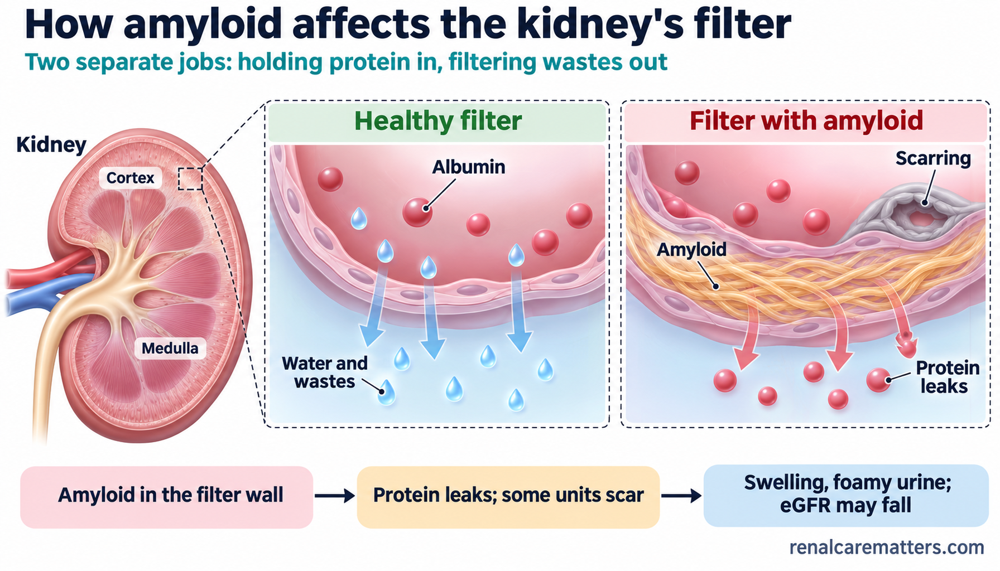

# AL Amyloidosis and Your Kidneys — Image Plan Blueprint and GPT Prompt Pack

**Guide:** `guides/al-amyloidosis-kidneys.html` · **Production target:** ChatGPT Image Generator GPT (https://chatgpt.com/g/g-pmuQfob8d-image-generator) · **Prepared:** November 6, 2026
**House rules applied to every prompt:** light backgrounds only · fonts Inter / Nunito Sans / IBM Plex Sans / Manrope only · American English · attribution `renalcarematters.com` (public guide set) · `.png` masters + `.webp` twins at exact pixel size · no histology, no invented numbers, no copied journal figures.

---

## Part 1 — Image plan blueprint

### 1.1 Visual narrative

The guide teaches one idea: **recovery in AL amyloidosis has three parts on three clocks** (light-chain production → deposits already in the kidney → kidney function). Every image either sets up that idea (what AL is, how it hurts the kidney), delivers it (the three-part figure), or helps the reader act on it (diagnosis, follow-up, discordant results, dialysis/transplant, coordination). Patient-tab images use plain words; clinician-tab images may use standard abbreviations, each defined in the figure's `fig-abbrevs` list.

### 1.2 Asset register

| ID | File (`images/`) | Size | Skill used | Placement (anchor) | Tab | Status |
|---|---|---|---|---|---|---|
| 001 | `al-amyloidosis-kidneys-vignette-hero.png` | 2048 × 2048 | hero-vignette v3 | Hero disc | Patient | Replace interim illustration |
| 002 | `al-amyloidosis-kidneys-02-three-parts.png` | 1792 × 1024 | biomedical-mechanism-figure | `#two-responses` | Patient | Replace code-native version after QC |
| 003 | `al-amyloidosis-kidneys-03-diagnosis-typing.png` | 1792 × 1024 | algorithm-generator, Mode B | `#confirming-the-type`, `#diagnostic-priorities` | Both | Replace code-native version after QC |
| 004 | `al-amyloidosis-kidneys-04-follow-up-domains.png` | 1792 × 1024 | simple-figure, Scaffold C | `#follow-up-numbers` | Patient | Replace code-native version after QC |
| 005 | `al-amyloidosis-kidneys-05-discordant-pathway.png` | 1024 × 1536 | algorithm-generator, Mode C | `#discordant-results` | Clinician | Replace code-native version after QC |
| 006 | `al-amyloidosis-kidneys-og.png` | **1200 × 630** | infographic (OG card) | `og:image`, `twitter:image`, Latest strip | — | Replace code-native card after QC |
| 007 | `al-amyloidosis-kidneys-07-filter-barrier.png` | 1792 × 1024 | biomedical-mechanism-figure | `#kidney-effects` | Patient | **New** — needs HTML wiring |
| 008 | `al-amyloidosis-kidneys-08-amyloid-types.png` | 1536 × 1152 | simple-figure, Scaffold E | `#what-is-al` (after the types table) | Patient | **New** — needs HTML wiring |
| 009 | `al-amyloidosis-kidneys-09-care-sigil.png` | 1024 × 1024 | organ-crosstalk-sigil | `#care-passport` (above the passport) | Patient | **New** — needs HTML wiring |
| 010 | `al-amyloidosis-kidneys-10-dialysis-transplant.png` | 1792 × 1024 | simple-figure, Scaffold B | `#kidney-replacement` | Patient | **New** — needs HTML wiring |
| 011 | `al-amyloidosis-kidneys-11-macrophage-paradox.png` | 1792 × 1024 | biomedical-mechanism-figure | `#study-appraisal` (after the limits callout) | Clinician | **New** — needs HTML wiring |
| — | Cohort bar chart | responsive SVG | code-native (not generated) | `#study-appraisal` | Clinician | Final — **never** a raster |

### 1.3 Rules that apply to the whole set

- **Words are exact.** Every on-image label is given in quotation marks in the prompt. Reject any render with misspelled, extra, or invented words; regenerate rather than edit pixels.
- **No numbers on generated images**, except the cohort study is never charted here at all (the in-page SVG owns it). No percentages, hazard ratios, thresholds, doses, or dates.
- **No histology or "biopsy photographs."** Glomeruli and cells are schematic vector shapes only.
- **No real people's likenesses, no brands, no drug packaging.**
- **Light canvas only.** Navy and teal are text/accent colors, never fills behind the whole image.
- **Attribution:** `renalcarematters.com`, small, ~70% opacity, bottom-right (bottom-center for portrait 005).
- **Code-native fallbacks stay in the repo** (`image-prompts/al-amyloidosis-kidneys-svg/`). If a generated version fails QC, the shipped SVG-rendered version remains in place.

### 1.4 Production workflow

1. Paste each prompt block (Part 2) into the Image Generator GPT, one per conversation turn.
2. Download the PNG; confirm exact pixel dimensions (resize with no crop only if the generator returns a near size at the same ratio).
3. Run the QC checklist (Part 3) — text spelling, anatomy, no numbers, attribution, light background.
4. Save as the listed file name in `images/`, then create the WebP twin: `cwebp -q 88 file.png -o file.webp` (or the existing PIL route).
5. For **new** IDs 007–011, ask Claude to wire them into the guide (figure markup, alt text, captions, and abbreviation lists are drafted in Part 4), then re-run `patch_image_lightbox.py`, `audit_acronym_expansion.py`, and the tests.
6. Optional Stage 2: hand this pack to `williamriveromd-local-image-generator` to build the local folder, `image-manifest.csv/json`, and README.

---

## Part 2 — Copy-ready GPT prompts

### 001 — Circular vignette hero

```
FILE NAME: al-amyloidosis-kidneys-vignette-hero.png
IMAGE TYPE: Circular vignette hero v3 — Scaffold B still-life
ASPECT RATIO: 1:1 (square — displayed inside an 85–90% inscribed circle with white margin)
PIXEL DIMENSIONS: 2048 × 2048
COMPOSITION ARCHETYPE: I — Object Hero
CAMERA: overhead, slightly angled top-down (about 70 degrees)
HUMAN VARIATION (vs. previous guide): no people (the previous guide, Born Small, Kidneys for Life, used a family scene)
AUDIENCE: mixed (patients and clinicians)
VISUAL GOAL: Calm, organized follow-up — one kidney-shaped focal object surrounded by the quiet tools of keeping track over time.

PROMPT:
Square 1:1 photorealistic still-life on a 2048×2048 canvas, composed to be displayed inside a
CIRCULAR vignette occupying 85–90% of the canvas diameter with a visible WHITE BORDER around the
full circle (the circle must never touch the canvas edges). Composition archetype: I Object Hero.
Camera: overhead, slightly angled top-down.

Subject: a single smooth, matte ceramic sculpture of a human kidney glazed in soft rose-coral,
resting on pale teal-tinted linen. Small supporting elements only, grouped at the lower right: a
closed pale-gray clinic folder with two blank tabbed dividers, a clear empty urine specimen cup
with a plain white lid, and a slim navy pen lying diagonally. Soft window daylight from the upper
left casts a gentle shadow. Shallow depth of field: the kidney is crisp, the folder edge softly
blurred.

Visual hierarchy: the ceramic kidney occupies 60–70% of the circle, center-right and slightly low;
supporting objects 20–30%; reserve a 20–25% TITLE SAFE ZONE in the upper-left of the circle as
plain, softly lit linen with no objects or object shadows. Soft edge falloff toward a slightly
deeper teal-gray at the rim. Light, calm, clinical color grade harmonizing with clinical teal
#1a6b72 and navy #0f1e2e.

Absolutely NO readable text or labels on any object (folder, tabs, cup, and pen are blank), no
titles, no logos, no watermark. No pills, syringes, blood, needles, or microscope slides. Full-bleed
within the inscribed circle, no rectangular borders.

NEGATIVE INSTRUCTIONS:
Avoid: busy layouts; collage overload; more than four supporting scenes; dozens of icons; tiny
unreadable labels; infographic clutter; duplicated people; repeated compositions; cropped circle;
cropped objects; cropped anatomy; edge clipping; objects touching the circular border; important
content inside the title safe zone; baked-in text, titles, captions, logos, watermarks; rectangular
borders, frames, banners; dark / charcoal / black backgrounds; cartoon style, neon, HDR,
over-saturation; distorted hands or faces; implausible anatomy; anything resembling a biopsy image.

QUALITY CHECK:
Square 2048×2048. Circle occupies 85–90% of canvas with a visible white margin — never cropped. ONE
dominant hero subject occupying 60–70% of the circle, 2–4 supporting elements, 20–25% empty
title-safe zone in the upper-left. No people, no text. Crops cleanly inside the circle.
```

> Hero exception: per the vignette skill the hero carries **no** attribution or text; keep `alt=""` (decorative).

---

### 002 — Three parts of recovery (primary teaching figure)

```
FILE NAME: al-amyloidosis-kidneys-02-three-parts.png
IMAGE TYPE: Biomedical mechanism schematic — three-scale recovery figure
ASPECT RATIO: 16:9
PIXEL DIMENSIONS: 1792 × 1024
AUDIENCE: patients and families
VISUAL GOAL: Show at a glance that blood response, deposit clearance, and kidney function recover on different timelines.

PROMPT:
Create a publication-grade biomedical mechanism schematic, review-article style, 1792×1024 landscape,
white (#ffffff) background, flat vector illustration with soft semi-3D shading, thin dashed panel
borders, muted clinical palette (light gray-blue anatomy, soft red for light chains, soft amber for
amyloid fibrils, pale green for the clean-up cell, teal accents). All text in clean sans-serif
Inter, navy #0f1e2e, never a serif font.

Title top-left, bold: "Three parts of recovery in AL amyloidosis". Subtitle in teal: "Each part
moves on its own clock".

Three equal dashed panels in a row, connected left to right by thin teal arrows:
PANEL 1 — organ-level context: a simplified bone (cross-section showing marrow) with one magnified
plasma cell (pale gray-blue oval with darker nucleus) releasing a few small Y-shaped light chains in
soft red. Header: "1 · Light-chain production". Small caption: "Measured in blood". Rounded pill at
the bottom: "Weeks to months".
PANEL 2 — magnified functional unit: one glomerulus (rounded tuft of pale-pink capillary loops inside
a thin capsule) with short soft-amber fibril bundles lying along the loop walls, and one small
pale-green macrophage at the tuft edge. Header: "2 · Deposits already in the kidney". Caption:
"Cleared slowly". Pill: "Months to years".
PANEL 3 — organ outcome: a simplified kidney with two small dial gauges beside it, labeled
"Protein held in" and "Filtering out". Header: "3 · Kidney function". Caption: "Urine protein and
eGFR, read together". Pill: "Months to years".

Bottom summary flow, three rounded boxes joined by teal arrows: pale-pink box "Treatment stops new
light chains" → pale-amber box "Deposits shrink slowly" → pale-blue box "Function may recover, often
partly".

Small gray note at bottom-left: "Teaching schematic, not measured data". Bottom-right: small
semi-transparent navy text "renalcarematters.com".

Use ONLY the words quoted above. Generous whitespace, labels readable at slide size.

NEGATIVE INSTRUCTIONS:
Avoid cartoon style, clutter, tiny unreadable labels, AI gibberish text, extra words, numbers,
percentages, dates, graphs or timeline axes, photorealism, microscope or histology imagery,
unrealistic anatomy, overprocessed HDR, excessive saturation. NEVER use dark, navy, charcoal, or black
backgrounds. Use ONLY Inter, Nunito Sans, IBM Plex Sans, or Manrope. Never omit the
renalcarematters.com attribution.

QUALITY CHECK:
Three panels clearly separated by dashed borders; arrows run left to right; every quoted label
spelled exactly; no numbers anywhere; white background; attribution bottom-right.
```

---

### 003 — Confirming the type: three separate answers

```
FILE NAME: al-amyloidosis-kidneys-03-diagnosis-typing.png
IMAGE TYPE: Journal-style diagnostic algorithm (Mode B), three converging columns
ASPECT RATIO: 16:9
PIXEL DIMENSIONS: 1792 × 1024
AUDIENCE: mixed (patients and clinicians)
VISUAL GOAL: Make clear that AL amyloidosis needs three separate proofs, and that a monoclonal protein alone is not a diagnosis.

PROMPT:
Create a clean academic medical journal algorithm figure on a white (#ffffff) background, landscape
1792×1024, minimal, centered, symmetrical, publication-ready. Typography clean and journal-like, set
in Inter, navy #0f1e2e, never a serif font.

Title top-left, bold: "Confirming AL amyloidosis: three separate answers". Subtitle in teal #1a6b72:
"A monoclonal protein answers only the third question".

Three equal-width rounded columns side by side:
Column 1 — pale blue-gray rounded box, number badge "1", heading "Is there amyloid in tissue?";
sub-label "Test"; text "Congo red stain"; divider; sub-label "Why it matters"; text "Fat pad and bone
marrow in most people; organ biopsy when needed".
Column 2 — pale beige rounded box, badge "2", heading "Which protein is it?"; "Test"; text "Typing by
mass spectrometry or expert immunostaining"; divider; "Why it matters"; text "Separates AL from AA,
ATTR, and other types".
Column 3 — pale green rounded box, badge "3", heading "Is there a plasma-cell clone?"; "Test"; text
"Blood and urine immunofixation, free light chains, bone marrow"; divider; "Why it matters"; text
"Finds the source treatment will target".

Thin muted teal arrows from the bottom of each column converge on one wide pale-green endpoint box:
"AL amyloidosis is confirmed only when all three agree".

Consistent rounded corners, equal column widths, wide margins, no icons. Bottom-right: small subtle
gray footer "renalcarematters.com".

NEGATIVE INSTRUCTIONS:
Avoid microscope or slide images, histology, decorative icons, extra words, numbers, clutter, dark
backgrounds, serif fonts, cartoon style, AI gibberish text. Never omit the renalcarematters.com
attribution.

QUALITY CHECK:
Three columns equal in width, arrows converge on one green box, every label spelled exactly as
quoted, white background, attribution bottom-right.
```

---

### 004 — Five things to follow

```
FILE NAME: al-amyloidosis-kidneys-04-follow-up-domains.png
IMAGE TYPE: Simple figure — Scaffold C horizontal card row (five domains)
ASPECT RATIO: 16:9
PIXEL DIMENSIONS: 1792 × 1024
AUDIENCE: patients and families
VISUAL GOAL: Show that blood, urine, filtration, heart, and daily-life measures each answer a different question.

PROMPT:
Clean clinical education infographic, white (#ffffff) background. Title at top-left in bold navy
(#0f1e2e), set in Inter: "Five things to follow, five different questions". Subtitle in teal
(#1a6b72): "Keep each one comparable and report them separately".

Five equal rounded cards in one horizontal row on a very soft gray panel (#f3f4f6), each with a thin
colored top accent band, one simple flat line icon in a circle, a bold heading, a short "measured
by" line, and an "Asks" question at the bottom:
Card 1 — soft red accent; icon: a plasma cell with small Y-shaped light chains; heading "Blood";
line "Free light chains"; Asks "Is the clone still active?"
Card 2 — amber accent; icon: a glomerulus tuft; heading "Urine"; line "24-hour protein or ratio";
Asks "How leaky is the filter?"
Card 3 — teal accent; icon: a kidney; heading "Filtration"; line "eGFR, same equation"; Asks "How much
filtering power?"
Card 4 — soft purple accent; icon: a heart; heading "Heart"; line "Heart blood tests, echo"; Asks "How
strained is the heart?"
Card 5 — renal green accent; icon: a bathroom scale; heading "Daily life"; line "Weight, blood
pressure, swelling"; Asks "How is treatment tolerated?"

Bottom strip, full width, soft gray, one navy sentence: "A better blood result does not prove kidney
recovery."

Generous whitespace, mobile-readable. Bottom-right: small semi-transparent navy text
"renalcarematters.com".

NEGATIVE INSTRUCTIONS:
Avoid cartoon style, clutter, tiny unreadable labels, AI gibberish text, numbers or target values,
photorealism, unrealistic anatomy, excessive saturation. NEVER use dark backgrounds. Use ONLY Inter,
Nunito Sans, IBM Plex Sans, or Manrope. Never omit the renalcarematters.com attribution.

QUALITY CHECK:
Five cards equal in size; each has heading, one line, and an "Asks" question exactly as quoted; no
numbers; white background; attribution bottom-right.
```

---

### 005 — When blood, urine, and eGFR disagree

```
FILE NAME: al-amyloidosis-kidneys-05-discordant-pathway.png
IMAGE TYPE: House-style clinical algorithm (Mode C), vertical six-step workflow
ASPECT RATIO: 2:3 portrait
PIXEL DIMENSIONS: 1024 × 1536
AUDIENCE: clinicians
VISUAL GOAL: A calm, stepwise check before labeling discordant trends as progression.

PROMPT:
Create a clean publication-ready clinical algorithm in the renalcarematters.com house style, portrait
1024×1536, white (#ffffff) background, restrained navy (#0f1e2e) and teal (#1a6b72) typography set in
Inter, thin teal connector arrows, generous margins, centered and symmetrical.

Title top-left, bold: "When blood, urine, and eGFR disagree". Subtitle in gray: "Clinician assessment
workflow (practice proposal)".

Six stacked full-width rounded boxes, each with a numbered circle on the left, a bold heading, and
one short line, joined by short downward teal arrows:
1 (pale teal box) "Confirm comparability" — "Same test, units, complete collection, same eGFR
equation"
2 (pale amber box, amber #b8860b numeral) "Exclude reversible causes" — "Over-diuresis, new RAAS or
SGLT2 drugs, hypotension, NSAIDs, contrast"
3 (pale red box, red #b91c1c numeral) "Re-examine the clone" — "Rising dFLC or new immunofixation:
hematology review"
4 (pale purple box) "Assess the heart" — "NT-proBNP and troponin trends, read with eGFR"
5 (pale blue-gray box) "Reconsider the kidney diagnosis" — "Drug toxicity, renal vein thrombosis,
obstruction"
6 (pale green box, green #1f7a4d numeral) "Report each domain separately" — "Hematologic, renal,
cardiac status, with dates"

Below the last box, one short red line of text: "Falling urine protein with falling eGFR can mean
nephron loss, not repair."

Bottom-center: small subtle gray footer "renalcarematters.com".

NEGATIVE INSTRUCTIONS:
Avoid decision diamonds with yes/no branches, numeric thresholds, mmHg or mL values, icons, clutter,
dark backgrounds, serif fonts, cartoon style, AI gibberish text. Never omit the renalcarematters.com
attribution.

QUALITY CHECK:
Six boxes in order 1–6, consistent widths and spacing, every abbreviation spelled exactly (RAAS,
SGLT2, NSAIDs, dFLC, NT-proBNP, eGFR), no numbers other than step numerals, attribution
bottom-center.
```

---

### 006 — Social share (OG) card

```
FILE NAME: al-amyloidosis-kidneys-og.png
IMAGE TYPE: OG / social share card
ASPECT RATIO: 1.91:1
PIXEL DIMENSIONS: 1200 × 630
AUDIENCE: mixed
VISUAL GOAL: Instantly readable share card that names the topic and the core message.

PROMPT:
Social share card, exactly 1200×630, off-white (#fafafa) background with a very light teal tint
(#eef6f7) panel on the right half. Thin teal (#1a6b72) vertical accent bar on the far left edge.
Typography in Inter.

Left half, stacked text: small teal letter-spaced kicker "GLOMERULAR DISEASE · HEMATOLOGY"; large
bold navy (#0f1e2e) title on two lines "AL Amyloidosis" / "and Your Kidneys" (second line in teal);
subtitle in slate gray "Why blood remission is only part of recovery".

Right half: a clean semi-3D vector illustration of one glomerulus (pale-pink capillary loops in a thin
capsule) with a few soft-amber fibril bundles on the loop walls and one small pale-green macrophage at
the edge, inside a soft white circle. Calm, premium, uncluttered.

Bottom-left: navy text "renalcarematters.com" (this doubles as the attribution).

NEGATIVE INSTRUCTIONS:
Avoid dark backgrounds of any kind, photographs of people, histology, numbers, extra text, gradients
that reduce contrast, serif fonts, clutter, AI gibberish text.

QUALITY CHECK:
Exactly 1200×630; title readable at thumbnail size; light background; text exactly as quoted;
renalcarematters.com visible.
```

---

### 007 — The kidney's filter: holding protein in vs filtering out (NEW)

```
FILE NAME: al-amyloidosis-kidneys-07-filter-barrier.png
IMAGE TYPE: Biomedical mechanism schematic — organ panel → magnified glomerulus → summary flow
ASPECT RATIO: 16:9
PIXEL DIMENSIONS: 1792 × 1024
AUDIENCE: patients and families
VISUAL GOAL: Explain how amyloid in the filter wall makes protein leak and, over time, lowers filtering power.

PROMPT:
Create a publication-grade biomedical mechanism schematic, review-article style, 1792×1024 landscape,
white (#ffffff) background, flat vector with soft semi-3D shading, thin dashed connector lines,
muted clinical palette (light gray-blue anatomy, pale pink capillaries, soft amber amyloid, soft red
for leaking protein, pale blue for filtered water). Clean sans-serif labels in Inter, navy #0f1e2e.

Title top-left, bold: "How amyloid affects the kidney's filter". Subtitle in teal: "Two separate
jobs: holding protein in, filtering wastes out".

LEFT organ-level panel: a simplified kidney cross-section with cortex and medulla, label "Kidney".
A small dashed square on the cortex connects by a dashed line to the magnified panels.

CENTER-RIGHT: two side-by-side dashed magnified panels of one capillary wall of the glomerulus:
Panel A, header "Healthy filter" (renal green #1f7a4d): a smooth capillary wall; small blue droplets
labeled "Water and wastes" pass through into the urine side; larger red dots labeled "Albumin" stay
in the blood side.
Panel B, header "Filter with amyloid" (clinical red #b91c1c): the same wall thickened by soft-amber
fibril bundles labeled "Amyloid"; red albumin dots leak through to the urine side, label "Protein
leaks"; a small scarred, collapsed capillary loop in gray labeled "Scarring".

Bottom summary flow, three rounded boxes joined by arrows:
pale-pink box "Amyloid in the filter wall" → pale-amber box "Protein leaks; some units scar" →
pale-blue box "Swelling, foamy urine; eGFR may fall".

Bottom-right: small semi-transparent navy text "renalcarematters.com". Use ONLY the words quoted.

NEGATIVE INSTRUCTIONS:
Avoid histology or microscope imagery, podocyte foot-process close-ups with extra labels, numbers,
lab values, cartoon style, clutter, AI gibberish text, dark backgrounds, serif fonts, excessive
saturation. Never omit the renalcarematters.com attribution.

QUALITY CHECK:
Healthy vs amyloid panels clearly comparable; albumin stays in on the left and leaks on the right;
labels exactly as quoted; white background; attribution bottom-right.
```

---

### 008 — Not all amyloid is the same (NEW)

```
FILE NAME: al-amyloidosis-kidneys-08-amyloid-types.png
IMAGE TYPE: Simple figure — Scaffold E reference card (four-row comparison)
ASPECT RATIO: 4:3
PIXEL DIMENSIONS: 1536 × 1152
AUDIENCE: patients and families
VISUAL GOAL: Show that amyloid types share a name but come from different proteins and need different treatment.

PROMPT:
Clinical reference card, publication-grade nephrology design, white (#ffffff) background, all text in
Inter. Bold navy (#0f1e2e) title at top: "Not all amyloid is the same". Subtitle in teal (#1a6b72):
"The type decides the treatment".

Compact table with three column headers in teal on soft gray (#f3f4f6): "Type", "Where the protein
comes from", "What treatment targets". Four rows with alternating white / very soft gray fills, each
row starting with a small simple line icon:
Row 1 — icon: plasma cell; "AL" | "Plasma cells in the bone marrow" | "The plasma cells"
Row 2 — icon: flame-like inflammation symbol; "AA" | "The liver, during long-lasting inflammation" |
"The inflammation"
Row 3 — icon: liver; "ATTR" | "The liver; with aging or inherited" | "Medicines that stabilize the
protein"
Row 4 — icon: dialysis machine; "Dialysis-related" | "Builds up over many years of dialysis" | "Joint
care within dialysis"

The "AL" row has a thin teal left border to mark it as this guide's topic.

Footer sentence in navy: "Confirm the exact type before treatment starts." Bottom-right: small
semi-transparent navy text "renalcarematters.com".

NEGATIVE INSTRUCTIONS:
Avoid extra rows, drug names, numbers, photographs, histology, clutter, AI gibberish text, dark
backgrounds, serif fonts. Never omit the renalcarematters.com attribution.

QUALITY CHECK:
Exactly four rows and three columns; every cell spelled as quoted; AL row highlighted; mobile-readable;
attribution bottom-right.
```

---

### 009 — One disease, several clinics (NEW)

```
FILE NAME: al-amyloidosis-kidneys-09-care-sigil.png
IMAGE TYPE: Organ-crosstalk sigil (minimal monoline)
ASPECT RATIO: 1:1
PIXEL DIMENSIONS: 1024 × 1024
AUDIENCE: patients and families
VISUAL GOAL: A calm symbol of shared care: the marrow source linked to the kidneys and the heart.

PROMPT:
Create a simple medical organ-crosstalk sigil illustration featuring a bone with visible marrow, the
two kidneys, and the heart.

RELATIONSHIP: show the bone marrow as the source at the top center, with dotted curved arrows flowing
down to the heart (lower left) and the kidneys (lower right), and a soft dotted circular loop linking
heart and kidneys and returning upward to the marrow, suggesting one disease followed by several
care teams.

STYLE: minimal clinical line-art, thin monoline strokes, soft teal-blue palette (teal #1a6b72, muted
slate, pale gray), white background, clean rounded organ shapes, balanced triangular sigil
composition, generous whitespace, no photorealism, no 3D, no labels.

OUTPUT: square, clean margins, high resolution, publication-grade medical icon aesthetic. Small
semi-transparent "renalcarematters.com" in the bottom-right corner, set in Inter, not obscuring the
sigil.

NEGATIVE INSTRUCTIONS:
Avoid photorealistic anatomy, surgical detail, labels or captions, dark background, neon colors,
complex infographics, crowded arrows, thick cartoon outlines, 3D rendering, glossy icons, dramatic
lighting, stock-photo style. Never omit the renalcarematters.com attribution.

QUALITY CHECK:
Three organ icons only (bone with marrow, heart, kidneys); dotted arrows form a calm loop; no text
except the attribution; white background.
```

---

### 010 — Dialysis and transplant: two separate tasks (NEW)

```
FILE NAME: al-amyloidosis-kidneys-10-dialysis-transplant.png
IMAGE TYPE: Simple figure — Scaffold B side-by-side comparison
ASPECT RATIO: 16:9
PIXEL DIMENSIONS: 1792 × 1024
AUDIENCE: patients and families
VISUAL GOAL: Show that dialysis and transplant replace kidney work, but neither treats the plasma-cell clone.

PROMPT:
Medical education comparison infographic, graphical-abstract style, white (#ffffff) background, all
text in Inter. Title centered at top in bold navy (#0f1e2e): "If the kidneys fail: two separate
tasks".

Soft dashed vertical divider splits the upper area into two equal rounded panels:
LEFT panel, header in navy "Replace kidney work": two small clean semi-3D vector illustrations side
by side — a hemodialysis machine with a simple blood line, labeled "Dialysis", and a single kidney
placed in the lower abdomen outline, labeled "Transplant". One short line beneath: "Takes over
filtering".
RIGHT panel, header in teal (#1a6b72) "Keep treating the source": a plasma cell with small Y-shaped
light chains beside a simple blood-test tube icon, labeled "Hematology follow-up continues". One
short line beneath: "The clone can return".

Full-width soft gray (#f3f4f6) bottom strip, one navy sentence: "Neither dialysis nor transplant
treats the clone."

Rounded corners, ample negative space, labels ≥11 pt equivalent. Bottom-right: small
semi-transparent navy text "renalcarematters.com".

NEGATIVE INSTRUCTIONS:
Avoid photographs of patients, surgical scenes, needles in skin, blood spatter, numbers or survival
figures, brand names, clutter, AI gibberish text, dark backgrounds, serif fonts. If any dialyzer is
drawn, it must show two end ports for blood and two side ports for dialysate, never merged; keep it
small and unlabeled beyond "Dialysis". Never omit the renalcarematters.com attribution.

QUALITY CHECK:
Two equal panels; labels exactly as quoted; no numbers; dialyzer (if visible) anatomically plausible;
attribution bottom-right.
```

---

### 011 — The macrophage paradox (clinician, NEW)

```
FILE NAME: al-amyloidosis-kidneys-11-macrophage-paradox.png
IMAGE TYPE: Biomedical mechanism schematic — two competing interpretations (hypothesis figure)
ASPECT RATIO: 16:9
PIXEL DIMENSIONS: 1792 × 1024
AUDIENCE: clinicians
VISUAL GOAL: Show that CD68 macrophage infiltration may reflect clearance or injury, and that the 2026 data are an association, not a treatment-selection tool.

PROMPT:
Create a publication-grade biomedical mechanism schematic, review-article style, 1792×1024 landscape,
white (#ffffff) background, flat vector with soft semi-3D shading, thin dashed panel borders, muted
clinical palette (gray-blue anatomy, soft amber amyloid, pale green macrophages, pale pink injury
boxes, pale blue benefit boxes). Clean sans-serif labels in Inter, navy #0f1e2e.

Title top-left, bold: "The macrophage paradox in kidney AL amyloidosis". Subtitle in teal: "Proposed
interpretations of an observational association".

LEFT organ-level panel: simplified kidney, label "Kidney after deep hematologic response". A dashed
connector leads to a magnified dashed inset of one glomerulus and nearby interstitium with amber
amyloid deposits and several pale-green CD68-positive macrophages, label "CD68+ macrophages".

From the inset, two diverging arrows lead to two stacked outcome boxes on the right:
UPPER pale-blue box, header "Clearance (hypothesis)": small icon of a macrophage engulfing an amber
fibril; text "Phagocytosis of amyloid" and "Regression on SAP scan".
LOWER pale-pink box, header "Injury and fibrosis (hypothesis)": small icon of scarred tubules; text
"Inflammatory activation" and "Interstitial fibrosis and tubular atrophy".

Bottom full-width gray strip, navy text: "Observational association with later RRT; not a
treatment-selection tool."

Bottom-right: small semi-transparent navy text "renalcarematters.com". Use ONLY the words quoted.

NEGATIVE INSTRUCTIONS:
Avoid histology, immunohistochemistry photographs, stained-slide textures, any numbers, hazard
ratios, percentages, survival curves, drug names, arrows implying proven causation, cartoon style,
clutter, AI gibberish text, dark backgrounds, serif fonts. Never omit the renalcarematters.com
attribution.

QUALITY CHECK:
Both interpretations labeled "(hypothesis)"; no numbers; the word "association" present in the
bottom strip; abbreviations exactly CD68, SAP, RRT; white background; attribution bottom-right.
```

---

## Part 3 — QC checklist (run on every render)

- [ ] Exact pixel dimensions; `.png` master saved; `.webp` twin created at the same size.
- [ ] Every word matches the quoted labels: no misspellings, no extra or invented words, American spelling.
- [ ] No numbers, doses, thresholds, percentages, or dates (step numerals in 003/005 excepted).
- [ ] No histology, slide textures, or "biopsy photo" look; anatomy schematic and plausible.
- [ ] Light background; text contrast readable on a phone at 375 px width.
- [ ] Font is clean sans-serif (Inter or another approved face).
- [ ] `renalcarematters.com` visible at the correct corner (none on the 001 hero).
- [ ] Hypothesis figures (011) say "hypothesis" and "association"; nothing implies proven causation.
- [ ] If any check fails, regenerate; keep the existing code-native file in place meanwhile.

---

## Part 4 — Wiring drafts for new images (007–011)

Alt text and captions are written to the guide's lightbox format (`fig-desc` + `fig-abbrevs`). Patient-tab captions need TL/CEB/KAP siblings when wired (draft translations, flagged for review like the rest of the guide).

| ID | Insert after | Alt text | Caption (`fig-desc`, EN) | `fig-abbrevs` |
|---|---|---|---|---|
| 007 | `#kidney-effects`, after the third paragraph | Kidney with a magnified filter wall, healthy versus thickened by amyloid with protein leaking. | Amyloid thickens the filter wall so protein leaks into the urine; over time some filtering units scar and eGFR can fall. | eGFR — Estimated glomerular filtration rate |
| 008 | `#what-is-al`, after the types table | Reference card comparing AL, AA, ATTR, and dialysis-related amyloid by source and treatment target. | Amyloid types share a name but come from different proteins, so each needs a different treatment. | AL — Amyloid light-chain; AA — Serum amyloid A; ATTR — Transthyretin amyloidosis |
| 009 | `#care-passport`, before the passport tool | Line-art symbol linking bone marrow to the heart and kidneys with dotted arrows. | One disease, several care teams: the marrow source affects the heart and kidneys, so hematology, cardiology, and nephrology share follow-up. | — |
| 010 | `#kidney-replacement`, after the intro paragraph | Comparison: dialysis and transplant replace kidney work, while hematology follow-up continues to treat the source. | Dialysis and transplant take over kidney work; neither treats the plasma-cell clone, so blood follow-up continues. | — |
| 011 | `#study-appraisal`, after "Limits that change interpretation" | Schematic of two proposed interpretations of CD68 macrophages in kidney AL amyloidosis: clearance or injury. | CD68 macrophage infiltration may reflect amyloid clearance or tissue injury; the 2026 cohort shows an association with later RRT, not a treatment-selection rule. | CD68 — Cluster of differentiation 68; SAP — Serum amyloid P component; RRT — Renal replacement therapy |

Markup pattern (matches the existing figures):

```html
<figure class="al-fig">
  <picture>
    <source srcset="../images/al-amyloidosis-kidneys-07-filter-barrier.webp" type="image/webp">
    
  </picture>
  <figcaption>
    <p class="fig-desc">…</p>
    <dl class="fig-abbrevs"><dt>eGFR</dt><dd>Estimated glomerular filtration rate</dd></dl>
  </figcaption>
</figure>
```

---

## Part 5 — Source anchors for figure content

Figure statements are limited to what the guide already cites: Rauf et al. (2026) *Kidney International* 110(5):1283–1293 (doi:10.1016/j.kint.2026.06.036) for the CD68 and SAP findings; Palladini & Gesualdo (2026) for the "macrophage paradox" framing (doi:10.1016/j.kint.2026.07.029); Kukreti et al. (2026) ASH diagnosis guideline (doi:10.1182/bloodadvances.2025017073) for typing and surrogate-biopsy statements; Palladini et al. (2014) *Blood* for the renal response/progression logic behind 005. No figure introduces a claim not in the guide text.
