# Cancer Treatment and Your Kidneys — Image Plan Blueprint and GPT Prompt Pack

**Guide:** `guides/onconephrology-chemotherapy-kidney.html`
**Production target:** ChatGPT Image Generator GPT (https://chatgpt.com/)
**Prepared:** November 6, 2026 · **Version:** 2 (replaces the 6-image v1 pack)
**Skills used:** `williamriveromd-hero-vignette` (v3), `williamriveromd-biomedical-mechanism-figure`, `williamriveromd-algorithm-generator-skill` (Modes B and C), `williamriveromd-simple-figure` (Scaffolds B, C, E), `williamriveromd-infographic-skill` (OG card, multi-panel), `williamriveromd-organ-crosstalk-sigil-graphic`

**House rules for every prompt in this pack:** light backgrounds only · fonts Inter, Nunito Sans, IBM Plex Sans, or Manrope only (each prompt names one) · American English · `© renalcarematters.com` small gray attribution, bottom-right (bottom-center for portrait) · `.png` master plus `.webp` twin at the exact pixel size · no histology photographs · no invented numbers · no drug brands or readable packaging · ADQI 34 figures are never copied, only redrawn as original schematics.

---

## Part 1 — The image plan

### 1.1 What the pictures have to do

The guide teaches one idea in three layers:

1. **The kidney is both the exit door and a target** for many cancer medicines.
2. **So the team measures kidney function carefully and protects the kidney drug by drug.**
3. **And kidney-safe cancer care is a shared plan** between the oncologist, the nephrologist, the pharmacist, the dialysis unit, and the patient.

Every image either sets up that idea, explains a mechanism behind it, or helps the reader act on it. Each picture is assigned to one of those three jobs.

### 1.2 Designing for every reading level

The patient tab is read by people with very different schooling, often on a phone, sometimes by a caregiver translating aloud into Tagalog, Cebuano, or Kapampangan. The clinician tab is read by nephrologists, oncologists, internists, and pharmacists. The pack therefore uses **two visual registers**.

| | Patient register (images 001, 02, 07–15) | Clinician register (images 03–05, 16–19) |
|---|---|---|
| Words on the image | 12 or fewer per panel; plain words; no acronyms | Short technical labels; standard acronyms allowed, each defined in the figure's `fig-abbrevs` list |
| Reading level | About Grade 6; one idea per panel | Specialist; one decision per node |
| Carrier of meaning | Icons, color, and position carry the message; words only confirm it | Structure (flow, table, timeline) carries the message |
| Numbers | Only a number that appears in the guide and helps action (for example, "6–12 hours") | Only numbers quoted in the guide from a verified source |
| Language | English labels kept short so the four-language figcaption does the translating | English only, matching the clinician tab |

**Shared visual vocabulary, used the same way in every image:**

- **Teal** `#1a6b72` = the kidney and the care team · **Green** `#1f7a4d` = do this, protective, safe · **Amber** `#b8860b` = caution, check first · **Red** `#b91c1c` = harm, stop, urgent · **Navy** `#0f1e2e` = text only.
- **One kidney icon** (a soft rose-pink, bean-shaped kidney with a lighter inner curve) appears in every patient image so readers learn to "find the kidney" at a glance.
- **Drug = small teal dots.** **Water and fluids = light-blue drops.** **Magnesium = small amber circles marked "Mg".** Used identically in 02, 07, 11, and 13.
- **People** are Filipino, varied in age, sex, and build, never caricatured as ill.

### 1.3 Asset register

**Status (2026-11-07):** all 19 GPT renders passed QC and are live on the guide; the code-native interims remain in `image-prompts/onconephrology-chemotherapy-kidney-svg/` as source only.

**Status key:** *Interim live* = a code-native version is already on the page and is replaced by the GPT render after QC. *New* = needs generating, then the HTML snippet in Part 3 is pasted at the anchor shown.

| ID | File (`images/`) | Size | Skill / scaffold | Anchor | Tab | Job | Status |
|---|---|---|---|---|---|---|---|
| 001 | `onconephrology-chemotherapy-kidney-vignette-hero.png` | 2048 × 2048 | hero-vignette v3, Scaffold A | Hero disc | Patient | Shared plan | Live (GPT render, 2026-11-07) |
| 006 | `onconephrology-chemotherapy-kidney-og-v2.png` | 1200 × 630 | infographic, OG card | `og:image`, Latest strip | — | Shared plan | Live (GPT render, 2026-11-07) |
| 02 | `onconephrology-chemotherapy-kidney-02-exit-door-target.png` | 1792 × 1024 | mechanism figure | `#why-kidneys` | Patient | Exit door and target | Live (GPT render, 2026-11-07) |
| 07 | `onconephrology-chemotherapy-kidney-07-two-way-street.png` | 1024 × 1024 | organ-crosstalk sigil | `#cancer-itself` (top) | Patient | Exit door and target | Live (GPT render, 2026-11-07) |
| 08 | `onconephrology-chemotherapy-kidney-08-cancer-itself.png` | 1792 × 1024 | simple-figure, Scaffold C | `#cancer-itself` (after the list) | Patient | Mechanism | Live (GPT render, 2026-11-07) |
| 09 | `onconephrology-chemotherapy-kidney-09-creatinine-trap.png` | 1792 × 1024 | simple-figure, Scaffold B | `#before-treatment` (after "normal creatinine") | Patient | Measure correctly | Live (GPT render, 2026-11-07) |
| 10 | `onconephrology-chemotherapy-kidney-10-cycle-check.png` | 1792 × 1024 | simple-figure, Scaffold C | `#before-treatment` (before the table) | Patient | Act | Live (GPT render, 2026-11-07) |
| 11 | `onconephrology-chemotherapy-kidney-11-three-ways.png` | 1792 × 1024 | mechanism figure (simplified) | `#higher-risk-drugs` (before the table) | Patient | Mechanism | Live (GPT render, 2026-11-07) |
| 12 | `onconephrology-chemotherapy-kidney-12-dialysis-timing.png` | 1792 × 1024 | simple-figure, Scaffold B | `#ckd-dialysis` | Patient | Shared plan | Live (GPT render, 2026-11-07) |
| 13 | `onconephrology-chemotherapy-kidney-13-protect-do-avoid.png` | 1792 × 1024 | infographic, food-matrix style | `#protect` (after the Do/Avoid cards) | Patient | Act | Live (GPT render, 2026-11-07) |
| 14 | `onconephrology-chemotherapy-kidney-14-after-treatment-loop.png` | 1024 × 1024 | infographic, circular workflow | `#after-treatment` | Patient | Act | Live (GPT render, 2026-11-07) |
| 15 | `onconephrology-chemotherapy-kidney-15-smarter-screening.png` | 1792 × 1024 | simple-figure, Scaffold B | `#screening` | Patient | Act | Live (GPT render, 2026-11-07) |
| 03 | `onconephrology-chemotherapy-kidney-03-injury-pattern-map.png` | 1792 × 1024 | mechanism figure | `#md-drugs` | Clinician | Mechanism | Live (GPT render, 2026-11-07) |
| 04 | `onconephrology-chemotherapy-kidney-04-before-cisplatin-checklist.png` | 1792 × 1024 | algorithm, Mode C | `#md-drugs` (cisplatin) | Clinician | Act | Live (GPT render, 2026-11-07) |
| 05 | `onconephrology-chemotherapy-kidney-05-gfr-for-dosing.png` | 1792 × 1024 | algorithm, Mode C | `#md-kidney-function` | Clinician | Measure correctly | Live (GPT render, 2026-11-07) |
| 16 | `onconephrology-chemotherapy-kidney-16-mtx-crystals-rescue.png` | 1792 × 1024 | mechanism figure | `#md-methotrexate` (after the physiology paragraph) | Clinician | Mechanism | Live (GPT render, 2026-11-07) |
| 17 | `onconephrology-chemotherapy-kidney-17-hdmtx-timeline.png` | 1792 × 1024 | algorithm, Mode B (timeline) | `#md-methotrexate` (after the checklist) | Clinician | Act | Live (GPT render, 2026-11-07) |
| 18 | `onconephrology-chemotherapy-kidney-18-tma-type1-type2.png` | 1792 × 1024 | simple-figure, Scaffold B | `#md-tma` | Clinician | Mechanism | Live (GPT render, 2026-11-07) |
| 19 | `onconephrology-chemotherapy-kidney-19-beyond-cytotoxics.png` | 1792 × 1024 | simple-figure, Scaffold C | `#md-other-classes` | Clinician | Mechanism | Live (GPT render, 2026-11-07) |

That gives 19 images: 6 interims already live to be upgraded, and 13 new ones. Every patient section now has at least one picture, and every clinician section that turns on a mechanism or a sequence has one.

### 1.4 Production order

Generate in this order, so the most-read images improve first:

1. 001 hero
2. 006 OG card
3. 02 exit door
4. 09 creatinine trap
5. 13 do and avoid
6. 11 three ways
7. 12 dialysis timing
8. 10 cycle check
9. 07 two-way street
10. 08 cancer itself
11. 14 after-treatment loop
12. 15 smarter screening
13. 05 GFR for dosing
14. 16 methotrexate mechanism
15. 17 methotrexate timeline
16. 03 injury pattern map
17. 04 cisplatin checklist
18. 18 TMA types
19. 19 beyond cytotoxics

### 1.5 QC rules (apply to every render before it ships)

- **Exact words only.** Every label is quoted in its prompt. Reject any render with a misspelled, extra, or invented word, or any stray number. Regenerate; never edit pixels.
- **Clinical accuracy.** The tubule cell has the blood side on the left and the urine side on the right (02, 11, 16). Glucarpidase acts in the blood, not in the tubule lumen (16). Gemcitabine is followed by dialysis; melphalan and cisplatin are given after dialysis (12).
- **Patient images:** no acronyms; at most 12 words per panel; the kidney icon is present; a Grade 6 reader can say what the picture means in one sentence.
- **Clinician images:** every acronym on the image appears in that figure's `fig-abbrevs` list in Part 3.
- **People:** Filipino, varied, calm, never shown in distress; no needles piercing skin.
- **Attribution** present and legible; light background; approved font.

---

## Part 2 — Prompts

### 001 — Hero vignette (patient, interim live)

```
FILE NAME: onconephrology-chemotherapy-kidney-vignette-hero.png
IMAGE TYPE: Circular vignette hero v3 — Scaffold A (clinical people scene)
ASPECT RATIO: 1:1 (displayed inside an 85–90% inscribed circle with a white margin)
PIXEL DIMENSIONS: 2048 × 2048
COMPOSITION ARCHETYPE: H — Clinical (one consultation scene, minimal supporting imagery)
CAMERA: wide environmental view from a slightly elevated over-the-shoulder angle behind the two clinicians
HUMAN VARIATION (vs. previous guide): the previous hero (AL amyloidosis) had no people (object hero, overhead). This hero uses three new people: a woman in her early 40s as the patient (slim; short wavy black bob; warm medium-brown skin; oval face; light lavender knit cardigan; small pearl studs; reclined; calm, attentive), a male nephrologist in his late 50s (stocky; close-cropped graying hair; rectangular glasses; square jaw; navy scrub top under an open white coat; standing with a tablet), and a female oncologist in her early 30s (tall; long straight hair in a low ponytail; deeper tan skin; angular face; teal blouse; white coat; pointing to the tablet). Age, sex mix, hair, build, clothing colors, posture, activity, setting, and camera angle all differ from recent heroes.
AUDIENCE: mixed (patients and clinicians)
VISUAL GOAL: Two specialists planning together beside a calm patient in a chemotherapy chair: kidney-safe cancer care is a team plan.

PROMPT:
Square 1:1 photorealistic editorial photograph on a 2048×2048 canvas, composed to be displayed inside a CIRCULAR vignette occupying 85–90% of the canvas diameter with a visible WHITE BORDER around the full circle (the circle must never touch the canvas edges). Composition archetype: H — Clinical. Camera: wide environmental view from a slightly elevated over-the-shoulder angle behind the two clinicians.

Subject: a bright, modern Philippine outpatient chemotherapy infusion suite. A Filipino woman in her early 40s (slim, short wavy black bob, warm medium-brown skin, oval face, light lavender knit cardigan, small pearl studs) sits reclined in a pale gray infusion chair. A thin IV line runs from a plain, unlabeled IV bag on a pole to a dressing on her forearm (no needle visible). Her expression is calm and attentive. In the foreground, seen partly from behind, a Filipino male nephrologist in his late 50s (stocky, close-cropped graying hair, rectangular glasses, navy scrub top under an open white coat) holds a tablet whose screen shows only an abstract soft-colored line chart with no readable text. A Filipino female oncologist in her early 30s (tall, long straight hair in a low ponytail, deeper tan skin, teal blouse, white coat) points to it. Both turn slightly toward the patient, including her in the conversation. Soft natural daylight from a large window, gentle shallow depth of field, a small potted plant and a glass of water on a side table.

Visual hierarchy: the three-person consultation fills 60–70% of the circle (lower and right portions); 2–3 supporting elements (IV pole, side table with water, window light) fill 20–30%; reserve a 20–25% TITLE SAFE ZONE in the upper-left of the circle of soft, out-of-focus pale wall and window glow, with no faces, hands, equipment, or objects inside it.

Calm, reassuring, documentary-realistic color grade harmonizing with clinical teal #1a6b72 and navy #0f1e2e on a light background. Edge falloff toward a slightly deeper neutral at the rim. Full-bleed within the inscribed circle; no rectangular borders, frames, or banners.

Absolutely NO text of any kind: no title, subtitle, caption, label, readable screen text, drug names, logo, or watermark.

NEGATIVE INSTRUCTIONS:
Avoid busy layouts, collage overload, more than four supporting scenes, dozens of icons, tiny unreadable labels, infographic clutter, duplicated people, repeated compositions, cropped circle, cropped objects, cropped anatomy, edge clipping, objects touching the circular border, important content inside the title safe zone, baked-in text, titles, captions, logos, watermarks, readable drug labels, rectangular borders, frames, banners, dark/charcoal/black backgrounds, cartoon style, neon, HDR, over-saturation, distorted hands or faces, implausible anatomy, visible needles piercing skin, a distressed or gaunt patient, hair-loss caricature.

QUALITY CHECK:
Square 2048×2048. Circle fills 85–90% of the canvas with a visible white margin and is never cropped. One dominant consultation scene filling 60–70% of the circle; 2–3 supporting elements; 20–25% empty title-safe zone upper-left. Filipino clinical context; three people whose traits differ from earlier heroes. No text anywhere, including the tablet and IV bag.
```

### 006 — OG social card (interim live)

```
FILE NAME: onconephrology-chemotherapy-kidney-og-v2.png
IMAGE TYPE: OG / social share card
ASPECT RATIO: 1.91:1
PIXEL DIMENSIONS: 1200 × 630 (fixed)
AUDIENCE: mixed
VISUAL GOAL: Instantly signal "cancer treatment + kidney protection" in a calm, trustworthy way in a Facebook or Messenger preview.

PROMPT:
OG social share card, 1200 × 630 px, very light mint background (#f3f8f7), typography in Inter (never a serif font), renalcarematters.com house style.
Left 60%, left-aligned with a 60 px safe margin:
- small teal (#1a6b72) uppercase eyebrow: "ONCONEPHROLOGY"
- large bold navy (#0f1e2e) title on two lines: "Cancer Treatment" / "and Your Kidneys"
- slate subtitle on two lines: "Kidney-safe chemotherapy: risks, prevention," / "and dosing with CKD or dialysis"
- white rounded pill with teal outline and teal text: "Patients & Clinicians · EN TL CEB KAP"
- small gray byline: "W Rivero, MD · renalcarematters.com"
Right 40%: a soft pale-teal circle containing a semi-photorealistic, gently lit rose-pink kidney cradled by two open hands (one in a white coat sleeve, one in a lavender cardigan sleeve), with a plain unlabeled IV drip bag softly out of focus behind it and one small light-blue water droplet. Mood: protection and partnership, not danger.
Use only these words. No people's faces, no drug names, no dark background, no extra icons.

NEGATIVE INSTRUCTIONS:
Avoid cartoon style, clutter, tiny unreadable labels, AI gibberish text, unrealistic anatomy, overprocessed HDR, generic stock-photo look, excessive saturation. NEVER use dark, navy, charcoal, or black backgrounds. Use ONLY Inter, Nunito Sans, IBM Plex Sans, or Manrope. Never omit the renalcarematters.com attribution (here inside the byline).

QUALITY CHECK:
Exactly 1200 × 630. All text inside the 60 px safe margin and readable at 50% thumbnail size. Light background.
```

### 02 — The kidney is both the exit door and a target (patient, interim live)

```
FILE NAME: onconephrology-chemotherapy-kidney-02-exit-door-target.png
IMAGE TYPE: Biomedical mechanism figure (patient register)
ASPECT RATIO: 16:9
PIXEL DIMENSIONS: 1792 × 1024
AUDIENCE: patients and families
VISUAL GOAL: A reader with no science background sees medicine coming in fast, leaving slowly, piling up, and salts leaking out.

PROMPT:
Create a publication-grade biomedical mechanism schematic, 1792 × 1024 px, white background, review-article style, flat vector with soft semi-3D shading, clean sans-serif labels set in Inter (never a serif font). Patient register: large shapes, few words, no acronyms on the image.

Title (top-left, navy #0f1e2e, bold): "The kidney is both the exit door and a target"
Subtitle (gray): "How cisplatin builds up inside a kidney tube cell"

Organ-level panel (small, far left): the house kidney icon (rose-pink bean with a lighter inner curve) with one tiny tube highlighted in pale yellow; a thin dashed connector leads to the magnified panel. Label: "Your kidney".

Magnified panel (dashed border, center): one large kidney tube cell drawn as a rounded rectangle. Left edge faces a pale pink band labeled "Blood side"; right edge has short finger-like microvilli facing a pale yellow band labeled "Urine side".
- On the left wall, a wide teal doorway labeled "Wide entry door", with a bold teal arrow carrying small teal dots (the medicine) into the cell.
- On the right wall, a narrow amber pump labeled "Narrow exit pump", with a thin arrow and the small word "slower".
- Inside the cell, a crowded cluster of teal dots labeled "Medicine piles up".
- Two bean-shaped energy factories (mitochondria) in soft red-orange with a small red crack mark, labeled "Cell energy damaged".
- A red arrow from the cell to the urine side carrying three small amber circles each marked "Mg", labeled "Magnesium leaks out".

Bottom summary flow (three rounded boxes left to right with arrows):
Left pale-pink box: "In fast, out slow"
Center pale-pink box: "Cell injury and salt loss"
Right pale-green box with a small water-drop icon and a magnesium circle: "Protect: fluids, magnesium, no NSAID painkillers"

Use only these words. Muted palette: gray-blue anatomy, pale yellow tube highlight, red for injury, teal for medicine. Generous whitespace; labels readable on a phone. No photorealism, no dark background, no extra icons, no numbers. Small professional footer "© renalcarematters.com" bottom-right in subtle gray.

NEGATIVE INSTRUCTIONS:
Avoid acronyms other than "Mg" and "NSAID", histology, gibberish labels, crossing arrows, dark backgrounds, serif fonts, cartoon faces on cells.

QUALITY CHECK:
Blood side on the LEFT, urine side on the RIGHT. Entry door clearly wider than exit pump. Exactly the quoted words. A Grade 6 reader can explain it in one sentence.
```

### 07 — A two-way street (patient, new)

```
FILE NAME: onconephrology-chemotherapy-kidney-07-two-way-street.png
IMAGE TYPE: Organ-crosstalk sigil
ASPECT RATIO: 1:1
PIXEL DIMENSIONS: 1024 × 1024
AUDIENCE: patients and families
VISUAL GOAL: Show at a glance that cancer and its treatment affect the kidneys, and kidney health shapes cancer treatment.

PROMPT:
Create a simple medical organ-crosstalk sigil illustration on a white background, minimal clinical line-art, thin monoline strokes, soft teal-blue palette with one rose-pink accent, generous whitespace, no photorealism, no 3D.

ORGANS AND SYMBOLS:
- Top center: a small cluster of rounded cells drawn in monoline, one cell slightly larger, symbolizing a tumor (no gore, no spikes).
- Bottom center: a pair of kidneys in monoline, filled with a very pale rose-pink.
- Left middle: a simple plain IV drip bag icon in monoline (no label).
- Right middle: a simple monoline stethoscope loop shaped like a gentle circle, symbolizing the care team.

RELATIONSHIP:
Two dotted curved arrows form a calm bidirectional loop between the tumor cluster and the kidneys: one dotted arrow sweeps down the left side, passing the IV bag ("treatment reaches the kidneys"); one sweeps up the right side, passing the stethoscope ("kidney function guides the plan"). The loop forms a balanced oval sigil.

LABELS (set in Inter, small, slate gray, exactly these words only):
- under the tumor cluster: "Cancer and its treatment"
- under the kidneys: "Your kidneys"
- beside the left arrow: "can affect"
- beside the right arrow: "help decide the dose"

Add a small, semi-transparent "renalcarematters.com" attribution in the bottom-right corner.

NEGATIVE INSTRUCTIONS:
Avoid photorealistic anatomy, surgical detail, extra labels, dark background, neon colors, crowded arrows, thick cartoon outlines, 3D rendering, glossy icons, dramatic lighting, stock-photo style, serif or decorative fonts.

QUALITY CHECK:
Square, symmetric, calm. Exactly four short labels. Arrows clearly run in both directions.
```

### 08 — How the cancer itself can affect the kidneys (patient, new)

```
FILE NAME: onconephrology-chemotherapy-kidney-08-cancer-itself.png
IMAGE TYPE: Simple figure — Scaffold C, horizontal step sequence (five cards)
ASPECT RATIO: 16:9
PIXEL DIMENSIONS: 1792 × 1024
AUDIENCE: patients and families
VISUAL GOAL: Five pictures that explain why kidney trouble during cancer is not always the medicine.

PROMPT:
Clean clinical education infographic, white (#ffffff) background, typography in Nunito Sans (never a serif font). Title at top center in bold navy (#0f1e2e): "Before any medicine: how cancer itself can affect the kidneys". Subtitle in teal (#1a6b72): "Your team checks these first".

Five rounded cards in one horizontal row on a very soft gray panel (#f3f4f6). Each card has a colored top accent band, one large simple flat icon (each icon includes the small rose-pink house kidney where natural), a bold label, and one short line. Cards are not joined by arrows (these are parallel causes, not steps).
1. Amber band. Icon: a half-empty water glass and a light-blue drop. Label "Dehydration". Line "Vomiting or poor intake".
2. Amber band. Icon: a simple bone outline with small white specks drifting toward a kidney. Label "High calcium". Line "Thirst, confusion".
3. Red band. Icon: tiny Y-shaped antibody pieces clogging a kidney tube. Label "Abnormal proteins". Line "In myeloma".
4. Red band. Icon: a round mass pressing on a thin tube (ureter) between kidney and bladder. Label "Blocked urine flow". Line "From a nearby tumor".
5. Red band. Icon: a cluster of cells bursting into tiny dots. Label "Tumor lysis". Line "Fast-growing cancers".

Bottom strip, full width, soft teal tint (#eef6f7), navy text: "A rise in creatinine is a reason to look for the cause, not always to stop treatment."

Mobile-readable labels at least 11 pt equivalent; generous whitespace. Bottom-right: "renalcarematters.com" in small semi-transparent navy text.

NEGATIVE INSTRUCTIONS:
Avoid cartoon style, clutter, tiny unreadable labels, AI gibberish text, gore, unrealistic anatomy, excessive saturation, acronyms. NEVER use dark, navy, charcoal, or black backgrounds. Use ONLY Inter, Nunito Sans, IBM Plex Sans, or Manrope. Never omit the renalcarematters.com attribution.

QUALITY CHECK:
Exactly five cards with exactly the quoted words. No arrows between cards. Readable on a phone.
```

### 09 — Why a "normal" creatinine can fool you (patient, new)

```
FILE NAME: onconephrology-chemotherapy-kidney-09-creatinine-trap.png
IMAGE TYPE: Simple figure — Scaffold B, side-by-side comparison
ASPECT RATIO: 16:9
PIXEL DIMENSIONS: 1792 × 1024
AUDIENCE: patients and families
VISUAL GOAL: Make it obvious that the same blood result can hide weaker kidneys in someone who has lost muscle.

PROMPT:
Medical education comparison infographic, AJKD graphical-abstract style, white (#ffffff) background, typography in Inter (never a serif font). Title centered at top in bold navy: "Why a normal creatinine can fool you". Subtitle in teal: "Creatinine comes from muscle".

A soft dashed vertical divider splits the canvas into two equal rounded panels.

LEFT panel, header in renal green (#1f7a4d): "More muscle". Show a semi-flat illustration of a sturdy Filipino man in his 40s in a plain polo shirt, with a soft highlighted thigh muscle. Beside him, a large muscle icon sends MANY small amber dots (creatinine) into the bloodstream toward the house kidney icon, which is drawn large and evenly pink, with a wide arrow of dots leaving into a urine drop. Below, a blood-test slip icon with a green check and the label "Normal result" (no numbers on the slip).
Caption under the panel: "Kidneys work well. Result is true."

RIGHT panel, header in amber (#b8860b): "Less muscle (weight loss, older age, bed rest)". Show a semi-flat illustration of a slender older Filipino woman in a cardigan, seated, with a small highlighted thigh muscle. A small muscle icon sends only a FEW amber dots toward the house kidney icon, which is drawn smaller with a pale amber patch, and a thin arrow of dots leaving into a urine drop. Below, the SAME blood-test slip icon with the SAME green check and the label "Same 'normal' result".
Caption under the panel: "Kidneys filter less. Result looks better than it is."

Bottom strip, full width, soft teal tint (#eef6f7), navy text with a small icon of a second test tube: "Your team may add cystatin C or a measured kidney test before setting a dose."

Rounded panel corners, ample negative space, labels at least 11 pt equivalent. Bottom-right: "renalcarematters.com" in small semi-transparent navy text.

NEGATIVE INSTRUCTIONS:
Avoid any numbers on the lab slips, body shaming, gaunt or ill-looking figures, cartoon style, AI gibberish text, clutter. NEVER use dark backgrounds. Use ONLY Inter, Nunito Sans, IBM Plex Sans, or Manrope. Never omit the renalcarematters.com attribution.

QUALITY CHECK:
Both lab slips identical (same check, no numbers). Left kidney clearly larger and healthier than right. Exactly the quoted words.
```

### 10 — Your kidney check before every cycle (patient, new)

```
FILE NAME: onconephrology-chemotherapy-kidney-10-cycle-check.png
IMAGE TYPE: Simple figure — Scaffold C, horizontal step sequence (five steps)
ASPECT RATIO: 16:9
PIXEL DIMENSIONS: 1792 × 1024
AUDIENCE: patients and families
VISUAL GOAL: A checklist a patient can follow before each chemotherapy cycle.

PROMPT:
Clean clinical education infographic, white (#ffffff) background, typography in Manrope (never a serif font). Title at top center in bold navy (#0f1e2e): "Your kidney check before every cycle". Subtitle in teal (#1a6b72): "Five things, every time".

Five rounded cards in one horizontal row on a very soft gray panel (#f3f4f6), connected by bold navy right-pointing arrows. Each card has a teal top accent band, a large numbered teal circle, one large flat icon, a bold label, and one short line.
1. Icon: a blood tube with the house kidney. Label "Blood test". Line "Creatinine and kidney score".
2. Icon: a small amber circle marked "Mg" beside a blood tube. Label "Salts". Line "Magnesium and potassium".
3. Icon: a urine cup. Label "Urine test". Line "Protein and blood".
4. Icon: a hand holding a list beside a pill bottle and a leaf (herbal). Label "Medicine list". Line "Include herbal and painkillers".
5. Icon: a simple scale and a water glass. Label "Weight and drinking". Line "Tell your team how you feel".

Bottom strip, full width, soft green tint, navy text with a small check icon: "Bring your latest results to every visit."

Generous whitespace, labels at least 11 pt equivalent. Bottom-right: "renalcarematters.com" in small semi-transparent navy text.

NEGATIVE INSTRUCTIONS:
Avoid cartoon style, clutter, tiny labels, AI gibberish text, numbers, acronyms other than "Mg", brand names. NEVER use dark backgrounds. Use ONLY Inter, Nunito Sans, IBM Plex Sans, or Manrope. Never omit the renalcarematters.com attribution.

QUALITY CHECK:
Five cards, numbered 1–5, exactly the quoted words, readable on a phone.
```

### 11 — Three ways chemotherapy can harm the kidney (patient, new)

```
FILE NAME: onconephrology-chemotherapy-kidney-11-three-ways.png
IMAGE TYPE: Biomedical mechanism figure (simplified, patient register)
ASPECT RATIO: 16:9
PIXEL DIMENSIONS: 1792 × 1024
AUDIENCE: patients and families
VISUAL GOAL: Three simple pictures that match the three injury patterns and what the team does about each.

PROMPT:
Create a clean biomedical mechanism schematic, 1792 × 1024 px, white background, flat vector with soft shading, typography in Inter (never a serif font). Patient register: no acronyms, few words.

Title (top-left, navy, bold): "Three ways chemotherapy can harm the kidney"
Subtitle (gray): "Each needs a different kind of protection"

Left: a large house kidney icon (rose-pink) with three small numbered dashed circles on it, each linked by a thin dashed line to one of three panels on the right.

Three stacked rounded panels on the right:
1. Teal header "1  The cleaning tubes". Inset: a kidney tube cell with small teal dots piling up inside and a small red crack. Medicine names in small text: "Cisplatin, ifosfamide, pemetrexed, melphalan". Protection line with a green check: "Fluids, magnesium, dose checked".
2. Amber header "2  Crystals that block the tubes". Inset: a tube with small amber diamond crystals blocking the flow, and a pH strip turning blue-green beside it. Medicine name: "High-dose methotrexate". Protection line with a green check: "Alkaline fluids, blood levels, rescue medicine".
3. Red header "3  The lining of tiny blood vessels". Inset: a tiny vessel with a roughened inner lining and a few small clots. Medicine names: "Gemcitabine, mitomycin". Protection line with a green check: "Blood pressure and blood counts watched".

Bottom band, soft teal tint, navy text: "Your team chooses the protection that fits your medicine."

Use only these words. Generous whitespace, labels readable on a phone. Footer "© renalcarematters.com" bottom-right in subtle gray.

NEGATIVE INSTRUCTIONS:
Avoid histology, gore, gibberish labels, crossing dashed lines, dark backgrounds, serif fonts, brand names, doses.

QUALITY CHECK:
Three panels, correct drug-to-pattern matching exactly as written, every protection line has a green check.
```

### 12 — Chemotherapy and dialysis: timing matters (patient, new)

```
FILE NAME: onconephrology-chemotherapy-kidney-12-dialysis-timing.png
IMAGE TYPE: Simple figure — Scaffold B, side-by-side comparison (two timelines)
ASPECT RATIO: 16:9
PIXEL DIMENSIONS: 1792 × 1024
AUDIENCE: patients on dialysis and their families
VISUAL GOAL: Show that some medicines go after dialysis and others go before it, and that the dialysis unit must know the plan.

PROMPT:
Medical education comparison infographic, white (#ffffff) background, typography in Nunito Sans (never a serif font). Title centered at top in bold navy: "On dialysis? Timing matters". Subtitle in teal: "Your team plans each dose around your sessions".

Two horizontal timeline rows, each in a rounded soft-gray panel, separated by a dashed line.

ROW 1, label at left in teal: "Given AFTER dialysis". Left to right: a simple dialysis-machine icon labeled "Dialysis session", a bold arrow, then an IV bag icon labeled "Medicine". Small caption under the row: "So the next session does not wash it out too early". Small gray example text at the right end: "For example: melphalan".

ROW 2, label at left in amber: "Given BEFORE dialysis". Left to right: an IV bag icon labeled "Medicine", a bold arrow with a small clock icon labeled "6–12 hours", then the dialysis-machine icon labeled "Dialysis session". Small caption under the row: "Dialysis then clears what the body no longer needs". Small gray example text at the right end: "For example: gemcitabine".

Bottom strip, full width, soft teal tint, with three small linked icons (a doctor with a stethoscope, a dialysis nurse, a patient holding a calendar) joined by dotted lines into a triangle, and navy text: "Make sure your dialysis unit has your chemotherapy calendar."

Labels at least 11 pt equivalent, generous whitespace. Bottom-right: "renalcarematters.com" in small semi-transparent navy text.

NEGATIVE INSTRUCTIONS:
Avoid other drug names, doses, other numbers, acronyms, cartoon style, clutter, AI gibberish text. NEVER use dark backgrounds. Use ONLY Inter, Nunito Sans, IBM Plex Sans, or Manrope. Never omit the renalcarematters.com attribution.

QUALITY CHECK:
Row 1 = dialysis then medicine; Row 2 = medicine, 6–12 hours, then dialysis. Only the two example drug names. Exactly the quoted words.
```

### 13 — Protect your kidneys: do and avoid (patient, new)

```
FILE NAME: onconephrology-chemotherapy-kidney-13-protect-do-avoid.png
IMAGE TYPE: Infographic — two-column matrix (food-matrix style)
ASPECT RATIO: 16:9
PIXEL DIMENSIONS: 1792 × 1024
AUDIENCE: patients and families (Philippine context)
VISUAL GOAL: A picture-first do/avoid list that works even for readers who skim.

PROMPT:
Patient education infographic, white (#ffffff) background, typography in Inter (never a serif font), renalcarematters.com house style. Title at top center in bold navy: "Protect your kidneys during treatment". Subtitle in teal: "Small choices that help".

Two equal columns of rounded cards.

LEFT column, green header bar (#1f7a4d) with a white check: "DO". Four cards, each with a realistic, softly lit object photo-illustration on a light background and one short line in navy:
1. A clear glass of water and a light-blue drop: "Drink the amount your team advises"
2. A simple calendar with a blood tube: "Keep every blood test"
3. Plain white magnesium tablets in a small dish beside a small amber circle marked "Mg": "Take magnesium as prescribed"
4. A hand showing a written medicine list to a pharmacist at a counter: "Tell every doctor you are on chemotherapy"

RIGHT column, red header bar (#b91c1c) with a white X: "AVOID". Four cards, each object shown with a small red X badge:
1. Generic unbranded blister packs of painkiller tablets: "Painkillers like ibuprofen or mefenamic acid"
2. An unlabeled amber bottle with dried leaves beside it: "Herbal 'detox' or 'kidney cleanse'"
3. A scan machine icon with a small dye syringe: "Contrast scans on chemo days, unless planned"
4. An empty plate and an untouched glass: "Skipping food and drinks because of nausea"

Bottom strip, soft amber tint, navy text with a small thermometer icon: "Fever during chemotherapy? Call your team before taking any medicine."

No brand names or readable packaging text. Labels at least 11 pt equivalent. Bottom-right: "renalcarematters.com" in small semi-transparent navy text.

NEGATIVE INSTRUCTIONS:
Avoid brand names, readable labels on pills or bottles, cartoon style, clutter, AI gibberish text, excessive saturation. NEVER use dark backgrounds. Use ONLY Inter, Nunito Sans, IBM Plex Sans, or Manrope. Never omit the renalcarematters.com attribution.

QUALITY CHECK:
Four DO cards, four AVOID cards, exactly the quoted words; no readable packaging; fever line present.
```

### 14 — After treatment: keep checking (patient, new)

```
FILE NAME: onconephrology-chemotherapy-kidney-14-after-treatment-loop.png
IMAGE TYPE: Infographic — circular workflow
ASPECT RATIO: 1:1
PIXEL DIMENSIONS: 1024 × 1024
AUDIENCE: cancer survivors and families
VISUAL GOAL: A yearly kidney check shown as a simple loop that survivors remember.

PROMPT:
Circular clinical workflow infographic, white (#ffffff) background, typography in Manrope (never a serif font). Title at top center in bold navy: "After treatment: keep checking your kidneys". Subtitle in teal: "At least once a year".

Center: the large rose-pink house kidney icon with a small green heart-shaped leaf beside it.

Around it, four rounded nodes on a soft teal ring with curved teal arrows running clockwise:
1. Top: blood tube icon, label "Kidney blood test"
2. Right: urine cup icon, label "Urine protein"
3. Bottom: blood-pressure cuff icon, label "Blood pressure"
4. Left: small amber circle marked "Mg", label "Magnesium"

Small amber note below the ring: "Check more often if your kidney score dropped during treatment."

Generous whitespace, labels at least 12 pt equivalent. Bottom-right: "renalcarematters.com" in small semi-transparent navy text.

NEGATIVE INSTRUCTIONS:
Avoid numbers, acronyms other than "Mg", cartoon style, clutter, AI gibberish text. NEVER use dark backgrounds. Use ONLY Inter, Nunito Sans, IBM Plex Sans, or Manrope. Never omit the renalcarematters.com attribution.

QUALITY CHECK:
Four nodes, clockwise arrows, exactly the quoted words.
```

### 15 — Smarter kidney cancer screening (patient, new)

```
FILE NAME: onconephrology-chemotherapy-kidney-15-smarter-screening.png
IMAGE TYPE: Simple figure — Scaffold B, side-by-side comparison
ASPECT RATIO: 16:9
PIXEL DIMENSIONS: 1792 × 1024
AUDIENCE: patients and families
VISUAL GOAL: Explain why "scan everyone" is not recommended and what smarter approaches are being studied.

PROMPT:
Medical education comparison infographic, white (#ffffff) background, typography in Inter (never a serif font). Title centered at top in bold navy: "Screening for kidney cancer: why not scan everyone?" Subtitle in teal: "Researchers are testing smarter ways".

A soft dashed vertical divider splits the canvas into two equal rounded panels.

LEFT panel, header in amber (#b8860b): "Scan everyone". Show a grid of about 40 small simple person icons in light gray, with only ONE highlighted in teal, each person paired with a tiny scan icon. Three short lines with small icons: "Very few cancers found", "High cost", "Many harmless spots cause worry".

RIGHT panel, header in renal green (#1f7a4d): "Smarter screening (being studied)". Two stacked mini-scenes:
(a) A small group of person icons, several highlighted in teal, under the label "Focus on higher-risk people" with small icons for a cigarette (crossed lightly), a blood-pressure cuff, and a weight scale.
(b) A simple low-dose chest CT scanner icon with a small add-on kidney icon and a plus sign, labeled "Add a kidney view to scans people already have".

Bottom strip, soft teal tint, navy text with a small drop icon: "Blood in the urine, side pain, or a lump? Get checked promptly."

No numbers or percentages on the image. Labels at least 11 pt equivalent. Bottom-right: "renalcarematters.com" in small semi-transparent navy text.

NEGATIVE INSTRUCTIONS:
Avoid numbers, acronyms, frightening imagery, tumors drawn graphically, cartoon style, clutter, AI gibberish text. NEVER use dark backgrounds. Use ONLY Inter, Nunito Sans, IBM Plex Sans, or Manrope. Never omit the renalcarematters.com attribution.

QUALITY CHECK:
Left panel clearly shows "many scanned, few found"; right panel labeled "being studied"; symptom line present.
```

### 03 — Where chemotherapy injures the nephron (clinician, interim live)

```
FILE NAME: onconephrology-chemotherapy-kidney-03-injury-pattern-map.png
IMAGE TYPE: Biomedical mechanism figure (clinician register)
ASPECT RATIO: 16:9
PIXEL DIMENSIONS: 1792 × 1024
AUDIENCE: clinicians
VISUAL GOAL: One glance links each agent to its nephron compartment and phenotype.

PROMPT:
Create a publication-grade biomedical mechanism schematic, 1792 × 1024 px, white background, review-article style, flat vector, clean sans-serif labels set in Inter (never a serif font). This is an ORIGINAL schematic; do not reproduce any journal figure layout.

Title (top-left, navy, bold): "Where chemotherapy injures the nephron"
Subtitle (gray): "Lesion pattern predicts the clinical picture"

Organ-level panel (small, top-left under the title): a gray-blue kidney cross-section with a dashed connector to the main drawing.
Main drawing: one simplified nephron running left to right — a glomerulus (circle of capillary loops, labeled "Glomerulus"), then a curving tubule (pale yellow lumen, gray-blue wall) ending at the right edge with the label "to urine". Small amber diamond-shaped crystals sit inside the distal tubule lumen. Small purple dots sit in the interstitium below the tubule.

Four callout boxes, each joined to its site by a thin dashed line in the same color; no line crosses text or another line:
1. Red box near the glomerular capillaries — header "Vessel lining (TMA)"; lines "Gemcitabine, mitomycin C" / "Hypertension, hematuria," / "proteinuria, hemolysis"
2. Teal box above the proximal tubule — header "Proximal tubule (ATI)"; lines "Cisplatin, ifosfamide," / "melphalan, pemetrexed" / "Creatinine rise, Mg and K" / "wasting, Fanconi syndrome"
3. Purple box below the interstitial dots — header "Interstitium"; lines "MTX, pemetrexed: nephritis" / "Pemetrexed: chronic fibrosis"
4. Amber box near the crystals — header "Tubular lumen (crystals)"; lines "High-dose MTX" / "Nonoliguric AKI," / "delayed drug clearance"

Small neutral gray note box at top-right: "Not covered by ADQI 34: checkpoint inhibitors (interstitial nephritis) and VEGF inhibitors (TMA, proteinuria)"
Small gray caption bottom-left: "Original schematic based on the pattern categories in ADQI 34 (Lentini et al., Kidney International 2026)."

Use only these words. Muted palette, generous whitespace. No histology, no photorealism, no dark background, no numbers. Footer "© renalcarematters.com" bottom-right in subtle gray.

QUALITY CHECK:
Drug-to-compartment mapping exactly as written; no crossing connectors; every acronym is in the figure's fig-abbrevs list (TMA, ATI, MTX, AKI, ADQI, VEGF, Mg, K).
```

### 04 — Before a nephrotoxic chemotherapy cycle (clinician, interim live)

```
FILE NAME: onconephrology-chemotherapy-kidney-04-before-cisplatin-checklist.png
IMAGE TYPE: Clinical algorithm — Mode C (renalcarematters.com house style), five-column checklist
ASPECT RATIO: 16:9
PIXEL DIMENSIONS: 1792 × 1024
AUDIENCE: clinicians
VISUAL GOAL: A pre-cycle checklist a team can run in under a minute.

PROMPT:
Create a clean publication-ready clinical algorithm in the renalcarematters.com house style, 1792 × 1024 px landscape, white background, typography set in Inter (never a serif font), navy #0f1e2e text, thin teal #1a6b72 connector arrows, generous margins.

Title (top-left, navy, bold): "Before a nephrotoxic chemotherapy cycle"
Subtitle (gray): "Five checks, every cycle"

Five equal rounded-rectangle columns left to right, each with a numbered circle at top and a short header, joined by small right-pointing arrows:
1 (teal) "Kidney function method": "Stable? Start with eGFR" / "Low muscle: add cystatin C" / "High stakes: measure GFR" / "Dose on mL/min (de-index)"
2 (green #1f7a4d) "Magnesium and potassium": "Check and correct" / "before the dose" / "IV magnesium with" / "cisplatin hydration"
3 (blue) "Hydration plan": "IV fluid before and after" / "Alkaline urine for HD-MTX" / "Respect heart failure" / "and dialysis fluid limits"
4 (amber #b8860b) "Nephrotoxin review": "Stop NSAIDs" / "Review PPI, TMP-SMX," / "penicillins, contrast," / "aminoglycosides, herbals"
5 (purple) "Monitoring schedule": "Creatinine, electrolytes," / "urine every cycle" / "MTX levels for HD-MTX" / "BP, hemolysis for TMA drugs"

Full-width soft-gray rounded bar beneath the columns, centered navy text in two lines: "If creatinine rises: look for dehydration, obstruction, and other drugs first;" / "then delay, reduce, substitute, or rescue, as a shared oncology–nephrology decision."

Use only these words; all text must fit inside its box with padding. No icons, no doses, no other numbers. Include a small professional footer reading "© renalcarematters.com" at the bottom-right corner in subtle gray medical-publication styling.

QUALITY CHECK:
All text inside boxes; acronyms (eGFR, GFR, HD-MTX, NSAID, PPI, TMP-SMX, MTX, BP, TMA) listed in fig-abbrevs.
```

### 05 — Choosing a kidney-function number for dosing (clinician, interim live)

```
FILE NAME: onconephrology-chemotherapy-kidney-05-gfr-for-dosing.png
IMAGE TYPE: Clinical algorithm — Mode C, left-to-right decision path with formula panel
ASPECT RATIO: 16:9
PIXEL DIMENSIONS: 1792 × 1024
AUDIENCE: clinicians and oncology pharmacists
VISUAL GOAL: Turn ADDIKD and KDIGO into a four-step choice plus the de-indexing formula.

PROMPT:
Create a clean publication-ready clinical algorithm in the renalcarematters.com house style, 1792 × 1024 px landscape, white background, typography set in Inter (never a serif font), navy #0f1e2e text, thin teal connector arrows, generous margins.

Title (top-left, navy, bold): "Choosing a kidney-function number for anticancer dosing"
Subtitle (gray): "Aligned with KDIGO 2024 and ADDIKD 2025"

A row of four nodes left to right joined by arrows. Node 1 is a teal DIAMOND decision node; nodes 2–4 are rounded boxes:
1 (teal diamond) "Kidney function stable?" with a small red side branch below labeled "No: evolving AKI" → small red box "Use kinetic eGFR and clinical judgment"; main arrow to the right labeled "Yes".
2 (teal box) header "Start: CKD-EPI eGFR"; lines "From creatinine" / "(not Cockcroft-Gault CrCl" / "for new assessments)"
3 (amber box) header "Creatinine unreliable?"; lines "Low muscle, amputation," / "cachexia: add cystatin C" / "(eGFRcr-cys)"
4 (purple box) header "High-stakes dose?"; lines "HD-MTX, high-dose cisplatin," / "curative carboplatin, extremes" / "of body size: measure GFR"

Full-width white box with navy border below the row:
"Then convert for dosing (de-index):"
Large teal formula line: "Absolute GFR (mL/min) = eGFR (mL/min/1.73 m²) × BSA ÷ 1.73"
Gray line: "Carboplatin (Calvert): dose = target AUC × (GFR + 25); cap estimated GFR at 125 mL/min"

Soft-gray bar at the bottom, centered navy text: "Cystatin C-based eGFR can read falsely low with cancer, inflammation, and steroids;" / "when creatinine and cystatin C disagree and the decision matters, measure GFR."

Reproduce the formulas character for character (superscript ², ×, ÷). No other numbers, no icons. Footer "© renalcarematters.com" bottom-right in subtle gray.

QUALITY CHECK:
Formulas exact; acronyms (KDIGO, ADDIKD, AKI, eGFR, CKD-EPI, CrCl, HD-MTX, GFR, BSA, AUC) in fig-abbrevs.
```

### 16 — High-dose methotrexate: crystals, clearance, rescue (clinician, new)

```
FILE NAME: onconephrology-chemotherapy-kidney-16-mtx-crystals-rescue.png
IMAGE TYPE: Biomedical mechanism figure (clinician register)
ASPECT RATIO: 16:9
PIXEL DIMENSIONS: 1792 × 1024
AUDIENCE: clinicians
VISUAL GOAL: Show the self-reinforcing loop of HD-MTX AKI and where each rescue acts.

PROMPT:
Create a publication-grade biomedical mechanism schematic, 1792 × 1024 px, white background, review-article style, flat vector with soft semi-3D shading, clean sans-serif labels set in IBM Plex Sans (never a serif font).

Title (top-left, navy, bold): "High-dose methotrexate: crystals, clearance, and rescue"

Organ-level panel (left): a gray-blue kidney with one nephron highlighted in pale yellow, labeled "AKI"; a dashed connector to the magnified panel.

Magnified panel (center, dashed border): a distal tubule segment in longitudinal section. Inside the lumen, many small amber needle-shaped crystals clump and partly block flow; a small pH scale beside the lumen is shaded orange at the acidic end with the label "Urine pH < 7.0: crystals form" and green at the alkaline end with the label "Alkalinize to pH > 7.1". The tubular epithelium shows small red marks labeled "Direct tubular toxicity". A small afferent arteriole at the edge is narrowed, labeled "Afferent vasoconstriction".

Circular loop (right of the inset, red dotted arrows): "AKI" → "Slower MTX clearance" → "Higher, longer MTX exposure" → back to "AKI". A small side arrow from the loop to three small icons labeled "Mucositis, myelosuppression, hepatotoxicity".

Three intervention badges placed where they act:
- On the lumen (green badge): "Hydration + bicarbonate"
- On the blood side, inside a small blood-vessel icon (green badge): "Glucarpidase: cleaves MTX in plasma (48–60 h window)"
- On a normal body cell icon (green badge): "Leucovorin: rescues normal cells"
A small gray note under the glucarpidase badge: "Rebound from cells; measure levels by HPLC, not immunoassay"

Bottom summary flow:
Left pale-pink box: "Acidic urine, volume depletion, interacting drugs, third-space fluid"
Center box: "Prevention + level-guided rescue"
Right pale-blue box: "Faster kidney recovery associated with glucarpidase (observational)"

Use only these words. Muted palette, generous whitespace, no crossing arrows. Footer "© renalcarematters.com" bottom-right in subtle gray.

NEGATIVE INSTRUCTIONS:
Do not place glucarpidase inside the tubule lumen. Avoid histology, gibberish, dark backgrounds, serif fonts, extra numbers.

QUALITY CHECK:
Glucarpidase acts in plasma; crystals in the lumen; "(observational)" present; acronyms (AKI, MTX, HPLC) in fig-abbrevs.
```

### 17 — High-dose methotrexate: the first 72 hours (clinician, new)

```
FILE NAME: onconephrology-chemotherapy-kidney-17-hdmtx-timeline.png
IMAGE TYPE: Clinical algorithm — Mode B (journal style), horizontal timeline
ASPECT RATIO: 16:9
PIXEL DIMENSIONS: 1792 × 1024
AUDIENCE: clinicians, oncology nurses, pharmacists
VISUAL GOAL: Put every kidney-relevant action on one clock.

PROMPT:
Create a clean academic medical journal timeline algorithm on a white background, typography in Inter (never a serif font), 1792 × 1024 px. Minimal, publication-ready.

Title (top-left, navy, bold): "High-dose methotrexate: the kidney clock"

A single horizontal time axis across the middle with tick labels "Before", "0 h", "24 h", "36 h", "48 h", "60 h", "72 h+". A thin teal bar spans "0 h" to the right edge labeled "IV hydration with bicarbonate; urine pH every void (target > 7.1)".

Above the axis, beige rounded boxes pinned to times by thin lines:
- at "Before": "Measured GFR if available; stop interacting drugs; drain third-space fluid"
- at "0 h": "Infusion starts"
- at "24 h": "Plasma MTX level (then every 24 h)"
- between "24 h" and "36 h": "Start level-guided leucovorin"

Below the axis, pale-blue and pale-green boxes:
- spanning "48 h" to "60 h", pale-green box with a small clock icon: "Glucarpidase window if clearance is delayed with AKI"
- under "60 h", pale-blue box: "No leucovorin within 2 h before or after glucarpidase"
- under "72 h+", pale-blue box: "After glucarpidase: HPLC levels; watch for rebound"
- far right, pale-green endpoint box: "Continue until MTX < 0.05–0.1 µmol/L"

Small gray footnote bottom-left: "Timings from ADQI 34 and the U.S. glucarpidase label; follow your institutional protocol."

Use only these words and numbers; reproduce "µmol/L" exactly. Thin muted teal lines, consistent box widths, wide margins. Footer "© renalcarematters.com" bottom-right in subtle gray.

QUALITY CHECK:
Times placed correctly on the axis; no extra numbers; acronyms (GFR, MTX, AKI, HPLC, IV) in fig-abbrevs.
```

### 18 — Chemotherapy-associated TMA: type 1 vs type 2 (clinician, new)

```
FILE NAME: onconephrology-chemotherapy-kidney-18-tma-type1-type2.png
IMAGE TYPE: Simple figure — Scaffold B, side-by-side comparison
ASPECT RATIO: 16:9
PIXEL DIMENSIONS: 1792 × 1024
AUDIENCE: clinicians
VISUAL GOAL: Separate the dose-dependent cytotoxic TMA from the VEGF/proteasome-inhibitor pattern at a glance.

PROMPT:
Medical education comparison infographic, AJKD graphical-abstract style, white (#ffffff) background, typography in Inter (never a serif font). Title centered at top in bold navy: "Drug-associated TMA: two patterns". A soft dashed vertical divider splits two equal rounded panels.

Each panel has, at the top, a small schematic glomerular capillary with swollen endothelium and a few platelet-fibrin microthrombi (identical drawing in both panels), then four labeled rows.

LEFT panel, header in clinical red (#b91c1c): "Type 1 (cytotoxic)".
- "Drugs": "Gemcitabine, mitomycin C"
- "Dose": "Dose-dependent (cumulative)"
- "Timing": "Late: months into treatment"
- "Action": "Stop drug (permanently for mitomycin C); BP control; supportive care"

RIGHT panel, header in amber (#b8860b): "Type 2".
- "Drugs": "VEGF-pathway and proteasome inhibitors"
- "Dose": "Not dose-dependent"
- "Timing": "Earlier: weeks to months"
- "Action": "Hold drug; BP and urine protein monitoring"

Bottom strip, full width, soft gray, navy text: "Look for: new hypertension, rising creatinine, hematuria, proteinuria, falling platelets, schistocytes. Renal-limited TMA is easy to miss."

Labels at least 11 pt equivalent. Bottom-right: "renalcarematters.com" in small semi-transparent navy text.

NEGATIVE INSTRUCTIONS:
Avoid histology photographs, numbers, AI gibberish text, clutter. NEVER use dark backgrounds. Use ONLY Inter, Nunito Sans, IBM Plex Sans, or Manrope. Never omit the renalcarematters.com attribution.

QUALITY CHECK:
Both capillary drawings identical; content exactly as written; acronyms (TMA, VEGF, BP) in fig-abbrevs.
```

### 19 — Beyond cytotoxics: three kidney pictures to recognize (clinician, new)

```
FILE NAME: onconephrology-chemotherapy-kidney-19-beyond-cytotoxics.png
IMAGE TYPE: Simple figure — Scaffold C, three-card sequence
ASPECT RATIO: 16:9
PIXEL DIMENSIONS: 1792 × 1024
AUDIENCE: clinicians
VISUAL GOAL: Three compact recognition cards for drugs outside ADQI 34.

PROMPT:
Clean clinical education infographic, white (#ffffff) background, typography in IBM Plex Sans (never a serif font). Title at top center in bold navy: "Beyond cytotoxics: three kidney patterns to recognize". Subtitle in teal: "Not covered by ADQI 34".

Three rounded cards in one row on a very soft gray panel (#f3f4f6), no arrows between them. Each card: colored top band, one small schematic, a bold header, and three short lines.

1. Purple band. Schematic: a tubule surrounded by small lymphocyte dots in the interstitium. Header "Checkpoint inhibitor AKI". Lines: "Mostly acute interstitial nephritis" / "Median onset about 14 weeks" / "Stop PPIs; corticosteroids; consider biopsy"
2. Amber band. Schematic: a glomerulus with a leaking protein arrow and a blood-pressure cuff icon. Header "VEGF-pathway drugs". Lines: "Hypertension and proteinuria" / "Can cause renal-limited TMA" / "Check BP and urine protein each cycle"
3. Red band. Schematic: bursting tumor cells releasing small dots toward a tubule with crystals. Header "Tumor lysis syndrome". Lines: "Potassium, phosphate, uric acid surge" / "Hydration; allopurinol or rasburicase" / "Routine urine alkalinization not advised"

Labels at least 11 pt equivalent, generous whitespace. Bottom-right: "renalcarematters.com" in small semi-transparent navy text.

NEGATIVE INSTRUCTIONS:
Avoid brand names, extra numbers, AI gibberish text, clutter. NEVER use dark backgrounds. Use ONLY Inter, Nunito Sans, IBM Plex Sans, or Manrope. Never omit the renalcarematters.com attribution.

QUALITY CHECK:
Three cards, exactly the quoted words; acronyms (ADQI, AKI, PPI, VEGF, TMA, BP) in fig-abbrevs.
```

---

## Part 3 — HTML wiring for the 13 new images

Paste each block at its anchor **after** the PNG and WebP are in `images/`. Every block already follows CLAUDE.md rule 11 (structured figcaption with a plain-language `fig-desc`; `fig-abbrevs` wherever the image has an acronym). Patient captions carry all four languages. Then run `python3 patch_image_lightbox.py --guide onconephrology-chemotherapy-kidney.html` and `python3 audit_acronym_expansion.py --guide onconephrology-chemotherapy-kidney.html`.

### 07 → `#cancer-itself`, directly after the `<h2>`

```html
<figure class="oc-fig oc-fig-square">
  <picture>
    <source srcset="../images/onconephrology-chemotherapy-kidney-07-two-way-street.webp" type="image/webp">
    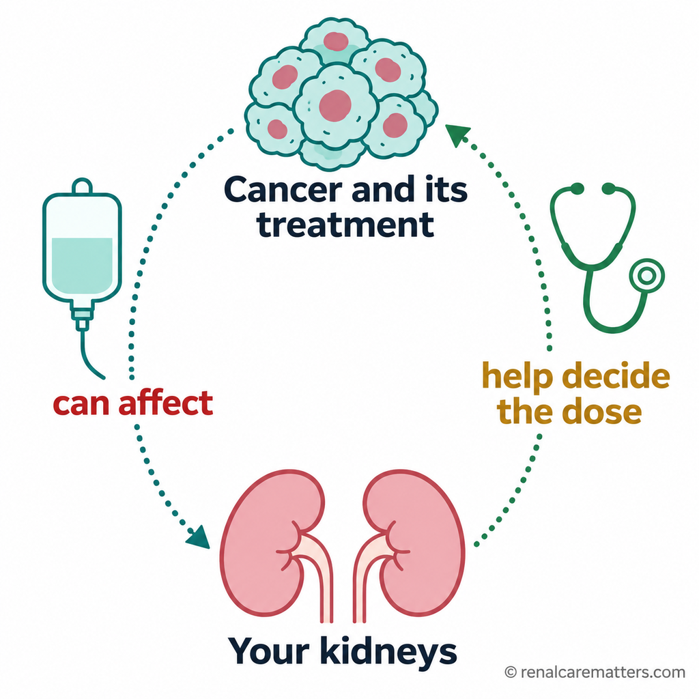
  </picture>
  <figcaption>
    <p class="fig-desc"><span data-lang="en">A two-way street: cancer and its treatment can affect the kidneys, and kidney health helps decide the treatment dose.</span><span data-lang="tl" class="lang-hidden">Dalawang-direksyong daan: maaaring makaapekto sa bato ang kanser at ang gamutan nito, at nakatutulong ang kalusugan ng bato sa pagpapasya ng dosis.</span><span data-lang="ceb" class="lang-hidden">Duha ka direksyon nga dalan: mahimong makaapekto sa bato ang kanser ug ang pagtambal niini, ug makatabang ang kahimsog sa bato sa pagdesisyon sa dosis.</span><span data-lang="kap" class="lang-hidden">Adwang direksyung dalan: malyaring makaapektu king batu ing kanser at ing pamanulu na, at makasaup ing kalusugan ning batu king pamagpasya king dosis.</span></p>
  </figcaption>
</figure>
```

### 08 → `#cancer-itself`, after the bulleted list

```html
<figure class="oc-fig">
  <picture>
    <source srcset="../images/onconephrology-chemotherapy-kidney-08-cancer-itself.webp" type="image/webp">
    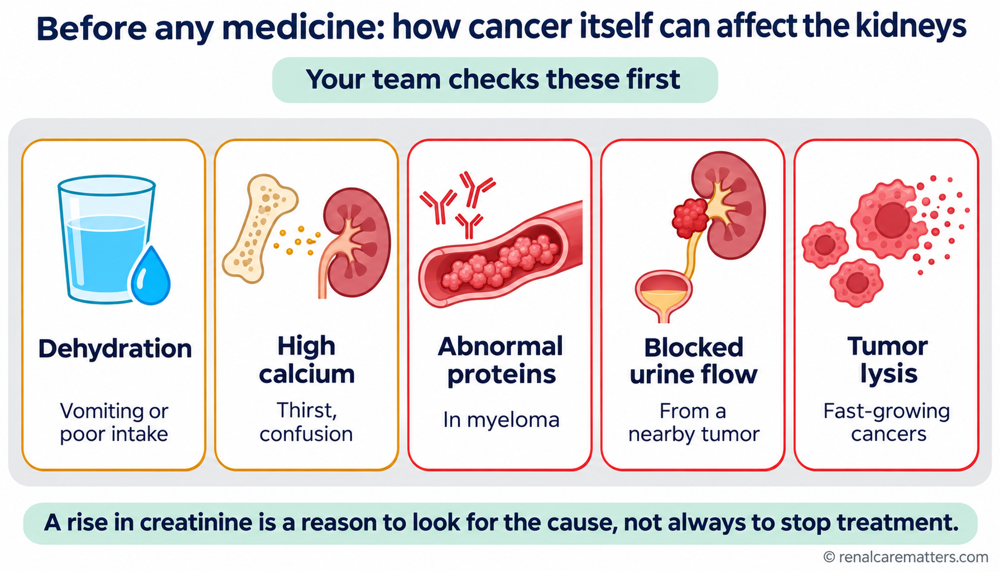
  </picture>
  <figcaption>
    <p class="fig-desc"><span data-lang="en">Before blaming the medicine, your team looks for these five causes that come from the cancer itself.</span><span data-lang="tl" class="lang-hidden">Bago sisihin ang gamot, hinahanap ng team ang limang sanhing ito na galing sa kanser mismo.</span><span data-lang="ceb" class="lang-hidden">Sa dili pa basolon ang tambal, pangitaon sa team kining lima ka hinungdan nga gikan sa kanser mismo.</span><span data-lang="kap" class="lang-hidden">Bayu sisisan ing gamut, panintunan ning team deng limang sanhi a iti a manibat king kanser mismu.</span></p>
  </figcaption>
</figure>
```

### 09 → `#before-treatment`, after the "Why a 'normal' creatinine can mislead" paragraph

```html
<figure class="oc-fig">
  <picture>
    <source srcset="../images/onconephrology-chemotherapy-kidney-09-creatinine-trap.webp" type="image/webp">
    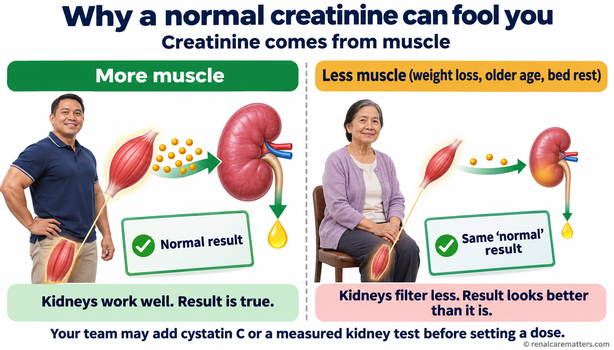
  </picture>
  <figcaption>
    <p class="fig-desc"><span data-lang="en">Creatinine comes from muscle. With less muscle, the same "normal" result can hide weaker kidneys, so your team may add cystatin C or a measured kidney test.</span><span data-lang="tl" class="lang-hidden">Galing sa kalamnan ang creatinine. Kapag kaunti ang kalamnan, maaaring maitago ng parehong "normal" na resulta ang mas mahinang bato, kaya maaaring magdagdag ang team ng cystatin C o measured na test ng bato.</span><span data-lang="ceb" class="lang-hidden">Gikan sa kaunoran ang creatinine. Kung gamay ang kaunoran, mahimong matago sa samang "normal" nga resulta ang mas huyang nga bato, busa mahimong modugang ang team og cystatin C o measured nga test sa bato.</span><span data-lang="kap" class="lang-hidden">Manibat king laman ing creatinine. Nung kaunti ing laman, malyaring matagu ning pareung "normal" a resulta ing mas makayang batu, kaya malyaring magdagdag ing team cystatin C o measured a test ning batu.</span></p>
  </figcaption>
</figure>
```

### 10 → `#before-treatment`, directly before the test table

```html
<figure class="oc-fig">
  <picture>
    <source srcset="../images/onconephrology-chemotherapy-kidney-10-cycle-check.webp" type="image/webp">
    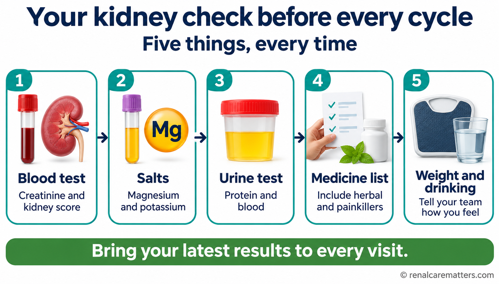
  </picture>
  <figcaption>
    <p class="fig-desc"><span data-lang="en">Five checks before every cycle: blood test, salts, urine, your medicine list, and your weight and drinking.</span><span data-lang="tl" class="lang-hidden">Limang pagsusuri bago ang bawat cycle: blood test, mga asin, ihi, listahan ng gamot, at timbang at pag-inom.</span><span data-lang="ceb" class="lang-hidden">Lima ka pagsusi sa dili pa ang matag cycle: blood test, mga asin, ihi, listahan sa tambal, ug timbang ug pag-inom.</span><span data-lang="kap" class="lang-hidden">Limang pamanuyu bayu ing balang cycle: blood test, deng asin, ihi, listahan ning gamut, at timbang at paminum.</span></p>
    <dl class="fig-abbrevs"><dt>Mg</dt><dd>Magnesium</dd></dl>
  </figcaption>
</figure>
```

### 11 → `#higher-risk-drugs`, directly before the medicines table

```html
<figure class="oc-fig">
  <picture>
    <source srcset="../images/onconephrology-chemotherapy-kidney-11-three-ways.webp" type="image/webp">
    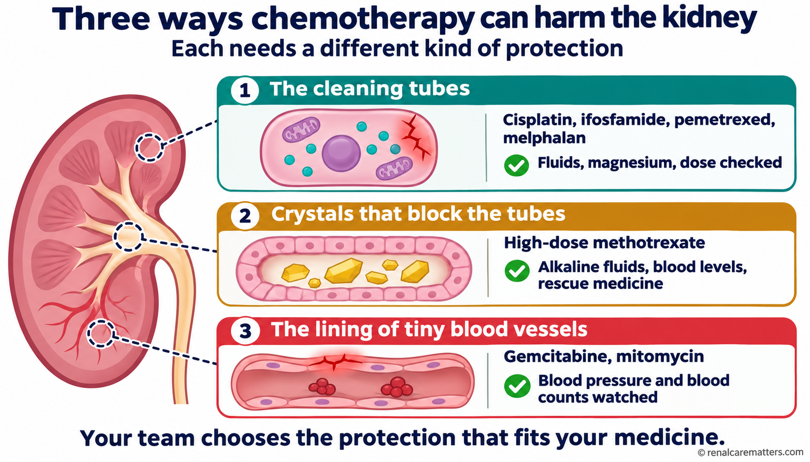
  </picture>
  <figcaption>
    <p class="fig-desc"><span data-lang="en">Three ways chemotherapy can harm the kidney, and the protection your team uses for each.</span><span data-lang="tl" class="lang-hidden">Tatlong paraan na maaaring makapinsala ang chemotherapy sa bato, at ang proteksyong ginagamit ng team para sa bawat isa.</span><span data-lang="ceb" class="lang-hidden">Tulo ka paagi nga makadaot ang chemotherapy sa bato, ug ang proteksyon nga gigamit sa team para sa matag usa.</span><span data-lang="kap" class="lang-hidden">Atlung paralan a malyaring makasira ing chemotherapy king batu, at ing proteksyun a gagamitan ning team para king balang metung.</span></p>
  </figcaption>
</figure>
```

### 12 → `#ckd-dialysis`, after the bulleted list

```html
<figure class="oc-fig">
  <picture>
    <source srcset="../images/onconephrology-chemotherapy-kidney-12-dialysis-timing.webp" type="image/webp">
    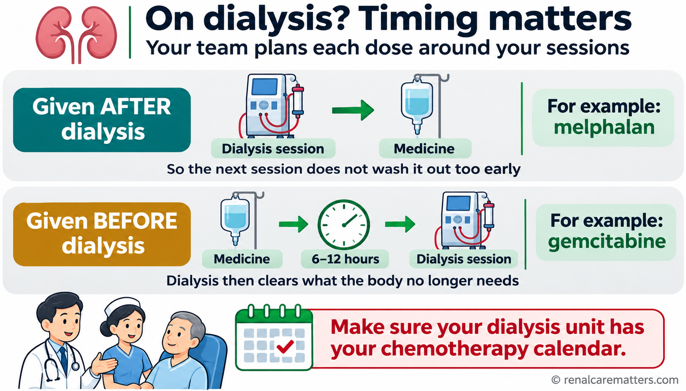
  </picture>
  <figcaption>
    <p class="fig-desc"><span data-lang="en">On dialysis, some medicines are given after the session and others before it. Make sure your dialysis unit has your chemotherapy calendar.</span><span data-lang="tl" class="lang-hidden">Kapag nagda-dialysis, ibinibigay ang ilang gamot pagkatapos ng session at ang iba ay bago ito. Tiyaking may kopya ng kalendaryo ng chemotherapy ang dialysis unit mo.</span><span data-lang="ceb" class="lang-hidden">Kung nag-dialysis, ihatag ang pipila ka tambal human sa session ug ang uban sa wala pa. Siguroha nga adunay kopya sa kalendaryo sa chemotherapy ang imong dialysis unit.</span><span data-lang="kap" class="lang-hidden">Nung magdialysis ka, ibibie ing pilan a gamut kaibat ning session at ing aliwa bayu na. Siguraduan a atin kopya ning kalendaryu ning chemotherapy ing dialysis unit mu.</span></p>
  </figcaption>
</figure>
```

### 13 → `#protect`, after the Do/Avoid cards (`</div>` closing `.oc-two`)

```html
<figure class="oc-fig">
  <picture>
    <source srcset="../images/onconephrology-chemotherapy-kidney-13-protect-do-avoid.webp" type="image/webp">
    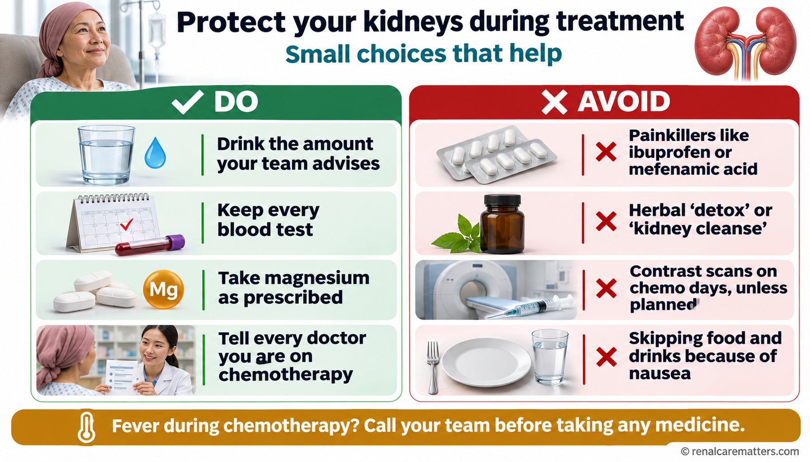
  </picture>
  <figcaption>
    <p class="fig-desc"><span data-lang="en">Small choices that protect your kidneys during treatment. If you get a fever, call your team before taking any medicine.</span><span data-lang="tl" class="lang-hidden">Maliliit na pagpili na nagpoprotekta sa bato habang ginagamot. Kapag nilagnat, tawagan muna ang team bago uminom ng anumang gamot.</span><span data-lang="ceb" class="lang-hidden">Gagmay nga pagpili nga manalipod sa bato samtang gitambalan. Kung hilantan, tawagi una ang team sa dili pa moinom og bisan unsang tambal.</span><span data-lang="kap" class="lang-hidden">Malating pamamili a protektan na ing batu kabang gagamutan. Nung lagnatan ka, tawagan mu pamu ing team bayu uminum anumang gamut.</span></p>
    <dl class="fig-abbrevs"><dt>Mg</dt><dd>Magnesium</dd></dl>
  </figcaption>
</figure>
```

### 14 → `#after-treatment`, after the second paragraph

```html
<figure class="oc-fig oc-fig-square">
  <picture>
    <source srcset="../images/onconephrology-chemotherapy-kidney-14-after-treatment-loop.webp" type="image/webp">
    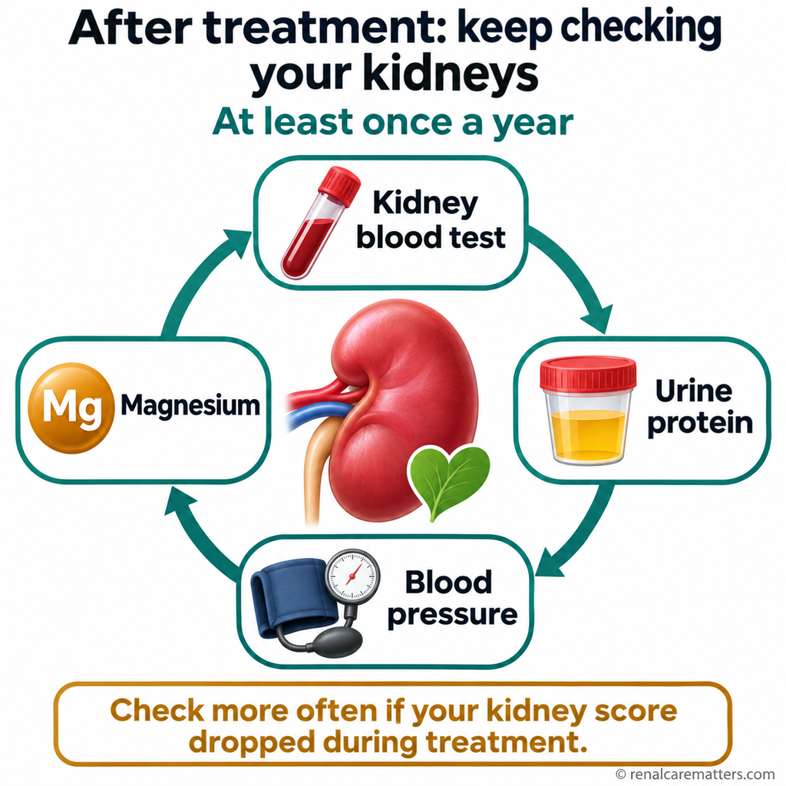
  </picture>
  <figcaption>
    <p class="fig-desc"><span data-lang="en">After treatment, check your kidneys at least once a year, and more often if your kidney score dropped during treatment.</span><span data-lang="tl" class="lang-hidden">Pagkatapos ng gamutan, ipasuri ang bato kahit isang beses kada taon, at mas madalas kung bumaba ang kidney score habang ginagamot.</span><span data-lang="ceb" class="lang-hidden">Human sa pagtambal, ipasusi ang bato labing menos kausa matag tuig, ug mas kanunay kung mikunhod ang kidney score samtang gitambalan.</span><span data-lang="kap" class="lang-hidden">Kaibat ning pamanulu, ipasuyu ing batu agyang misan king metung a banwa, at mas malimit nung mibaba ing kidney score kabang gagamutan.</span></p>
    <dl class="fig-abbrevs"><dt>Mg</dt><dd>Magnesium</dd></dl>
  </figcaption>
</figure>
```

### 15 → `#screening`, after the first paragraph

```html
<figure class="oc-fig">
  <picture>
    <source srcset="../images/onconephrology-chemotherapy-kidney-15-smarter-screening.webp" type="image/webp">
    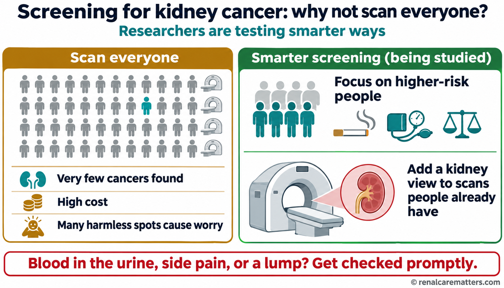
  </picture>
  <figcaption>
    <p class="fig-desc"><span data-lang="en">Scanning everyone finds very few kidney cancers. Researchers are testing smarter ways, such as focusing on higher-risk people.</span><span data-lang="tl" class="lang-hidden">Iilang kanser sa bato ang nakikita kapag ini-scan ang lahat. Sinusubukan ng mga mananaliksik ang mas matalinong paraan, gaya ng pagtuon sa mas mataas ang panganib.</span><span data-lang="ceb" class="lang-hidden">Gamay ra nga kanser sa bato ang makit-an kung i-scan ang tanan. Gisulayan sa mga tigsiksik ang mas maalamon nga paagi, sama sa pagtutok sa mas taas og peligro.</span><span data-lang="kap" class="lang-hidden">Kakaunting kanser king batu ing akakit nung i-scan ing eganaga. Subukan dareng mananaliksik ing mas matalinung paralan, anti ing pamagtuon kareng mas matas ing panganib.</span></p>
  </figcaption>
</figure>
```

### 16 → `#md-methotrexate`, after the **Physiology** paragraph

```html
<figure class="oc-fig">
  <picture>
    <source srcset="../images/onconephrology-chemotherapy-kidney-16-mtx-crystals-rescue.webp" type="image/webp">
    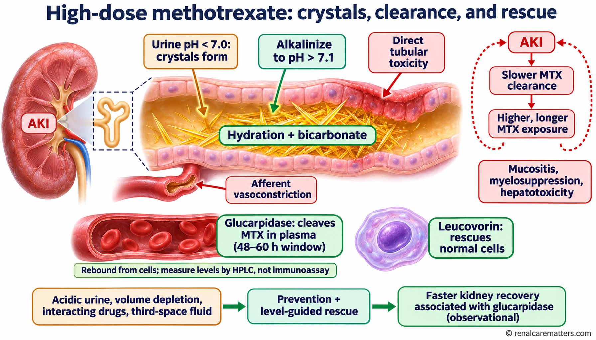
  </picture>
  <figcaption>
    <p class="fig-desc">High-dose methotrexate AKI is self-reinforcing: crystals and tubular toxicity slow clearance, which prolongs exposure. Alkaline hydration prevents crystals, glucarpidase cleaves plasma drug, and leucovorin rescues normal cells.</p>
    <dl class="fig-abbrevs"><dt>AKI</dt><dd>Acute kidney injury</dd><dt>MTX</dt><dd>Methotrexate</dd><dt>HPLC</dt><dd>High-performance liquid chromatography</dd></dl>
  </figcaption>
</figure>
```

### 17 → `#md-methotrexate`, after the checklist (`.algo-card`)

```html
<figure class="oc-fig">
  <picture>
    <source srcset="../images/onconephrology-chemotherapy-kidney-17-hdmtx-timeline.webp" type="image/webp">
    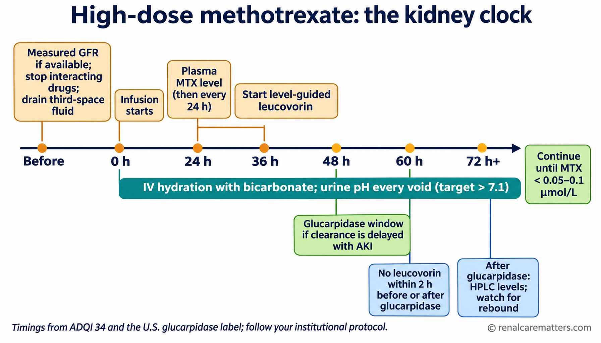
  </picture>
  <figcaption>
    <p class="fig-desc">The kidney clock for high-dose methotrexate: what to do before infusion, at 24 hours, and in the 48–60 hour glucarpidase window.</p>
    <dl class="fig-abbrevs"><dt>GFR</dt><dd>Glomerular filtration rate</dd><dt>MTX</dt><dd>Methotrexate</dd><dt>AKI</dt><dd>Acute kidney injury</dd><dt>HPLC</dt><dd>High-performance liquid chromatography</dd><dt>IV</dt><dd>Intravenous</dd></dl>
  </figcaption>
</figure>
```

### 18 → `#md-tma`, after the first paragraph

```html
<figure class="oc-fig">
  <picture>
    <source srcset="../images/onconephrology-chemotherapy-kidney-18-tma-type1-type2.webp" type="image/webp">
    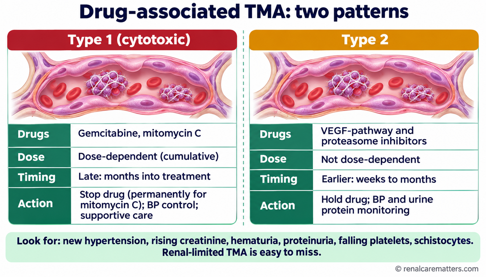
  </picture>
  <figcaption>
    <p class="fig-desc">Type 1 TMA (gemcitabine, mitomycin C) is dose-dependent and appears late; type 2 (VEGF-pathway and proteasome inhibitors) is not dose-dependent and appears earlier.</p>
    <dl class="fig-abbrevs"><dt>TMA</dt><dd>Thrombotic microangiopathy</dd><dt>VEGF</dt><dd>Vascular endothelial growth factor</dd><dt>BP</dt><dd>Blood pressure</dd></dl>
  </figcaption>
</figure>
```

### 19 → `#md-other-classes`, after the intro paragraph

```html
<figure class="oc-fig">
  <picture>
    <source srcset="../images/onconephrology-chemotherapy-kidney-19-beyond-cytotoxics.webp" type="image/webp">
    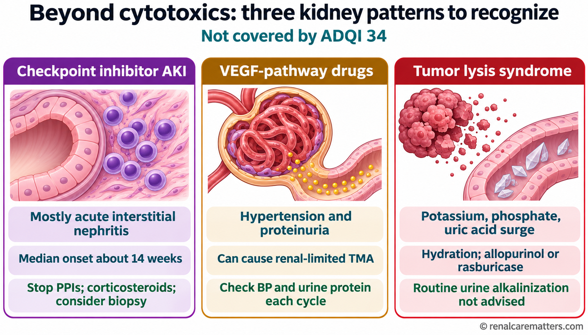
  </picture>
  <figcaption>
    <p class="fig-desc">Three kidney patterns outside ADQI 34: checkpoint inhibitor interstitial nephritis, VEGF-pathway hypertension and proteinuria, and tumor lysis syndrome.</p>
    <dl class="fig-abbrevs"><dt>ADQI</dt><dd>Acute Disease Quality Initiative</dd><dt>AKI</dt><dd>Acute kidney injury</dd><dt>PPI</dt><dd>Proton pump inhibitor</dd><dt>VEGF</dt><dd>Vascular endothelial growth factor</dd><dt>TMA</dt><dd>Thrombotic microangiopathy</dd><dt>BP</dt><dd>Blood pressure</dd></dl>
  </figcaption>
</figure>
```

### Square-figure CSS

The `.oc-fig-square` rule (caps 1:1 figures 07 and 14 at 520 px, centered) is already in the guide's second `<style>` block; no CSS change is needed when wiring.

---

## Part 4 — After generation

1. Save each PNG master to `images/` with the exact file name; create the WebP twin at the same pixel size (quality about 86).
2. Run the QC rules in 1.5. Keep the interim for 001, 006, 02, 03, 04, 05 until the generated version passes.
3. Wire the 13 new images with Part 3, then run `patch_image_lightbox.py`, `audit_acronym_expansion.py`, `validate_hero_grid.py`, and check dark mode.
4. Code-native interims and their source live in `image-prompts/onconephrology-chemotherapy-kidney-svg/` and stay in the repo as the fallback.
