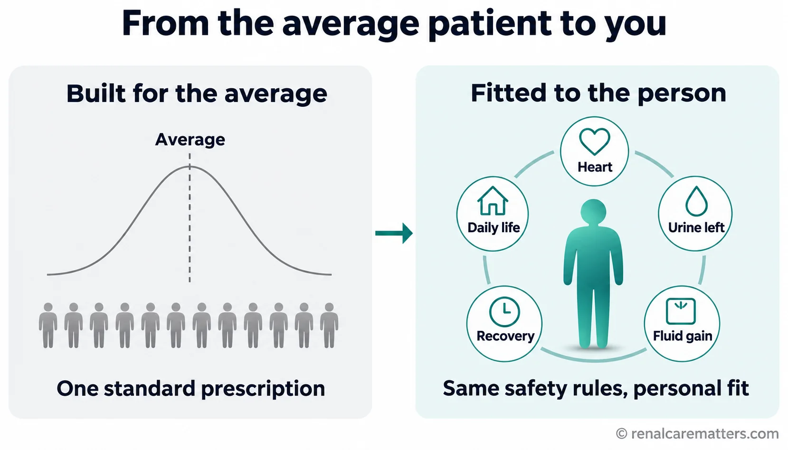

# Precision Dialysis — Image Plan Blueprint and GPT Prompt Pack

**Guide:** `guides/personalized-dialysis-care.html` — *Precision Dialysis: From the Average Patient to You* (patient) · *Precision Dialysis: Population Evidence, Person-Centered Delivery* (clinician)
**Prepared:** November 3, 2026 · renalcarematters.com
**Production target:** ChatGPT Image Generator GPT — https://chatgpt.com/g/g-pmuQfob8d-image-generator
**Skills applied:** williamriveromd-hero-vignette v3 · williamriveromd-infographic-skill v5 · williamriveromd-simple-figure · williamriveromd-biomedical-mechanism-figure · williamriveromd-algorithm-generator-skill · williamriveromd-local-image-generator (Stage 2 schema)

---

## Part A — Visual strategy

### A1. What the images must do

The guide's argument is a journey from the **population average** to the **person in the chair**, built on the lecture's **five domains** and its **before / during / after treatment** frame. The images carry that argument visually so a reader who only skims the pictures still gets it:

1. **The idea** — one average prescription versus one real person (concept figure).
2. **The physiology** — why fluid removal speed matters (patient analogy + clinician mechanism figure).
3. **The frame** — five domains and three treatment phases (radial + timeline).
4. **The action** — priority → plan, and protect remaining kidney function (patient figures).
5. **The proof** — what tailoring has and has not shown (clinician evidence map) and how to act on a concern (algorithm).

### A2. House rules applied to every prompt

- **Light backgrounds only** (white #ffffff, off-white #fafafa, light teal tint #eef6f7). Navy #0f1e2e and teal #1a6b72 are for text and accents, never fills behind the whole image.
- **One approved font, named in every prompt: Inter.** No serif or decorative type.
- **Attribution** "© renalcarematters.com" on every image except the wordless hero vignette (hero-vignette v3 forbids baked-in text). Bottom-right for landscape/square, bottom-center for portrait.
- **No invented numbers.** Every number printed on an image is either illustrative arithmetic labeled as such, or taken from a cited source in the guide's references.
- **Certainty on the image matches the guide.** Associations are labeled "linked with", pending trials "being tested", mechanism-only claims "proposed".
- **Filipino context** for people; American English for all on-image text.
- **Dialyzer anatomy:** no dialyzer or circuit appears in this set, so the hemofilter reference-anatomy rules are not triggered. If a model adds one unprompted, regenerate.
- **Text-heavy figures:** GPT renders labels imperfectly. Every asset below whose label is safety-critical (02, 07, 08, 11) already exists as an exact-text HTML-rendered version in the guide. Use the GPT version only if every label renders perfectly; otherwise keep the HTML version.

### A3. Asset map

| # | File stem | Type (skill) | Size | Section | Audience | Status |
|---|---|---|---|---|---|---|
| 00 | `personalized-dialysis-care-vignette-hero` | Circular vignette hero v3, Scaffold A (hero-vignette) | 2048 × 2048 | Hero (patient mode only) | Patients | **Replace interim placeholder** |
| 01 | `personalized-dialysis-care-og` | OG share card (infographic v5) | 1200 × 630 | `og:image` / `twitter:image` | All | GPT upgrade of HTML card |
| 02 | `personalized-dialysis-care-05-average-to-person` | Concept comparison (simple figure) | 1792 × 1024 | P1 *Why one plan does not fit everyone* | Patients | **New** |
| 03 | `personalized-dialysis-care-06-tub-and-sponge` | Analogy comparison (simple figure) | 1792 × 1024 | P1, after the bathtub paragraph | Patients | **New** |
| 04 | `personalized-dialysis-care-07-five-domains` | Radial circular workflow (infographic v5, Circular Diagram) | 1024 × 1024 | P1b *Five ways* and C0 *Lecture frame* | Mixed | **New** |
| 05 | `personalized-dialysis-care-01-goals-to-plan` | Step sequence (simple figure) | 1792 × 1024 | P2 *Your goal* | Patients | GPT upgrade of HTML figure |
| 06 | `personalized-dialysis-care-02-symptom-timing` | Three-phase timeline card (simple figure) | 1536 × 1152 | P3 *Tell your team when* | Patients | GPT upgrade, now matches the before/during/after table |
| 07 | `personalized-dialysis-care-08-protect-urine` | Comparison card (simple figure) | 1536 × 1152 | P4, residual-urine paragraph | Patients | **New** |
| 08 | `personalized-dialysis-care-03-time-fluid-rate` | Two-panel comparison (simple figure) | 1792 × 1024 | P4 and C2 | Mixed | GPT upgrade of HTML figure |
| 09 | `personalized-dialysis-care-09-plasma-refill-mechanism` | Review-article mechanism figure (biomedical-mechanism-figure) | 1792 × 1024 | C2 *Physiology* | Clinicians | **New** |
| 10 | `personalized-dialysis-care-10-evidence-map` | Clinician reference card (infographic v5) | 1536 × 1152 | C3 *Evidence* / C3b *Toolkit* | Clinicians | **New** |
| 11 | `personalized-dialysis-care-04-clinician-review` | House-style algorithm, Mode C (algorithm generator) | 1024 × 1536 | C7 *Symptom response* | Clinicians | GPT upgrade of HTML figure |
| 12 | `personalized-dialysis-care-11-four-claims` | Horizontal step chain (simple figure) | 1792 × 1024 | C8 *Digital tools* | Clinicians | **New** |

**Production order:** 00 → 01 → 02 → 03 → 09 → 04 → 10 → 07 → 12, then the optional GPT upgrades 05, 06, 08, 11.

### A4. Visual rhythm across the page

Patient tab: hero photo → concept (02) → analogy (03) → radial (04) → steps (05) → timeline (06) → card (07) → comparison (08). The figure types rotate so no two adjacent figures look alike. Clinician tab: radial (04) → mechanism (09) → comparison (08) → evidence map (10) → algorithm (11) → chain (12).

### A5. Placement markup (paste after generation)

Every inline figure uses the house pattern. Example for asset 02:

```html
<figure class="pdc-fig">
  <picture>
    <source srcset="../images/personalized-dialysis-care-05-average-to-person.webp" type="image/webp">
    
  </picture>
  <figcaption>
    <p class="fig-desc">[4-language caption spans]</p>
    <!-- add <dl class="fig-abbrevs"> when the image shows an abbreviation -->
    <span class="fig-copy">© renalcarematters.com</span>
  </figcaption>
</figure>
```

Save each output as `images/<stem>.png` plus a WebP twin (`images/<stem>.webp`, quality about 85). The OG card stays PNG only. Re-run `patch_hero_fetchpriority.py`, `patch_image_lightbox.py` and `patch_img_dimensions.py` after wiring.

### A6. Hero variation record

The interim hero placeholder is an illustrated card, drop and clock. The v1 prompt specified a woman in her early forties with glasses and a rust blouse plus a female nurse. Asset 00 below deliberately changes the cast, setting, camera and archetype so it reads as a new guide, not a repeat. Before generating, compare it with the heroes of `post-dialysis-fatigue`, `dialysis-cramps-stasis-pigmentation` and `dry-weight-determination`. If any of them is too close, change the hero's age, clothing and posture.

---

## Part B — Copy-ready GPT prompts

Paste each **PROMPT** block into the Image Generator GPT, together with its **NEGATIVE INSTRUCTIONS**. Generate one asset per chat turn.

---

### IMAGE 00 — Hero vignette

```
IMAGE NUMBER: 00
SECTION PLACEMENT: Hero — figure.hero-figure.mode-patient > .hero-vignette (patient mode only)
FILE NAME: personalized-dialysis-care-vignette-hero.png
IMAGE TYPE: Circular vignette hero v3 — Scaffold A (people)
ARCHETYPE: J — Environmental Storytelling (one cohesive scene, no floating panels)
CAMERA: low three-quarter angle from the foot of the dialysis chair, looking slightly up toward the patient
HUMAN VARIATION (vs. previous dialysis heroes): male patient; late fifties; lean build; long oval face; prominent cheekbones; short salt-and-pepper hair with receding hairline; thin gray mustache; deep-brown skin; olive-green polo shirt; wristwatch; relaxed seated posture with one hand raised mid-explanation; engaged, thoughtful expression; nurse is a young Filipina Muslim nurse in a soft-gray hijab and white scrubs, kneeling at eye level; in-center dialysis setting instead of a consultation room
AUDIENCE: Patients and families
ASPECT RATIO: 1:1
PIXEL DIMENSIONS: 2048 × 2048
VISUAL MIX: photorealistic models 100%
PURPOSE: Show that precision dialysis starts with the person in the chair explaining what matters to him, and a nurse listening at eye level.
KEY CONCEPTS: the person, not the average; listening; shared plan; in-center dialysis.
```

**PROMPT**

```
Square 1:1 photorealistic editorial photograph on a 2048×2048 canvas, composed to be displayed inside a CIRCULAR vignette occupying 85–90% of the canvas diameter with a visible WHITE BORDER around the full circle (the circle must never touch the canvas edges). Composition archetype: J — Environmental Storytelling, one cohesive scene. Camera: low three-quarter angle from the foot of a dialysis recliner, looking slightly up.

Subject: a Filipino man in his late fifties — lean build, long oval face, prominent cheekbones, short salt-and-pepper hair with a receding hairline, thin gray mustache, deep-brown skin, olive-green polo shirt, simple wristwatch — sits comfortably in a light-gray dialysis recliner in a bright, clean, modern Philippine in-center dialysis unit. One hand is raised mid-sentence as he explains something that matters to him; his expression is engaged and thoughtful, not sad. A young Filipina Muslim dialysis nurse in a soft-gray hijab and white scrubs kneels beside the chair at his eye level, listening attentively, holding a blank clipboard against her knee. A light knit blanket covers his lap and arm; no needles, tubing or blood lines are visible. The dialysis machine is only a soft, out-of-focus pale shape in the far background, with no readable screen.

Visual hierarchy: the two people and their exchange occupy 60–70% of the circle, placed in the lower-right two-thirds; 2–3 supporting context elements (window daylight, a small potted plant, the blurred row of recliners) fill 20–30%; the upper-left 20–25% of the circle is a TITLE SAFE ZONE of soft, blurred pale wall and window light with no faces, objects or details.

Soft natural daylight, gentle shallow depth of field, calm documentary-realistic color grade harmonizing with clinical teal #1a6b72 and warm neutrals on a light background. Slight edge falloff toward the rim. Full-bleed within the inscribed circle, no rectangular borders, frames or banners. Absolutely NO text of any kind: no title, caption, label, logo, signage, screen text or watermark.
```

**NEGATIVE INSTRUCTIONS:** busy layouts; collage; more than four supporting elements; tiny unreadable details; duplicated people; cropped circle; objects touching the circular border; content inside the title-safe zone; baked-in text, titles, captions, logos, watermarks or readable screens; visible needles, blood, tubing or connected dialysis circuit; rectangular borders; dark, charcoal or moody backgrounds; cartoon style, neon, HDR, oversaturation; distorted hands or faces; stock-photo smiles at the camera.

**QUALITY CHECK:** Square 2048×2048. Circle at 85–90% of the canvas with a visible white margin, never cropped. Upper-left title-safe zone empty. Hands anatomically correct (count fingers). Hijab worn naturally and respectfully. No readable text anywhere. At least 12 traits differ from the previous dialysis heroes.

**ALT TEXT:** A Filipino man in a dialysis chair explains what matters to him while a nurse kneels beside him and listens.
**CAPTION (fig-desc):** Precision dialysis starts with the person in the chair.
**OG WIDTH / HEIGHT:** n/a (separate OG asset 01)

---

### IMAGE 01 — OG share card

```
IMAGE NUMBER: 01
SECTION PLACEMENT: <head> og:image and twitter:image (absolute URL https://renalcarematters.com/images/personalized-dialysis-care-og.png)
FILE NAME: personalized-dialysis-care-og.png
IMAGE TYPE: OG / social share card (infographic v5)
AUDIENCE: All
ASPECT RATIO: 1.91:1
PIXEL DIMENSIONS: 1200 × 630 (fixed — never change)
VISUAL MIX: 2D infographic 55%, 3D component graphics 45%
PURPOSE: A share card that states the title and the core idea at thumbnail size.
KEY CONCEPTS: from many identical figures to one person; precision dialysis.
```

**PROMPT**

```
Clean premium medical editorial social share card, exactly 1200×630 pixels, off-white #fafafa background. Typography in Inter only.

Left 55%: small uppercase kicker in clinical teal #1a6b72, letter-spaced: "RENAL CARE MATTERS · DIALYSIS". Below it the large bold headline in navy #0f1e2e on two lines: "Precision Dialysis". Under it, a teal subheadline: "From the average patient to you". A short teal horizontal rule. Then one line in dark slate: "Population evidence • Person-centered delivery". Generous margins; all text inside the central mobile-safe area, at least 60 px from every edge.

Right 45%: a calm semi-3D graphic on the same light background — a soft row of eight identical pale-gray human silhouettes fading into the background on the far right, with ONE silhouette in front rendered in solid clinical teal, slightly larger, softly lit, with a subtle teal halo, as if stepping out of the crowd. Minimal, elegant, plenty of negative space; no medical equipment.

Bottom-right corner: small legible text "renalcarematters.com" in navy at about 70% opacity.
```

**NEGATIVE INSTRUCTIONS:** No dark or navy background fill. No logos of ASN or any organization; no suggestion of endorsement. No extra words beyond the exact text given. No misspellings. No serif fonts. No photographs of real people. No clutter or icons. No text closer than 60 px to the edges.

**QUALITY CHECK:** Exactly 1200×630. Headline readable at 300 px wide. All text spelled exactly as given. Only one teal figure. Light background.

**ALT TEXT:** Precision Dialysis — from the average patient to you. One teal figure steps forward from a row of gray silhouettes.
**OG WIDTH:** 1200 · **OG HEIGHT:** 630

---

### IMAGE 02 — From the average patient to the person

```
IMAGE NUMBER: 02
SECTION PLACEMENT: Patient P1 #pt-why, after the first paragraph
FILE NAME: personalized-dialysis-care-05-average-to-person.png
IMAGE TYPE: Single side-by-side comparison (simple figure)
AUDIENCE: Patients and families
ASPECT RATIO: 16:9
PIXEL DIMENSIONS: 1792 × 1024
VISUAL MIX: 2D infographic 70%, 3D component graphics 30%
PURPOSE: Make the lecture's central idea visible: a standard plan is built for an average; each person differs.
KEY CONCEPTS: population average; individual signals; same rules, personal fit.
```

**PROMPT**

```
Clean educational comparison figure, 16:9, 1792×1024, white background, renalcarematters.com house style, Inter typography, navy #0f1e2e text, clinical teal #1a6b72 accents, generous whitespace.

Title at top center in bold navy: "From the average patient to you".

LEFT PANEL (soft gray card #f3f4f6), heading "Built for the average": a smooth, simple bell-shaped curve drawn in thin gray line, with a single dashed vertical line at its peak labeled "Average". Under the curve, a neat row of twelve identical small gray human silhouettes. Below, one short line: "One standard prescription".

A thin teal arrow points from the left panel to the right panel.

RIGHT PANEL (light teal card #eef6f7), heading "Fitted to the person": one larger, softly shaded teal human figure in the center, surrounded by five small, clean line icons on a gentle circle, each with a one-to-three-word label: a heart icon "Heart", a water-drop icon "Urine left", a scale icon "Fluid gain", a clock icon "Recovery", a house icon "Daily life". Below, one short line: "Same safety rules, personal fit".

Bottom-right: small text "© renalcarematters.com" in gray at 70% opacity.
```

**NEGATIVE INSTRUCTIONS:** No numbers or axis values on the curve; no statistics. No dialysis machine, needles or anatomy. No cartoon faces; silhouettes stay simple and dignified. No dark background. No extra text beyond the labels given. Avoid clutter, tiny labels and AI gibberish text.

**QUALITY CHECK:** All labels spelled exactly. Five icons, five labels. The left panel looks uniform; the right panel looks individual. Readable on a phone.

**ALT TEXT:** Left, identical gray figures under an average curve; right, one teal figure surrounded by personal factors: heart, urine left, fluid gain, recovery and daily life.
**CAPTION (fig-desc):** A standard prescription is designed for an average patient. Precision dialysis keeps the safety rules and fits the plan to your own body and life.

---

### IMAGE 03 — The bathtub and the sponge

```
IMAGE NUMBER: 03
SECTION PLACEMENT: Patient P1 #pt-why, after the bathtub-and-sponge paragraph
FILE NAME: personalized-dialysis-care-06-tub-and-sponge.png
IMAGE TYPE: Single analogy comparison (simple figure)
AUDIENCE: Patients and families
ASPECT RATIO: 16:9
PIXEL DIMENSIONS: 1792 × 1024
VISUAL MIX: 2D infographic 50%, 3D component graphics 50%
PURPOSE: Explain plasma refill without jargon: the machine drains the blood (tub) while the tissues (sponge) refill it at their own speed.
KEY CONCEPTS: fluid lives in tissues; removal from blood; refill speed differs per person.
```

**PROMPT**

```
Clean medical teaching illustration, 16:9, 1792×1024, white background, Inter typography, navy #0f1e2e text, clinical teal #1a6b72 water, soft semi-3D rendering, calm and uncluttered.

Title at top left in bold navy: "Why fluid removal speed matters".

Two panels side by side, each showing the same simple scene: a clean white bathtub filled with light-teal water (labeled "Your blood"), a large soft yellow sponge resting on the tub's edge and dripping water back into the tub (labeled "Your tissues"), and a drain at the bottom of the tub with a small tap-style valve (labeled "Dialysis").

LEFT PANEL, green-tinted heading "Removal matches refill": the drain flows gently with thin arrows; the sponge drips steadily; the tub's water level stays comfortably high. Small caption under it: "Blood pressure stays steady".

RIGHT PANEL, amber-tinted heading "Removal faster than refill": the drain flows fast with thick arrows; the sponge still looks wet and drips at the same steady pace; the tub's water level is visibly low. Small caption under it: "Blood pressure can drop · cramps · dizziness".

Bottom center, one line in navy: "Your team sets how fast fluid comes out."
Bottom-right: "© renalcarematters.com" in gray at 70% opacity.
```

**NEGATIVE INSTRUCTIONS:** No human body, anatomy, blood or needles. No numeric rates. No red danger symbols or alarm icons. No dark background. No cartoon faces on the sponge or tub. No extra text. Avoid clutter and AI gibberish text.

**QUALITY CHECK:** The sponge is equally wet in both panels and only the drain speed differs. Water level clearly lower on the right. Labels exact and readable on a phone.

**ALT TEXT:** Two bathtubs refilled by a wet sponge. When the drain is gentle the water stays high; when it drains fast the water drops even though the sponge is still wet.
**CAPTION (fig-desc):** Dialysis removes fluid from your blood, while your tissues refill it at their own speed. Removing it faster than they refill can drop your blood pressure.

---

### IMAGE 04 — Five domains of precision dialysis

```
IMAGE NUMBER: 04
SECTION PLACEMENT: Patient P1b #pt-five (above the table) and Clinician C0 #md-frame
FILE NAME: personalized-dialysis-care-07-five-domains.png
IMAGE TYPE: Circular workflow / radial diagram (infographic v5)
AUDIENCE: Mixed
ASPECT RATIO: 1:1
PIXEL DIMENSIONS: 1024 × 1024
VISUAL MIX: 2D infographic 85%, 3D component graphics 15%
PURPOSE: Show the lecture's five domains around the person, with an honest status for each.
KEY CONCEPTS: five domains; the person at the center; available now vs being studied.
```

**PROMPT**

```
Clean radial infographic, square 1024×1024, white background, Inter typography, navy #0f1e2e text, clinical teal #1a6b72 accents, generous margins.

Center: a soft teal circle containing a simple, dignified human figure icon and the label "You".

Around it, five evenly spaced rounded cards connected to the center by thin teal lines, clockwise from the top:
1. "Choosing your treatment" — small icon: three branching paths.
2. "Your body's own signals" — small icon: a heart with a water drop.
3. "Measurements and access" — small icon: a simple arm with a fistula outline and a checklist.
4. "Data and monitoring" — small icon: a simple line chart.
5. "The whole person" — small icon: a house with two people.

Under each card title, a small status pill: cards 1, 3 and 5 show a green pill "Available now"; card 2 shows an amber pill "Partly — genetics still research"; card 4 shows an amber pill "Benefit still being tested".

Small title at the top: "Five areas of precision dialysis".
Bottom-center: "© renalcarematters.com" in gray at 70% opacity.
```

**NEGATIVE INSTRUCTIONS:** No DNA helix imagery suggesting genetic testing is routine. No numbers or percentages. No dark background. No clutter or tiny labels. No extra words. No cartoon style.

**QUALITY CHECK:** Five cards in the stated order, each status pill matching the guide's table. Readable at 360 px wide.

**ALT TEXT:** Five areas of precision dialysis around the patient: choosing treatment, body signals, measurements and access, data and monitoring, and the whole person, each marked with its current status.
**CAPTION (fig-desc):** Five areas where dialysis can be fitted to you. Three are available in most units now; two are still being studied.

---

### IMAGE 05 — Turn a priority into a plan (GPT upgrade)

```
IMAGE NUMBER: 05
SECTION PLACEMENT: Patient P2 #pt-goal (replaces HTML-rendered version only if all text renders perfectly)
FILE NAME: personalized-dialysis-care-01-goals-to-plan.png
IMAGE TYPE: Step sequence, 4 steps (simple figure)
AUDIENCE: Patients
ASPECT RATIO: 16:9
PIXEL DIMENSIONS: 1792 × 1024
VISUAL MIX: 2D infographic 80%, photorealistic models 20%
PURPOSE: Show that a useful plan links a priority, a concern, an action with an owner, and a review.
KEY CONCEPTS: priority; concern; agreed action; review.
```

**PROMPT**

```
Calm educational step sequence, 16:9, 1792×1024, white background, Inter typography, navy #0f1e2e headings, soft light-teal cards #eef6f7, thin teal arrows.

Title at top center in bold navy: "Turn a priority into a plan". Subtitle in slate: "Personal dialysis care, one step at a time".

Four equal rounded cards in a horizontal row, joined by thin teal arrows. Each card has a small navy number badge, a small circular photographic vignette at the top, a bold heading and one short line:
1. Vignette: a Filipino grandmother's hands holding a child's small hand. Heading "My priority". Line "What I want to keep doing".
2. Vignette: a tired person resting a hand on their forehead, calm and dignified. Heading "My concern". Line "What gets in the way".
3. Vignette: a dialysis nurse and a patient's hands pointing at a blank clipboard. Heading "Agreed action". Line "Who will do what".
4. Vignette: a wall calendar with one date circled, no readable text. Heading "Review together". Line "Did it help?"

Bottom-right: "© renalcarematters.com" in gray at 70% opacity.
```

**NEGATIVE INSTRUCTIONS:** No numeric clinical targets. No readable text inside the photo vignettes. No dark background. No extra words. Avoid clutter, tiny labels and AI gibberish text.

**QUALITY CHECK:** Exactly four cards with exact headings and lines. Photo vignettes small and consistent. Readable on a phone.

**ALT TEXT:** Four connected cards: My priority, My concern, Agreed action, Review together.
**CAPTION (fig-desc):** A useful plan links four things: what you want to keep doing, what gets in the way, who will do what, and a date to check whether it helped.

---

### IMAGE 06 — Before, during, after dialysis (GPT upgrade)

```
IMAGE NUMBER: 06
SECTION PLACEMENT: Patient P3 #pt-when (keep HTML version unless every label renders perfectly)
FILE NAME: personalized-dialysis-care-02-symptom-timing.png
IMAGE TYPE: Three-phase timeline card (simple figure)
AUDIENCE: Patients
ASPECT RATIO: 4:3
PIXEL DIMENSIONS: 1536 × 1152
VISUAL MIX: 2D infographic 100%
PURPOSE: Teach the lecture's before/during/after frame as the way to report a symptom.
KEY CONCEPTS: timing is a clue; what the team checks; what you report; report urgent symptoms now.
```

**PROMPT**

```
Clean clinical teaching card, 4:3, 1536×1152, white background, Inter typography, navy #0f1e2e text, clinical teal #1a6b72 accents.

Title top-left in bold navy: "Tell the team when it happens". Subtitle: "Timing is a clue to the cause".

A horizontal timeline arrow runs across the upper middle with three evenly spaced teal circular markers labeled "Before dialysis", "During dialysis" and "After dialysis". Under each marker, one light-teal rounded card with two short lines:
- Before: "Weight gain · breathing · urine you still pass"
- During: "Cramps · dizziness · nausea · chest discomfort"
- After: "Recovery time · dizziness standing · sleep"

Below the timeline, four large prompts in a 2×2 grid, each with a small navy question-mark badge: "What happened?", "When did it start?", "What did it stop you doing?", "Who did you tell?"

Near the bottom, a soft amber bar with bold dark-brown text: "Report new symptoms during treatment right away".
Under it, small slate text: "A discussion aid — not a scoring tool or a diagnosis."
Bottom-right: "© renalcarematters.com" in gray at 70% opacity.
```

**NEGATIVE INSTRUCTIONS:** No scores, scales or numbers. No emergency decision tree. No anatomy. No dark background. No extra words. Avoid tiny labels and AI gibberish text.

**QUALITY CHECK:** Three phases in order, four prompts, amber warning exact. Every word spelled exactly.

**ALT TEXT:** A timeline of before, during and after dialysis, with what to report in each phase and four questions about a symptom.
**CAPTION (fig-desc):** Timing and impact help your team connect a symptom to its cause. This card is a discussion aid, not a scoring tool or a diagnosis.

---

### IMAGE 07 — Protect the urine you still make

```
IMAGE NUMBER: 07
SECTION PLACEMENT: Patient P4 #pt-review, after the residual-urine paragraph
FILE NAME: personalized-dialysis-care-08-protect-urine.png
IMAGE TYPE: Comparison card (simple figure)
AUDIENCE: Patients and families
ASPECT RATIO: 4:3
PIXEL DIMENSIONS: 1536 × 1152
VISUAL MIX: 2D infographic 60%, 3D component graphics 40%
PURPOSE: Show why remaining kidney function is precious: it works around the clock, while dialysis works a few hours a week.
KEY CONCEPTS: residual kidney function; 168 hours vs about 12 hours; tell your team how much urine you pass.
```

**PROMPT**

```
Clean patient education card, 4:3, 1536×1152, off-white #fafafa background, Inter typography, navy #0f1e2e text, clinical teal #1a6b72 accents, soft semi-3D medical rendering.

Title at top in bold navy: "If you still pass urine, protect it".

Two side-by-side panels:
LEFT (light teal card): a calm semi-3D render of a pair of human kidneys in soft renal red with a small teal water-drop beneath them. Heading "Your own kidneys". Large number "168 hours" with the line "every hour of every week".
RIGHT (soft gray card): a simple, clean, generic dialysis-chair icon with no machine details. Heading "Dialysis". Large number "about 12 hours" with the line "a typical schedule of three 4-hour sessions".

Below both panels, one teal line: "Even a little remaining kidney function keeps working between sessions."
Then three small action chips with check icons: "Tell your team how much urine you pass", "Ask how your plan protects it", "Never skip sessions".

Bottom-right: "© renalcarematters.com" in gray at 70% opacity.
```

**NEGATIVE INSTRUCTIONS:** No blood, needles, dialysis circuit or dialyzer. No percentages or survival numbers. No dark background. No cartoon kidneys with faces. No extra words. Avoid AI gibberish text.

**QUALITY CHECK:** Numbers exactly "168 hours" and "about 12 hours" with the "three 4-hour sessions" qualifier. Kidneys anatomically plausible. Light background.

**ALT TEXT:** Your own kidneys work 168 hours a week, while a typical dialysis schedule gives about 12 hours, so remaining urine output is worth protecting.
**CAPTION (fig-desc):** Remaining kidney function works every hour of the week. Illustrative schedule: three 4-hour sessions. Tell your team how much urine you still pass.
**FIG-ABBREVS:** none

---

### IMAGE 08 — Same fluid goal, different times (GPT upgrade)

```
IMAGE NUMBER: 08
SECTION PLACEMENT: Patient P4 #pt-review and Clinician C2 #md-physiology (keep HTML version unless every number renders perfectly)
FILE NAME: personalized-dialysis-care-03-time-fluid-rate.png
IMAGE TYPE: Two-panel comparison (simple figure)
AUDIENCE: Mixed
ASPECT RATIO: 16:9
PIXEL DIMENSIONS: 1792 × 1024
VISUAL MIX: 2D infographic 70%, 3D component graphics 30%
PURPOSE: Show that fewer hours for the same fluid goal means faster hourly removal.
KEY CONCEPTS: illustrative arithmetic only; 70 kg; 2,000 mL; 4 h vs 3 h.
```

**PROMPT**

```
Two-panel medical teaching comparison, 16:9, 1792×1024, white background, Inter typography, navy #0f1e2e text, neutral teal #1a6b72 fills — no green/red safe/unsafe coding.

Title at top center in bold navy: "The same fluid goal over different times". Subtitle in slate: "Illustrative 70 kg example · average rate = fluid ÷ (weight × hours)".

Two equal outlined rounded panels side by side. Each contains: a heading ("4 hours" left, "3 hours" right) in teal; a clean semi-3D glass measuring container filled with light-teal fluid, labeled "2,000 mL" in its center; a horizontal row of equal navy time-blocks beneath it (four blocks on the left labeled 1 h to 4 h, three blocks on the right labeled 1 h to 3 h); and a bold navy result line: left "4 hours: about 7.1 mL/kg/hour", right "3 hours: about 9.5 mL/kg/hour".

Bottom center in dark amber-brown: "A calculation is not a prescription. Your team sets the plan."
Bottom-right: "© renalcarematters.com" in gray at 70% opacity.
```

**NEGATIVE INSTRUCTIONS:** No safe/unsafe thresholds, no green or red judgment colors, no anatomy, no tubing or dialyzer, no extra numbers. No dark background. Avoid AI gibberish text.

**QUALITY CHECK:** Numbers exactly 2,000 mL, 7.1 and 9.5 mL/kg/hour, 70 kg; four vs three time blocks.

**ALT TEXT:** The same 2,000 mL fluid goal gives about 7.1 mL/kg/hour over 4 hours and about 9.5 mL/kg/hour over 3 hours for an illustrative 70 kg person.
**CAPTION (fig-desc):** Same fluid goal, fewer hours, faster removal. This illustrative example is not a prescription and does not show a safe or unsafe rate.
**FIG-ABBREVS:** mL — milliliters · kg — kilograms · h — hour

---

### IMAGE 09 — Plasma refill and intradialytic hypotension (mechanism figure)

```
IMAGE NUMBER: 09
SECTION PLACEMENT: Clinician C2 #md-physiology, after "Ultrafiltration outruns plasma refill"
FILE NAME: personalized-dialysis-care-09-plasma-refill-mechanism.png
IMAGE TYPE: Review-article biomedical mechanism figure (biomedical-mechanism-figure)
AUDIENCE: Clinicians
ASPECT RATIO: 16:9
PIXEL DIMENSIONS: 1792 × 1024
VISUAL MIX: 2D infographic 70%, 3D component graphics 30%
PURPOSE: Show organ-to-capillary physiology linking ultrafiltration rate, plasma refill, hypotension, myocardial stunning and loss of residual function.
KEY CONCEPTS: Starling forces; refill rate; relative blood volume; cardiac reserve; stunning (proposed progression); residual kidney function.
```

**PROMPT**

```
Clean publication-grade biomedical mechanism figure in the style of a review-article schematic, 16:9, 1792×1024, white background, flat vector illustration with soft semi-3D shading, thin dashed boxes for magnified panels, muted clinical palette (light gray-blue anatomy, pale yellow highlights, red for injury and arterial side, blue for venous and protective effects, pale pink pathology box, pale blue benefit box). Clean sans-serif typography set in Inter. Short, precise labels.

LEFT PANEL — Organ-level context: a simplified human torso outline in light gray-blue showing the heart and both kidneys, with a forearm access drawn as a simple outline. A small label "Hemodialysis: fluid removed from plasma". A dashed connector box links the lower leg tissue to the central magnified panel.

CENTER PANEL (dashed border) — Magnified capillary and interstitium: a single capillary running horizontally between pale-yellow interstitial tissue. Arrows show fluid moving from the interstitium into the capillary labeled "Plasma refill". Small callouts on the capillary wall: "Hydrostatic pressure", "Oncotic pressure (albumin)", "Capillary permeability", "Tissue hydration". A larger downward arrow leaving the capillary labeled "Ultrafiltration".

RIGHT PANEL (dashed border) — Heart inset: a simplified heart with a thickened left ventricle, labels "↓ Relative blood volume", "↓ Coronary perfusion", "Regional wall-motion abnormality (stunning)". A smaller kidney icon beside it labeled "↓ Residual kidney function".

BOTTOM SUMMARY ROW, three boxes joined by arrows:
Pale pink box (left), title "When removal outruns refill": "Ultrafiltration rate > refill rate" · "Intradialytic hypotension" · "Repeated stunning — proposed path to fixed dysfunction".
Center box: "Individualized prescription" · "Session time and frequency" · "Accurate target weight" · "Sodium and fluid intake" · "Structured fluid assessment".
Pale blue box (right), title "Expected benefits": "Steadier blood pressure" · "Less cramping and recovery time" · "Residual function protected".

Small footnote at bottom-left in gray: "Mechanistic schematic — no universal ultrafiltration threshold implied."
Bottom-right: "© renalcarematters.com" in gray at 70% opacity.
```

**NEGATIVE INSTRUCTIONS:** No numeric thresholds (no mL/kg/h values, no blood-pressure numbers). No dialyzer or blood circuit. No photorealism, no dark background, no decorative shadows, no cartoon style. No invented pathways or extra labels. Avoid AI gibberish text.

**QUALITY CHECK:** Starling labels correctly placed on the capillary; refill arrows point into the capillary; ultrafiltration arrow points out. "Proposed" wording present on the stunning progression. Anatomy plausible.

**ALT TEXT:** Mechanism schematic: ultrafiltration removes plasma water while the tissues refill the capillary. When removal outruns refill, blood volume and coronary perfusion fall, which can cause stunning and loss of residual kidney function.
**CAPTION (fig-desc):** When ultrafiltration outruns plasma refill, blood volume and coronary perfusion fall. Progression from repeated stunning to fixed dysfunction is a proposed mechanism.
**FIG-ABBREVS:** none (all terms spelled out)

---

### IMAGE 10 — What tailoring has shown (evidence map)

```
IMAGE NUMBER: 10
SECTION PLACEMENT: Clinician C3b #md-toolkit, after the toolkit table
FILE NAME: personalized-dialysis-care-10-evidence-map.png
IMAGE TYPE: Clinician reference card (infographic v5)
AUDIENCE: Clinicians
ASPECT RATIO: 4:3
PIXEL DIMENSIONS: 1536 × 1152
VISUAL MIX: 2D infographic 100%
PURPOSE: One glance at which precision strategies helped, failed, are associated only, or remain untested.
KEY CONCEPTS: CONVINCE, MyTEMP, BISTRO, TiME, TwoPlus, Anemia Control Model, SWIFT; certainty labels.
```

**PROMPT**

```
Publication-grade clinician reference card, 4:3, 1536×1152, white background, Inter typography, navy #0f1e2e text, restrained palette with four status colors used only on small badges: green #1f7a4d, gray #6b7280, amber #b8860b, slate blue #3b5b8a.

Title top-left in bold navy: "Precision dialysis: what tailoring has shown". Subtitle: "Outcome evidence by strategy".

A clean 2×2 grid of rounded cards, each with a colored badge heading and 1–3 entries; each entry has a bold strategy name and one short result line:

Card 1 — green badge "Benefit shown (randomized)":
• "High-volume hemodiafiltration — CONVINCE 2023: lower all-cause death in eligible patients"

Card 2 — gray badge "No benefit (randomized)":
• "Personalized cooler dialysate — MyTEMP 2022: no cardiovascular benefit"
• "Bioimpedance vs structured protocol — BISTRO 2025: no difference in time to anuria"

Card 3 — amber badge "Linked, not proven (observational)":
• "Algorithmic anemia dosing — fewer hospital stays, no survival difference"
• "Long recovery time and fast ultrafiltration — linked with higher mortality"

Card 4 — slate-blue badge "Unanswered or being tested":
• "Longer default sessions — TiME 2019: inconclusive"
• "Incremental twice-weekly start — TwoPlus: results pending"
• "Routine symptom monitoring — SWIFT: being tested"

Footer line in navy across the bottom: "Gains so far come from structured clinical attention, not new biomarkers."
Bottom-right: "© renalcarematters.com" in gray at 70% opacity.
```

**NEGATIVE INSTRUCTIONS:** No hazard ratios, percentages or other numbers beyond the trial years shown. No logos of journals or organizations. No dark background. No icons beyond the four badges. Avoid clutter, tiny labels and AI gibberish text.

**QUALITY CHECK:** Each strategy sits in the correct certainty card (verify against the guide's toolkit table). Trial names spelled exactly: CONVINCE, MyTEMP, BISTRO, TiME, TwoPlus, SWIFT.

**ALT TEXT:** Evidence map of precision dialysis strategies grouped as benefit shown, no benefit, linked but not proven, and unanswered.
**CAPTION (fig-desc):** Which tailoring strategies have trial evidence, which failed, which are only associations, and which are still being tested.
**FIG-ABBREVS:** none (trial names are defined in the guide text and references)

---

### IMAGE 11 — Review a dialysis care concern (GPT upgrade)

```
IMAGE NUMBER: 11
SECTION PLACEMENT: Clinician C7 #md-response (keep HTML version unless every node renders perfectly)
FILE NAME: personalized-dialysis-care-04-clinician-review.png
IMAGE TYPE: Clinical algorithm — algorithm generator Style Mode C (renalcarematters.com house style)
AUDIENCE: Clinicians and dialysis nurses
ASPECT RATIO: 2:3 portrait
PIXEL DIMENSIONS: 1024 × 1536
VISUAL MIX: algorithm/flowchart 100%
PURPOSE: Link any patient concern to urgent triage, assessment, an owned action and a review.
KEY CONCEPTS: urgency check; owner; review date; feedback to patient; not a dosing algorithm.
```

**PROMPT**

```
Portrait publication-style clinical workflow, 1024×1536, white background, clean sans-serif typography set in Inter, navy #0f1e2e node text, thin teal #1a6b72 arrows, aligned rounded rectangles in light teal #eef6f7, one diamond decision node outlined in navy, generous margins, centered top-to-bottom logic.

Title at top in bold navy: "Review a dialysis care concern".

Nodes, top to bottom:
1. Rounded rectangle (pale blue-gray): "Patient concern or changed circumstances"
2. Diamond: "Urgent clinical concern?"
   - "Yes" branch to the right, thin red arrow, to a muted pale-red rounded rectangle: "Immediate clinical assessment and local emergency protocol"
   - "No" branch continues downward
3. "Clarify the goal, symptoms, and timing"
4. "Review clinical data, treatment, medicines, and practical barriers"
5. "Agree on a clinically appropriate action"
6. "Name the owner and the review date"
7. "Reassess and communicate the result"

Below the last node, bold dark-amber text: "Proposed workflow — not a dosing algorithm".
Bottom-center footer: "© renalcarematters.com" in gray at 70% opacity.
```

**NEGATIVE INSTRUCTIONS:** No drug names, doses, targets, scores or numbers. No machine settings. No loops drawn back to the top. No dark background. No photorealistic people. No extra nodes. Avoid AI gibberish text.

**QUALITY CHECK:** Exactly seven nodes plus the Yes branch; "Yes" and "No" labels on the correct arrows; footer text exact; copyright not inside any node.

**ALT TEXT:** Workflow: check urgency, clarify the concern, review the data, agree an action, name an owner, then reassess and communicate.
**CAPTION (fig-desc):** Proposed workflow linking a patient concern to clinical assessment and accountable follow-up. It is not a dosing algorithm.

---

### IMAGE 12 — Four claims to separate for digital tools

```
IMAGE NUMBER: 12
SECTION PLACEMENT: Clinician C8 #md-digital
FILE NAME: personalized-dialysis-care-11-four-claims.png
IMAGE TYPE: Horizontal step chain (simple figure)
AUDIENCE: Clinicians
ASPECT RATIO: 16:9
PIXEL DIMENSIONS: 1792 × 1024
VISUAL MIX: 2D infographic 100%
PURPOSE: Show that evidence for one step (collecting data, predicting) does not prove the next (acting, benefit).
KEY CONCEPTS: collect → predict → act → improve outcomes; evidence gap between steps.
```

**PROMPT**

```
Clean conceptual chain figure, 16:9, 1792×1024, white background, Inter typography, navy #0f1e2e text, clinical teal #1a6b72 accents.

Title at top left in bold navy: "Digital tools: four claims, four kinds of proof".

Four large rounded cards in a horizontal row, each with a small line icon and a bold heading, joined by thin teal arrows. Between each pair of cards, on the arrow, a small amber gap marker reading "needs its own evidence".
1. Icon: database cylinder. Heading "Collect". Line "The system gathers data".
2. Icon: line chart with a forecast dot. Heading "Predict". Line "A model flags who is at risk".
3. Icon: two people at a table. Heading "Act". Line "The team responds to the alert".
4. Icon: heart with a check mark. Heading "Benefit". Line "Patients live better or longer".

Below the row, one navy line: "Keep a human review step and a non-digital route for every patient."
Bottom-right: "© renalcarematters.com" in gray at 70% opacity.
```

**NEGATIVE INSTRUCTIONS:** No product names or logos, no screenshots, no robots, no glowing AI brains or holograms, no numbers. No dark background. Avoid clutter and AI gibberish text.

**QUALITY CHECK:** Four cards in order; three gap markers; all text exact; calm and uncluttered.

**ALT TEXT:** Four linked steps for a digital tool: collect, predict, act and benefit, each needing its own evidence.
**CAPTION (fig-desc):** Evidence that a tool collects data or predicts risk does not prove that acting on it helps patients. Each step needs its own proof.

---

## Part C — Stage 2 hand-off

1. Save each prompt as `image-prompts/NNN-<stem>.md` (provided in the package) for `williamriveromd-local-image-generator` validation and manifests.
2. Generate in the Image Generator GPT, one per turn; save PNG to `generated-images/`.
3. Inspect every label against Part B. Regenerate on any misspelling, extra word or wrong number.
4. Convert to WebP twins; copy to `images/`; wire with the Part A5 markup and the four-language captions in the guide's content scripts.
5. Run `patch_hero_fetchpriority.py`, `patch_image_lightbox.py`, `patch_img_dimensions.py`, then re-check light and dark mode.
