# Primary Aldosteronism — Image Plan Blueprint and GPT Prompt Pack

**Guide:** `guides/primary-aldosteronism.html` · **Calculator:** `guides/calc-aldosterone-renin-ratio.html`
**Production target:** ChatGPT Image Generator GPT (https://chatgpt.com/)
**Prepared:** November 10, 2026 · **Version:** 2 (supersedes the 11-image v1 pack; all v1 file names are kept, so nothing already wired into the guide changes)
**Skills used:** `williamriveromd-hero-vignette` (v3) · `williamriveromd-infographic-skill` (v5 archetypes 1, 2, 4, 5, 6, 8, 9) · `williamriveromd-simple-figure` (Scaffolds A–E) · `williamriveromd-biomedical-mechanism-figure` · `williamriveromd-algorithm-generator-skill` (Modes B and C) · organ-crosstalk sigil style · Stage 2 handled by `williamriveromd-local-image-generator`

**House rules for every prompt in this pack**
- Light backgrounds only (white, ivory, or soft light gray). Navy and teal are accents and text, never backgrounds.
- Illustrated, softly shaded semi-3D medical rendering or photorealistic editorial photography. No flat clip-art vector look, no cartoons, no neon.
- On-image type uses one approved sans-serif font only (Inter, Nunito Sans, IBM Plex Sans, or Manrope), named in each prompt.
- American English spelling and number style.
- `© renalcarematters.com` in small gray type, bottom-right (bottom-center on portrait images).
- Every number on an image comes from the guide's verified sources. No invented values, no drug brands, no readable packaging.
- No journal names, guideline acronyms, brand names, or watermarks on any image.
- Deliver a `.png` master and a same-size `.webp` twin.

---

## Part 1 — The image plan

### 1.1 The teaching job

Primary aldosteronism is hard for lay readers for three reasons, and each image is assigned to one of them:

| Barrier | Why readers struggle | What the pictures do |
|---|---|---|
| **An invisible organ and hormone** | Few people know the adrenal glands exist or what aldosterone does | Show *where* the glands are (11), then *what the signal does* with one consistent "request and reply" story (02, 09) |
| **A test that is easy to misread** | A ratio, two renin units, and medicines that bend the result | Turn the ratio into a picture (05), decode the lab slip (14), show test-day steps (13), and show why kidney disease complicates it (16) |
| **A treatment choice with numbers** | Percentages and relative risks mean little to many readers | Use icon arrays "out of 100 people" (12, 18), a step-by-step dose journey (19), and a procedure walkthrough (17) |

The emotional job is equally important: the reader should finish feeling that this is **common, findable, and treatable**, not frightening. The hero (001) and the pathway images (06, 21) carry that tone.

### 1.2 Designing for every educational level

Readers range from people with elementary schooling who read on a phone, often with a caregiver translating aloud into Tagalog, Cebuano, or Kapampangan, to nephrologists and endocrinologists. Every image is built for three depths of reading:

| Depth | Who | What they must get | How the image delivers it |
|---|---|---|---|
| **Glance (5 seconds)** | Everyone, including low-literacy readers | One idea, stated in the image's headline | One focal subject, a headline of 8 words or fewer, color and position carry meaning |
| **Grasp (30 seconds)** | Motivated patients and caregivers | How the parts connect | Arrows in reading order (left to right, top to bottom), short labels of 6 words or fewer, numbers shown as "out of 100 people" |
| **Go deeper** | Clinicians and curious readers | Mechanism, thresholds, evidence strength | Clinician-register figures (08, 09, 10, 22, 23, 24) with standard abbreviations defined in each figure's `fig-abbrevs` list |

**Rules that make images readable at any education level**
1. **One idea per image.** If a picture needs two headlines, it becomes two pictures.
2. **Pictures before words.** Patient images use 12 words or fewer per panel; words confirm what the picture already shows.
3. **Numbers as people, not percentages.** Every patient-facing number is an icon array of 100 small figures or a "1 in 5" grouping. Never a relative risk, odds ratio, or decimal on a patient image.
4. **Plain verbs on labels.** "Keeps salt," "loses potassium," "pressure goes up." No acronyms on patient images except "K" for potassium, which is taught in image 02.
5. **The same symbol always means the same thing** (see 1.3), so a reader who learns it once can read every later image.
6. **Color plus shape.** Meaning never depends on color alone: risk uses a triangle, safe uses a check, caution uses a circle-bar, so readers with color-vision deficiency are not lost.
7. **Phone first.** Every label must stay legible when the image is 360 px wide. QC checks this at 50% zoom.
8. **Translation lives in the caption.** Images carry short English labels; the four-language `fig-desc` under each image does the translating, so the picture never needs re-rendering per language.
9. **Read-aloud friendly.** Each patient image can be explained by a caregiver in one sentence; that sentence is the `fig-desc`.
10. **Filipino context.** People, food, homes, and clinics are recognizably Filipino, varied in age, sex, build, and skin tone, and never shown as frightened or caricatured as ill.

### 1.3 Shared visual vocabulary

| Element | Always drawn as | Color |
|---|---|---|
| Kidney | Soft rose-pink bean with a lighter inner curve | `#e8a0a8` family |
| Adrenal gland | Warm golden cap sitting on top of the kidney | Gold `#d4a017` family |
| Aldosterone (the "reply") | Small glowing hexagons | Amber `#b8860b` |
| Renin (the "request") | Small envelope-shaped signals | Soft blue `#4a7fb5` |
| Sodium / salt | White cube crystals | White with gray edge |
| Potassium | Small purple dots marked "K" | Purple `#6b46c1` |
| Blood pressure | Round gauge with a needle | Navy needle |
| Kidney filtering unit | Small round tuft of vessels | Rose-pink |
| Safe / do this | Check mark in a circle | Green `#1f7a4d` |
| Caution / check first | Circle with a bar | Amber `#b8860b` |
| Stop / urgent | Triangle | Red `#b91c1c` |
| Text | Navy only | `#0f1e2e` |

### 1.4 Story arc: one image per teaching step

| Section | Teaching step | Image(s) |
|---|---|---|
| Hero | "This could be me" | 001 |
| `#what-is` | Where the glands are, then what the signal does | 11, 02 |
| `#why-matters` | It is common, and it harms more than pressure | 12, 03 |
| `#who-should-ask` | Do I fit? | 04 |
| `#blood-test` | What test day looks like; what the slip says | 13, 14 |
| `#ratio` | Why the ratio misleads; why kidneys complicate it | 05, 16 |
| `#next-steps` | What comes after; what adrenal vein sampling is | 06, 17 |
| `#treatment` | Two treatments; what surgery achieves; how medicine is adjusted | 07, 18, 19 |
| `#living` | Daily choices at the Filipino table | 20 |
| `#ph-path` | The route through the Philippine system | 21 |
| `#md-evidence` | Certainty of each claim | 25 |
| `#md-physiology` | Principal-cell mechanism | 09 |
| `#md-screen` | Drugs that bend the result | 10 |
| `#md-interpret` | Thresholds by assay; CKD pitfalls | 22, 23 |
| `#md-confirm` | The full pathway | 08 |
| `#md-treat` | Renin-guided titration | 24 |
| OG / social | Instant recognition in a feed | 006 |

### 1.5 Asset register

**Status key:** *Wired* = the `<figure>` is already in the guide and only the image file is needed. *New* = needs generating, then paste the Part 3 snippet at the anchor.

| ID | File (`images/`) | Size | Skill / scaffold | Anchor | Tab | Status |
|---|---|---|---|---|---|---|
| 001 | `primary-aldosteronism-vignette-hero.png` | 2048 × 2048 | hero-vignette v3, Scaffold A, archetype J | Hero disc | Patient | Wired |
| 006 | `primary-aldosteronism-og.png` | 1200 × 630 | infographic, OG card | `og:image` | — | Wired |
| 11 | `primary-aldosteronism-11-where-glands-are.png` | 1792 × 1024 | simple-figure, Scaffold D | `#what-is`, after the intro callout | Patient | New |
| 02 | `primary-aldosteronism-02-request-and-reply.png` | 1792 × 1024 | mechanism figure (patient register) | `#what-is` | Patient | Wired |
| 12 | `primary-aldosteronism-12-how-common.png` | 1792 × 1024 | infographic, icon array | `#why-matters`, after paragraph 1 | Patient | New |
| 03 | `primary-aldosteronism-03-beyond-pressure.png` | 1792 × 1024 | organ-crosstalk sigil | `#why-matters` | Patient | Wired |
| 04 | `primary-aldosteronism-04-who-should-ask.png` | 1792 × 1024 | infographic, multi-panel | `#who-should-ask` | Patient | Wired |
| 13 | `primary-aldosteronism-13-test-day.png` | 1792 × 1024 | simple-figure, Scaffold C | `#blood-test`, before the do/don't cards | Patient | New |
| 14 | `primary-aldosteronism-14-lab-slip-decoded.png` | 1536 × 1152 | infographic, reference card (patient) | `#blood-test`, after the ARR paragraph | Patient | New |
| 05 | `primary-aldosteronism-05-same-ratio.png` | 1792 × 1024 | simple-figure, Scaffold B | `#ratio`, `#md-interpret` | Both | Wired |
| 16 | `primary-aldosteronism-16-kidneys-change-the-test.png` | 1792 × 1024 | simple-figure, Scaffold D | `#ratio`, under the CKD heading | Patient | New |
| 06 | `primary-aldosteronism-06-next-steps.png` | 1792 × 1024 | algorithm, Mode C | `#next-steps` | Patient | Wired |
| 17 | `primary-aldosteronism-17-adrenal-vein-sampling.png` | 1792 × 1024 | infographic, procedural education | `#next-steps`, before the kidney alert | Patient | New |
| 07 | `primary-aldosteronism-07-surgery-or-medicine.png` | 1792 × 1024 | simple-figure, Scaffold B | `#treatment`, `#md-treat` | Both | Wired |
| 18 | `primary-aldosteronism-18-surgery-out-of-100.png` | 1792 × 1024 | infographic, icon array | `#treatment`, after the surgery-results paragraph | Patient | New |
| 19 | `primary-aldosteronism-19-medicine-journey.png` | 1792 × 1024 | simple-figure, Scaffold C | `#treatment`, after the medicine paragraph | Patient | New |
| 20 | `primary-aldosteronism-20-filipino-table.png` | 1536 × 1152 | infographic, food matrix | `#living`, after the cards | Patient | New |
| 21 | `primary-aldosteronism-21-philippine-route.png` | 1792 × 1024 | infographic, journey | `#ph-path`, after the list | Patient | New |
| 09 | `primary-aldosteronism-09-mr-mechanism.png` | 1792 × 1024 | biomedical mechanism figure | `#md-physiology` | Clinician | Wired |
| 10 | `primary-aldosteronism-10-medication-effects.png` | 1536 × 1152 | infographic, compact reference card | `#md-screen` | Clinician | Wired |
| 22 | `primary-aldosteronism-22-threshold-card.png` | 1536 × 1152 | simple-figure, Scaffold E | `#md-interpret`, after the threshold table | Clinician | New |
| 23 | `primary-aldosteronism-23-ckd-pitfalls.png` | 1792 × 1024 | infographic, pathophysiology poster | `#md-interpret`, after the CKD paragraph | Clinician | New |
| 08 | `primary-aldosteronism-08-clinician-algorithm.png` | 1024 × 1536 | algorithm, Mode B | `#md-confirm` | Clinician | Wired |
| 24 | `primary-aldosteronism-24-renin-guided-titration.png` | 1792 × 1024 | infographic, clinician reference | `#md-treat`, after the titration paragraph | Clinician | New |
| 25 | `primary-aldosteronism-25-certainty-ladder.png` | 1792 × 1024 | simple-figure, Scaffold D | `#md-asi`, after the remission paragraph | Clinician | New |

**Totals:** 25 images (2 hero/social + 15 patient + 8 clinician, of which 05 and 07 serve both tabs). 11 are already wired; 14 are new. Every patient section now has at least one picture, and every patient number has a picture.

### 1.6 Production order

Generate the most-read and most-explanatory images first:

1. 001 hero · 2. 006 OG card · 3. 11 where the glands are · 4. 02 request and reply · 5. 05 same ratio · 6. 13 test day · 7. 12 how common · 8. 04 who should ask · 9. 14 lab slip · 10. 06 next steps · 11. 18 surgery out of 100 · 12. 07 surgery or medicine · 13. 19 medicine journey · 14. 20 Filipino table · 15. 16 kidneys change the test · 16. 17 adrenal vein sampling · 17. 03 beyond pressure · 18. 21 Philippine route · 19. 09 mechanism · 20. 08 clinician algorithm · 21. 10 medication card · 22. 22 threshold card · 23. 23 CKD pitfalls · 24. 24 titration · 25. 25 certainty ladder

### 1.7 QC rubric (every render, before it ships)

| Check | Pass standard |
|---|---|
| **5-second test** | A non-medical adult can state the image's single message after 5 seconds |
| **Tell-back test** (patient images) | The reader can say the `fig-desc` sentence in their own words |
| **Exact words** | Every label matches the prompt's quoted text. Reject misspellings, extra words, or stray numbers; regenerate rather than edit pixels |
| **Numbers** | Only the numbers quoted in the prompt; icon arrays contain exactly the counts specified |
| **Physiology** | Adrenal on top of the kidney; renin arrows kidney→adrenal, aldosterone arrows adrenal→kidney; in 09 the lumen (urine) is on the right with ENaC and ROMK on that side, and the sodium-potassium pump is on the blood side |
| **Phone legibility** | All labels readable at 50% zoom |
| **Color plus shape** | Meaning survives in grayscale |
| **People** | Filipino, varied, calm, dignified; no needles piercing skin; no surgical gore |
| **Clinician images** | Every abbreviation on the image appears in that figure's `fig-abbrevs` list |
| **House style** | Light background, approved font, attribution present and legible |

---

## Part 2 — Prompts


#### Hero and social

### 001 — Hero vignette (patient)

```
IMAGE NUMBER: 001
SECTION PLACEMENT: Hero disc (figure.hero-figure.mode-patient)
FILE NAME: primary-aldosteronism-vignette-hero.png
ARCHETYPE: Circular vignette hero v3, Scaffold A — composition archetype J (Environmental Storytelling)
AUDIENCE: mixed (patients and families first)
ASPECT RATIO: 1:1
PIXEL DIMENSIONS: 2048 × 2048
VISUAL MIX:
- photorealistic models: yes (one person)
- 2D infographic: no
- 3D component graphics: no
- algorithm/flowchart: no
PURPOSE: A person whose blood pressure stays high despite several medicines, quietly checking it at home: the everyday face of an under-recognized cause.
KEY CONCEPTS: resistant hypertension at home; several medicines; a calm moment of noticing; no text
HUMAN VARIATION (vs. previous hero, onconephrology: three people, clinical infusion suite, over-the-shoulder): one person only; a Filipino man in his late 30s, lean and tall, oblong face with a defined jaw and light stubble, straight nose, short black hair in a low undercut with a slight wave on top, no glasses, warm light-tan skin, wearing a rust-orange henley shirt with sleeves pushed up and a simple steel wristwatch; seated in profile; focused, neutral expression; home study corner in the evening; camera side profile at seated eye level. At least 12 characteristics differ from recent heroes.

COPY-READY IMAGE GENERATOR GPT PROMPT:
Square 1:1 photorealistic editorial photograph on a 2048×2048 canvas, composed to be displayed inside a CIRCULAR vignette occupying 85–90% of the canvas diameter with a visible WHITE BORDER around the full circle (the circle must never touch the canvas edges). Composition archetype: J — Environmental Storytelling, one cohesive scene, no floating panels. Camera: side profile at seated eye level, moderate depth of field.

Subject: a quiet home study corner in a Philippine apartment in the early evening. A Filipino man in his late 30s (lean and tall, oblong face with a defined jaw and light stubble, straight nose, short black hair in a low undercut with a slight wave on top, no glasses, warm light-tan skin, rust-orange henley shirt with sleeves pushed up, simple steel wristwatch) sits at a light oak desk in side profile, his left upper arm in a gray blood pressure cuff connected to a small white home monitor whose display is softly blurred with no readable digits. His right hand rests on a small open paper notebook with faint unreadable handwritten lines. On the desk: three plain white pill bottles without labels in a neat row, a glass of water, and a small potted snake plant. Warm light from a table lamp mixes with cool blue dusk from a window behind him. Expression calm and attentive, not worried.

Visual hierarchy: the man and the monitor fill 60–70% of the circle (lower and right portions); the pill bottles, water glass, and plant are the 2–3 supporting elements (20–30%); reserve a 20–25% TITLE SAFE ZONE in the upper-left of the circle of soft, out-of-focus pale wall and window glow, with no faces, hands, objects, or equipment inside it.

Calm, documentary-realistic color grade harmonizing with clinical teal #1a6b72, warm amber, and navy #0f1e2e accents on a light background. Edge falloff toward a slightly deeper neutral at the rim. Full-bleed within the inscribed circle; no rectangular borders, frames, or banners.

Absolutely NO text of any kind: no title, caption, label, readable monitor digits, drug names, logo, or watermark.

NEGATIVE INSTRUCTIONS:
Avoid busy layouts, collage overload, more than four supporting elements, dozens of icons, tiny unreadable labels, infographic clutter, duplicated people, repeated compositions, cropped circle, cropped objects, cropped anatomy, edge clipping, objects touching the circular border, important content inside the title safe zone, baked-in text, titles, captions, logos, watermarks, readable drug labels or monitor numbers, rectangular borders, frames, banners, dark/charcoal/black backgrounds, cartoon style, neon, HDR, over-saturation, distorted hands or faces, implausible anatomy, a distressed or sickly look, clutter on the desk.

QUALITY CHECK:
Square 2048×2048; circle fills 85–90% with a visible white margin and is never cropped; one person in side profile; cuff correctly on the upper arm; three unlabeled bottles; title-safe zone upper-left is empty; no text anywhere, including the monitor.

ALT TEXT: (decorative hero; alt="" in HTML)
OG WIDTH: 2048
OG HEIGHT: 2048
```

### 006 — OG social card

```
IMAGE NUMBER: 006
SECTION PLACEMENT: <meta property="og:image">, Latest guides strip, related-guide thumbnail source
FILE NAME: primary-aldosteronism-og.png
ARCHETYPE: OG / social share card
AUDIENCE: mixed
ASPECT RATIO: 1.91:1
PIXEL DIMENSIONS: 1200 × 630 (fixed)
VISUAL MIX:
- photorealistic models: no
- 2D infographic: yes (typography)
- 3D component graphics: yes (semi-photorealistic kidney and adrenal)
- algorithm/flowchart: no
PURPOSE: Instantly signal "a hidden hormone cause of high blood pressure" in a Facebook or Messenger preview.
KEY CONCEPTS: adrenal gland on kidney; aldosterone signal; blood pressure

COPY-READY IMAGE GENERATOR GPT PROMPT:
OG social share card, 1200 × 630 px, very light warm-ivory background (#fbf8f2), typography in Inter (never a serif font), renalcarematters.com house style.
Left 58%, left-aligned with a 60 px safe margin:
- small teal (#1a6b72) uppercase eyebrow: "ENDOCRINE HYPERTENSION"
- large bold navy (#0f1e2e) title on two lines: "Could Aldosterone Be Driving" / "Your High Blood Pressure?"
- slate subtitle on two lines: "Who to test, how to read the ratio," / "and surgery versus medicine"
- white rounded pill with teal outline and teal text: "Patients & Clinicians · EN TL CEB KAP"
- small gray byline: "W Rivero, MD · renalcarematters.com"
Right 42%: inside a soft pale-amber circle, a semi-photorealistic, gently lit rose-pink kidney with a warm golden adrenal gland sitting on top like a small cap; from the adrenal, a few small glowing amber hexagons drift downward toward the kidney; behind the kidney, the faint outline of a blood pressure cuff gauge needle tipped to the right, softly out of focus. Mood: curiosity and clarity, not alarm.
Use only these words. No faces, no drug names, no numbers, no dark background, no extra icons.

NEGATIVE INSTRUCTIONS:
Avoid cartoon style, clutter, tiny unreadable labels, AI gibberish text, unrealistic anatomy (the adrenal must sit on top of the kidney), overprocessed HDR, generic stock-photo look, excessive saturation. NEVER use dark, navy, charcoal, or black backgrounds. Use ONLY Inter, Nunito Sans, IBM Plex Sans, or Manrope. No journal names, guideline acronyms, brand names, or watermarks.

QUALITY CHECK:
Exactly 1200 × 630; all text inside the 60 px safe margin and readable at 50% thumbnail size; light background; byline carries renalcarematters.com.

ALT TEXT: Primary aldosteronism — renalcarematters.com
OG WIDTH: 1200
OG HEIGHT: 630
```


#### Patient tab

### 11 — Where the adrenal glands are (patient orientation)

```
IMAGE NUMBER: 11
SECTION PLACEMENT: #what-is, immediately after the intro callout
FILE NAME: primary-aldosteronism-11-where-glands-are.png
ARCHETYPE: Simple figure, Scaffold D (single-concept poster) — anatomical orientation
AUDIENCE: patients and families (all reading levels)
ASPECT RATIO: 16:9
PIXEL DIMENSIONS: 1792 × 1024
VISUAL MIX:
- photorealistic models: no
- 2D infographic: yes (labels)
- 3D component graphics: yes (semi-3D organs)
- algorithm/flowchart: no
PURPOSE: Most readers have never heard of the adrenal glands. Before any mechanism, show where they are and how small they are.
KEY CONCEPTS: two glands; on top of the kidneys; small; make hormones; one hormone is aldosterone

COPY-READY IMAGE GENERATOR GPT PROMPT:
Create a calm, publication-grade anatomical orientation figure, 1792 × 1024 px, white background, softly shaded semi-3D medical rendering (not flat clip art, not cartoon), labels in Nunito Sans (never a serif font), navy text.
Left half: a gentle, gender-neutral translucent human torso seen from behind, in very light gray, with only two organs visible inside at the lower back: two rose-pink kidneys, each with a small warm golden cap-shaped gland sitting on top. A thin navy leader line points to the golden caps with the label "Adrenal glands". A second leader line points to the kidneys with the label "Kidneys".
Right half: a magnified close-up of one kidney with its golden adrenal cap, shown at a comfortable size, with a thumb-tip silhouette beside the adrenal gland for scale and the label "About the size of your thumb tip". Three small amber hexagons float out of the adrenal gland with the label "Makes aldosterone".
Headline across the top in bold navy: "Two small glands on top of your kidneys".
Use exactly these words and no others: "Two small glands on top of your kidneys", "Adrenal glands", "Kidneys", "About the size of your thumb tip", "Makes aldosterone".
Add small gray "© renalcarematters.com" bottom-right.

NEGATIVE INSTRUCTIONS:
No visible skin detail, genitals, faces, or muscles; no skeleton; no blood; no numbers; no acronyms; no dark background; no extra organs labeled; no flat clip-art or cartoon style. The adrenal glands must sit on top of the kidneys, never beside or below them. No journal names, guideline acronyms, brand names, or watermarks.

QUALITY CHECK:
A reader who has never heard the word "adrenal" can point to where the glands are within 5 seconds. Exact labels; correct anatomy; attribution present.

ALT TEXT: A see-through outline of the back of a person showing two kidneys with a small golden adrenal gland on top of each, and a close-up showing an adrenal gland about the size of a thumb tip releasing aldosterone.
OG WIDTH: 1792
OG HEIGHT: 1024
```

### 02 — Request and reply (patient mechanism)

```
IMAGE NUMBER: 02
SECTION PLACEMENT: #what-is, after the second body paragraph
FILE NAME: primary-aldosteronism-02-request-and-reply.png
ARCHETYPE: Biomedical mechanism figure — patient register (two-panel comparison)
AUDIENCE: patients and families
ASPECT RATIO: 16:9
PIXEL DIMENSIONS: 1792 × 1024
VISUAL MIX:
- photorealistic models: no
- 2D infographic: yes
- 3D component graphics: yes (soft semi-3D organs)
- algorithm/flowchart: no
PURPOSE: A reader with no science background sees that, normally, aldosterone is released only when renin asks, and that in primary aldosteronism it is released without being asked.
KEY CONCEPTS: renin request; aldosterone reply; feedback; salt kept; potassium lost; pressure up

COPY-READY IMAGE GENERATOR GPT PROMPT:
Create a publication-grade illustrated medical figure, 1792 × 1024 px, white background, two equal panels side by side separated by a thin light-gray divider, softly shaded semi-3D medical-rendering style (not flat clip art), clean sans-serif labels set in Manrope (never a serif font). Patient register: large shapes, few words, no acronyms.

Left panel header (teal #1a6b72): "Normal: reply only when asked". A rose-pink kidney with a warm golden adrenal cap on top. From the kidney, two small soft-blue envelope-shaped signals travel up an arrow to the adrenal, labeled "Renin: request". From the adrenal, three small amber hexagons travel down a return arrow to the kidney, labeled "Aldosterone: reply". A small balanced scale icon below, labeled "Balanced".

Right panel header (amber #b8860b): "Primary aldosteronism: reply without asking". The same kidney and adrenal, but the adrenal glows brighter and releases many amber hexagons; the soft-blue renin envelopes are tiny and faded, labeled "Renin: low". Beside the kidney, three short labeled arrows: white salt crystals moving back into a small blood vessel labeled "Salt and water kept"; small purple dots marked "K" leaving into a urine droplet labeled "Potassium lost"; and a small blood pressure gauge with the needle tipped right, labeled "Pressure up".

Use exactly these words and no others: "Normal: reply only when asked", "Renin: request", "Aldosterone: reply", "Balanced", "Primary aldosteronism: reply without asking", "Renin: low", "Salt and water kept", "Potassium lost", "Pressure up", "K".
Add small gray "© renalcarematters.com" at the bottom-right.

NEGATIVE INSTRUCTIONS:
No acronyms other than "K", no numbers, no dark background, no histology, no clutter, no extra labels, no misplaced adrenal (it must sit on top of the kidney), no flat clip-art look. No journal names, guideline acronyms, brand names, or watermarks.

QUALITY CHECK:
Two clean panels; arrows run kidney→adrenal for renin and adrenal→kidney for aldosterone; right panel shows many hormone hexagons and faint renin; every label spelled exactly; attribution present.

ALT TEXT: Two side-by-side panels. Left, normal: the kidney sends a renin signal and the adrenal gland answers with aldosterone only when asked. Right, primary aldosteronism: the adrenal gland releases aldosterone with no request, renin is pushed low, the kidney keeps salt and water and loses potassium, and blood pressure rises.
OG WIDTH: 1792
OG HEIGHT: 1024
```

### 12 — How common it is (patient icon array)

```
IMAGE NUMBER: 12
SECTION PLACEMENT: #why-matters, after the first paragraph
FILE NAME: primary-aldosteronism-12-how-common.png
ARCHETYPE: Infographic archetype 4 (multi-panel educational) — paired icon arrays
AUDIENCE: patients and families (numeracy-friendly)
ASPECT RATIO: 16:9
PIXEL DIMENSIONS: 1792 × 1024
VISUAL MIX:
- photorealistic models: no
- 2D infographic: yes
- 3D component graphics: no
- algorithm/flowchart: no
PURPOSE: Turn prevalence percentages into people a reader can count.
KEY CONCEPTS: up to 14 in 100 in everyday clinics; about 1 in 5 when pressure is hard to control

COPY-READY IMAGE GENERATOR GPT PROMPT:
Create a clean, numeracy-friendly icon-array infographic, 1792 × 1024 px, very light off-white background (#fafaf7), typography in Inter (never a serif font), navy text.
Headline across the top in bold navy: "How many people with high blood pressure have it?"
Two panels side by side, each containing a 10 × 10 grid of 100 identical small rounded person icons (simple head-and-shoulders shapes, evenly spaced).
Left panel title: "In everyday clinics". In this grid, exactly 14 icons are filled amber (#b8860b), grouped together in the top-left rows, and the other 86 are light gray. Beneath the grid: "Up to 14 in every 100".
Right panel title: "When pressure is hard to control". In this grid, exactly 22 icons are filled amber, grouped together in the top-left rows, and the other 78 are light gray. Beneath the grid: "About 1 in every 5".
A small legend under both panels: an amber person icon followed by "Has primary aldosteronism".
Use exactly these words and numbers and no others. Add small gray "© renalcarematters.com" bottom-right.

NEGATIVE INSTRUCTIONS:
No percent signs, no decimals, no charts other than the two grids, no extra icons, no faces on the icons, no dark background, no clutter. Icon counts must be exact (14 and 22 amber). No journal names, guideline acronyms, brand names, or watermarks.

QUALITY CHECK:
Count the amber icons: exactly 14 left and exactly 22 right, each grid totaling 100. Labels exact and legible at phone width; attribution present.

ALT TEXT: Two grids of 100 people. In everyday clinics, up to 14 of every 100 people with high blood pressure have primary aldosteronism. When blood pressure is hard to control, about 22 of every 100, or roughly 1 in 5, have it.
OG WIDTH: 1792
OG HEIGHT: 1024
```

### 03 — More than pressure (patient organ crosstalk)

```
IMAGE NUMBER: 03
SECTION PLACEMENT: #why-matters, end of section
FILE NAME: primary-aldosteronism-03-beyond-pressure.png
ARCHETYPE: Organ-crosstalk sigil graphic (hub and spokes)
AUDIENCE: patients and families
ASPECT RATIO: 16:9
PIXEL DIMENSIONS: 1792 × 1024
VISUAL MIX:
- photorealistic models: no
- 2D infographic: yes
- 3D component graphics: yes (soft semi-3D organs)
- algorithm/flowchart: no
PURPOSE: Show that excess aldosterone harms four organs directly, beyond what blood pressure alone explains.
KEY CONCEPTS: brain, heart, vessels, kidney; stroke, rhythm, stiffening, overworked filters

COPY-READY IMAGE GENERATOR GPT PROMPT:
Create an illustrated hub-and-spoke medical figure, 1792 × 1024 px, white background, softly shaded semi-3D organs, labels in Nunito Sans (never a serif font). Center: a warm golden adrenal gland on a rose-pink kidney top, surrounded by a soft amber halo of small hexagons, labeled "Too much aldosterone". Four curved amber arrows radiate to four organs evenly spaced around it, each inside a pale circular badge:
- upper left: a brain with a small highlighted vessel, label "Brain: stroke"
- upper right: a heart with a slightly thickened wall and a small zigzag rhythm line, label "Heart: thick muscle, irregular beat"
- lower left: a short artery segment with a stiffened ribbed wall, label "Vessels: stiffening"
- lower right: a kidney filter (small glomerulus tuft) with tiny droplets leaking, label "Kidneys: overworked filters"
Bottom center caption in slate: "Harm beyond blood pressure".
Use exactly these words and no others. Add small gray "© renalcarematters.com" bottom-right.

NEGATIVE INSTRUCTIONS:
No numbers, no acronyms, no dark background, no gore, no histology photos, no extra icons, no clutter, no flat clip-art look. No journal names, guideline acronyms, brand names, or watermarks.

QUALITY CHECK:
Four organs equally spaced; labels exact; center label legible; attribution present.

ALT TEXT: A central adrenal gland with arrows to four organs: the brain (stroke), the heart (thickened muscle, irregular rhythm, heart failure), the blood vessels (stiffening), and the kidney (overworked filters, protein in urine).
OG WIDTH: 1792
OG HEIGHT: 1024
```

### 04 — Who should ask (patient multi-panel)

```
IMAGE NUMBER: 04
SECTION PLACEMENT: #who-should-ask, after the closing paragraph
FILE NAME: primary-aldosteronism-04-who-should-ask.png
ARCHETYPE: Multi-panel educational infographic (2 × 3 tiles)
AUDIENCE: patients and families
ASPECT RATIO: 16:9
PIXEL DIMENSIONS: 1792 × 1024
VISUAL MIX:
- photorealistic models: no
- 2D infographic: yes
- 3D component graphics: yes (soft semi-3D icons)
- algorithm/flowchart: no
PURPOSE: Six recognizable reasons to ask for the test, plus the message that normal potassium does not rule it out.
KEY CONCEPTS: several medicines; low potassium; adrenal lump; sleep apnea; young onset; family history

COPY-READY IMAGE GENERATOR GPT PROMPT:
Create a clean illustrated infographic, 1792 × 1024 px, very light off-white background (#fafaf7), six equal rounded tiles in a 2 × 3 grid with soft drop shadows, softly shaded semi-3D icons (not flat clip art), labels in Inter (never a serif font), navy text, teal tile accents. Title at top in bold navy: "Ask about an aldosterone test if…".
Tile 1: four plain unlabeled pill bottles and a blood pressure gauge with the needle high — label "Pressure high on 3+ medicines".
Tile 2: a blood tube with a small downward amber arrow and purple dots marked "K" — label "Low potassium".
Tile 3: a soft gray body-scan silhouette with a small highlighted lump on top of one kidney — label "Lump on an adrenal gland".
Tile 4: a person asleep on a pillow with small "z" shapes and a faint pause line — label "Loud snoring with pauses".
Tile 5: a young adult (Filipina woman in her late 20s, short hair) checking blood pressure on an upper-arm cuff — label "High pressure before 40".
Tile 6: a small family group of three generations — label "Family history".
Bottom banner in a pale teal rounded strip: "Normal potassium does not rule it out".
Use exactly these words and no others. Add small gray "© renalcarematters.com" bottom-right.

NEGATIVE INSTRUCTIONS:
No numbers other than "3+" and "40", no acronyms other than "K", no dark background, no clutter, no extra tiles, no readable drug labels, no flat clip-art look. No journal names, guideline acronyms, brand names, or watermarks.

QUALITY CHECK:
Six tiles, consistent icon style, labels exact, banner legible at thumbnail, attribution present.

ALT TEXT: Six simple icon tiles showing who should ask about testing: several pill bottles, a low potassium blood tube, an adrenal lump on a scan, a person snoring, a young adult checking blood pressure, and a family group.
OG WIDTH: 1792
OG HEIGHT: 1024
```

### 13 — Test day, step by step (patient)

```
IMAGE NUMBER: 13
SECTION PLACEMENT: #blood-test, before the "Before the test: do / don't" cards
FILE NAME: primary-aldosteronism-13-test-day.png
ARCHETYPE: Simple figure, Scaffold C (horizontal step sequence), with photorealistic vignettes
AUDIENCE: patients and families
ASPECT RATIO: 16:9
PIXEL DIMENSIONS: 1792 × 1024
VISUAL MIX:
- photorealistic models: yes (one patient, one phlebotomist)
- 2D infographic: yes (step numbers, labels)
- 3D component graphics: no
- algorithm/flowchart: no
PURPOSE: Make test day predictable so patients prepare correctly and do not stop medicines on their own.
KEY CONCEPTS: written instructions; usual salt; bring the medicine list; morning draw; sit a few minutes; one draw for three tests

COPY-READY IMAGE GENERATOR GPT PROMPT:
Create a horizontal five-step sequence, 1792 × 1024 px, white background, five rounded rectangular cards in a row connected by thin teal (#1a6b72) arrows, each card holding a small, bright, photorealistic editorial vignette above a short label. Typography in Manrope (never a serif font), navy text, a teal number in a circle at the top-left of each card.
The same patient appears in cards 1 to 5: a Filipina woman in her mid-50s, medium build, shoulder-length graying black hair tied low, deep-tan skin, round face, small gold hoop earrings, wearing a mustard-yellow blouse.
Card 1 — she holds a printed sheet of instructions while a doctor's hand points to it (sheet text unreadable). Label: "Get written instructions".
Card 2 — her ordinary home meal of rice, fish, and vegetables on a plate. Label: "Eat your usual food".
Card 3 — she holds a small notebook listing medicines next to three unlabeled pill bottles. Label: "Bring your medicine list".
Card 4 — a wall clock showing a morning hour and a sunlit clinic waiting chair where she sits. Label: "Morning, sit a few minutes".
Card 5 — a calm Filipino male phlebotomist in his late 20s in light-blue scrubs places three small blood tubes in a rack; her arm rests on the chair, cotton ball and bandage already applied, no needle visible. Label: "One draw, three tests".
Below the row, a slim amber caution strip with a circle-bar icon: "Do not stop any medicine on your own".
Use exactly these words and no others. Add small gray "© renalcarematters.com" bottom-right.

NEGATIVE INSTRUCTIONS:
No needles in skin, no blood visible, no readable text on papers, bottles, or tubes, no clock numerals that form readable text other than a simple clock face, no dark background, no clutter, no different-looking patient across cards. No journal names, guideline acronyms, brand names, or watermarks.

QUALITY CHECK:
Five cards in order, same patient throughout, caution strip legible at phone width, labels exact, attribution present.

ALT TEXT: Five steps for test day: get written instructions, eat your usual food, bring your medicine list, come in the morning and sit for a few minutes, and give one blood sample for three tests. A caution strip says not to stop any medicine on your own.
OG WIDTH: 1792
OG HEIGHT: 1024
```

### 14 — Your lab slip, decoded (patient)

```
IMAGE NUMBER: 14
SECTION PLACEMENT: #blood-test, after the paragraph introducing the aldosterone-to-renin ratio
FILE NAME: primary-aldosteronism-14-lab-slip-decoded.png
ARCHETYPE: Infographic archetype 5 (reference card), patient register — annotated document
AUDIENCE: patients, caregivers, and primary care staff
ASPECT RATIO: 4:3
PIXEL DIMENSIONS: 1536 × 1152
VISUAL MIX:
- photorealistic models: no
- 2D infographic: yes
- 3D component graphics: no
- algorithm/flowchart: no
PURPOSE: Readers receive a paper result with unfamiliar words and units. Show which lines matter and what to ask.
KEY CONCEPTS: aldosterone line; renin line and its type; potassium line; ratio line; "ask which method"

COPY-READY IMAGE GENERATOR GPT PROMPT:
Create an annotated mock laboratory result, 1536 × 1152 px, light gray background (#f4f5f7) with a clean white paper result sheet slightly tilted in the center, typography in IBM Plex Sans (never a serif font). The sheet has a plain header bar reading "Laboratory Result" with no logo and no patient name, then four result rows in a simple table:
Row 1: "Aldosterone" … "24" … "ng/dL"
Row 2: "Renin (PRA)" … "0.40" … "ng/mL/h"
Row 3: "Potassium" … "checked" … (blank)
Row 4: "Ratio" … "60" … (blank)
Four rounded callout bubbles sit outside the sheet, each connected to its row by a thin teal line:
- to Row 1, amber bubble with a hexagon icon: "The hormone. Is it high?"
- to Row 2, soft-blue bubble with an envelope icon: "The request. Is it low? Note the type."
- to Row 3, purple bubble with a "K" dot: "Low potassium can hide it"
- to Row 4, navy-outlined bubble: "Read with the other numbers"
Bottom banner, pale teal: "Ask the lab which method it uses".
Use exactly these words, abbreviations, and numbers and no others. Add small gray "© renalcarematters.com" bottom-right.

NEGATIVE INSTRUCTIONS:
No patient names, dates, barcodes, hospital logos, reference ranges, or extra rows; no diagnosis written on the slip; no dark background; no clutter. No journal names, guideline acronyms, brand names, or watermarks.

QUALITY CHECK:
Four rows and four callouts aligned to the correct rows; numbers exactly 24, 0.40, 60; banner legible; attribution present.

ALT TEXT: A sample lab result with four rows: aldosterone 24, renin as plasma renin activity 0.40, potassium, and a ratio of 60. Callouts explain that aldosterone is the hormone, renin is the request and its type matters, low potassium can hide the condition, and the ratio must be read with the other numbers.
OG WIDTH: 1536
OG HEIGHT: 1152
```

### 05 — Same ratio, different meaning (shared)

```
IMAGE NUMBER: 05
SECTION PLACEMENT: #ratio (patient) and #md-interpret (clinician)
FILE NAME: primary-aldosteronism-05-same-ratio.png
ARCHETYPE: Simple figure — side-by-side comparison
AUDIENCE: mixed
ASPECT RATIO: 16:9
PIXEL DIMENSIONS: 1792 × 1024
VISUAL MIX:
- photorealistic models: no
- 2D infographic: yes
- 3D component graphics: no
- algorithm/flowchart: no
PURPOSE: Show that an identical ratio can come from a tiny renin with low aldosterone or from a truly high aldosterone.
KEY CONCEPTS: denominator problem; read all three numbers

COPY-READY IMAGE GENERATOR GPT PROMPT:
Create a clean comparison figure, 1792 × 1024 px, white background, two lab-result cards side by side on a soft light-gray surface with gentle shadows, typography in IBM Plex Sans (never a serif font), navy text.
Left card header: "Person A". Inside, two vertical bars on a shared baseline: a short amber bar labeled "Aldosterone 6" and a very short soft-blue bar labeled "Renin 0.10". Below, a large number line: "Ratio 60". Footer tag in a pale amber rounded label: "High ratio, low hormone".
Right card header: "Person B". A tall amber bar labeled "Aldosterone 24" and a short soft-blue bar labeled "Renin 0.40". Below: "Ratio 60". Footer tag in a pale green rounded label: "Fits primary aldosteronism".
Between the cards, a small slate equals sign with the caption beneath both cards: "Same ratio. Read all three numbers."
Use exactly these words and numbers and no others. Add small gray "© renalcarematters.com" bottom-right.

NEGATIVE INSTRUCTIONS:
No units on the image, no extra numbers, no acronyms, no dark background, no clutter, no clip-art people. No journal names, guideline acronyms, brand names, or watermarks.

QUALITY CHECK:
Bar heights are proportional within each card (Person B aldosterone visibly four times Person A's); both ratios read "60"; labels exact; attribution present.

ALT TEXT: Two lab result cards side by side with the same ratio of 60. On the left, a small aldosterone bar over a tiny renin bar. On the right, a tall aldosterone bar over a small renin bar. Only the right card is labeled as fitting primary aldosteronism.
OG WIDTH: 1792
OG HEIGHT: 1024
```

### 16 — Why kidney disease changes the test (patient)

```
IMAGE NUMBER: 16
SECTION PLACEMENT: #ratio, immediately under the heading "If you have chronic kidney disease"
FILE NAME: primary-aldosteronism-16-kidneys-change-the-test.png
ARCHETYPE: Simple figure, Scaffold D (single-concept poster) with three cause tiles
AUDIENCE: patients with CKD and their families
ASPECT RATIO: 16:9
PIXEL DIMENSIONS: 1792 × 1024
VISUAL MIX:
- photorealistic models: no
- 2D infographic: yes
- 3D component graphics: yes (semi-3D kidney)
- algorithm/flowchart: no
PURPOSE: Explain, without jargon, why a ratio can look abnormal in kidney disease and why the doctor may repeat the test.
KEY CONCEPTS: fewer working units send fewer requests; some kidney medicines raise renin; fluid and potassium shifts; repeat when stable

COPY-READY IMAGE GENERATOR GPT PROMPT:
Create a calm explanatory figure, 1792 × 1024 px, white background, softly shaded semi-3D medical rendering, labels in Nunito Sans (never a serif font), navy text.
Center: a rose-pink kidney shown with a cutaway revealing many tiny round filtering units; about half of them are pale gray and dim, the rest healthy pink. From the healthy units only a few small soft-blue envelope signals rise. Label beside it: "Fewer working filters send fewer requests".
Around the kidney, three equal tiles with icons:
- left tile: a single plain white tablet with a small upward soft-blue arrow and envelope — "Some kidney medicines raise renin"
- right tile: a water droplet and a small balance scale tipped slightly — "Fluid changes move the numbers"
- bottom tile: purple "K" dots with a small downward arrow — "Low potassium can hide it"
Bottom banner in pale teal with a circular repeat-arrow icon: "Your doctor may repeat the test when you are stable".
Headline across the top in bold navy: "Why kidney disease makes this test harder to read".
Use exactly these words and no others (plus "K"). Add small gray "© renalcarematters.com" bottom-right.

NEGATIVE INSTRUCTIONS:
No numbers, no drug names, no acronyms other than "K", no dark background, no gore, no flat clip-art look, no clutter. No journal names, guideline acronyms, brand names, or watermarks.

QUALITY CHECK:
Half the filtering units visibly dimmed; three tiles plus banner; labels exact; attribution present.

ALT TEXT: A kidney with half its filtering units dimmed sends fewer renin signals. Three tiles explain that some kidney medicines raise renin, fluid changes move the numbers, and low potassium can hide the condition. A banner says the doctor may repeat the test when the patient is stable.
OG WIDTH: 1792
OG HEIGHT: 1024
```

### 06 — After the first blood test (patient pathway)

```
IMAGE NUMBER: 06
SECTION PLACEMENT: #next-steps, after the four-path card
FILE NAME: primary-aldosteronism-06-next-steps.png
ARCHETYPE: Clinical algorithm — Mode C, renalcarematters.com house style (wide)
AUDIENCE: patients and families
ASPECT RATIO: 16:9
PIXEL DIMENSIONS: 1792 × 1024
VISUAL MIX:
- photorealistic models: no
- 2D infographic: yes
- 3D component graphics: no
- algorithm/flowchart: yes
PURPOSE: A simple, phone-readable map of what can happen after screening.
KEY CONCEPTS: one blood test; three branches; kidney checkpoint before confirmation testing

COPY-READY IMAGE GENERATOR GPT PROMPT:
Create a clean publication-ready clinical pathway in the renalcarematters.com house style, 1792 × 1024 px, bright white background, typography in Inter (never a serif font), navy #0f1e2e text, thin teal #1a6b72 connector arrows, generous margins, left-to-right flow.
Left node (rounded rectangle, pale teal): "One blood test: aldosterone and renin".
A teal diamond to its right: "What did it show?"
Three branches fan out to the right:
- top branch, amber #b8860b node: "Unclear: repeat under a safe plan"
- middle branch, green #1f7a4d node: "Positive, no surgery wanted: start medicine and monitor"
- bottom branch: a small soft-gray checkpoint capsule "Check kidneys and fluid first", then a pale-blue node "Positive, surgery wanted: confirm, then find the side", then a final green node "Scan and adrenal vein sampling, then surgery or medicine".
Use exactly these words and no others. Rounded rectangles for actions, one diamond for the decision, consistent spacing. Include a small professional footer reading "© renalcarematters.com" at the bottom-right in subtle gray.

NEGATIVE INSTRUCTIONS:
No numbers, no acronyms, no icons, no dark background, no clutter, no extra branches. No journal names, guideline acronyms, brand names, or watermarks.

QUALITY CHECK:
One decision diamond; three readable branches on a phone; checkpoint capsule sits before the confirmation node on the bottom branch only; labels exact; attribution present.

ALT TEXT: A simple patient pathway: one blood test with aldosterone and renin leads to three branches: repeat the test under a safe plan, start an aldosterone-blocking medicine, or look for the side with a scan and adrenal vein sampling before surgery. A small kidney checkpoint sits before the confirmation test.
OG WIDTH: 1792
OG HEIGHT: 1024
```

### 17 — What adrenal vein sampling is (patient procedure)

```
IMAGE NUMBER: 17
SECTION PLACEMENT: #next-steps, after the pathway image (06) and before the "If you have kidney disease" alert
FILE NAME: primary-aldosteronism-17-adrenal-vein-sampling.png
ARCHETYPE: Infographic archetype 9 (access / procedural education), three panels
AUDIENCE: patients considering surgery, and their families
ASPECT RATIO: 16:9
PIXEL DIMENSIONS: 1792 × 1024
VISUAL MIX:
- photorealistic models: yes (panel 1)
- 2D infographic: yes
- 3D component graphics: yes (vessels and glands)
- algorithm/flowchart: no
PURPOSE: Demystify the test that decides whether surgery can help, so patients understand why a scan alone is not enough.
KEY CONCEPTS: thin tube through a vein; samples from both sides; compare left and right; a lump on a scan is not always the source

COPY-READY IMAGE GENERATOR GPT PROMPT:
Create a three-panel procedural education figure, 1792 × 1024 px, white background, typography in Inter (never a serif font), navy text, teal panel numbers in circles.
Panel 1 (photorealistic, bright procedure room): a calm Filipino man in his early 60s, slim, short white hair, light-brown skin, lying on a procedure table under a light blue drape, looking relaxed; a female interventional radiologist in her 40s in a lead apron and cap stands beside a ceiling-mounted monitor that shows only a soft gray abstract vessel image with no text. No needles or incisions visible. Label: "A thin tube is guided through a vein".
Panel 2 (semi-3D anatomy): the two kidneys with golden adrenal caps and the large central vein between them; a thin teal tube enters the central vein from below and its tip reaches the small vein of each adrenal gland in turn; two small blood tubes appear beside the glands, one labeled "Left", one labeled "Right". Label: "Blood is taken from both sides".
Panel 3 (comparison): two blood tubes side by side; the left tube filled with many amber hexagons, the right with only a few. A green check beside the left tube with the label "This side makes too much". Beneath the panel, a small inset of a scan silhouette with a lump on the right gland and a gray circle-bar icon: "A lump on a scan is not always the source".
Use exactly these words and no others. Add small gray "© renalcarematters.com" bottom-right.

NEGATIVE INSTRUCTIONS:
No blood, needles in skin, incisions, or surgical gore; no readable monitor text; no numbers; no acronyms; no dark background; no clutter. Anatomy must keep adrenals on top of the kidneys. No journal names, guideline acronyms, brand names, or watermarks.

QUALITY CHECK:
Three panels in order; tube reaches both adrenal veins; left tube clearly richer in hexagons; inset makes the "lump is not always the source" point; labels exact; attribution present.

ALT TEXT: Three panels explaining adrenal vein sampling: a thin tube is guided through a vein while the patient lies calmly; blood is taken from the left and right adrenal veins; comparing the samples shows which side makes too much aldosterone, because a lump seen on a scan is not always the source.
OG WIDTH: 1792
OG HEIGHT: 1024
```

### 07 — Surgery or medicine (shared)

```
IMAGE NUMBER: 07
SECTION PLACEMENT: #treatment (patient) and #md-treat (clinician)
FILE NAME: primary-aldosteronism-07-surgery-or-medicine.png
ARCHETYPE: Simple figure — two parallel paths
AUDIENCE: mixed
ASPECT RATIO: 16:9
PIXEL DIMENSIONS: 1792 × 1024
VISUAL MIX:
- photorealistic models: no
- 2D infographic: yes
- 3D component graphics: yes (soft semi-3D organs)
- algorithm/flowchart: no
PURPOSE: Contrast the two disease-directed treatments and their shared follow-up.
KEY CONCEPTS: remove one gland; block aldosterone; renin rises; follow-up of pressure, potassium, kidneys

COPY-READY IMAGE GENERATOR GPT PROMPT:
Create an illustrated two-path medical figure, 1792 × 1024 px, white background, softly shaded semi-3D style, labels in Manrope (never a serif font).
Left path header (teal): "Remove one overactive gland". Illustration: two kidneys with adrenal caps; the left adrenal is glowing amber and shown being lifted out by two slim laparoscopic instrument tips (no blood, no incision detail); the right adrenal is calm golden. Beneath, a small amber hexagon cluster shrinking to a normal size, labeled "Hormone back to normal".
Right path header (green): "Block aldosterone every day". Illustration: a single plain white tablet (no markings) beside a kidney tubule where amber hexagons bounce off a small green shield at a receptor. Beneath, a tiny two-line chart: a navy line sloping down labeled "Pressure" and a soft-blue line sloping up labeled "Renin rises".
Bottom strip spanning both paths, pale gray rounded: three small icons in a row — a blood pressure gauge, purple dots marked "K", and a kidney — with the caption "Follow-up: pressure, potassium, kidneys".
Use exactly these words and no others. Add small gray "© renalcarematters.com" bottom-right.

NEGATIVE INSTRUCTIONS:
No numbers, no drug names or packaging, no blood or surgical gore, no dark background, no clutter, no flat clip-art look. No journal names, guideline acronyms, brand names, or watermarks.

QUALITY CHECK:
Only one adrenal removed; tablet unmarked; "Renin rises" line slopes upward; labels exact; attribution present.

ALT TEXT: Two paths side by side. Left: one adrenal gland is removed by keyhole surgery and the hormone signal returns to normal. Right: a daily tablet blocks aldosterone at its target in the kidney, with a small chart showing blood pressure falling and renin rising.
OG WIDTH: 1792
OG HEIGHT: 1024
```

### 18 — Surgery results, out of 100 people (patient icon array)

```
IMAGE NUMBER: 18
SECTION PLACEMENT: #treatment, after the paragraph reporting the international surgery study
FILE NAME: primary-aldosteronism-18-surgery-out-of-100.png
ARCHETYPE: Infographic archetype 4 — icon arrays (numeracy-friendly)
AUDIENCE: patients and families
ASPECT RATIO: 16:9
PIXEL DIMENSIONS: 1792 × 1024
VISUAL MIX:
- photorealistic models: no
- 2D infographic: yes
- 3D component graphics: no
- algorithm/flowchart: no
PURPOSE: Show realistic expectations after surgery for one-sided disease: hormones usually normalize, and blood pressure improves for most, but many still take some medicine.
KEY CONCEPTS: 94 in 100 hormone normal; 37 in 100 no pressure medicine; 47 in 100 fewer medicines

COPY-READY IMAGE GENERATOR GPT PROMPT:
Create a numeracy-friendly icon-array infographic, 1792 × 1024 px, very light off-white background (#fafaf7), typography in Inter (never a serif font), navy text.
Headline across the top in bold navy: "After surgery for one-sided disease: out of 100 people".
Two panels side by side, each a 10 × 10 grid of 100 identical small rounded person icons.
Left panel title: "Hormone levels". Exactly 94 icons filled green (#1f7a4d), grouped from the top-left, and 6 light gray. Beneath: "94 back to normal".
Right panel title: "Blood pressure medicines". Exactly 37 icons filled green, grouped from the top-left, followed by exactly 47 icons filled teal (#1a6b72), followed by 16 light gray. Beneath, a small legend: green icon "37 need none", teal icon "47 need fewer", gray icon "16 no change".
Use exactly these words and numbers and no others. Add small gray "© renalcarematters.com" bottom-right.

NEGATIVE INSTRUCTIONS:
No percent signs, no decimals, no faces on icons, no surgical imagery, no dark background, no clutter. Counts must be exact. No journal names, guideline acronyms, brand names, or watermarks.

QUALITY CHECK:
Left grid: 94 green + 6 gray. Right grid: 37 green + 47 teal + 16 gray = 100. Legend matches colors; colors also differ in shade so the grids read in grayscale; attribution present.

ALT TEXT: Two grids of 100 people after surgery for one-sided primary aldosteronism. In 94, hormone levels returned to normal. For blood pressure, 37 needed no medicine, 47 needed fewer medicines, and 16 had no change.
OG WIDTH: 1792
OG HEIGHT: 1024
```

> **Data note:** the right-hand "16 no change" is the remainder of 705 people after complete (259) and partial (334) clinical success in the international surgical outcome cohort (Williams et al., 2017); 259/705 = 37% and 334/705 = 47%.

### 19 — The medicine journey (patient)

```
IMAGE NUMBER: 19
SECTION PLACEMENT: #treatment, after the paragraph on spironolactone and eplerenone
FILE NAME: primary-aldosteronism-19-medicine-journey.png
ARCHETYPE: Simple figure, Scaffold C (horizontal step sequence) — timeline
AUDIENCE: patients starting aldosterone-blocking medicine
ASPECT RATIO: 16:9
PIXEL DIMENSIONS: 1792 × 1024
VISUAL MIX:
- photorealistic models: no
- 2D infographic: yes
- 3D component graphics: yes (small semi-3D objects)
- algorithm/flowchart: no
PURPOSE: Show that medicine is adjusted in steps, with blood checks, and that a rising renin is a good sign.
KEY CONCEPTS: start; blood check in about a week; adjust in steps; renin rises; pressure falls; tell the team about side effects

COPY-READY IMAGE GENERATOR GPT PROMPT:
Create a horizontal timeline figure, 1792 × 1024 px, white background, a gently curving teal (#1a6b72) road running left to right with four milestone markers, small semi-3D objects at each milestone, typography in Manrope (never a serif font), navy text.
Milestone 1 (green check marker): a single plain white tablet beside a glass of water. Label: "Start the medicine".
Milestone 2 (amber circle-bar marker): a small blood tube and a calendar page with one week circled (no readable dates). Label: "Blood check in about a week".
Milestone 3 (teal marker): a small up-step staircase icon. Label: "Dose adjusted in steps".
Milestone 4 (green check marker): a tiny two-line chart, a navy line sloping down labeled "Pressure", a soft-blue line sloping up labeled "Renin". Label: "Renin rising is a good sign".
Above the road, a soft lavender speech bubble with a small chest outline icon and a small calendar icon: "Breast tenderness or period changes? Tell your team".
Use exactly these words and no others. Add small gray "© renalcarematters.com" bottom-right.

NEGATIVE INSTRUCTIONS:
No drug names, no doses, no numbers, no readable calendar dates, no anatomical nudity, no dark background, no clutter. No journal names, guideline acronyms, brand names, or watermarks.

QUALITY CHECK:
Four milestones in order; renin line slopes upward and pressure line downward; side-effect bubble is discreet and non-anatomical beyond a simple outline; labels exact; attribution present.

ALT TEXT: A timeline for aldosterone-blocking medicine: start the medicine, have a blood check in about a week, adjust the dose in steps, and watch renin rise as blood pressure falls. A bubble reminds readers to tell their team about breast tenderness or period changes.
OG WIDTH: 1792
OG HEIGHT: 1024
```

### 20 — At the Filipino table (patient food matrix)

```
IMAGE NUMBER: 20
SECTION PLACEMENT: #living, after the do / avoid cards
FILE NAME: primary-aldosteronism-20-filipino-table.png
ARCHETYPE: Infographic archetype 6 (food matrix)
AUDIENCE: patients, cooks, and caregivers
ASPECT RATIO: 4:3
PIXEL DIMENSIONS: 1536 × 1152
VISUAL MIX:
- photorealistic models: no
- 2D infographic: yes
- 3D component graphics: yes (realistic food and object rendering)
- algorithm/flowchart: no
PURPOSE: Translate "go easy on salt, avoid potassium substitutes and licorice" into familiar Filipino kitchen items.
KEY CONCEPTS: hidden salt in condiments and processed food; potassium salt substitutes; licorice; pain relievers

COPY-READY IMAGE GENERATOR GPT PROMPT:
Create a realistic food-matrix infographic, 1536 × 1152 px, warm ivory background (#fbf8f2), two stacked rows of rounded cards, realistic food photography-style rendering of each item, typography in Nunito Sans (never a serif font), navy text.
Top row header with an amber circle-bar icon: "Go easy: hidden salt". Five cards, each with one item and a one-word or two-word label: a small saucer of fish sauce — "Patis"; a small bowl of soy sauce — "Toyo"; a small jar of shrimp paste — "Bagoong"; a bowl of instant noodles — "Instant noodles"; an open can of processed meat on a plate — "Canned meats". No brand names on any package.
Bottom row header with a red triangle icon: "Avoid unless your doctor says yes". Three cards: an unbranded small salt shaker with a purple "K" dot — "Potassium salt substitute"; a small heap of black licorice candy — "Licorice"; a plain blister strip of unmarked white tablets — "Some pain relievers".
Bottom take-home strip, pale green with a check icon: "Less salt helps your treatment work".
Use exactly these words and no others (plus "K"). Add small gray "© renalcarematters.com" bottom-right.

NEGATIVE INSTRUCTIONS:
No brand names or readable labels, no numbers, no people, no dark background, no clutter, no cartoon food. No journal names, guideline acronyms, brand names, or watermarks.

QUALITY CHECK:
Eight foods/objects, all recognizable as Filipino kitchen items or common pharmacy items; row headers carry both icon and color; labels exact; attribution present.

ALT TEXT: A food chart. Go easy on hidden salt in patis, toyo, bagoong, instant noodles, and canned meats. Avoid potassium salt substitutes, licorice, and some pain relievers unless your doctor approves. Less salt helps treatment work.
OG WIDTH: 1536
OG HEIGHT: 1152
```

### 21 — Your route through the Philippine system (patient journey)

```
IMAGE NUMBER: 21
SECTION PLACEMENT: #ph-path, after the bulleted list
FILE NAME: primary-aldosteronism-21-philippine-route.png
ARCHETYPE: Infographic, journey (composition archetype B logic, rectangular)
AUDIENCE: patients and families in the Philippines
ASPECT RATIO: 16:9
PIXEL DIMENSIONS: 1792 × 1024
VISUAL MIX:
- photorealistic models: no
- 2D infographic: yes
- 3D component graphics: yes (small semi-3D buildings and objects)
- algorithm/flowchart: no
PURPOSE: Show a practical, hopeful route: clinic → lab with the right questions → specialist → treatment, with surgery as one branch.
KEY CONCEPTS: ask your doctor; ask the lab two questions; see a specialist; treatment; experienced center for adrenal vein sampling

COPY-READY IMAGE GENERATOR GPT PROMPT:
Create a hopeful journey-map illustration, 1792 × 1024 px, soft light background (#f6f9f8), a winding pale road from left to right with five small semi-3D stops, typography in Inter (never a serif font), navy text, teal stop numbers.
Stop 1: a small neighborhood clinic building with a palm tree. Label: "Ask your doctor about testing".
Stop 2: a small laboratory building with a microscope icon and two little question-mark cards. Label: "Ask the lab: renin type? aldosterone method?".
Stop 3: a medical office with a stethoscope icon. Label: "See a hormone or kidney specialist".
Stop 4: a fork in the road. Upper branch to a small hospital with a soft halo: "Surgery center for vein sampling". Lower branch to a home with a pill-bottle icon: "Medicine and regular checks".
Stop 5 (both branches rejoin): a small house with a blood pressure gauge showing the needle in the middle and a green check. Label: "Pressure under control".
Use exactly these words and no others. Add small gray "© renalcarematters.com" bottom-right.

NEGATIVE INSTRUCTIONS:
No real hospital names, logos, or flags; no prices; no numbers; no acronyms; no dark background; no clutter. No journal names, guideline acronyms, brand names, or watermarks.

QUALITY CHECK:
Five stops in order, one fork, both branches rejoin at the goal; labels exact and legible at phone width; attribution present.

ALT TEXT: A road map: ask your doctor about testing, ask the lab which renin type and aldosterone method it uses, see a hormone or kidney specialist, then either go to a surgery center for vein sampling or take medicine with regular checks, with both paths leading to controlled blood pressure.
OG WIDTH: 1792
OG HEIGHT: 1024
```


#### Clinician tab

### 09 — Mineralocorticoid receptor mechanism (clinician)

```
IMAGE NUMBER: 09
SECTION PLACEMENT: #md-physiology, end of section
FILE NAME: primary-aldosteronism-09-mr-mechanism.png
ARCHETYPE: Biomedical mechanism figure — organ-level panel, magnified functional-unit inset, injury → intervention → benefit flow
AUDIENCE: clinicians
ASPECT RATIO: 16:9
PIXEL DIMENSIONS: 1792 × 1024
VISUAL MIX:
- photorealistic models: no
- 2D infographic: yes
- 3D component graphics: yes (semi-3D cell and organs)
- algorithm/flowchart: yes (bottom flow)
PURPOSE: Connect adrenal autonomy to principal-cell transport, organ injury, and the three treatment levers.
KEY CONCEPTS: CYP11B2; MR; ENaC; Na/K-ATPase; ROMK; volume expansion; renin suppression; fibrosis; hyperfiltration; MRA; ASI; adrenalectomy

COPY-READY IMAGE GENERATOR GPT PROMPT:
Create a publication-grade biomedical mechanism figure in review-article style, 1792 × 1024 px, white background, softly shaded semi-3D medical rendering (not flat clip art), labels in Inter (never a serif font), navy text, amber for aldosterone, teal for kidney structures.
Left third — organ-level panel: a rose-pink kidney with a golden adrenal cap; a small highlighted nodule in the adrenal cortex labeled "Autonomous CYP11B2"; amber hexagons labeled "Aldosterone" flow down a vessel toward the kidney; a faded soft-blue renin signal from the kidney labeled "Renin suppressed".
Center third — magnified inset (circle callout from the collecting duct): one principal cell, blood side on the LEFT and urine lumen on the RIGHT. Inside the cell, aldosterone binds a receptor labeled "MR" near the nucleus. On the lumen membrane: a channel labeled "ENaC" with white Na+ ions entering the cell, and a channel labeled "ROMK" with purple K+ ions exiting into the lumen. On the blood-side membrane: a pump labeled "Na/K-ATPase" moving Na+ to blood and K+ into the cell.
Right third — top: three small injury icons labeled "Volume expansion", "Cardiac and vascular fibrosis", "Glomerular hyperfiltration".
Bottom strip across the full width, left to right with arrows: "Injury" → three green intervention chips "MRA: block receptor", "ASI: block synthesis", "Adrenalectomy: remove source" → "Benefit: BP, K+, organ protection".
Use exactly these words and symbols and no others. Add small gray "© renalcarematters.com" bottom-right.

NEGATIVE INSTRUCTIONS:
No numbers, no drug brand names, no histology photographs, no dark background, no reversed cell polarity (ENaC and ROMK on the lumen side; pump on the blood side), no clutter. No journal names, guideline acronyms, brand names, or watermarks.

QUALITY CHECK:
Correct polarity; Na+ in through ENaC, K+ out through ROMK; pump on basolateral membrane; abbreviations match fig-abbrevs (CYP11B2, MR, ENaC, ROMK, MRA, ASI) plus Na/K-ATPase and BP; attribution present.

ALT TEXT: Review-style mechanism figure: organ-level panel of adrenal and kidney, a magnified collecting duct principal cell showing aldosterone binding the mineralocorticoid receptor, increased ENaC and sodium-potassium ATPase, potassium exit through ROMK, and a bottom flow from injury (volume, fibrosis, hyperfiltration) to intervention (MRA, aldosterone synthase inhibitor, adrenalectomy) to benefit.
OG WIDTH: 1792
OG HEIGHT: 1024
```

### 10 — Interfering medications reference card (clinician)

```
IMAGE NUMBER: 10
SECTION PLACEMENT: #md-screen, after the withdrawal paragraph
FILE NAME: primary-aldosteronism-10-medication-effects.png
ARCHETYPE: Compact reference card
AUDIENCE: clinicians
ASPECT RATIO: 4:3
PIXEL DIMENSIONS: 1536 × 1152
VISUAL MIX:
- photorealistic models: no
- 2D infographic: yes
- 3D component graphics: no
- algorithm/flowchart: no
PURPOSE: A one-glance card of drug effects on renin, aldosterone, and the ratio, with withdrawal intervals.
KEY CONCEPTS: false-positive and false-negative directions; 2-week and 4-week intervals

COPY-READY IMAGE GENERATOR GPT PROMPT:
Create a clean clinician reference card, 1536 × 1152 px, very light gray background (#f7f8fa) with a white rounded card, typography in IBM Plex Sans (never a serif font), navy text, thin gray table rules.
Title: "Drugs that move the aldosterone-renin ratio".
A table with columns: "Drug class", "Renin", "Aldosterone", "ARR", "If a repeat is needed".
Rows (use small up and down arrows in the Renin, Aldosterone, and ARR columns; color ARR arrows red for upward (false-positive risk) and blue for downward (false-negative risk)):
1. "Beta blockers, clonidine, methyldopa" | down | down | up | "Withhold 2 weeks if safe"
2. "NSAIDs" | down | — | up | "Stop if feasible"
3. "Estrogen pills, hormone therapy" | down (DRC) | up | up | "Prefer PRA"
4. "ACE inhibitors, ARBs" | up | down | down | "Withhold 2 weeks if necessary"
5. "SGLT2 inhibitors" | up | — | down | "Note on request"
6. "Diuretics, MRAs, amiloride, triamterene" | up | up | down | "Withhold 4 weeks if necessary"
Footer note in slate: "Screen on current drugs first; a positive result despite renin-raising drugs remains meaningful."
Legend at bottom-left: a red up arrow "False-positive risk", a blue down arrow "False-negative risk".
Use exactly these words and abbreviations and no others. Add small gray "© renalcarematters.com" bottom-right.

NEGATIVE INSTRUCTIONS:
No drug brand names, no extra rows, no dark background, no icons beyond arrows, no clutter. No journal names, guideline acronyms, brand names, or watermarks.

QUALITY CHECK:
Six rows; arrow directions exactly as listed; legend present; abbreviations match fig-abbrevs (ARR, ACE, ARB, SGLT2, MRA, NSAID, plus PRA and DRC); attribution present.

ALT TEXT: Reference card with drug classes in rows and arrows showing their effect on renin, aldosterone, and the ratio, color-coded for false-positive and false-negative risk, with withdrawal intervals.
OG WIDTH: 1536
OG HEIGHT: 1152
```

### 22 — 2025 screening thresholds by assay (clinician)

```
IMAGE NUMBER: 22
SECTION PLACEMENT: #md-interpret, after the threshold table
FILE NAME: primary-aldosteronism-22-threshold-card.png
ARCHETYPE: Simple figure, Scaffold E (reference / quick-look card)
AUDIENCE: clinicians
ASPECT RATIO: 4:3
PIXEL DIMENSIONS: 1536 × 1152
VISUAL MIX:
- photorealistic models: no
- 2D infographic: yes
- 3D component graphics: no
- algorithm/flowchart: no
PURPOSE: A printable bedside card of the 2025 screening values, separated by aldosterone assay and renin measure.
KEY CONCEPTS: renin suppression; aldosterone thresholds by assay; ARR by unit pairing; overt pattern; LC-MS/MS ratio about 25% lower

COPY-READY IMAGE GENERATOR GPT PROMPT:
Create a clean clinician quick-look card, 1536 × 1152 px, very light gray background (#f7f8fa) with a white rounded card, typography in IBM Plex Sans (never a serif font), navy text, thin gray rules, teal column headers.
Title: "Screening values by assay".
Table with three columns: "Component", "Immunoassay", "LC-MS/MS". Rows:
1. "Renin suppressed" | spanning both columns: "PRA ≤1 ng/mL/h or DRC ≤8.2 mU/L"
2. "Aldosterone" | "≥10 ng/dL (277 pmol/L)" | "≥7.5 ng/dL (208 pmol/L)"
3. "ARR with PRA (ng/dL ÷ ng/mL/h)" | ">20" | "about 25% lower"
4. "ARR with DRC (pmol/L ÷ mU/L)" | ">70" | "about 25% lower"
5. "Overt pattern" | "PRA <0.2 or DRC <2, aldosterone >20 ng/dL" | "PRA <0.2 or DRC <2, aldosterone >15 ng/dL"
Three amber footnote chips beneath the table, each with a circle-bar icon: "Keep PRA and DRC in their own units", "Below-limit renin: ratio is a minimum", "Use your laboratory's validated cut point".
Use exactly these words, symbols, and numbers and no others. Add small gray "© renalcarematters.com" bottom-right.

NEGATIVE INSTRUCTIONS:
No extra rows, no conversions between PRA and DRC, no icons beyond the chips, no dark background, no clutter. No journal names, guideline acronyms, brand names, or watermarks.

QUALITY CHECK:
Every value matches the guide's table exactly (≤1, ≤8.2, ≥10, 277, ≥7.5, 208, >20, >70, <0.2, <2, >20, >15); abbreviations match fig-abbrevs (ARR, PRA, DRC, LC-MS/MS); attribution present.

ALT TEXT: Reference card of 2025 screening values: renin suppressed at plasma renin activity of 1 or below or direct renin concentration of 8.2 or below; aldosterone thresholds of 10 ng/dL by immunoassay and 7.5 ng/dL by mass spectrometry; ratio cutoffs above 20 or above 70 depending on units, about 25% lower with mass spectrometry; and the overt pattern.
OG WIDTH: 1536
OG HEIGHT: 1152
```

### 23 — CKD pitfalls in reading the screen (clinician)

```
IMAGE NUMBER: 23
SECTION PLACEMENT: #md-interpret, after the CKD paragraph and before the teaching cases
FILE NAME: primary-aldosteronism-23-ckd-pitfalls.png
ARCHETYPE: Infographic archetype 2 (pathophysiology mechanism poster), clinician register
AUDIENCE: nephrologists, internists, endocrinologists
ASPECT RATIO: 16:9
PIXEL DIMENSIONS: 1792 × 1024
VISUAL MIX:
- photorealistic models: no
- 2D infographic: yes
- 3D component graphics: yes (semi-3D kidney, adrenal, renal artery)
- algorithm/flowchart: yes (bottom resolution strip)
PURPOSE: Map the forces that push the ARR toward false positive or false negative in CKD, and the practical way to resolve discordance.
KEY CONCEPTS: nephron loss lowers renin; aldosterone elevated in CKD; RAS raises renin; SGLT2i, diuretics raise renin; hypokalemia lowers aldosterone; volume shifts

COPY-READY IMAGE GENERATOR GPT PROMPT:
Create a publication-grade clinician pathophysiology poster, 1792 × 1024 px, white background, softly shaded semi-3D rendering, typography in Inter (never a serif font), navy text.
Center: a CKD kidney with a cutaway showing scattered dimmed nephrons, its renal artery visible, and a golden adrenal on top. A horizontal seesaw labeled "ARR" sits beneath the kidney.
Left side of the seesaw (pushing the ratio UP, red up-arrows with triangle icons), three cards:
- "Nephron loss lowers renin"
- "Aldosterone can be elevated in CKD"
- "Beta blockers, NSAIDs lower renin"
Right side of the seesaw (pushing the ratio DOWN, blue down-arrows with circle-bar icons), four cards:
- "SGLT2i and diuretics raise renin"
- "ACEi and ARBs raise renin"
- "Renal artery stenosis raises renin"
- "Hypokalemia lowers aldosterone"
Bottom resolution strip, pale teal, left to right with arrows: "Read all three components" → "Weigh pretest probability" → "Repeat when euvolemic" → "Specialist input in G4–G5 and dialysis".
Use exactly these words and abbreviations and no others. Add small gray "© renalcarematters.com" bottom-right.

NEGATIVE INSTRUCTIONS:
No numeric thresholds, no drug brand names, no dark background, no clutter, no histology photographs. No journal names, guideline acronyms, brand names, or watermarks.

QUALITY CHECK:
Three up-pushing and four down-pushing cards on the correct sides; arrows also differ by icon shape; abbreviations match fig-abbrevs (ARR, CKD, NSAID, SGLT2i, ACEi, ARB); attribution present.

ALT TEXT: A seesaw labeled ARR under a kidney with chronic kidney disease. Factors pushing the ratio up: nephron loss lowering renin, elevated aldosterone in CKD, and beta blockers or NSAIDs. Factors pushing it down: SGLT2 inhibitors and diuretics, ACE inhibitors and ARBs, renal artery stenosis, and hypokalemia. A strip advises reading all three components, weighing pretest probability, repeating when euvolemic, and seeking specialist input in advanced CKD and dialysis.
OG WIDTH: 1792
OG HEIGHT: 1024
```

### 08 — Clinician algorithm (portrait)

```
IMAGE NUMBER: 08
SECTION PLACEMENT: #md-confirm, end of section
FILE NAME: primary-aldosteronism-08-clinician-algorithm.png
ARCHETYPE: Clinical algorithm — Mode B, journal nephrology treatment algorithm
AUDIENCE: clinicians
ASPECT RATIO: 2:3
PIXEL DIMENSIONS: 1024 × 1536
VISUAL MIX:
- photorealistic models: no
- 2D infographic: no
- 3D component graphics: no
- algorithm/flowchart: yes
PURPOSE: The 2025 diagnostic and treatment pathway with a CKD and volume checkpoint before suppression testing or contrast.
KEY CONCEPTS: paired screen; discordance; treatment intent; suppression testing; lateralization; MRA titration

COPY-READY IMAGE GENERATOR GPT PROMPT:
Create a clean academic medical journal treatment algorithm flowchart on a white background, portrait 1024 × 1536 px, resembling a nephrology review figure: minimal, centered, symmetrical, publication-ready. Typography clean, black, journal-like, set in IBM Plex Sans (never a serif font).
Conventions: beige rounded rectangles for assessment and classification; pale blue rounded rectangles for testing steps; pale green rounded rectangles for treatment outcomes; thin muted teal arrows; one soft-gray capsule for a checkpoint.
Content, top to bottom:
1. Beige: "Hypertension: paired aldosterone, renin, potassium (same draw)"
2. Beige: "Read all three: renin suppressed? aldosterone high? ARR above assay cutoff?"
3. Three branches:
   - Left pale blue: "Discordant or confounded" → pale blue: "Correct K; review drugs; repeat under safe protocol"
   - Center pale green: "Positive; surgery not desired or unlikely to help" → pale green: "MRA, titrate to rising renin; monitor K and eGFR"
   - Right beige: "Positive; surgery desired" → split into:
       a. soft-gray capsule "CKD and volume checkpoint" → pale blue "Intermediate probability: suppression test (avoid saline if heart failure or advanced CKD)"
       b. pale blue "Overt pattern with resistant hypertension or hypokalemia: no suppression test"
     Both converge on pale blue: "Adrenal CT + 1-mg DST if adenoma + AVS"
4. Bottom row, two pale green nodes: "Lateralized: adrenalectomy" and "Bilateral or unresolved: MRA".
Use exactly these words and abbreviations and no others. Keep text concise, consistent node widths, balanced branches, wide margins. Include a small professional footer reading "© renalcarematters.com" centered at the bottom in subtle gray.

NEGATIVE INSTRUCTIONS:
No numeric thresholds other than "1-mg", no icons, no dark background, no 3D, no decorative graphics, no clutter. No journal names, guideline acronyms, brand names, or watermarks.

QUALITY CHECK:
Checkpoint capsule precedes the suppression-test node only; "Overt pattern" path bypasses suppression testing; both surgical paths converge on lateralization; abbreviations match the fig-abbrevs list (ARR, K, MRA, eGFR, CKD, CT, DST, AVS); attribution present.

ALT TEXT: Journal-style clinician algorithm: paired aldosterone and renin screen, with branches for discordant results (repeat under a safe protocol), positive screen with surgery not desired (MRA with monitoring), intermediate probability with surgery desired (CKD and volume checkpoint, then suppression test), and overt pattern (CT, DST, and AVS, then adrenalectomy or MRA).
OG WIDTH: 1024
OG HEIGHT: 1536
```

### 24 — Renin-guided MRA titration (clinician)

```
IMAGE NUMBER: 24
SECTION PLACEMENT: #md-treat, after the "Renin-guided MRA titration" paragraph
FILE NAME: primary-aldosteronism-24-renin-guided-titration.png
ARCHETYPE: Infographic archetype 5 (clinician reference) — two-panel
AUDIENCE: clinicians
ASPECT RATIO: 16:9
PIXEL DIMENSIONS: 1792 × 1024
VISUAL MIX:
- photorealistic models: no
- 2D infographic: yes
- 3D component graphics: no
- algorithm/flowchart: yes (titration ladder)
PURPOSE: Connect the observational signal (residual risk when renin stays suppressed) to the practical titration loop.
KEY CONCEPTS: renin <1 vs ≥1 on MRA; titrate toward rising renin; 25–50 mg steps; most de-suppress at 50–100 mg; recheck at about 1 week then 2–3 months

COPY-READY IMAGE GENERATOR GPT PROMPT:
Create a clean two-panel clinician reference figure, 1792 × 1024 px, white background, typography in IBM Plex Sans (never a serif font), navy text, teal and amber accents.
Left panel title: "Why renin matters on MRA". Two simple horizontal bars comparing cardiovascular event risk relative to essential hypertension: an amber bar labeled "PRA <1 ng/mL/h on MRA: excess risk" extending well past a dashed vertical reference line labeled "Essential hypertension", and a teal bar labeled "PRA ≥1 ng/mL/h: no significant excess" ending at the reference line. Small gray caption: "Registry association, not a randomized trial".
Right panel title: "Titration loop". A circular loop of four nodes with arrows:
1. "Start spironolactone"
2. "K+ and creatinine at about 1 week"
3. "BP, K+, eGFR, renin at 2–3 months"
4. "Uncontrolled BP and suppressed renin: increase 25–50 mg"
Center of the loop: "Most patients de-suppress renin at 50–100 mg/day". A small amber chip beneath: "Advanced CKD and hyperkalemia limit titration".
Use exactly these words, symbols, and numbers and no others. Add small gray "© renalcarematters.com" bottom-right.

NEGATIVE INSTRUCTIONS:
No hazard-ratio numbers, no drug brand names, no dark background, no clutter, no axis tick numbers. No journal names, guideline acronyms, brand names, or watermarks.

QUALITY CHECK:
Amber bar extends past the reference line, teal bar ends at it; loop has exactly four nodes in order; caption marks the evidence as observational; abbreviations match fig-abbrevs (MRA, PRA, K+, BP, eGFR, CKD); attribution present.

ALT TEXT: Left, bars showing that patients whose plasma renin activity stays below 1 ng/mL/h on mineralocorticoid receptor antagonist therapy had excess cardiovascular risk, while those at 1 or above did not, in a registry study. Right, a titration loop: start spironolactone, check potassium and creatinine at about 1 week, check blood pressure, potassium, eGFR, and renin at 2 to 3 months, and increase by 25 to 50 mg if blood pressure is uncontrolled and renin suppressed; most patients de-suppress renin at 50 to 100 mg a day.
OG WIDTH: 1792
OG HEIGHT: 1024
```

### 25 — How certain is each claim? (clinician evidence ladder)

```
IMAGE NUMBER: 25
SECTION PLACEMENT: #md-asi, after the remission paragraph
FILE NAME: primary-aldosteronism-25-certainty-ladder.png
ARCHETYPE: Simple figure, Scaffold D (single-concept poster) — evidence ladder
AUDIENCE: clinicians (also readable by advanced patients)
ASPECT RATIO: 16:9
PIXEL DIMENSIONS: 1792 × 1024
VISUAL MIX:
- photorealistic models: no
- 2D infographic: yes
- 3D component graphics: yes (a soft semi-3D ladder)
- algorithm/flowchart: no
PURPOSE: Show readers how firmly each major claim in the guide stands, so a promising hypothesis is not mistaken for proven therapy.
KEY CONCEPTS: established physiology; randomized evidence on blood pressure; observational associations; hypothesis of remission

COPY-READY IMAGE GENERATOR GPT PROMPT:
Create an evidence-ladder figure, 1792 × 1024 px, white background, a soft semi-3D five-rung ladder on the left third, rung colors from deep green at the top to pale lavender at the bottom, typography in Inter (never a serif font), navy text.
Each rung connects by a thin line to a claim card on the right:
Top rung (deep green, label "Established physiology"): card "Aldosterone retains sodium and wastes potassium via MR and ENaC".
Rung 2 (green, label "Randomized evidence"): card "ASIs lower systolic BP about 6 to 10 mm Hg versus placebo (BP is a surrogate)".
Rung 3 (teal, label "Consistent cohorts"): card "PA carries more stroke and AF than matched essential hypertension".
Rung 4 (amber, label "Single cohorts"): card "Suppressed renin on MRA tracks with residual risk".
Bottom rung (pale lavender, label "Hypothesis"): card "A finite ASI course may induce remission (14 patients, uncontrolled)".
Headline across the top in bold navy: "How certain is each claim?"
Use exactly these words, symbols, and numbers and no others. Add small gray "© renalcarematters.com" bottom-right.

NEGATIVE INSTRUCTIONS:
No trial names, no drug brand names, no extra rungs, no dark background, no clutter. No journal names, guideline acronyms, brand names, or watermarks.

QUALITY CHECK:
Five rungs in descending certainty with matching colors and labels; card text exact; abbreviations match fig-abbrevs (MR, ENaC, ASI, BP, PA, AF, MRA); attribution present.

ALT TEXT: An evidence ladder. Top: established physiology that aldosterone retains sodium and wastes potassium. Next: randomized evidence that aldosterone synthase inhibitors lower systolic blood pressure about 6 to 10 mm Hg versus placebo. Then: consistent cohorts linking primary aldosteronism to more stroke and atrial fibrillation; a single cohort linking suppressed renin on treatment to residual risk; and at the bottom, the hypothesis that a finite course may induce remission, based on 14 uncontrolled patients.
OG WIDTH: 1792
OG HEIGHT: 1024
```

---

## Part 3 — HTML snippets for the 14 new figures
Paste each block at its anchor (patient snippets carry four-language captions; clinician snippets are English, matching the clinician tab). The 11 v1 figures are already in the guide. After pasting, re-run `audit_acronym_expansion.py --guide primary-aldosteronism.html`.

**11 · anchor:** `#what-is — immediately after the intro callout`

```html
<figure class="pa-fig">
  <picture>
    <source srcset="../images/primary-aldosteronism-11-where-glands-are.webp" type="image/webp">
    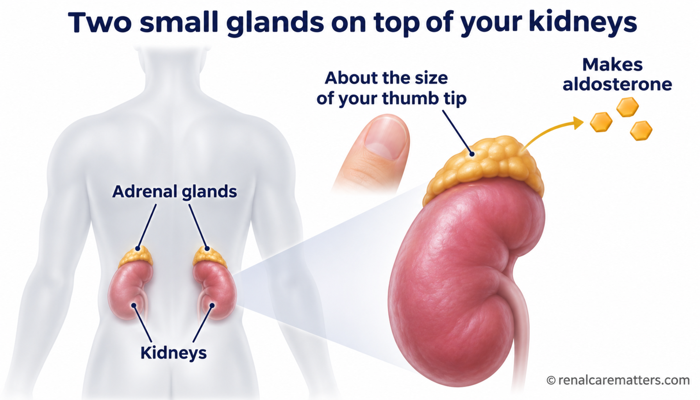
  </picture>
  <figcaption>
    <p class="fig-desc"><span data-lang="en">Your two adrenal glands sit on top of your kidneys. Each is about the size of a thumb tip, and they make aldosterone.</span><span data-lang="tl" class="lang-hidden">Nakapatong ang dalawang adrenal gland sa ibabaw ng iyong bato. Kasinlaki ng dulo ng hinlalaki ang bawat isa, at gumagawa sila ng aldosterone.</span><span data-lang="ceb" class="lang-hidden">Ang duha ka adrenal gland naa sa ibabaw sa imong bato. Sama kadako sa tumoy sa kumagko ang matag usa, ug mohimo sila og aldosterone.</span><span data-lang="kap" class="lang-hidden">Ing adwang adrenal gland atyu king babo ning batu mu. Kasing laki ning dulu ning gimalat ing balang metung, at gagawa la aldosterone.</span></p>
  </figcaption>
</figure>
```

**12 · anchor:** `#why-matters — after the first paragraph`

```html
<figure class="pa-fig">
  <picture>
    <source srcset="../images/primary-aldosteronism-12-how-common.webp" type="image/webp">
    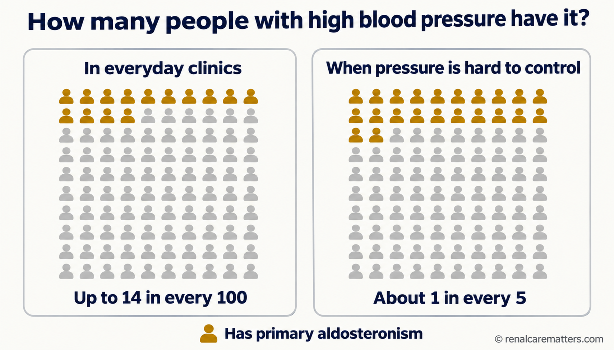
  </picture>
  <figcaption>
    <p class="fig-desc"><span data-lang="en">Out of 100 people with high blood pressure, up to 14 in everyday clinics have primary aldosteronism, and about 1 in 5 when pressure is hard to control.</span><span data-lang="tl" class="lang-hidden">Sa 100 taong may altapresyon, hanggang 14 sa karaniwang klinika ang may primary aldosteronism, at mga 1 sa 5 kapag mahirap kontrolin ang presyon.</span><span data-lang="ceb" class="lang-hidden">Sa 100 ka tawo nga adunay altapresyon, hangtod 14 sa kasagarang klinika ang adunay primary aldosteronism, ug mga 1 sa 5 kung lisod kontrolon ang presyon.</span><span data-lang="kap" class="lang-hidden">King 100 a tau a atin altapresyun, anggang 14 king karaniwang klinika ing atin primary aldosteronism, at intang 1 king 5 nung masakit kontrolan ing presyun.</span></p>
  </figcaption>
</figure>
```

**13 · anchor:** `#blood-test — before the do / don't cards`

```html
<figure class="pa-fig">
  <picture>
    <source srcset="../images/primary-aldosteronism-13-test-day.webp" type="image/webp">
    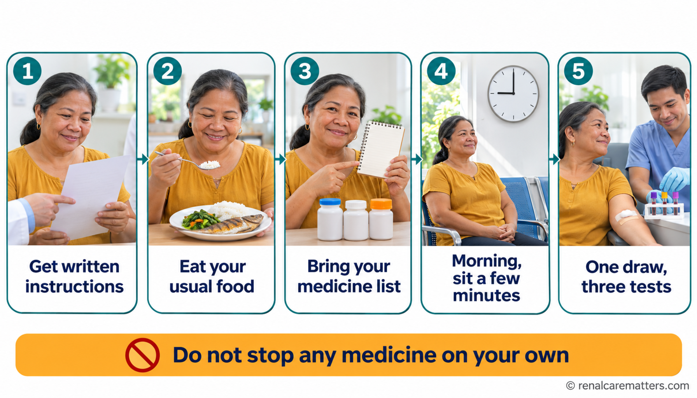
  </picture>
  <figcaption>
    <p class="fig-desc"><span data-lang="en">Test day in five steps: written instructions, usual food, your medicine list, a morning sample after sitting, and one draw for three tests. Never stop a medicine on your own.</span><span data-lang="tl" class="lang-hidden">Araw ng test sa limang hakbang: nakasulat na tagubilin, karaniwang pagkain, listahan ng gamot, sample sa umaga matapos umupo, at isang kuha ng dugo para sa tatlong test. Huwag ihinto ang gamot nang mag-isa.</span><span data-lang="ceb" class="lang-hidden">Adlaw sa test sa lima ka lakang: sinulat nga instruksyon, kasagarang pagkaon, listahan sa tambal, sample sa buntag human molingkod, ug usa ka kuha og dugo para sa tulo ka test. Ayaw hunonga ang tambal sa imong kaugalingon.</span><span data-lang="kap" class="lang-hidden">Aldo ning test king limang addang: nakasulat a turu, karaniwang pamangan, listahan ning gamut, sample king abak kaibat lumukluk, at metung a pamikuang daya para king atlung test. Eme itian ing gamut king sarili mu.</span></p>
  </figcaption>
</figure>
```

**14 · anchor:** `#blood-test — after the paragraph introducing the aldosterone-to-renin ratio`

```html
<figure class="pa-fig">
  <picture>
    <source srcset="../images/primary-aldosteronism-14-lab-slip-decoded.webp" type="image/webp">
    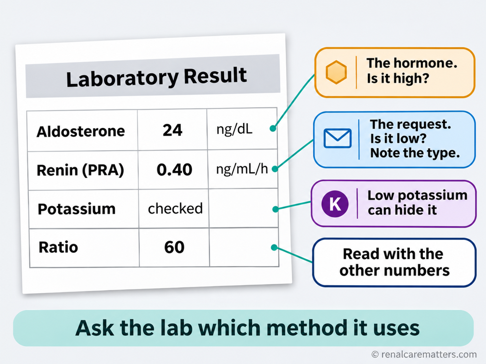
  </picture>
  <figcaption>
    <p class="fig-desc"><span data-lang="en">How to read your result: aldosterone is the hormone, renin is the request (note its type), low potassium can hide the condition, and the ratio is read with the other numbers.</span><span data-lang="tl" class="lang-hidden">Paano basahin ang resulta: ang aldosterone ang hormone, ang renin ang kahilingan (tandaan ang uri), maaaring itago ng mababang potassium ang kondisyon, at binabasa ang ratio kasama ng ibang numero.</span><span data-lang="ceb" class="lang-hidden">Unsaon pagbasa sa resulta: ang aldosterone ang hormone, ang renin ang hangyo (timan-i ang klase), ang ubos nga potassium makatago sa kondisyon, ug basahon ang ratio uban sa ubang numero.</span><span data-lang="kap" class="lang-hidden">Makananu basan ing resulta: ing aldosterone ya ing hormone, ing renin ya ing pakisabi (tandanan ing uri), ing mababang potassium malyaring magtagu king kundisyun, at babasan ing ratio kayabe ing aliwang numeru.</span></p>
    <dl class="fig-abbrevs"><dt>PRA</dt><dd>Plasma renin activity</dd></dl>
  </figcaption>
</figure>
```

**16 · anchor:** `#ratio — immediately under the heading "If you have chronic kidney disease"`

```html
<figure class="pa-fig">
  <picture>
    <source srcset="../images/primary-aldosteronism-16-kidneys-change-the-test.webp" type="image/webp">
    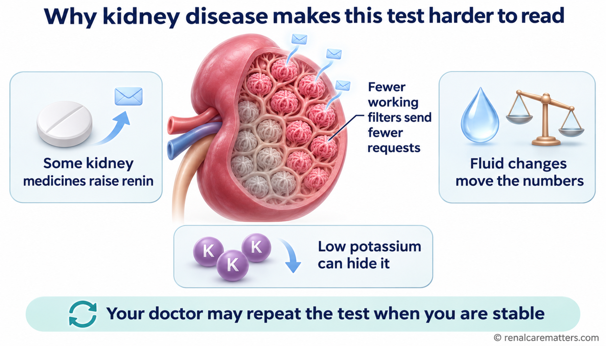
  </picture>
  <figcaption>
    <p class="fig-desc"><span data-lang="en">With kidney disease, fewer working filters send fewer renin signals, some kidney medicines raise renin, and fluid and potassium shift the numbers, so the test may be repeated when you are stable.</span><span data-lang="tl" class="lang-hidden">Kapag may sakit sa bato, mas kaunting gumaganang pansala ang nagpapadala ng renin, may gamot sa bato na nagpapataas ng renin, at nagbabago ang numero dahil sa likido at potassium, kaya maaaring ulitin ang test kapag stable ka na.</span><span data-lang="ceb" class="lang-hidden">Kung adunay sakit sa bato, mas gamay nga naglihok nga pansala ang mopadala og renin, adunay tambal sa bato nga mopataas sa renin, ug mausab ang numero tungod sa likido ug potassium, mao nga mahimong usbon ang test kung stable na ka.</span><span data-lang="kap" class="lang-hidden">Nung atin sakit king batu, mas kakaunting gagaganang pansala ing mamadala renin, atin gamut king batu a mamatas king renin, at mibayu ing numeru uli ning likidu at potassium, kaya malyaring ulitan ing test nung stable ka na.</span></p>
  </figcaption>
</figure>
```

**17 · anchor:** `#next-steps — after image 06, before the "If you have kidney disease" alert`

```html
<figure class="pa-fig">
  <picture>
    <source srcset="../images/primary-aldosteronism-17-adrenal-vein-sampling.webp" type="image/webp">
    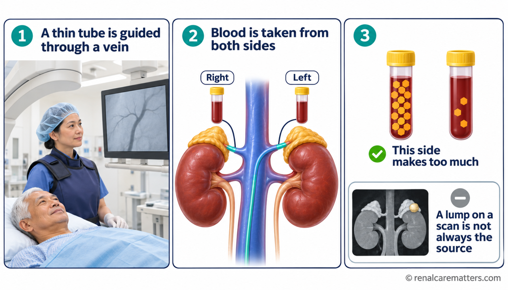
  </picture>
  <figcaption>
    <p class="fig-desc"><span data-lang="en">Adrenal vein sampling: a thin tube collects blood from both adrenal veins so the team can see which side makes too much aldosterone. A lump on a scan is not always the source.</span><span data-lang="tl" class="lang-hidden">Adrenal vein sampling: kumukuha ang manipis na tubo ng dugo mula sa dalawang adrenal vein para makita kung aling panig ang sobra ang aldosterone. Hindi laging pinagmumulan ang bukol sa scan.</span><span data-lang="ceb" class="lang-hidden">Adrenal vein sampling: mokuha ang nipis nga tubo og dugo gikan sa duha ka adrenal vein aron makita kung hain nga kilid ang sobra og aldosterone. Dili kanunay gigikanan ang bukol sa scan.</span><span data-lang="kap" class="lang-hidden">Adrenal vein sampling: mangwa ing manipis a tubu daya menibat king adwang adrenal vein ban akit nung nanung sulip ing sobra aldosterone. Ali panayan pipagmulan ing bukol king scan.</span></p>
  </figcaption>
</figure>
```

**18 · anchor:** `#treatment — after the paragraph reporting the international surgery study`

```html
<figure class="pa-fig">
  <picture>
    <source srcset="../images/primary-aldosteronism-18-surgery-out-of-100.webp" type="image/webp">
    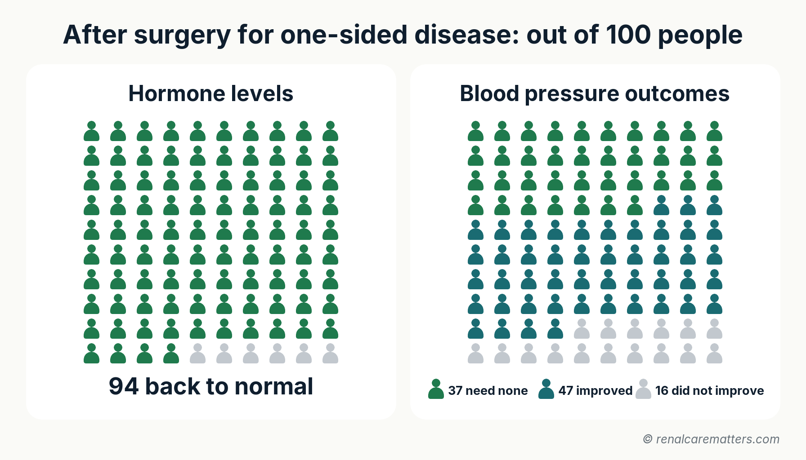
  </picture>
  <figcaption>
    <p class="fig-desc"><span data-lang="en">After surgery for one-sided disease, out of 100 people: 94 have normal hormone levels; 37 need no blood pressure medicine, 47 need fewer, and 16 see no change.</span><span data-lang="tl" class="lang-hidden">Pagkatapos ng operasyon sa isang-panig na sakit, sa 100 tao: 94 ang normal na ang hormone; 37 ang hindi na kailangan ng gamot sa presyon, 47 ang mas kaunti, at 16 ang walang pagbabago.</span><span data-lang="ceb" class="lang-hidden">Human sa operasyon sa usa-ka-kilid nga sakit, sa 100 ka tawo: 94 ang normal na ang hormone; 37 ang dili na kinahanglan og tambal sa presyon, 47 ang mas gamay, ug 16 ang walay kausaban.</span><span data-lang="kap" class="lang-hidden">Kaibat ning operasyun king metung-sulip a sakit, king 100 a tau: 94 ing normal ne ing hormone; 37 ing ali na kailangan gamut king presyun, 47 ing mas kakaunti, at 16 ing alang mibayu.</span></p>
  </figcaption>
</figure>
```

**19 · anchor:** `#treatment — after the paragraph on spironolactone and eplerenone`

```html
<figure class="pa-fig">
  <picture>
    <source srcset="../images/primary-aldosteronism-19-medicine-journey.webp" type="image/webp">
    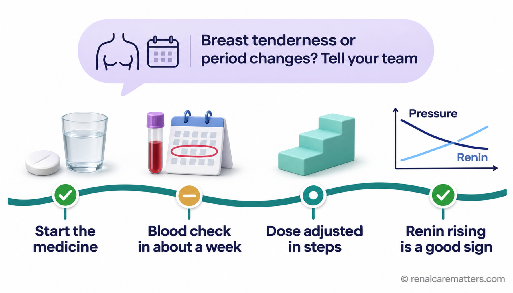
  </picture>
  <figcaption>
    <p class="fig-desc"><span data-lang="en">The medicine journey: start, a blood check in about a week, dose changes in steps, and renin rising as pressure falls. Tell your team about breast tenderness or period changes.</span><span data-lang="tl" class="lang-hidden">Ang paglalakbay sa gamot: magsimula, blood check sa mga isang linggo, unti-unting pagbabago ng dosis, at pagtaas ng renin habang bumababa ang presyon. Sabihin sa team kung may pananakit ng dibdib o pagbabago sa regla.</span><span data-lang="ceb" class="lang-hidden">Ang panaw sa tambal: magsugod, blood check sa mga usa ka semana, hinay-hinay nga pag-usab sa dosis, ug pagsaka sa renin samtang mous-os ang presyon. Isulti sa team kung adunay sakit sa dughan o kausaban sa regla.</span><span data-lang="kap" class="lang-hidden">Ing paglakbe king gamut: mumpisa, blood check king intang metung a domingu, dadalan-dalan a pamagbayu dosis, at pamitaas ning renin kabang mababa ing presyun. Sabyan me ing team nung atin sakit king susu o pamagbayu king regla.</span></p>
  </figcaption>
</figure>
```

**20 · anchor:** `#living — after the do / avoid cards`

```html
<figure class="pa-fig">
  <picture>
    <source srcset="../images/primary-aldosteronism-20-filipino-table.webp" type="image/webp">
    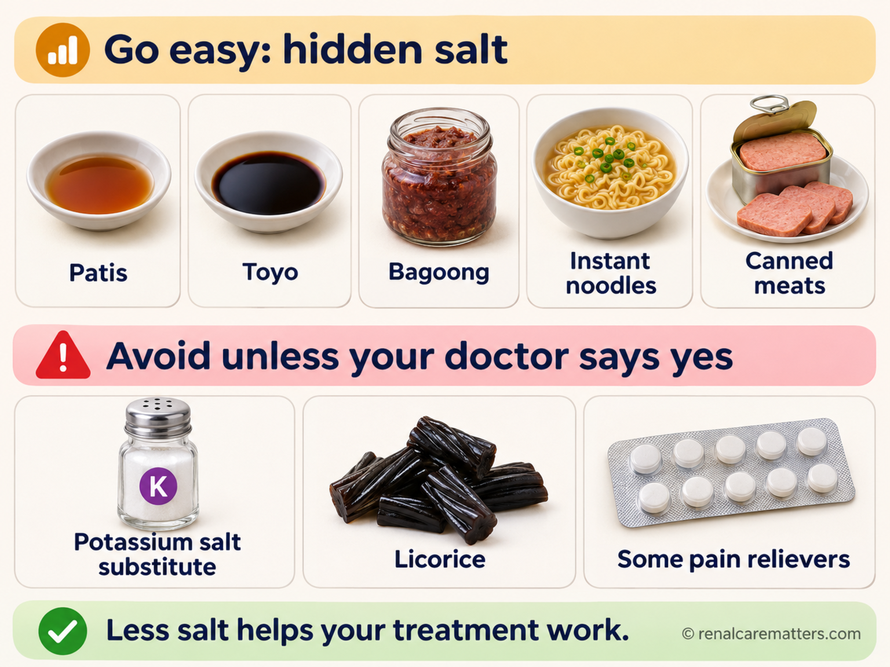
  </picture>
  <figcaption>
    <p class="fig-desc"><span data-lang="en">Go easy on hidden salt in patis, toyo, bagoong, instant noodles, and canned meats; avoid potassium salt substitutes, licorice, and some pain relievers unless your doctor says yes.</span><span data-lang="tl" class="lang-hidden">Bawasan ang nakatagong asin sa patis, toyo, bagoong, instant noodles, at de-latang karne; iwasan ang potassium na pamalit sa asin, licorice, at ilang pain reliever maliban kung pumayag ang doktor.</span><span data-lang="ceb" class="lang-hidden">Pakunhori ang natago nga asin sa patis, toyo, bagoong, instant noodles, ug de-lata nga karne; likayi ang potassium nga puli sa asin, licorice, ug pipila ka pain reliever gawas kung motugot ang doktor.</span><span data-lang="kap" class="lang-hidden">Bawasan ing makatagung asin king patis, toyo, bagoong, instant noodles, at de-latang karne; iwasan ing potassium a pamalit king asin, licorice, at pilan a pain reliever nung e pumayag ing doktor.</span></p>
  </figcaption>
</figure>
```

**21 · anchor:** `#ph-path — after the bulleted list`

```html
<figure class="pa-fig">
  <picture>
    <source srcset="../images/primary-aldosteronism-21-philippine-route.webp" type="image/webp">
    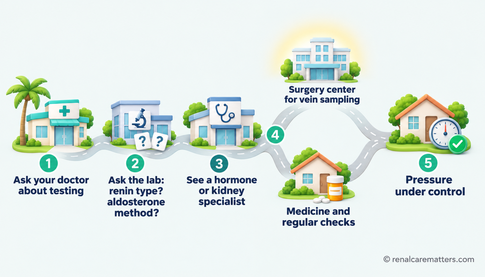
  </picture>
  <figcaption>
    <p class="fig-desc"><span data-lang="en">Your route: ask your doctor, ask the lab two questions, see a specialist, then surgery or medicine, with both paths aiming for controlled blood pressure.</span><span data-lang="tl" class="lang-hidden">Ang iyong landas: magtanong sa doktor, magtanong ng dalawang bagay sa lab, magpatingin sa espesyalista, pagkatapos operasyon o gamot, at parehong naglalayong makontrol ang presyon.</span><span data-lang="ceb" class="lang-hidden">Ang imong dalan: pangutana sa doktor, pangutana og duha ka butang sa lab, magpatan-aw sa espesyalista, unya operasyon o tambal, ug pareho nga nagtumong nga makontrol ang presyon.</span><span data-lang="kap" class="lang-hidden">Ing dalan mu: mangutang king doktor, mangutang adwang bage king lab, magpalawe king espesyalista, kaibat operasyun o gamut, at pareu lang mangatula king kontroladung presyun.</span></p>
  </figcaption>
</figure>
```

**22 · anchor:** `#md-interpret — after the threshold table`

```html
<figure class="pa-fig">
  <picture>
    <source srcset="../images/primary-aldosteronism-22-threshold-card.webp" type="image/webp">
    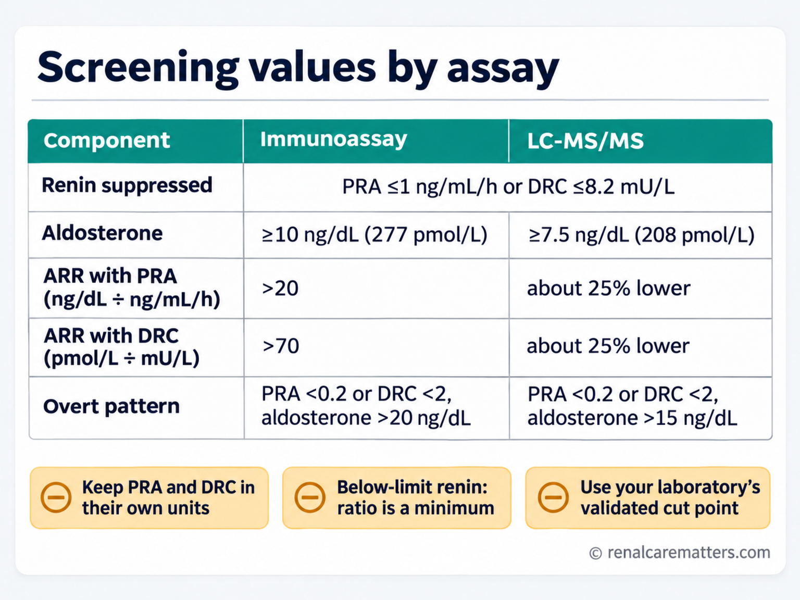
  </picture>
  <figcaption>
    <p class="fig-desc">Bedside card of the 2025 Endocrine Society screening values, separated by aldosterone assay and renin measure.</p>
    <dl class="fig-abbrevs"><dt>ARR</dt><dd>Aldosterone-to-renin ratio</dd><dt>PRA</dt><dd>Plasma renin activity</dd><dt>DRC</dt><dd>Direct renin concentration</dd><dt>LC-MS/MS</dt><dd>Liquid chromatography-tandem mass spectrometry</dd></dl>
  </figcaption>
</figure>
```

**23 · anchor:** `#md-interpret — after the CKD paragraph, before the teaching cases`

```html
<figure class="pa-fig">
  <picture>
    <source srcset="../images/primary-aldosteronism-23-ckd-pitfalls.webp" type="image/webp">
    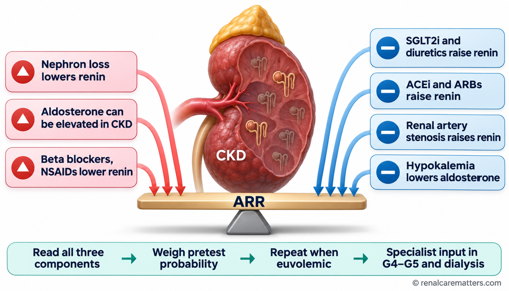
  </picture>
  <figcaption>
    <p class="fig-desc">Forces that bend the ratio in CKD toward false positive or false negative, and how to resolve a discordant screen.</p>
    <dl class="fig-abbrevs"><dt>ARR</dt><dd>Aldosterone-to-renin ratio</dd><dt>CKD</dt><dd>Chronic kidney disease</dd><dt>NSAID</dt><dd>Nonsteroidal anti-inflammatory drug</dd><dt>SGLT2i</dt><dd>Sodium-glucose cotransporter 2 inhibitor</dd><dt>ACEi</dt><dd>Angiotensin-converting enzyme inhibitor</dd><dt>ARB</dt><dd>Angiotensin receptor blocker</dd></dl>
  </figcaption>
</figure>
```

**24 · anchor:** `#md-treat — after the "Renin-guided MRA titration" paragraph`

```html
<figure class="pa-fig">
  <picture>
    <source srcset="../images/primary-aldosteronism-24-renin-guided-titration.webp" type="image/webp">
    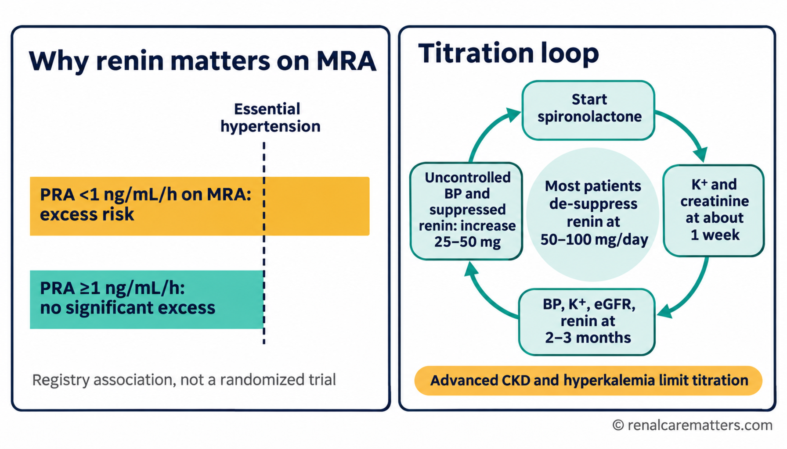
  </picture>
  <figcaption>
    <p class="fig-desc">The observational case for renin-guided MRA titration, and the practical titration loop.</p>
    <dl class="fig-abbrevs"><dt>MRA</dt><dd>Mineralocorticoid receptor antagonist</dd><dt>PRA</dt><dd>Plasma renin activity</dd><dt>K+</dt><dd>Potassium</dd><dt>BP</dt><dd>Blood pressure</dd><dt>eGFR</dt><dd>Estimated glomerular filtration rate</dd><dt>CKD</dt><dd>Chronic kidney disease</dd></dl>
  </figcaption>
</figure>
```

**25 · anchor:** `#md-asi — after the remission paragraph`

```html
<figure class="pa-fig">
  <picture>
    <source srcset="../images/primary-aldosteronism-25-certainty-ladder.webp" type="image/webp">
    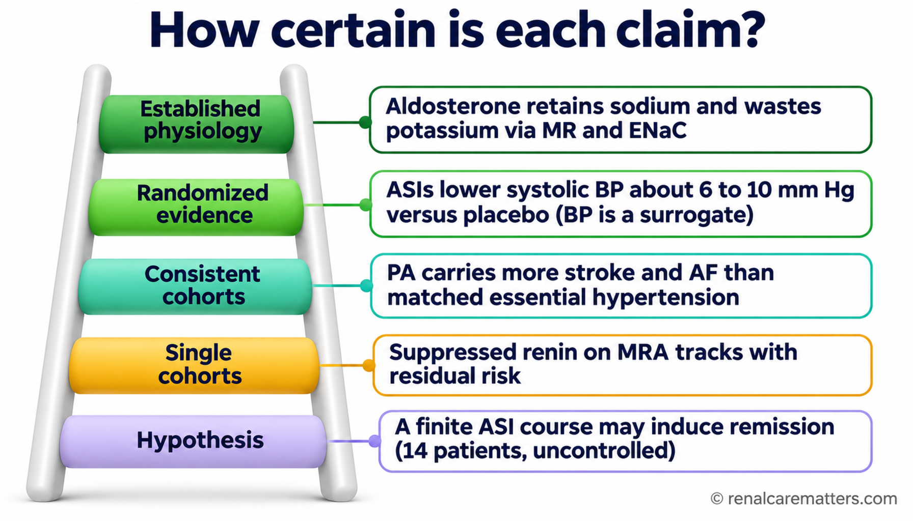
  </picture>
  <figcaption>
    <p class="fig-desc">How certain is each claim in this guide: from established physiology to an unproven remission hypothesis.</p>
    <dl class="fig-abbrevs"><dt>MR</dt><dd>Mineralocorticoid receptor</dd><dt>ENaC</dt><dd>Epithelial sodium channel</dd><dt>ASI</dt><dd>Aldosterone synthase inhibitor</dd><dt>BP</dt><dd>Blood pressure</dd><dt>PA</dt><dd>Primary aldosteronism</dd><dt>AF</dt><dd>Atrial fibrillation</dd><dt>MRA</dt><dd>Mineralocorticoid receptor antagonist</dd></dl>
  </figcaption>
</figure>
```

---

## Part 4 — Stage 2 hand-off

1. Generate in the order in 1.6, saving each render to `generated-images/` under its exact file name.
2. Run the 1.7 QC rubric on every render; regenerate rather than edit pixels.
3. Convert each `.png` to a same-size `.webp` and place both in `images/`.
4. Paste the 14 Part 3 snippets at their anchors, then run `audit_acronym_expansion.py` and the dark-mode contrast check.
5. Run `python3 generate_rg_thumbs.py` once the OG card (006) is in place, then `generate_latest_guides.py`.
